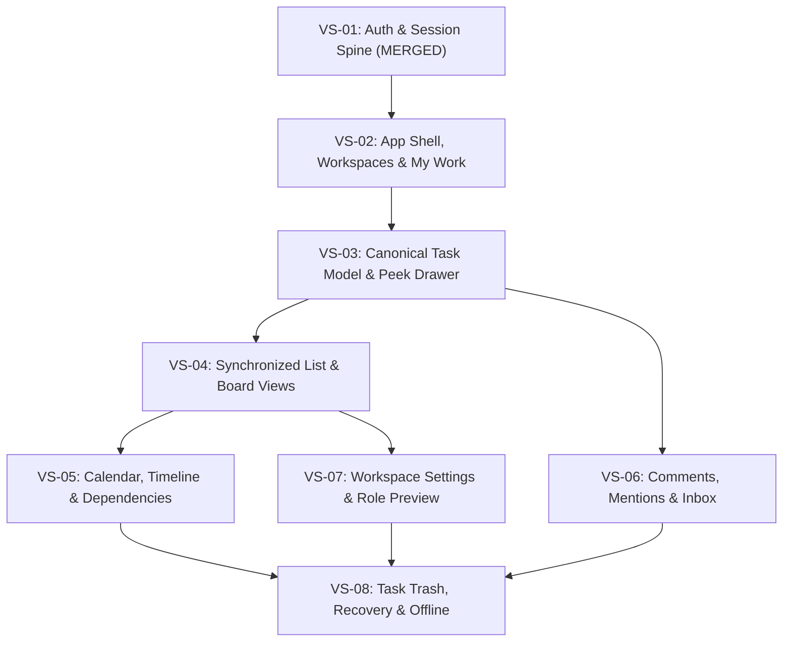

# Frontend Antigravity Implementation Blueprint

**Baseline:** v1.5.0 · **API:** 0.3.20-draft (not frozen)

---

# 13. Frontend architecture and responsibilities

## 13.1 Frontend responsibility

Antigravity CLI / frontend developer owns the SPA/PWA experience, navigation, component system, accessibility, responsive/mobile UX, state/cache layer, request orchestration, optimistic behavior, view projections, local draft/offline queue client, realtime client, generated TypeScript API types and frontend integration tests. It does not own security policy decisions or backend authorization.

## 13.2 Proposed technology direction — RECOMMENDED DEFAULT, NOT FROZEN

The prior research baseline recommends Vite + React + TypeScript. Candidate supporting pieces include a typed API client generated from OpenAPI, a query/cache layer such as TanStack Query, MSW for contract-shaped mocks, router-based URL state, accessible headless primitives, semantic CSS tokens and Tailwind or equivalent styling. This is a proposed stack, not a final lock; the final choice must be confirmed jointly after backend deployment/API requirements are reviewed.

Do not add a heavyweight component framework solely for convenience if it makes dense views, keyboard behavior or visual consistency harder. Prefer well-scoped primitives, composable components and semantic design tokens. Motion should be lightweight, purposeful and respect reduced-motion settings.

## 13.3 Recommended frontend module boundaries

- `app-shell` — routes, global navigation, workspace switcher and responsive shell.
- `identity` — sign-in, sign-up, provider linking, session and profile UI.
- `community` — community switcher, membership and community admin UI.
- `workspace` — Workspace landing, members, settings and role administration.
- `tasks` — canonical task model, task drawer, composer, inline edits, subtask tree and task-key resolution. The composer/detail permission panel uses `canManageAssigneeFieldGrants`; Workspace Owners edit the allowed/default ceiling, while Task Creators select per-task groups from the approved set.
- `views/list`, `views/board`, `views/calendar`, `views/timeline` — view-only projections over shared query/cache data.
- `my-work` — cross-workspace triage.
- `search` — omnibar, filtering and result routing.
- `collaboration` — comments, mention picker, watchers and activity timeline.
- `notifications` — inbox, preferences and reminders.
- `saved-views` — Personal/Shared presets and copy-on-write flow.
- `offline` — service worker asset caching, IndexedDB selected-field queue and conflict UI; exact cache/queue policy must follow CR-15.
- `realtime` — WebSocket ticket/bootstrap, stream cursors, event dedupe and refetch recovery.
- `design-system` — tokens, accessible primitives, iconography and responsive layout patterns.
- `mocks` / `tests` — schema-shaped MSW fixtures, deterministic seed data, Playwright and accessibility tests.

## 13.4 Frontend rules

- Do not duplicate task truth into four independent stores; normalize by task ID and derive view projections.
- Do not infer permissions from role names or hard-code Coordinator/Owner exceptions into every component. Consume server permission projections for display and still handle 403/404/409 from operations.
- Render assignee field-group controls only when `canManageAssigneeFieldGrants` is true. The Workspace Permissions settings expose the allowed ceiling and default; task composer/detail controls expose only groups within the returned ceiling. Never treat the displayed checkboxes as enforcement.
- Do not hand-author duplicate API types that drift from OpenAPI. Generate types after contract remediation and freeze.
- Use optimistic updates only where the mutation contract is idempotent and rollback/conflict behavior is defined.
- URL state represents unsaved view draft filters; persisted SavedView changes require explicit action.
- Treat offline entries as local untrusted pending commands. Never bypass current backend permission checks.
- Never store auth tokens/session secrets in localStorage.

---

## 13.5 Repository baseline and implementation status (VS-00 & VS-01 verified)

The frontend foundation is established in the Sonder monorepo on branch `develop`:

1. **Toolchain & Runtime Engine:**
   - Package manager: `pnpm` v12.13.0.
   - Node runtime: `26.11.1` (pinned via `.nvmrc`, `.node-version`, and CI).
   - Bundler: Vite 6.1.0 with `@vitejs/plugin-react` and `@tailwindcss/vite` v4.0.6.
   - Typechecker: TypeScript 5.7.3 in strict mode (`tsc --noEmit`).
   - Test Runner: Vitest 3.0.5 with jsdom, `@testing-library/react`, and MSW v2.15.0.
2. **Contract Type Generation (`packages/contracts`):**
   - OpenAPI 3.1.0 candidate: `openapi-0.3.20-draft.yaml` (95 paths, 118 operations, 201 schemas).
   - Realtime schemas: `ws-events.schema.json` (31 event types) and `ws-protocol.schema.json`.
   - In-memory schema composition generates clean, non-duplicated TypeScript types (`api-types.ts`, `ws-events-types.ts`, `ws-protocol-types.ts`).
3. **Authentication & Session Foundation (VS-01 Completed & Merged):**
   - Zero browser storage secrets: no JWTs, refresh tokens, or session IDs in `localStorage` or `sessionStorage`.
   - Host-only cookies: `__Host-session` (session lifetime) and `__Host-auth-csrf` (600s CSRF binding).
   - Fail-closed CSRF protection: mutating requests (`POST`, `PUT`, `PATCH`, `DELETE`) fail closed in `api-client.ts` if `csrfToken` is omitted or empty (`CSRF_TOKEN_REQUIRED`), sending no network request.
   - Idempotency protection: RFC 9562 UUIDv7 generator (`uuid.ts`) attaches `X-Mutation-Id` to all mutating requests.
   - Confirmed logout: local session state is only cleared upon confirmed server invalidation (`204 No Content`); on failure, session state is preserved and an accessible retry path is displayed.
   - Automated test suite: 25 unit and integration tests passing green across `api-client.test.ts`, `App.test.tsx`, and `AuthFlow.test.tsx`.

---

## 13.6 Domain boundaries, invariants and decision baseline

### Hierarchy & Invariants
```
Community (Tenancy Boundary)
  └── Workspace (Personal or Shared Governance Boundary)
        └── Task (Canonical Work Item, Prefix-Keyed)
              └── Subtask (Child Task, Depth 1–2 Max)
```
- **Strict Invariant 1: Hierarchy Depth.** The hierarchy is strictly `Community → Workspace → Task → Subtask`. Projects and Lists are **not** hierarchy layers. Subtask depth is 1 by default, expandable up to 2 by Workspace Owner (DEC-OPEN-09). Unsafe reductions below existing tree depth are rejected.
- **Strict Invariant 2: Four Synchronized Projections.** List, Board, Calendar, and Timeline are projections of the **exact same** canonical query and authorization result. No view maintains an independent task truth or divergent filter logic.
- **Strict Invariant 3: Excluded File Capabilities.** No file attachments, binary uploads, comment attachments, or file hubs exist in Sonder (PRD Section 2.3).
- **Strict Invariant 4: Authorization Ownership.** Backend authorization remains authoritative. Frontend permission flags (e.g., `canManageAssigneeFieldGrants`, `canEditTask`, `isCommunityAdmin`) are display hints only, not client-side security enforcement.

### Approved Decision Baseline (v1.5.0)
- **DEC-OPEN-01 (`AUDITED_BREAK_GLASS`):** Personal Workspace break-glass access requires audited approval workflow and explicit time-bound renewal.
- **DEC-OPEN-02 (Option A):** Assignee field delegation. Workspace Owner sets allowed ceiling/default; Task Creator configures per-task subset.
- **DEC-OPEN-06 (Task-Key Lifecycle):** Community-unique, case-insensitive permanent prefix reservations (e.g., `ENG-`, `EVENT-`); Workspace-local monotonic sequence. Renaming prefix preserves numeric suffixes and generates permanent aliases.
- **DEC-OPEN-07 (Built-in Templates):** Exactly 3 read-only setup templates (`GENERAL_PURPOSE`, `EVENT_PLANNING`, `TEAM_OPERATIONS`) that seed workflows, Phase 1 custom fields, and shared saved views only (never sample tasks or members).
- **DEC-OPEN-08 (Milestones):** Workspace-scoped planning markers linked directly to tasks; never hierarchical containers.
- **DEC-OPEN-09 (Subtask Depth):** Default max depth 1; Workspace Owner can increase to 2.
- **DEC-OPEN-10 (Task Transfer):** Cross-workspace transfer uses `NAMES_ONLY` title/tree/order; transferred root is always top-level (`targetParentTaskId=null`; no `itemType`).
- **DEC-OPEN-11 (Task Trash & Purge):** 30-day restorable Trash; permanent purge is disabled pending DEC-OPEN-03.
- **DEC-OPEN-15 (Multiple Workspace Owners):** Multiple active owners allowed; dedicated atomic transfer flow; minimum one active owner invariant.

### Open / Unresolved Decisions (Preserved Without Assumption)
- **DEC-OPEN-03:** Audit log retention durations and legal-hold authority remain unresolved. Task permanent purge API `/trash/tasks/{taskId}/purge` remains feature-disabled.
- **DEC-OPEN-04:** SLO / RPO / RTO targets remain provisional.
- **DEC-OPEN-05:** Domain-neutral core terminology confirmed; agile extensions (Sprints, Burndowns) are strictly deferred to Phase 4.
- **DEC-OPEN-12:** Idempotency cache retention window (CR-15 draft proposes 30 days).
- **DEC-OPEN-13:** Hosting, provider, and operational cloud budget.
- **DEC-OPEN-14:** Production identity provider selection and password hashing cost parameters.

---

## 13.7 Feature inventory and route architecture

All application views are client-routed via `react-router-dom` v7 with strict authentication guards, accessible loading states, and deep-linkable URL search parameters:

| Route Path | View / Page Component | Layout Wrapper | Auth Guard | URL Search State / Parameters |
|---|---|---|---|---|
| `/login` | `LoginForm` | Public Minimal Shell | Anonymous Only | `?from=/requested/path` |
| `/register` | `RegisterForm` | Public Minimal Shell | Anonymous Only | — |
| `/` | `RootRedirector` | App Shell | `ProtectedRoute` | Redirects to active workspace or `/my-work` |
| `/my-work` | `MyWorkDashboard` | App Shell with Left Rail | `ProtectedRoute` | `?group=due_date&filter=assigned` |
| `/inbox` | `NotificationInbox` | App Shell with Left Rail | `ProtectedRoute` | `?tab=action_required\|updates` |
| `/c/:communityId/w/:workspaceId` | `WorkspaceRedirect` | Workspace Shell | `ProtectedRoute` | Redirects to default saved view or `/list` |
| `/c/:communityId/w/:workspaceId/list` | `ListView` | Workspace Shell + View Tabs | `ProtectedRoute` | `?task=KEY-123&q=search&sort=due&group=status` |
| `/c/:communityId/w/:workspaceId/board` | `BoardView` | Workspace Shell + View Tabs | `ProtectedRoute` | `?task=KEY-123&stage=IN_PROGRESS` (mobile) |
| `/c/:communityId/w/:workspaceId/calendar` | `CalendarView` | Workspace Shell + View Tabs | `ProtectedRoute` | `?task=KEY-123&view=month\|week&date=2026-11` |
| `/c/:communityId/w/:workspaceId/timeline` | `TimelineView` | Workspace Shell + View Tabs | `ProtectedRoute` | `?task=KEY-123&zoom=week\|month` |
| `/c/:communityId/w/:workspaceId/trash` | `TaskTrashView` | Workspace Shell | `ProtectedRoute` | `?page=1` (30-day restorable items) |
| `/c/:communityId/w/:workspaceId/settings` | `WorkspaceSettings` | Settings Layout | `WorkspaceOwnerGuard` | Redirects to `/settings/general` |
| `/c/:communityId/w/:workspaceId/settings/:category` | `WorkspaceSettingsCategory` | Settings Layout (6 Tabs) | `WorkspaceOwnerGuard` | Categories: `general`, `members`, `permissions`, `tasks`, `views`, `notifications` |
| `/c/:communityId/w/:workspaceId/settings/audit` | `WorkspaceAuditLog` | Settings Layout | `WorkspaceOwnerGuard` | `?from=DATE&to=DATE&actor=UUID` |
| `/c/:communityId/settings` | `CommunityAdminSettings` | Admin Layout | `CommunityAdminGuard` | Shared workspace creation policy, templates |
| `/settings/profile` | `UserProfileSettings` | Account Settings Layout | `ProtectedRoute` | Display name, avatar, email status |
| `/settings/security` | `SecuritySettings` | Account Settings Layout | `ProtectedRoute` | Connected identities, active sessions |

### Dialog, Drawer & Popover Inventory
- **Task Peek Drawer (`TaskPeekDrawer`):** Collapsible right-docked canvas drawer on desktop; full bottom sheet on mobile. Deep-linked via `?task=KEY-123`.
- **Quick Task Composer (`QuickTaskComposer`):** Modal dialog triggered by `C` shortcut or Global Header button. Max 5 default fields: Title (required), Workspace, Status, Priority, Assignee. Secondary disclosure for Due Date, Labels, and Estimate.
- **Workspace Creation Modal (`CreateWorkspaceModal`):** Personal vs Shared selector, setup template selector (`GENERAL_PURPOSE`, `EVENT_PLANNING`, `TEAM_OPERATIONS`), and real-time prefix collision validation.
- **Command Palette Omnibar (`OmnibarModal`):** Triggered by `Cmd/Ctrl+K` or header search. Permission-aware instant search across Task Keys, Aliases, Titles, Workspaces, and Saved Views.
- **Role Preview Simulator Banner (`RolePreviewBanner`):** Sticky top banner when Workspace Owner tests views as `COORDINATOR`, `MEMBER`, `VIEWER`, or custom roles.

---

## 13.8 Information architecture and responsive layouts

### Desktop Application Shell
```
+-------------------------------------------------------------------------------------------------------+
| GLOBAL HEADER: Sonder Logo | Community Switcher | Omnibar (Ctrl+K) | Quick Create (+) | User Profile  |
+-------------------+-----------------------------------------------------------------------------------+
| LEFT NAV RAIL     | WORKSPACE HEADER: Workspace Name [Shared/Personal] | Role Badge | Settings (Owner)|
|                   +-----------------------------------------------------------------------------------+
| [My Work] (3)     | VIEW TABS: [ List ] [ Board ] [ Calendar ] [ Timeline ]  | Saved Views Presets    |
| [Inbox] (1)       +-----------------------------------------------------------------------------------+
|                   | FILTER BAR: [Filter +] [Group: Status v] [Sort: Due Date v] [Fields v] [Save View]|
| WORKSPACES:       +-------------------------------------------------------------+---------------------+
| > Eng Platform    |                                                             | TASK PEEK DRAWER    |
| > Event Gala 2027 |                                                             | (Right Docked Panel)|
| > Alex's Personal |                 CANVAS PROJECTION AREA                      |                     |
|                   |                                                             | [ENG-104] Status    |
| + New Workspace   |   (List Tree / Board Columns / Calendar Grid / Timeline)    | Title & Description |
|                   |                                                             | Subtasks Tree (0/2) |
| ----------------- |                                                             | Threaded Comments   |
| [Trash (30d)]     |                                                             | Activity History    |
| [Help / Shortcut] |                                                             |                     |
+-------------------+-------------------------------------------------------------+---------------------+
```

### Mobile Touch Adaptations
- **Header:** Compact top bar with Hamburger menu, active Workspace title, and Omnibar search icon.
- **Bottom Navigation Bar (44×44px touch targets):** `My Work` | `Views` | `Quick Create (+)` | `Inbox` | `Account`.
- **Board Adaptation:** Horizontal multi-column scrolling replaced by a sticky Stage Selector tab bar (`Backlog` | `In Progress` | `Review` | `Done`).
- **Task Drawer:** Renders as a full bottom-sheet with drag-down-to-dismiss gesture and explicit close action.

---

## 13.9 Design research plan and candidate interaction patterns

> [!NOTE]
> Visual identity, final palettes, and concrete styling are **not** frozen in this document. Multi-product reference research is a separate upcoming design task. The framework below establishes candidate interaction patterns to evaluate and adapt.

| Product Reference | Pattern to Evaluate | User Problem Addressed | Potential Fit for Sonder | Candidate Patterns to Adapt vs. Reject |
|---|---|---|---|---|
| **Linear** | High-density keyboard navigation, instantaneous omnibar, and minimal click-to-edit attribute pills. | Eliminates navigation latency and complex modal clicking for daily contributors. | **High** | **Candidate Adapt:** Roving focus keyboard shortcuts (`C` create, `J/K` row navigate, `E` edit), inline status badges. <br>**Reject:** Extreme stark minimalism that hides workspace governance or obscures multi-community context. |
| **Asana** | Seamless four-view tab switching with shared underlying query state and collapsible subtask rows. | Allows team members with different cognitive preferences to collaborate on identical data. | **Very High** | **Candidate Adapt:** Tabbed view navigation bar, unscheduled tasks tray for calendar, clean subtask hierarchy disclosure. <br>**Reject:** Confusing multi-tiered hierarchy (Portfolios, Projects, Sections, Tasks) and heavy cross-selling banners. |
| **Jira** | Permanent task keys (`ENG-101`), workflow category mappings (`TODO`, `IN_PROGRESS`, `DONE`), and structured permissions. | Provides reliable verbal/written identifiers and governance for structured organizations. | **High (Selective)** | **Candidate Adapt:** Prefix-based task keys, permanent alias generation on rename, five-category workflow mapping. <br>**Reject:** Configuration labyrinth, JQL query syntax requirement, bloated modal dialogs, and sluggish rendering. |
| **Height** | Inline spreadsheet cell editing in List View and clean attribute tag popovers. | Streamlines bulk task updates without opening separate drawer panels. | **High** | **Candidate Adapt:** Inline cell editing for status, priority, due date, and assignee directly on List table rows. <br>**Reject:** Freeform chat stream mixing that blurs official task change history. |
| **Notion** | Clean empty states, structured attribute properties, and accessible slash commands. | Guides new users during initial workspace onboarding without training. | **Medium** | **Candidate Adapt:** Clear, friendly empty states with suggested starter actions; accessible property labels. <br>**Reject:** Arbitrary block canvas that lacks relational task constraints or rigid validation. |
| **Monday.com** | Distinct visual status indicators and progress summary bars. | Enhances peripheral readability of project status and team workload. | **Medium** | **Candidate Adapt:** High-contrast, WCAG-compliant status badges with mandatory text labels and icons. <br>**Reject:** Cartoonish gamification, celebratory confetti animations, and visual noise. |
| **ClickUp** | View customization options (card property toggles, density modes). | Empowers power users to control information density on dense screens. | **Medium** | **Candidate Adapt:** "Display Properties" popover enabling users to toggle card fields (Assignee, Subtasks, Dates, Key). <br>**Reject:** Feature soup, nested duplicate navigation layers, and inconsistent UI patterns. |

---

## 13.10 Deterministic demo-data and mock service architecture

The frontend demo environment utilizes an in-memory reactive entity repository intercepted at the network level by MSW v2, allowing the application to be fully demonstrable without a running backend:

### Seed Scenarios
```
Community: "Sonder Engineering & Operations" (ID: 018f98a2-3f12-7890-a123-456789abcdef)
  │
  ├── Shared Workspace: "Engineering Platform" (Prefix: ENG, General Purpose Template)
  │     ├── Tasks: ENG-101 through ENG-118
  │     │     ├── ENG-101: "Implement Distributed Idempotency Cache" [High | In Progress | Alex]
  │     │     │     ├── ENG-101.1: "Redis Key Eviction TTL Policy" [Done | Casey]
  │     │     │     └── ENG-101.2: "UUIDv7 Header Validation Guard" [In Progress | Alex]
  │     │     ├── ENG-102: "Migrate Postgres Schema to Multi-Tenant RLS" [Urgent | In Review | Alex]
  │     │     │     └── Blocker for ENG-104 (Dependency Conflict Demonstration)
  │     │     └── ENG-105: "Benchmark WebSocket Outbox Deduplication" [Medium | Todo | Jordan]
  │     ├── Saved Views: "Active Sprint Backlog" (Shared), "Alex's High Priority Blockers" (Personal)
  │     └── Milestones: "v1.5 Security Audit Gate" (Target: 2026-11-20)
  │
  ├── Shared Workspace: "Spring Community Gala 2027" (Prefix: EVENT, Event Planning Template)
  │     ├── Tasks: EVENT-201 through EVENT-212 (Catering, Audio/Visual, Venue Booking)
  │     └── Milestones: "Venue Booking Deadline" (Target: 2026-12-01)
  │
  └── Personal Workspace: "Alex's Private Notes & Tasks" (Prefix: ALEX, Private by Default)
        └── Tasks: ALEX-1 through ALEX-6 (Private personal triage items)
```

### Seed Personas
1. **Alex Morgan (`alex.morgan@example.org`):** Workspace Owner in Engineering Platform, Community Administrator. Full permissions.
2. **Jordan Lee (`jordan.lee@example.org`):** Default Coordinator in Engineering Platform, Workspace Owner in Spring Gala. Can assign, triage, and update shared views.
3. **Casey Chen (`casey.chen@example.org`):** Member in Engineering Platform. Can edit assigned tasks, comment, and create tasks.
4. **Riley Taylor (`riley.taylor@example.org`):** Viewer in Engineering Platform. Read-only access with permission-denied feedback on mutation attempts.

### Demo Controls
- **Persona Switcher:** Quick switcher in header allowing instant simulation of Alex (Owner), Jordan (Coordinator), Casey (Member), and Riley (Viewer).
- **Network Latency Simulation:** Configurable latency (0ms for automated tests, 150ms default, 800ms slow 3G).
- **Fault Injection:** Toggles to test server rejection (`500 Server Error`), permission denied (`403 Forbidden`), and conflict (`409 Conflict`).
- **Reset Demo Data Button:** One-click restoration of clean seed baseline.

---

## 13.11 Implementation directory structure and state orchestration

The frontend code organization strictly follows the module boundaries established in Section 13.3:

```
apps/web/src/
├── app/                        # Application bootstrap, routing, and top-level providers
│   ├── routes.tsx              # Declarative route configuration
│   └── App.tsx                 # Root layout with QueryClient and AuthProvider
├── lib/                        # Core utilities and client libraries
│   ├── api-client.ts           # Type-safe fetch client with problem decoding and CSRF/UUIDv7
│   ├── uuid.ts                 # RFC 9562 UUIDv7 generator
│   └── formatters.ts           # Date, key, and text formatting helpers
├── modules/                    # Feature-based modular architecture
│   ├── auth/                   # Identity, login, register, session guards
│   ├── app-shell/              # Header, left navigation rail, omnibar modal, persona switcher
│   ├── workspace/              # Workspace switcher, creation modal, member management
│   ├── my-work/                # Cross-workspace task aggregation dashboard
│   ├── tasks/                  # Canonical task store, composer, peek drawer, inline editors
│   ├── views/                  # Synchronized four-view projections
│   │   ├── list/               # Hierarchical tree-grid with keyboard navigation
│   │   ├── board/              # Status columns with mobile stage switcher
│   │   ├── calendar/           # Month/week/agenda grid with unscheduled drawer
│   │   └── timeline/           # Gantt-style split table + time axis with conflict markers
│   ├── collaboration/          # Threaded markdown comments, @mention picker, watchers
│   ├── notifications/          # Inbox categories (Action Required, Updates)
│   ├── saved-views/            # View query presets and copy-on-write handlers
│   └── settings/               # Six-category workspace settings & role preview simulator
├── mocks/                      # MSW v2 mock infrastructure
│   ├── handlers/               # Route handlers (auth, workspaces, tasks, views, notifications)
│   ├── data/                   # Deterministic seed data fixtures
│   └── store.ts                # Reactive in-memory demo entity store
└── test/                       # Test utilities, render helpers, and Vitest setup
```

### State & Cache Rules
- **Server Cache:** Managed via TanStack Query v5 with normalized keys `["workspaces", workspaceId, "tasks", querySpec]`.
- **Optimistic Mutations:** Instant UI update with snapshot rollback upon `ApiProblemError`.
- **URL Query State:** Filters, sorting, grouping, and drawer focus (`?task=ENG-101`) reside in URL parameters for bookmarkability and sharing.

---

## 13.12 Dependency-aware vertical-slice implementation roadmap

The frontend execution is divided into 8 manageable, demonstrable vertical slices:



- **VS-01: Authentication & Session Spine (COMPLETED & MERGED):** Merged to `develop` at commit `9915196`. Implements `/login`, `/register`, session lifecycle, fail-closed CSRF, UUIDv7 `X-Mutation-Id`, confirmed logout with retry path, and 25 passing tests.
- **VS-02: Application Shell, Workspace Switcher, Omnibar & My Work:** Left navigation rail, workspace switching (Personal vs Shared), Command Palette Omnibar (`Cmd/Ctrl+K`), and cross-workspace My Work triage dashboard.
- **VS-03: Canonical Task Model, Quick Composer & Task Peek Drawer:** Quick Task Composer (`C` shortcut), right-docked Task Peek Drawer, inline attribute editing, and subtask hierarchy (depth 1–2).
- **VS-04: Synchronized List & Board Views with Saved Views Presets:** List tree-grid with roving tabindex, Board status columns with mobile stage switcher, and Saved View copy-on-write presets.
- **VS-05: Calendar View, Timeline View & Dependency Conflict Visualizer:** Month/week calendar with unscheduled tray, Gantt-style timeline with dependency conflict warnings, and workspace milestone markers.
- **VS-06: Collaboration Spine — Comments, @Mentions & Notifications Inbox:** Threaded Markdown comments (safe AST), member @mentions, task watchers, and categorized in-app notification center.
- **VS-07: Workspace Governance, Six Settings Categories & Role Preview Simulator:** Six settings categories (General, Members, Permissions, Tasks, Views, Notifications), custom role builder, and Role Preview Simulator.
- **VS-08: 30-Day Task Trash, Recovery, Selected-Field Offline Queue & Hardening:** 30-day task restoration, selected-field offline queue, conflict resolution dialog, and WCAG 2.2 AA accessibility audit.

---

## 13.13 UX, accessibility and visual quality standards

- **Density Modes:** Compact density (32px row height for List & Timeline); Comfortable density (16px card padding for Board & Drawer).
- **Touch Bounding Box:** Primary interactive touch targets enforce a minimum of **44×44 CSS px** on mobile.
- **Animation Budget:** Transitions capped at **150ms–200ms** using `ease-out` timing curves (`cubic-bezier(0, 0, 0.2, 1)`). Instant snapping when `prefers-reduced-motion: reduce` is active.
- **Accessibility (WCAG 2.2 Level AA):**
  - Minimum 4.5:1 text-to-background contrast ratio; 3:1 for interactive controls.
  - Mandatory dual-indicator status chips: every badge combines an icon and text label (never color alone).
  - Predictable roving focus navigation for complex grids and table rows (`J`/`K` navigation, `Enter` to open, `Escape` to close).

---

## 13.14 Risk registry and mitigation strategies

| Risk / Decision | Impact on Frontend | Mitigation Strategy in Blueprint |
|---|---|---|
| **DEC-OPEN-03 (Audit & Purge Authority)** | Permanent task purge is legally sensitive and unapproved. | The frontend Trash view exposes the "Restore" action but renders the "Permanent Purge" button in a disabled state with an explanatory tooltip citing DEC-OPEN-03. |
| **DEC-OPEN-06 (Prefix Collision Concurrency)** | Two users creating workspaces with identical prefixes simultaneously. | The frontend validates prefix availability client-side and handles `409 PREFIX_COLLISION` with clear field errors. |
| **DEC-OPEN-02 (Assignee Field Delegation)** | Complex permission logic for field delegation. | UI renders delegation controls only when `canManageAssigneeFieldGrants` is true; defaults to server-provided capability ceiling. |
| **Mock-to-Backend Drift Risk** | Mock data diverging from real backend behavior when backend is implemented. | All mock handlers and seed objects are strictly validated against `@sonder/contracts` TypeScript definitions generated directly from `openapi.yaml`. |
| **Realtime Reconnect Race Conditions** | Missing events during client reconnection. | Realtime client implements cursor-based reconnection (`/realtime-ticket`) and triggers a TanStack Query cache invalidation if cursors mismatch. |

---

# 17. Governance and implementation alignment

## 17.1 Frontend/backend responsibility matrix

| Area | Frontend owner | Backend owner | Joint gate |
|---|---|---|---|
| Product behavior | Reflect approved behavior; identify UX ambiguities. | Identify domain/security constraints. | Product signs scope and edge cases. |
| HTTP/WS contracts | Review usability and type needs. | Own canonical schema shape and implementation. | Joint contract review and freeze. |
| UI and responsive behavior | Own components, navigation, accessibility and mobile UX. | Expose stable permission/projection APIs. | E2E behavior acceptance. |
| Authentication | Render flows, CSRF integration and session UX; do not store secrets. | Own identity, cookies, OIDC, CSRF, session and revocation. | Security review. |
| Authorization | Render server-provided capability hints and handle denials. | Enforce all membership/role/task rules on every request. | BOLA/IDOR tests. |
| Assignee field delegation | Owner ceiling/default UI; task Creator per-task grant controls; render from `canManageAssigneeFieldGrants`. | Persist Workspace ceiling/default and task grants; validate subset, actor (Creator/Owner), revision and live active-assignee status. | DEC-OPEN-02 creator/Owner/Coordinator/Assigner permission tests. |
| Views and query | Shared normalized client cache; projection rendering and URL draft state. | Canonical query AST, filtering, snapshots and pagination. | Cross-view task parity. |
| Realtime | Client stream/cursor/dedupe/refetch. | WS auth, sequencing, outbox and revocation. | Race/reconnect/privacy tests. |
| Offline | Local queue, states and conflict-resolution UI. | Live-auth replay and per-field revision conflict endpoint. | M1.3 offline tests. |
| Audit/recovery | Read/export UI and safe recovery interactions. | Append-only audit/chain/retention/restore. | Security and Ops acceptance. |
| Release | Frontend build, bundle and browser verification. | Migrations, backend deploy, DB and health. | Shared staging, rollback and launch sign-off. |

---

## 17.2 Immediate execution slice: VS-02 Application Shell & My Work

The immediate next recommended implementation slice is:
**`VS-02: Application Shell, Workspace Switcher, Omnibar & My Work Dashboard`**

- **Target Feature Branch:** `feat/FE-VS02-app-shell-mywork` (to be branched from `develop` upon authorization).
- **Core Scope:**
  1. Persistent responsive Shell (`AppShell`) with left navigation rail and active community context.
  2. Workspace Switcher dropdown supporting seamless transitions between Personal and Shared Workspaces.
  3. Command Palette Omnibar (`Cmd/Ctrl+K`) for fast task key/title search.
  4. My Work dashboard (`/my-work`) aggregating tasks grouped by Overdue, Due Today, Upcoming, and Unscheduled.
  5. Deterministic seed data for 3 workspaces and 15 tasks in `apps/web/src/mocks/data/`.
  6. Comprehensive Vitest test coverage for navigation, search, and triage workflows.
