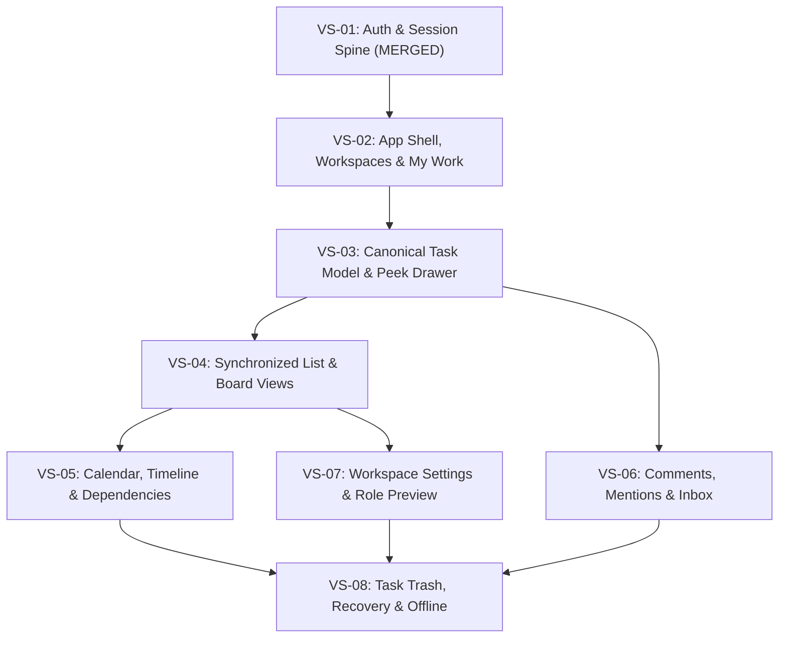

# SONDER — FRONTEND IMPLEMENTATION BLUEPRINT & PRODUCT AUDIT

- **Document Version:** 1.0.0
- **Baseline Authority:** `Community-Work-Management-Master-Specification-v1.5.0.md` (v1.5.0)
- **API Baseline:** OpenAPI `0.3.20-draft` (Unfrozen, 95 paths, 118 operations, 201 schemas)
- **Realtime Baseline:** `ws-events.schema.json` (31 event types), `ws-protocol.schema.json`
- **Ownership Scope:** **Frontend Application (`apps/web`) & Demo-Data Mock Service Layer**
- **Exclusion:** Backend runtime, services, server infrastructure, and database migrations are outside this frontend execution scope.

---

## 1. Repository Audit

### 1.1. Git & Monorepo State
- **Branch:** `develop`
- **HEAD Commit:** [`9915196`](https://github.com/Samudra-Bose/sonder/commit/9915196) (`feat(web): implement VS-01 authentication and session spine (#2)`)
- **Working Tree:** Clean (`nothing to commit, working tree clean`)
- **Monorepo Manager:** `pnpm` workspace v12.13.0 with Node `26.11.1` (pinned via `.nvmrc`, `.node-version`, and CI)
- **Packages:**
  - `apps/web`: Single-Page Application (SPA) built with React 19, TypeScript strict mode, Vite 6, Tailwind CSS v4, React Router v7, TanStack Query v5, and MSW v2.
  - `packages/contracts`: OpenAPI & WebSocket TypeScript type generation package exporting `api-types.ts`, `ws-events-types.ts`, and `ws-protocol-types.ts`.

### 1.2. Existing Frontend Foundation (VS-00 & VS-01 Completed)
1. **Security & Session Model:**
   - **Zero Client Secrets:** No session tokens, passwords, or JWTs stored in `localStorage` or `sessionStorage`.
   - **Host-Only Cookies:** Relies strictly on `__Host-session` and `__Host-auth-csrf`.
   - **Fail-Closed CSRF Handling:** Mutating requests (`POST`, `PUT`, `PATCH`, `DELETE`) fail closed in [`api-client.ts`](file:///home/samudra/Projects/VisualSCode/VisualCode/Vscoding/Sonder/apps/web/src/lib/api-client.ts) if `csrfToken` is omitted or empty (`CSRF_TOKEN_REQUIRED`).
   - **Idempotency Invariant:** RFC 9562 UUIDv7 generated on all mutating requests and transmitted via `X-Mutation-Id` ([`uuid.ts`](file:///home/samudra/Projects/VisualSCode/VisualCode/Vscoding/Sonder/apps/web/src/lib/uuid.ts)).
   - **Confirmed Logout:** `logout()` distinguishes confirmed server revocation (`204 No Content`) from server/network failure, preserving authenticated state and providing an accessible retry path when invalidation fails.
2. **Routing & Authentication UI:**
   - `/login`: Form validation, error alerts (`role="alert"`), loading spinner, Google OAuth start link, redirection state.
   - `/register`: Validation (`displayName`, `email`, `password` ≥ 8 chars) and anti-enumeration `202 Accepted` confirmation screen.
   - `/`: Protected root displaying the application shell with active user context, community membership, and sign-out controls.
3. **Automated Verification Suite:**
   - 25 automated Vitest tests across [`api-client.test.ts`](file:///home/samudra/Projects/VisualSCode/VisualCode/Vscoding/Sonder/apps/web/src/lib/api-client.test.ts), [`App.test.tsx`](file:///home/samudra/Projects/VisualSCode/VisualCode/Vscoding/Sonder/apps/web/src/App.test.tsx), and [`AuthFlow.test.tsx`](file:///home/samudra/Projects/VisualSCode/VisualCode/Vscoding/Sonder/apps/web/src/modules/auth/AuthFlow.test.tsx).
   - 51/51 documentation and policy validation checks passing via `python3 Community-Work-Management-v1.5/validation/validate_v1_5.py`.

---

## 2. Product Requirements & Source-of-Truth Map

### 2.1. Traceability Hierarchy & Binding Invariants
```
Community (Tenancy Boundary)
  └── Workspace (Personal or Shared Governance Boundary)
        └── Task (Canonical Work Item, Prefix-Keyed)
              └── Subtask (Child Task, Depth 1–2 Max)
```
- **Strict Invariant 1: Hierarchy Depth.** The hierarchy is strictly `Community → Workspace → Task → Subtask`. Projects and Lists are **not** hierarchy layers. Subtask depth is 1 by default, expandable up to 2 by Workspace Owner (DEC-OPEN-09). Unsafe reductions below existing tree depth are rejected.
- **Strict Invariant 2: Four Synchronized Projections.** List, Board, Calendar, and Timeline are projections of the **exact same** canonical query and authorization result. No view maintains an independent task truth or divergent filter logic.
- **Strict Invariant 3: Excluded File Capabilities.** No file attachments, binary uploads, comment attachments, or file hubs exist in Sonder (PRD Section 2.3).
- **Strict Invariant 4: Authorization Ownership.** Backend authorization remains authoritative. Frontend permission flags (e.g., `canManageAssigneeFieldGrants`, `canEditTask`, `isCommunityAdmin`) are display hints only, not client-side security enforcement.

### 2.2. User Personas & Primary Jobs
1. **Community Contributor / Member:**
   - Primary Job: Rapidly inspect assigned work across workspaces, change task status, comment, and manage private personal tasks.
   - Key UI: My Work dashboard, List/Board views, Quick Task Composer, Task Peek Drawer.
2. **Coordinator:**
   - Primary Job: Triage shared backlogs, assign tasks, resolve blockers, visualize milestone deadlines, and track dependencies.
   - Key UI: Workspace-level List/Board/Calendar/Timeline, Saved Shared Views, dependency conflict highlights.
3. **Workspace Owner:**
   - Primary Job: Govern workspace lifecycle, control role capability ceilings, configure workflow statuses and Phase 1 custom fields, manage task key prefixes, and audit recovery.
   - Key UI: Six-category Workspace Settings, Custom Role Builder, Role Preview Simulator, Task Trash & Recovery.
4. **Community Administrator:**
   - Primary Job: Govern community-wide shared workspace creation policies, manage default coordinator pool, and execute audited break-glass recovery for emergency compliance.
   - Key UI: Community Admin Settings, Workspace Governance Directory, Break-Glass Request & Audit UI.

### 2.3. Owner-Approved Decisions (Baseline v1.5.0)
- **DEC-OPEN-01 (`AUDITED_BREAK_GLASS`):** Personal Workspace break-glass access requires audited approval workflow and explicit time-bound renewal.
- **DEC-OPEN-02 (Option A):** Assignee field delegation. Workspace Owner sets allowed ceiling/default; Task Creator configures per-task subset.
- **DEC-OPEN-06 (Task-Key Lifecycle):** Community-unique, case-insensitive permanent prefix reservations (e.g., `ENG-`, `EVENT-`); Workspace-local monotonic sequence. Renaming prefix preserves numeric suffixes and generates permanent aliases.
- **DEC-OPEN-07 (Built-in Templates):** Exactly 3 read-only setup templates (`GENERAL_PURPOSE`, `EVENT_PLANNING`, `TEAM_OPERATIONS`) that seed workflows, Phase 1 custom fields, and shared saved views only (never sample tasks or members).
- **DEC-OPEN-08 (Milestones):** Workspace-scoped planning markers linked directly to tasks; never hierarchical containers.
- **DEC-OPEN-09 (Subtask Depth):** Default max depth 1; Workspace Owner can increase to 2.
- **DEC-OPEN-10 (Task Transfer):** Cross-workspace transfer uses `NAMES_ONLY` title/tree/order; transferred root is always top-level (`targetParentTaskId=null`; no `itemType`).
- **DEC-OPEN-11 (Task Trash & Purge):** 30-day restorable Trash; permanent purge is disabled pending DEC-OPEN-03.
- **DEC-OPEN-15 (Multiple Workspace Owners):** Multiple active owners allowed; dedicated atomic transfer flow; minimum one active owner invariant.

### 2.4. Open / Unresolved Decisions (Must Not Be Hardcoded)
- **DEC-OPEN-03:** Audit log retention durations and legal-hold authority remain unresolved. Task permanent purge API `/trash/tasks/{taskId}/purge` remains feature-disabled.
- **DEC-OPEN-04:** SLO / RPO / RTO targets remain provisional.
- **DEC-OPEN-05:** Domain-neutral core terminology confirmed; agile extensions (Sprints, Burndowns) are strictly deferred to Phase 4.
- **DEC-OPEN-12:** Idempotency cache retention window (CR-15 draft proposes 30 days).
- **DEC-OPEN-13:** Hosting, provider, and operational cloud budget.
- **DEC-OPEN-14:** Production identity provider selection and password hashing cost parameters.

---

## 3. Frontend Feature & Route Inventory

### 3.1. Complete Route Specification
All routes are client-routed via `react-router-dom` v7 with strict authentication guards, accessible loading states, and deep-linkable URL search parameters.

| Route Path | View / Page Component | Layout Wrapper | Auth Guard | URL Search State / Parameters |
|---|---|---|---|---|
| `/login` | `LoginForm` | Public Minimal Shell | Anonymous Only | `?from=/requested/path` |
| `/register` | `RegisterForm` | Public Minimal Shell | Anonymous Only | — |
| `/` | `RootRedirector` | App Shell | `ProtectedRoute` | Redirects to active workspace or `/my-work` |
| `/my-work` | `MyWorkDashboard` | App Shell with Left Rail | `ProtectedRoute` | `?group=due_date&filter=assigned` |
| `/inbox` | `NotificationInbox` | App Shell with Left Rail | `ProtectedRoute` | `?tab=action_required\|updates` |
| `/c/:communityId/w/:workspaceId` | `WorkspaceRedirect` | Workspace Shell | `ProtectedRoute` | Redirects to default saved view or `/list` |
| `/c/:communityId/w/:workspaceId/list` | `ListView` | Workspace Shell + View Tabs | `ProtectedRoute` | `?task=KEY-123&q=search&sort=due&group=status` |
| `/c/:communityId/w/:workspaceId/board` | `BoardView` | Workspace Shell + View Tabs | `ProtectedRoute` | `?task=KEY-123&stage=IN_PROGRESS` (mobile) |
| `/c/:communityId/w/:workspaceId/calendar` | `CalendarView` | Workspace Shell + View Tabs | `ProtectedRoute` | `?task=KEY-123&view=month\|week&date=2026-11` |
| `/c/:communityId/w/:workspaceId/timeline` | `TimelineView` | Workspace Shell + View Tabs | `ProtectedRoute` | `?task=KEY-123&zoom=week\|month` |
| `/c/:communityId/w/:workspaceId/trash` | `TaskTrashView` | Workspace Shell | `ProtectedRoute` | `?page=1` (30-day restorable items) |
| `/c/:communityId/w/:workspaceId/settings` | `WorkspaceSettings` | Settings Layout | `WorkspaceOwnerGuard` | Redirects to `/settings/general` |
| `/c/:communityId/w/:workspaceId/settings/:category` | `WorkspaceSettingsCategory` | Settings Layout (6 Tabs) | `WorkspaceOwnerGuard` | Categories: `general`, `members`, `permissions`, `tasks`, `views`, `notifications` |
| `/c/:communityId/w/:workspaceId/settings/audit` | `WorkspaceAuditLog` | Settings Layout | `WorkspaceOwnerGuard` | `?from=DATE&to=DATE&actor=UUID` |
| `/c/:communityId/settings` | `CommunityAdminSettings` | Admin Layout | `CommunityAdminGuard` | Shared workspace creation policy, templates |
| `/settings/profile` | `UserProfileSettings` | Account Settings Layout | `ProtectedRoute` | Display name, avatar, email status |
| `/settings/security` | `SecuritySettings` | Account Settings Layout | `ProtectedRoute` | Connected identities, active sessions |

### 3.2. Dialog, Drawer, and Popover Inventory
- **Task Peek Drawer (`TaskPeekDrawer`):**
  - Desktop: Collapsible/resizable right-side panel docked over the canvas without dismounting or resetting view scroll state.
  - Mobile / Tablet: Full-height touch-friendly bottom sheet.
  - Deep-linked via `?task=KEY-123`.
- **Quick Task Composer (`QuickTaskComposer`):**
  - Modal dialog triggered by `C` shortcut or Global Header button.
  - Max 5 default fields: Title (required), Workspace, Status, Priority, Assignee. Secondary disclosure for Due Date, Labels, and Estimate.
- **Workspace Creation Modal (`CreateWorkspaceModal`):**
  - Personal vs Shared selector.
  - Template selector (`GENERAL_PURPOSE`, `EVENT_PLANNING`, `TEAM_OPERATIONS`).
  - Prefix reservation validator with collision detection (`PREFIX_COLLISION`).
- **Command Palette & Omnibar (`OmnibarModal`):**
  - Keyboard shortcut `Cmd/Ctrl+K` or header search input.
  - Permission-aware instant search across Task Keys, Aliases, Titles, Workspaces, and Saved Views.
- **Role Preview Simulator Banner (`RolePreviewBanner`):**
  - Persistent sticky top banner when Workspace Owner tests views as `COORDINATOR`, `MEMBER`, `VIEWER`, or a custom role.
- **Dependency & Link Popover (`TaskLinkPopover`):**
  - Assigns `BLOCKS`, `BLOCKED_BY`, or `RELATION` links with visual cycle warning.

---

## 4. Information Architecture

### 4.1. Desktop Application Layout Blueprint
```
+-------------------------------------------------------------------------------------------------------+
| GLOBAL HEADER: Sonder Logo | Community Switcher | Omnibar (Ctrl+K) | Quick Create (+) | User Profile  |
+-------------------+-----------------------------------------------------------------------------------+
| LEFT NAV RAIL     | WORKSPACE HEADER: Workspace Name [Shared/Personal] | Role Badge | Settings (Owner)|
|                   +-----------------------------------------------------------------------------------+
| [My Work] (3)     | VIEW TABS: [ List ] [ Board ] [ Calendar ] [ Timeline ]  | Saved Views Presets    |
| [Inbox] (1)       +-----------------------------------------------------------------------------------+
|                   | FILTER BAR: [Filter +] [Group: Status v] [Sort: Due Date v] [Fields v] [Save View]|
| WORKSPACES:       +-------------------------------------------------------------+---------------------+
| > Eng Platform    |                                                             | TASK PEEK DRAWER    |
| > Event Gala 2027 |                                                             | (Right Docked Panel)|
| > Alex's Personal |                 CANVAS PROJECTION AREA                      |                     |
|                   |                                                             | [ENG-104] Status    |
| + New Workspace   |   (List Tree / Board Columns / Calendar Grid / Timeline)    | Title & Description |
|                   |                                                             | Subtasks Tree (0/2) |
| ----------------- |                                                             | Threaded Comments   |
| [Trash (30d)]     |                                                             | Activity History    |
| [Help / Shortcut] |                                                             |                     |
+-------------------+-------------------------------------------------------------+---------------------+
```

### 4.2. Mobile Touch Architecture
- **Header:** Compact top bar with Hamburger menu, active Workspace title, and Omnibar search trigger.
- **Bottom Navigation Bar (44px min targets):** `My Work` | `Views` | `Quick Create (+)` | `Inbox` | `Account`.
- **Board Adaptation:** Replaces horizontal multi-column scroll with a sticky Stage Selector tab bar (`Backlog` | `In Progress` | `Review` | `Done`).
- **Task Drawer:** Renders as a full bottom-sheet with drag-down-to-dismiss gesture and explicit close button.

---

## 5. Design Research Plan

To deliver an interface that combines mature task-tracking depth with frictionless operation, the design direction is informed by structured comparative research across established productivity platforms:

| Product Reference | Pattern to Study | Problem Solved | Fit for Sonder | What to Adapt vs. Reject |
|---|---|---|---|---|
| **Linear** | High-density keyboard navigation, instantaneous omnibar, and minimal click-to-edit attribute pills. | Eliminates navigation latency and complex modal clicking for daily contributors. | **High** | **Adapt:** Roving focus keyboard shortcuts (`C` create, `J/K` row navigate, `E` edit), inline status badges. <br>**Reject:** Extreme stark minimalism that hides workspace governance or obscures multi-community context. |
| **Asana** | Seamless four-view tab switching with shared underlying query state and collapsible subtask rows. | Allows team members with different cognitive preferences to collaborate on identical data. | **Very High** | **Adapt:** Tabbed view navigation bar, unscheduled tasks tray for calendar, clean subtask hierarchy disclosure. <br>**Reject:** Confusing multi-tiered hierarchy (Portfolios, Projects, Sections, Tasks) and heavy cross-selling banners. |
| **Jira** | Permanent task keys (`ENG-101`), workflow category mappings (`TODO`, `IN_PROGRESS`, `DONE`), and structured permissions. | Provides reliable verbal/written identifiers and governance for structured organizations. | **High (Selective)** | **Adapt:** Prefix-based task keys, permanent alias generation on rename, five-category workflow mapping. <br>**Reject:** Configuration labyrinth, JQL query syntax requirement, bloated modal dialogs, and sluggish rendering. |
| **Height** | Inline spreadsheet cell editing in List View and clean attribute tag popovers. | Streamlines bulk task updates without opening separate drawer panels. | **High** | **Adapt:** Inline cell editing for status, priority, due date, and assignee directly on List table rows. <br>**Reject:** Freeform chat stream mixing that blurs official task change history. |
| **Notion** | Clean empty states, structured attribute properties, and accessible slash commands. | Guides new users during initial workspace onboarding without training. | **Medium** | **Adapt:** Clear, friendly empty states with suggested starter actions; accessible property labels. <br>**Reject:** Arbitrary block canvas that lacks relational task constraints or rigid validation. |
| **Monday.com** | Distinct, vibrant visual status indicators and progress summary bars. | Enhances peripheral readability of project status and team workload. | **Medium** | **Adapt:** High-contrast, WCAG-compliant status badges with mandatory text labels and icons. <br>**Reject:** Cartoonish gamification, celebratory confetti animations, and overwhelming visual clutter. |
| **ClickUp** | Extensive view customization options (card property toggles, density modes). | Empowers power users to control information density on dense screens. | **Medium** | **Adapt:** "Display Properties" popover enabling users to toggle card fields (Assignee, Subtasks, Dates, Key). <br>**Reject:** Feature soup, nested duplicate navigation layers, and inconsistent UI patterns. |

### Component & Primitive Strategy
- **Headless Accessibility Primitives:** Composable primitives following Base UI / Radix patterns for focus rings, roving tabindex, escape-to-close modals, accessible popovers, and screen-reader announcements (`aria-live`).
- **Original Sonder Visual Identity:**
  - **Tone:** Calm, authoritative, professional slate canvas (`#0f172a` foreground, `#f8fafc` background, `#ffffff` cards).
  - **Color Palette:** Controlled semantic tokens for status (`#2563eb` Primary Blue, `#16a34a` Success Green, `#d97706` Warning Amber, `#dc2626` Danger Red, `#475569` Neutral Slate).
  - **Typography:** System font stack (`system-ui, -apple-system, sans-serif`) with strict modular scale (11px micro-badge, 13px table data, 14px body, 16px section heading, 20px page heading).

---

## 6. Demo-Data & Mock-Service Architecture

To provide an immediate, fully functional, and demonstrable product experience without relying on backend deployment, Sonder employs a deterministic, client-side mock infrastructure.

### 6.1. Deterministic Seed Data Scenarios

```
Community: "Sonder Engineering & Operations" (ID: 018f98a2-3f12-7890-a123-456789abcdef)
  │
  ├── Shared Workspace: "Engineering Platform" (Prefix: ENG, General Purpose Template)
  │     ├── Tasks: ENG-101 through ENG-118
  │     │     ├── ENG-101: "Implement Distributed Idempotency Cache" [High | In Progress | Alex]
  │     │     │     ├── ENG-101.1: "Redis Key Eviction TTL Policy" [Done | Casey]
  │     │     │     └── ENG-101.2: "UUIDv7 Header Validation Guard" [In Progress | Alex]
  │     │     ├── ENG-102: "Migrate Postgres Schema to Multi-Tenant RLS" [Urgent | In Review | Alex]
  │     │     │     └── Blocker for ENG-104 (Dependency Conflict Demonstration)
  │     │     └── ENG-105: "Benchmark WebSocket Outbox Deduplication" [Medium | Todo | Jordan]
  │     ├── Saved Views:
  │     │     ├── "Active Sprint Backlog" (Shared)
  │     │     └── "Alex's High Priority Blockers" (Personal)
  │     └── Milestones: "v1.5 Security Audit Gate" (Target: 2026-11-20)
  │
  ├── Shared Workspace: "Spring Community Gala 2027" (Prefix: EVENT, Event Planning Template)
  │     ├── Tasks: EVENT-201 through EVENT-212
  │     │     ├── EVENT-201: "Catering Vendor Contracts & Tasting" [Medium | Done | Riley]
  │     │     └── EVENT-204: "Venue Audio/Visual Soundcheck" [High | Scheduled: Dec 12 | Jordan]
  │     └── Milestones: "Venue Booking Deadline" (Target: 2026-12-01)
  │
  └── Personal Workspace: "Alex's Private Notes & Tasks" (Prefix: ALEX, Private by Default)
        └── Tasks: ALEX-1 through ALEX-6 (Private personal triage items)
```

### 6.2. Seed Personas & Role Matrix
1. **Alex Morgan (`alex.morgan@example.org`):** Workspace Owner in Engineering Platform, Community Administrator. Full permissions.
2. **Jordan Lee (`jordan.lee@example.org`):** Default Coordinator in Engineering Platform, Workspace Owner in Spring Gala. Can assign, triage, and update shared views.
3. **Casey Chen (`casey.chen@example.org`):** Member in Engineering Platform. Can edit assigned tasks, comment, and create tasks.
4. **Riley Taylor (`riley.taylor@example.org`):** Viewer in Engineering Platform. Read-only access with permission-denied feedback on mutation attempts.

### 6.3. Client-Side Mock Service Layer
- **Architecture:** MSW v2 browser worker intercepts all fetch calls transparently at the service worker level.
- **State Store:** In-memory reactive entity repository initialized with deterministic seed data. Includes a `localStorage` snapshot layer to persist demo interactions across page refreshes.
- **Demo Controls:**
  - **Persona Switcher:** Quick switcher in header allowing instant simulation of Alex (Owner), Jordan (Coordinator), Casey (Member), and Riley (Viewer).
  - **Network Latency Slider:** Simulates realistic network conditions (0ms for tests, 150ms default, 800ms slow 3G).
  - **Fault Injection:** Toggle to test server rejection (`500 Server Error`), permission denied (`403 Forbidden`), and conflict (`409 Conflict`).
  - **Reset Demo Data Button:** One-click restoration of clean seed baseline.

---

## 7. Frontend Architecture Recommendation

### 7.1. Target Directory & Module Structure
```
apps/web/src/
├── app/                        # Application bootstrap, routing, and top-level providers
│   ├── routes.tsx              # Declarative route configuration
│   └── App.tsx                 # Root layout with QueryClient and AuthProvider
├── lib/                        # Core utilities and client libraries
│   ├── api-client.ts           # Type-safe fetch client with problem decoding and CSRF/UUIDv7
│   ├── uuid.ts                 # RFC 9562 UUIDv7 generator
│   └── formatters.ts           # Date, key, and text formatting helpers
├── modules/                    # Feature-based modular architecture
│   ├── auth/                   # Identity, login, register, session guards
│   ├── app-shell/              # Header, left navigation rail, omnibar modal, persona switcher
│   ├── workspace/              # Workspace switcher, creation modal, member management
│   ├── my-work/                # Cross-workspace task aggregation dashboard
│   ├── tasks/                  # Canonical task store, composer, peek drawer, inline editors
│   ├── views/                  # Synchronized four-view projections
│   │   ├── list/               # Hierarchical tree-grid with keyboard navigation
│   │   ├── board/              # Status columns with mobile stage switcher
│   │   ├── calendar/           # Month/week/agenda grid with unscheduled drawer
│   │   └── timeline/           # Gantt-style split table + time axis with conflict markers
│   ├── collaboration/          # Threaded markdown comments, @mention picker, watchers
│   ├── notifications/          # Inbox categories (Action Required, Updates)
│   ├── saved-views/            # View query presets and copy-on-write handlers
│   └── settings/               # Six-category workspace settings & role preview simulator
├── mocks/                      # MSW v2 mock infrastructure
│   ├── handlers/               # Route handlers (auth, workspaces, tasks, views, notifications)
│   ├── data/                   # Deterministic seed data fixtures
│   └── store.ts                # Reactive in-memory demo entity store
└── test/                       # Test utilities, render helpers, and Vitest setup
```

### 7.2. Data Flow & Cache Strategy
1. **Server State (TanStack Query v5):**
   - Query keys strictly structured: `["workspaces", workspaceId, "tasks", querySpec]`.
   - Stale time set to 2 minutes with automatic background revalidation.
   - Mutations employ optimistic updates: UI updates instantaneously; on error, the previous snapshot is restored and an accessible alert is raised.
2. **URL as Source of Truth for Transient View State:**
   - Active filters, sorting, grouping, search terms, and current task drawer key (`?task=ENG-101`) reside in the URL.
   - Sharing a URL preserves the exact view projection for another user.
3. **Form Handling & Validation:**
   - Lightweight controlled components with schema-based validation.
   - RFC 7807 problem details automatically highlight invalid form fields using `aria-invalid` and `aria-describedby`.

---

## 8. Dependency-Aware Vertical-Slice Implementation Roadmap

The frontend execution is divided into 8 manageable, demonstrable vertical slices:



### VS-01: Authentication & Session Spine (COMPLETED & MERGED)
- **Status:** **Merged to `develop` at commit `9915196`**.
- **Delivered:** `/login`, `/register`, `AuthContext`, session cookie management, fail-closed CSRF handling, UUIDv7 `X-Mutation-Id`, confirmed logout with retry path, 25 tests.

---

### VS-02: Application Shell, Workspace Switcher, Omnibar & My Work
- **Objective:** Establish the persistent multi-community application shell, left navigation rail, workspace switching, command palette omnibar, and the cross-workspace "My Work" dashboard.
- **Pages & Components:**
  - Global Header with active Community switcher, Persona Switcher (Demo bar), and user profile dropdown.
  - Left Navigation Rail with collapsible workspaces, My Work, Inbox, and Trash links.
  - Command Palette / Omnibar modal (`Cmd/Ctrl+K`) with instant keyboard-driven search across tasks and workspaces.
  - My Work Dashboard (`/my-work`) grouping items by Overdue, Due Today, Upcoming, and Unscheduled.
- **Dependencies:** VS-01 (Auth state & user context).
- **Demo Data:** Pre-seeded Personal and Shared Workspaces for Alex, Jordan, Casey, and Riley; 15 assigned tasks across workspaces.
- **Acceptance Criteria:**
  1. User can switch between Personal and Shared Workspaces smoothly.
  2. Omnibar responds to `Cmd/Ctrl+K`, searches tasks by key (`ENG-101`) and title, navigating to target on Enter.
  3. My Work accurately aggregates tasks across joined workspaces and updates when filters change.
  4. Persona Switcher simulates different users instantly without reloading the page.
- **Tests Required:** Vitest tests for My Work grouping, Omnibar keyboard navigation, and workspace switching.

---

### VS-03: Canonical Task Model, Quick Composer & Task Peek Drawer
- **Objective:** Implement the central task data model, quick task creation, and the deep-linkable task detail drawer with inline attribute editing.
- **Pages & Components:**
  - Quick Task Composer modal (`C` shortcut) with Title, Workspace, Status, Priority, Assignee.
  - Desktop Task Peek Drawer docked on the right canvas; mobile bottom sheet.
  - Inline editors for Status, Priority, Due Date, Assignee, and Labels.
  - Subtask Tree component supporting depth 1–2 with quick inline child creation.
  - Task Key chip (`ENG-101`) with copy-link action.
- **Dependencies:** VS-02 (Shell and Workspace context).
- **Demo Data:** 20 tasks with subtasks, estimates, priorities, and status definitions.
- **Acceptance Criteria:**
  1. Creating a task updates the central cache and opens the drawer with assigned key.
  2. Subtask depth enforces the max limit (1 or 2) and rejects exceeding depth.
  3. Inline edits update immediately with optimistic feedback.
  4. Closing or opening the drawer preserves the current canvas scroll and query state.
- **Tests Required:** Form validation, subtask depth boundary enforcement, and optimistic attribute updates.

---

### VS-04: Synchronized List & Board Views with Saved Views Presets
- **Objective:** Deliver the primary execution views (List Tree-Grid and Board Status Columns) with shared query filtering, sorting, and Saved View presets.
- **Pages & Components:**
  - View Tab Switcher: `List` | `Board` tabs with instant transition.
  - Filter Bar: Filter chips (Assignee, Status, Priority, Due Date), Sort selector, Grouping selector, "Display Properties" popover.
  - List View: Dense table with expandable subtask hierarchy, keyboard roving focus (`J/K`), and inline cell editing.
  - Board View: Status columns, card reordering via pointer and keyboard menus, and mobile stage switcher.
  - Saved Views Bar: Personal vs Shared view presets with copy-on-write notice when filters are modified.
- **Dependencies:** VS-03 (Canonical task model and drawer).
- **Demo Data:** 30 tasks populated across Backlog, Todo, In Progress, In Review, and Done columns.
- **Acceptance Criteria:**
  1. Changing a filter in List view reflects identically when switching to Board view.
  2. Modifying a card status on the Board updates the List view immediately.
  3. List view keyboard navigation allows expanding/collapsing subtask rows with Arrow keys.
  4. Mobile displays stage switcher instead of requiring wide horizontal panning.
  5. Saved View copy-on-write allows saving personal drafts without altering shared presets.
- **Tests Required:** Cross-view parity tests, keyboard table navigation, filter serialization into URL.

---

### VS-05: Calendar View, Timeline View & Dependency Conflict Visualizer
- **Objective:** Complete the planning view suite with Month/Week Calendar (including Unscheduled Tray) and Gantt Timeline with dependency conflict markers.
- **Pages & Components:**
  - Calendar View (`/calendar`): Month and Week grid layouts, multi-day task spans, and expandable Unscheduled Tray for drag/click scheduling.
  - Timeline View (`/timeline`): Split view with left task hierarchy table and right horizontal date axis with zoom controls (Day, Week, Month).
  - Dependency Link Drawer: Configure `BLOCKS` and `BLOCKED_BY` relationships.
  - Conflict Visualizer: Prominent visual warning lines when a blocker task finishes after its dependent task starts.
  - Milestone Markers: Workspace-level target date indicators linked to key tasks.
- **Dependencies:** VS-04 (Four-view layout and query bar).
- **Demo Data:** Tasks with start/due dates, dependencies with at least one intentional conflict scenario, and 2 milestones.
- **Acceptance Criteria:**
  1. Tasks without dates appear in the Unscheduled Tray and can be assigned dates directly.
  2. Timeline renders date spans accurately and highlights dependency conflicts in red with explanatory tooltips.
  3. Milestone markers render on the timeline and display associated tasks.
  4. All edits remain fully operable via keyboard/menu without requiring pointer drag.
- **Tests Required:** Date span calculations, dependency cycle prevention, and conflict indicator tests.

---

### VS-06: Collaboration Spine — Comments, @Mentions & Notifications Inbox
- **Objective:** Implement threaded task collaboration, safe Markdown formatting, user mentions, watchers, and the categorized notification center.
- **Pages & Components:**
  - Threaded Comments Panel in Task Drawer with safe Markdown rendering (bold, italics, lists, code, quotes; no raw HTML).
  - @Mention Autocomplete Popover scoped to current workspace members.
  - Task Watcher Toggle button with active subscriber count.
  - Notification Inbox (`/inbox`): "Action Required" (mentions, assignments) and "Updates" (status changes, comments).
  - Global Header unread badge indicator with real-time update simulation.
- **Dependencies:** VS-03 (Task Drawer).
- **Demo Data:** Existing comments with mentions, notification items in both categories.
- **Acceptance Criteria:**
  1. Submitting a comment appends it immediately and triggers simulated notifications for mentioned users.
  2. Raw HTML and unsafe scripts in comments are sanitized and rendered as plain text.
  3. Marking notifications as read updates the header unread counter.
- **Tests Required:** Markdown AST sanitization, mention search filtering, notification read/unread state.

---

### VS-07: Workspace Governance, Six Settings Categories & Role Preview Simulator
- **Objective:** Deliver the administrative governance interface for Workspace Owners, including custom roles, workflow mapping, Phase 1 custom fields, and the Role Preview Simulator.
- **Pages & Components:**
  - Settings Navigation Layout with 6 tabs: General, Members, Permissions, Tasks, Views, Notifications.
  - General Settings: Rename workspace, prefix management with alias history.
  - Members & Invitations: Member list, role assignment dropdown, invitation modal.
  - Permissions & Custom Role Builder: Matrix of capabilities, creation of custom roles.
  - Tasks Settings: Workflow status manager (custom status mapped to 5 core categories), Phase 1 custom fields builder (`TEXT`, `NUMBER`, `DATE`, `BOOLEAN`, `SINGLE_SELECT`).
  - Role Preview Simulator: Top sticky bar allowing Owners to simulate and verify the workspace as `COORDINATOR`, `MEMBER`, or `VIEWER`.
- **Dependencies:** VS-04 (Workspace structure).
- **Demo Data:** Pre-configured custom role ("External Auditor"), custom fields, prefix history.
- **Acceptance Criteria:**
  1. Non-owners are prevented from accessing `/settings` by `WorkspaceOwnerGuard`.
  2. Prefix rename validates against collisions and generates permanent aliases.
  3. Role Preview Simulator restricts visible UI controls according to simulated role capabilities.
  4. Custom fields dynamically render in Quick Composer and Task Peek Drawer.
- **Tests Required:** Guard redirection, custom field schema validation, role preview capability evaluation.

---

### VS-08: 30-Day Task Trash, Recovery, Selected-Field Offline Queue & Hardening
- **Objective:** Implement the 30-day restorable Trash view, selected-field offline editing with conflict recovery, mobile responsive audit, and accessibility compliance.
- **Pages & Components:**
  - Trash View (`/trash`): List of archived tasks with remaining days count (30-day countdown), Restore button, and disabled Purge button (with tooltip citing DEC-OPEN-03).
  - Selected-Field Offline Queue: IndexedDB/localStorage queue for status, priority, and due date edits when offline; visual banner indicating pending sync items.
  - Offline Conflict Resolver: Dialog showing local vs server revisions with keep-local or keep-server choices.
  - WCAG 2.2 AA Accessibility & Keyboard Polish across all views.
- **Dependencies:** VS-05, VS-06, VS-07.
- **Demo Data:** 3 archived tasks in Trash with timestamps (5 days left, 22 days left).
- **Acceptance Criteria:**
  1. Archived tasks can be restored to their original workspace position within 30 days.
  2. Going offline allows editing task status and priority, queueing mutations locally.
  3. Reconnecting replays mutations in FIFO order and surfaces conflicts gracefully.
  4. Tab navigation, screen-reader landmarks, and contrast ratios pass automated axe-core checks.
- **Tests Required:** 30-day trash lifecycle tests, offline queue serialization, and axe accessibility audit.

---

## 9. UX & Visual Quality Standards

### 9.1. Density & Layout Modes
- **Compact Density (Default for List & Timeline):** 32px row height on desktop, 12px padding, concise text clipping with full tooltip on hover.
- **Comfortable Density (Board & Drawer):** 16px padding, card gap of 10px, clear visual hierarchy between title, badges, and metadata.
- **Mobile Touch Targets:** Primary interactive elements enforce a minimum touch bounding box of **44×44 CSS px**.

### 9.2. Interaction & Animation Performance
- **Micro-Interactions:** Subtle transitions strictly capped at **150ms–200ms** using `ease-out` timing curves (`cubic-bezier(0, 0, 0.2, 1)`).
- **Motion Restraint:** Animations communicate state transitions (drawer sliding in, accordion expanding); no gratuitous decorative bouncing or looping movements.
- **Reduced Motion:** Full support for `prefers-reduced-motion: reduce`, instantly snapping transitions without delay.

### 9.3. Accessibility (WCAG 2.2 Level AA Mandate)
- **Contrast:** Minimum 4.5:1 text-to-background contrast ratio across all states; 3:1 for interactive borders and graphical controls.
- **Non-Color Indicators:** Status and priority values must never rely solely on color. Every chip must combine an icon, distinct shape/border, and text label (e.g., `[!] High`, `[✓] Done`).
- **Keyboard Traversal:**
  - `J` / `K` for vertical item navigation in List and Board.
  - `Enter` / `Space` to open detail drawer or expand tree row.
  - `Escape` to close drawers, modals, and popovers, restoring focus to trigger.
  - `?` shortcut opens the accessible Keyboard Shortcut Cheat Sheet.

---

## 10. Risks, Unresolved Decisions & Dependencies

| Risk / Decision | Impact on Frontend | Mitigation Strategy in Blueprint |
|---|---|---|
| **DEC-OPEN-03 (Audit & Purge Authority)** | Permanent task purge is legally sensitive and unapproved. | The frontend Trash view exposes the "Restore" action but renders the "Permanent Purge" button in a disabled state with an explanatory tooltip citing DEC-OPEN-03. |
| **DEC-OPEN-06 (Prefix Collision Concurrency)** | Two users creating workspaces with identical prefixes simultaneously. | The frontend validates prefix availability client-side and handles `409 PREFIX_COLLISION` with clear field errors. |
| **DEC-OPEN-02 (Assignee Field Delegation)** | Complex permission logic for field delegation. | UI renders delegation controls only when `canManageAssigneeFieldGrants` is true; defaults to server-provided capability ceiling. |
| **Mock-to-Backend Drift Risk** | Mock data diverging from real backend behavior when backend is implemented. | All mock handlers and seed objects are strictly validated against `@sonder/contracts` TypeScript definitions generated directly from `openapi.yaml`. |
| **Realtime Reconnect Race Conditions** | Missing events during client reconnection. | Realtime client implements cursor-based reconnection (`/realtime-ticket`) and triggers a TanStack Query cache invalidation if cursors mismatch. |

---

## 11. Recommended Immediate Next Task: VS-02 Execution

The immediate next recommended implementation slice is:
**`VS-02: Application Shell, Workspace Switcher, Omnibar & My Work Dashboard`**

### Target Branch:
`feat/FE-VS02-app-shell-mywork` (to be branched from `develop` upon authorization).

### Scope of Immediate Work:
1. Implement the persistent responsive Shell (`AppShell`) with left navigation rail and workspace list.
2. Build the Workspace Switcher dropdown supporting seamless switching between Personal and Shared Workspaces.
3. Implement the Command Palette Omnibar (`Cmd/Ctrl+K`) for fast task key/title search.
4. Implement the My Work dashboard (`/my-work`) aggregating tasks grouped by Overdue, Due Today, Upcoming, and Unscheduled.
5. Create deterministic seed data for 3 workspaces and 15 tasks in `apps/web/src/mocks/data/`.
6. Add comprehensive Vitest test coverage for navigation, search, and triage workflows.
