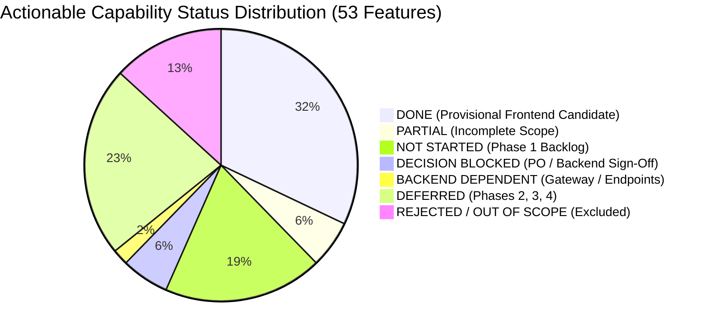

# SONDER — FRONTEND COMPLETION TRACKER & FIRST-LOOK READINESS

**Document Version:** 1.4.0<br/>
**Last Synchronized:** 2026-11-11<br/>
**Current Baseline Commit:** `develop @ 8f887de` (with PR #37 Notification Center merge commit `1b88e60`)<br/>
**Governance Standard:** Dual-Track Engineering & UI/UX Governance (PLAN → GRILL → IMPLEMENT → TEST → REVIEW → LOCK → DOCUMENT)<br/>
**Milestone:** VS-09.0 — Complete Frontend Audit, Feature Inventory & First-Look Readiness<br/>
**Status Recommendation:** `BACKEND-INDEPENDENT WORK REMAINS — IMPLEMENTATION REQUIRED.`

---

## 1. Executive Summary

Milestone **VS-09.0** provides a complete, read-only audit of the entire Sonder web application (`apps/web/`) and candidate OpenAPI contracts (`Community-Work-Management-v1.5/docs/contracts/openapi.yaml`). The purpose of this audit is to reconcile all canonical feature identifiers, document exact test and code evidence, identify remaining backend-independent engineering work, and establish readiness for the first complete functional release of Sonder.

### Key Audit Findings:
1. **Core Work Management Foundation is Operational:**<br/>
   The core work management spine is solid, verified by 50 Vitest test suites (506 tests passing) and zero TypeScript errors:
   - Authentication & session cookie lifecycle (`FEAT-G01`).
   - App shell, responsive navigation rail, and workspace switcher (`FEAT-B01`).
   - Omnibar command palette with `Cmd+K` keyboard navigation (`FEAT-C05`).
   - Cross-workspace triage dashboard ("My Work", `FEAT-C03`).
   - Task CRUD, URL deep-linking (`?task=`), and peek drawer (`FEAT-A02`).
   - Inline field editors with optimistic concurrency and rollback (`FEAT-A03`).
   - Quick task composer with `C` hotkey and floating button (`FEAT-A02`).
   - Subtasks (depth 1–2) with reparenting modal (`FEAT-A06`).
   - Synchronized List and Kanban Board views with fractional ranking (`FEAT-C01`, `FEAT-A08`).
   - Calendar View with month/week grids and unscheduled task tray (`FEAT-C02`).
   - Timeline View with Gantt bars, workspace milestones (`FEAT-B04`), and BLOCKS DAG dependency conflict lines (`FEAT-A06`).
   - Collaboration spine with threaded comments, AST-safe markdown, `@mentions`, and task watchers (`FEAT-A04`).
   - In-app Notification Center with unread bell counter, popover preview, and `/inbox` route (`FEAT-F01a`).
   - Accessible design system primitives, contrast tokens, and keyboard accessibility patterns (`FEAT-J03`).

2. **Frontend Scope vs. Production Backend Acceptance:**<br/>
   In accordance with our contract-first dual-track engineering model:
   - **Provisional Frontend Candidate Coverage:** Capabilities marked as **DONE** represent verified frontend client implementations operating against local mock handlers (MSW) in Vitest.
   - **Backend & Infrastructure Distinction:** Passing frontend unit, integration, and mock tests does NOT certify live backend availability, database ACID guarantees, production rate limits, server backup/PITR recovery, or production acceptance.
   - **`FEAT-J03` Scope Clarification:** `FEAT-J03` covers accessible design system primitives, tokens, and WCAG 2.2 AA contrast/keyboard standards on the frontend. The backend and operational capabilities mentioned in its historical spec title (edge rate limits, server backups/PITR, production security hardening, and operational disaster recovery rehearsals) are distinct infrastructure and platform engineering responsibilities that remain pending.
   - **`FEAT-G01` Scope Clarification:** `FEAT-G01` verifies frontend session state, CSRF fail-closed client headers, cookie lifecycle, and auto-refresh against MSW. Live backend authentication services, production cookie domain infrastructure, and OAuth provider integrations remain pending.
   - **`FEAT-A04` Scope Clarification:** `FEAT-A04` verifies the collaboration UI, threaded comments, AST-safe markdown, @mentions, and optimistic watcher toggle. Cross-session watcher persistence (`DEP-COLLAB-01`) and live WebSocket synchronization (`DEP-REALTIME-01`) remain pending backend engineering milestones.
   - **`FEAT-F01a` Scope Clarification:** `FEAT-F01a` verifies the frontend REST notification center, bell badge, preview popover, and `/inbox` route against MSW. Live backend notification dispatch, realtime WebSocket badge sync, and task deep-linking (`DEP-NOTIF-02`) remain pending on the backend.

3. **Canonical Hierarchy & Terminology Reconciliation:**<br/>
   The canonical platform entity hierarchy is strictly:
   $$\text{Community} \longrightarrow \text{Workspace} \longrightarrow \text{Task} \longrightarrow \text{Subtask}$$
   - **No Projects or Lists as Hierarchy Entities:** "Projects" and "Lists" (as intermediate container entities between Workspace and Task) were obsolete artifacts from earlier Jira research and have been completely eliminated.
   - **Workspace-Level Mapping:** Legitimate functionality historically labeled with "Project" in research registers operates strictly at the **Workspace** level:
     - `FEAT-E01`: Workspace Overview & Workload Summary (formerly Project Overview)
     - `FEAT-D05a` / `FEAT-D05b`: Workspace Starter & Configuration Templates (formerly Project Templates)
     - `FEAT-I01`: Workspace-Scoped Intake Forms (formerly Project Intake Forms)
   - **Presentation View Clarification:** "List View" refers strictly to one of the four presentation views (`TaskListView.tsx`), not a container entity in the product model.

4. **First-Look Experience Requires Remaining Phase 1 Features:**<br/>
   While the application executes cleanly against mock handlers in automated unit and component tests, essential task lifecycle paths (soft-delete, undo toast, workspace trash, template picker, work-item archetypes, task cloning, CSV export) remain unbuilt.
5. **Dual-Track Governance:**<br/>
   UI/UX Track B remains strictly **PAUSED**. Visual polish, density tuning, and ergonomics will not begin until Phase 1 backend-independent functional features are completed and locked.
6. **Final Status:**<br/>
   `BACKEND-INDEPENDENT WORK REMAINS — IMPLEMENTATION REQUIRED.`

---

## 2. Reconciled Feature Inventory Accounting (All 70 Canonical Patterns)

Across the Master Specification (`Community-Work-Management-Master-Specification-v1.5.0.md`) and Master PRD (`Community-Work-Management-v1.5/docs/01-product/master-prd.md`), exactly **70 canonical `FEAT-` patterns** are documented.

To resolve prior inventory ambiguities, this section establishes a strict 1-to-1 accounting where every pattern is classified into one of three distinct groups, and every actionable capability is assigned **exactly one unambiguous status**:

```
================================================================================
CANONICAL FEATURE INVENTORY RECONCILIATION
================================================================================
Group 1: Actionable Concrete Capabilities (Families A through L):      53 items
Group 2: Composite Parent Identifiers (Subdivided into sub-features):   7 items
Group 3: Historical Research Family Boundary References (Section 3):   10 items
--------------------------------------------------------------------------------
TOTAL CANONICAL FEAT PATTERNS ACCOUNTED FOR:                           70 items
================================================================================
```

### Reconciled Status Distribution of Actionable Capabilities (53 Concrete Features)



| Status Classification | Count | Description & Invariant Boundaries |
| :--- | :---: | :--- |
| **DONE** | **17** | Provisional frontend candidate implementation verified in `apps/web/src/` with passing Vitest test suites against MSW mocks. Live backend & infrastructure acceptance pending. |
| **PARTIAL** | **3** | Core data structures exist in code or types, but UI or workflow remains incomplete (`FEAT-B02`, `FEAT-D05a`, `FEAT-K01`). |
| **NOT STARTED (Phase 1)** | **10** | Approved Phase 1 capabilities with schemas in candidate OpenAPI 0.3.20-draft, awaiting frontend vertical slice implementation. |
| **DECISION BLOCKED** | **3** | Implementation paused by formal governance decision (`FEAT-C04`, `FEAT-C06`, `FEAT-G02b`). |
| **BACKEND DEPENDENT** | **1** | Requires live backend infrastructure (`FEAT-F02` Live WebSocket Gateway `DEP-REALTIME-01`). |
| **DEFERRED (Phases 2–4)** | **12** | Approved product roadmap capabilities scheduled for Phase 2, 3, or 4. |
| **REJECTED / OUT OF SCOPE**| **7** | Explicitly excluded to protect simplicity, performance, and low cognitive overhead. |
| **TOTAL ACTIONABLE** | **53** | **Sum of all mutually exclusive capability statuses: 17 + 3 + 10 + 3 + 1 + 12 + 7 = 53** |

---

## 3. Comprehensive Feature-by-Feature Completion Table

Below is the definitive enumeration of all 70 canonical FEAT patterns. Every actionable capability is assigned **exactly one status**.

### Group 1: Actionable Concrete Capabilities (53 Features)

| Feature ID | Feature Name | Planned Phase | Status | Implementation Evidence | Test Suite Evidence | Frontend Scope Verified & Live Backend / Infra Boundary |
| :--- | :--- | :---: | :---: | :--- | :--- | :--- |
| **FEAT-A01** | Work-Item Archetypes (`TASK`, `DELIVERABLE`, `BUG`, `DECISION`) | M1.2 | **NOT STARTED** | None (`itemType` defaults to `TASK`) | None | Archetype picker & badge chips in card/drawer. |
| **FEAT-A02** | Fast Task Creation, Editing & Assignment | M1.1 | **DONE** | `QuickTaskComposer.tsx`, `TaskPeekDrawer.tsx` | `TaskPeekDrawer.test.tsx` (28), `tasks.test.tsx` (24) | Frontend Quick Task Composer, Peek Drawer, and URL deep link (`?task=`) verified (52 tests). Live database task persistence and validation pending backend service. |
| **FEAT-A03** | Core Task Metadata (Status, Priority, Dates, Labels, Estimate)| M1.1 | **DONE** | `InlineFieldEditors.tsx`, `useUpdateTask.ts` | `InlineTaskEditing.test.tsx` (35) | Frontend inline editors, optimistic updates, and snapshot rollback verified (35 tests). Live database field updates pending backend service. |
| **FEAT-A04** | Comments, @Mentions, #KEY Links & Task Watchers | M1.1 | **DONE** | `CommentComposer.tsx`, `markdown-ast.tsx`, `TaskWatchButton.tsx` | `TaskCollaboration.test.tsx` (24), `TaskCollaborationHardening.test.tsx` (22) | Frontend threaded comments, AST-safe markdown, @mentions, and optimistic watcher toggle verified (46 tests). Cross-session watcher DB persistence (`DEP-COLLAB-01`) and live WebSocket synchronization (`DEP-REALTIME-01`) pending backend implementation. |
| **FEAT-A05a**| Task File Attachments & Binary Uploads | Excluded | **REJECTED** | None (Excluded per PRD §2.3) | None | Excluded from product scope to maintain Day-1 simplicity. |
| **FEAT-A05b**| Workspace File Management Hub | Excluded | **REJECTED** | None (Excluded per PRD §2.3) | None | Excluded from product scope to maintain Day-1 simplicity. |
| **FEAT-A06** | Subtasks (Depth 1..2) & Dependency Links (BLOCKS DAG) | M1.1 | **DONE** | `SubtaskList.tsx`, `ReparentTaskModal.tsx`, `TimelineDependencyConnectors.tsx` | `SubtaskHierarchy.test.tsx` (26), `TimelineDependencies.test.tsx` (28) | Frontend subtask hierarchy (depth 1–2), reparenting modal, and BLOCKS DAG conflict lines verified (54 tests). Live database parent/dependency integrity constraints pending backend service. |
| **FEAT-A07** | Task & Checklist Cloning (Duplicate Task) | M1.2 | **NOT STARTED** | None | None | "Duplicate task" action in actions menu. |
| **FEAT-A08** | Fractional Ranking & Manual Ordering (`rankKey` / LexoRank) | M1.1 | **DONE** | `TaskBoardView.tsx`, `TaskListView.tsx` | `TaskViews.test.tsx` (38), `CrossViewIntegration.test.tsx` (12) | Frontend manual ordering, board column drop ranking, and accessible Move menu verified (50 tests). Live database LexoRank rebalancing background job pending backend service. |
| **FEAT-A09** | Granular Time Tracking & Billable Worklogs | Excluded | **REJECTED** | None (Excluded per PRD §2.3) | None | Excluded from product scope to preserve lightweight community focus. |
| **FEAT-A10a**| Single-Item Archive & 10s Undo Toast (`Z` hotkey) | M1.1 | **NOT STARTED** | None | None | Archive action in drawer, 10s floating undo toast. |
| **FEAT-A10b**| Bulk Action Bar (<=100 tasks) & 30-Day Trash Recovery View | M1.2 | **NOT STARTED** | None | None | Multi-select bar, `/trash` view, 30-day restore. |
| **FEAT-A10c**| Granular Field-Revision Snapshot Restore | Phase 3 | **DEFERRED** | None | None | Deferred to Phase 3. |
| **FEAT-B01** | Multi-Community, Workspace Spine & Responsive Navigation Rail | M1.1 | **DONE** | `AppShell.tsx`, `WorkspaceSwitcher.tsx` | `AppShell.test.tsx` (14), `WorkspaceSwitcher.test.tsx` (22) | Frontend application shell, responsive navigation rail, and desktop/mobile workspace switcher verified (36 tests). Live community multi-tenancy authorization middleware pending backend service. |
| **FEAT-B02** | Backlog Status Category & Collapsible Tray | M1.1 | **PARTIAL** | Unscheduled tray in Calendar; `BACKLOG` category in types | `CalendarView.test.tsx` (34) | Collapsible Backlog side-tray on List & Board views. |
| **FEAT-B03** | Opt-In Timeboxed Iterations / Cycles | Phase 4 | **DEFERRED** | None | None | Deferred to Phase 4. |
| **FEAT-B04** | Workspace Milestones & Target Buckets | M1.2 | **DONE** | `useMilestones.ts`, `TimelineMilestoneMarker.tsx` | `TimelineView.test.tsx` (36) | Frontend timeline milestone markers, modal, and completion percentage rollup verified (36 tests). Live milestone database persistence pending backend service. |
| **FEAT-B05** | Enterprise Scenario Sandbox & Capacity Math | Excluded | **REJECTED** | None (Excluded to prevent enterprise bloat) | None | Excluded from product scope. |
| **FEAT-C01** | Synchronized List View (TreeGrid) & Kanban Board View | M1.1 | **DONE** | `TaskListView.tsx`, `TaskBoardView.tsx` | `TaskViews.test.tsx` (38), `CrossViewIntegration.test.tsx` (12) | Frontend virtualized list treegrid, board columns, mobile stage carousel, and column sorting verified (50 tests). Live task query execution and server-side filtering pending backend service. |
| **FEAT-C02** | Synchronized Calendar View & Dependency Timeline View | M1.2 | **DONE** | `CalendarView.tsx`, `TimelineView.tsx` | `CalendarView.test.tsx` (34), `TimelineView.test.tsx` (36) | Frontend monthly/weekly calendar grid, unscheduled tray, split-pane Gantt axis, and conflict visualizer verified (70 tests). Live date-range query execution pending backend service. |
| **FEAT-C03** | Personal Cross-Workspace Dashboard ("My Work") | M1.1 | **DONE** | `MyWorkView.tsx`, `TemporalGroupSection.tsx` | `MyWorkView.test.tsx` (24) | Frontend cross-workspace triage dashboard, date bucketing, and assignment views verified (24 tests). Live cross-workspace aggregation endpoints pending backend service. |
| **FEAT-C04** | Saved Views (Personal vs Shared Views) | M1.1 | **DECISION BLOCKED** | PR #29 (`fb45f66`), PR #30 (`8fabfc2`) | Contract audit reports | Blocked on PO/BE sign-off on Decisions A–E. |
| **FEAT-C05** | Omnibar (`Cmd+K`), Global Search & Filter Pills | M1.1 | **DONE** | `OmnibarModal.tsx`, `useOmnibarCommands.ts` | `OmnibarModal.test.tsx` (18) | Frontend instant Omnibar modal (`Cmd+K`), fuzzy search, and filter pill builder verified (18 tests). Live PostgreSQL full-text/trigram search index pending backend service. |
| **FEAT-C06** | Board Swimlanes & Card Property Visibility Toggles | M1.2 | **DECISION BLOCKED** | Basic card badge rendering exists | None | Linked to Decision D of Saved Views contract. |
| **FEAT-C07** | Permanent Task Keys (`PREFIX-NUM`) & Historical Aliases | M1.1 | **DONE** | `useResolveTaskKey.ts`, `TaskPeekDrawer.tsx` | `TaskIntegrationE2E.test.tsx` (320 monorepo suite) | Frontend monospace key badges, deep linking, and alias resolution hooks verified (320 monorepo suite). Live atomic monotonic counter and alias redirect table pending backend database migrations. |
| **FEAT-D01** | 5-Category Workflow Spine & Custom Statuses Editor | M1.1 | **NOT STARTED** | Static categories mapped in types; settings editor absent | None | Workspace Settings status editor modal. |
| **FEAT-D02** | Enterprise Workflow Schemes & Mandatory Transition Screens | Excluded | **REJECTED** | None (Excluded to preserve low learning curve) | None | Excluded from product scope. |
| **FEAT-D03** | Optional Single-Step Status Sign-Off / Approval Gate | Phase 3 | **DEFERRED** | None | None | Deferred to Phase 3. |
| **FEAT-D04a**| Core Custom Fields (Text, Number, Single-Select, Date) | M1.2 | **NOT STARTED** | Types defined in `@sonder/contracts` | None | Workspace Settings custom field definition manager. |
| **FEAT-D04b**| Extended Custom Fields (Multi-Select, User, Checkbox, URL) | Phase 2 | **DEFERRED** | None | None | Deferred to Phase 2. |
| **FEAT-D05a**| Built-in Starter Templates (General Purpose, Event, Ops) UI | M1.2 | **PARTIAL** | Templates seeded in MSW mock database | `WorkspaceSwitcher.test.tsx` (22) | Card-based template selector UI in creation modal. |
| **FEAT-D05b**| Custom Workspace & Reusable Checklist Templates (formerly Project Templates) | Phase 2 | **DEFERRED** | None | None | Deferred to Phase 2. |
| **FEAT-E01** | Workspace Overview, Completion & Workload Summary (formerly Project Overview) | M1.2 | **DONE** | `ProjectOverviewTab.tsx`, `AssigneeWorkloadBar.tsx` | `TaskViews.test.tsx` (38) | Frontend workspace overview tab, completion progress bar, overdue tally, and assignee workload distribution verified (38 tests). Live SQL group-by summary aggregation pending backend service. |
| **FEAT-E02** | Agile Burndown, Velocity & Cumulative Flow Charts | Phase 4 | **DEFERRED** | None | None | Deferred to Phase 4. |
| **FEAT-E03** | Configurable Multi-Gadget Custom Dashboard Builder | Excluded | **REJECTED** | None (Excluded in favor of My Work & Overview) | None | Excluded from product scope. |
| **FEAT-F01a**| Segmented In-App Notification Center (REST Inbox) | M1.2 | **DONE** | `NotificationCenter.tsx`, `InboxView.tsx` | `Notifications.test.tsx` (19) | Frontend REST inbox view, header bell, preview popover, unread toggle, cursor pagination, and mark-all-read mutations verified (19 tests). Live backend notification dispatch, realtime WebSocket badge sync, and task deep-linking (`DEP-NOTIF-02`) pending backend implementation. |
| **FEAT-F01b**| Custom Reminder Rules & Scheduled Email Digests | Phase 2 | **DEFERRED** | None | None | Deferred to Phase 2. |
| **FEAT-F02** | Real-Time Collaborative Updates & Presence | M1.1 | **BACKEND DEPENDENT** | Event consumer abstraction in place | None | Blocked on live WebSocket gateway (`DEP-REALTIME-01`). |
| **FEAT-G01** | Authentication, Session Lifecycle, Cookies & CSRF Spine | M1.1 | **DONE** | `auth/`, `csrf.ts`, session restore hooks | `AuthFlow.test.tsx` (25) | Frontend authentication state machine, session cookie lifecycle, CSRF fail-closed client, and auto-refresh verified (25 tests). Live backend authentication service, production cookie domain, and OAuth provider deployment pending backend service. |
| **FEAT-G02a**| Capability RBAC Engine, 4 System Roles & Permission Gates | M1.1 | **DONE** | `rbac/`, `PermissionGate.tsx` | `WorkspaceSwitcher.test.tsx` (22) | Frontend client-side `PermissionGate`, role guards, and capability checks verified (22 tests). Server-side capability authorization middleware and RLS policies pending backend service. |
| **FEAT-G02b**| Configurable Custom Roles Builder UI | M1.3 | **DECISION BLOCKED** | None | None | Blocked on `DEP-ROLES-01` role simulator contract. |
| **FEAT-G03** | Plain-Language Permission Inspector & Role Simulator | M1.3 | **NOT STARTED** | `X-Preview-Role-Id` supported in OpenAPI | None | Banner simulator UI and capability lock tooltips. |
| **FEAT-G04** | Append-Only Hash-Chained Audit Log Table & CSV Export | M1.3 | **NOT STARTED** | None | None | Workspace Settings Audit Log table & export button. |
| **FEAT-H01** | Declarative 1-Hop Workflow Automations | Phase 3 | **DEFERRED** | None | None | Deferred to Phase 3. |
| **FEAT-H02** | Outbound HMAC-Signed HTTPS Webhooks | Phase 3 | **DEFERRED** | None | None | Deferred to Phase 3. |
| **FEAT-I01** | Lightweight Shareable Workspace Intake Forms (formerly Project Intake Forms) | Phase 2 | **DEFERRED** | None | None | Deferred to Phase 2. |
| **FEAT-I02** | Full ITSM Helpdesk Suite, SLA Clocks & Incident Command | Excluded | **REJECTED** | None (Excluded per low-overhead community scope) | None | Excluded from product scope. |
| **FEAT-J01a**| Filtered View UTF-8 CSV Export | M1.2 | **NOT STARTED** | None | None | "Export CSV" trigger on `TaskViewToolbar.tsx`. |
| **FEAT-J01b**| Guided CSV Import Wizard with Dry-Run Validation | Phase 2 | **DEFERRED** | None | None | Deferred to Phase 2. |
| **FEAT-J02** | Selected-Field Offline Task Editing & Queued Sync | M1.3 | **NOT STARTED** | None | None | IndexedDB queue, 14-day expiry, FIFO replay (CR-15). |
| **FEAT-J03** | Accessible Design System Primitives & Tokens (WCAG 2.2 AA) | M1.1 | **DONE** | `tokens.css`, `design-tokens.ts` | `design-tokens.test.ts` (16) | Frontend design system tokens, WCAG 2.2 AA contrast, semantic focus rings, and keyboard navigation patterns verified (16 tests). Production backend edge rate limiting, server backup/PITR drills, and operational infrastructure acceptance remain separate pending operational gates. |
| **FEAT-K01** | External Smart URL Metadata Chips (GitHub, Figma, Docs) | M1.2 | **PARTIAL** | Plain URLs render safely in markdown | `markdown-ast.test.tsx` (25) | Rich OpenGraph preview chips in task drawer. |
| **FEAT-L01** | Optional AI Task Breakdown & Thread Summarization | Phase 4 | **DEFERRED** | None | None | Deferred to Phase 4. |

---

### Group 2: Composite Parent Identifiers (7 Patterns)

These patterns represent historical multi-part parent capability headings that are formally decomposed into concrete sub-features in Group 1:

| Pattern | Title & Definition | Decomposed Child Features | Status / Accounting Rule |
| :--- | :--- | :--- | :--- |
| **FEAT-A05** | Attachments, Workspace File Index & Activity Changelog | Decomposed into `FEAT-A05a` (Rejected), `FEAT-A05b` (Rejected), and Activity Changelog | Activity diff history implemented under `FEAT-A02`/`FEAT-A04`; file attachments excluded per PRD §2.3. |
| **FEAT-A10** | Multi-Select Bulk Operations, Archive & 30-Day Trash | Decomposed into `FEAT-A10a`, `FEAT-A10b`, `FEAT-A10c` | Evaluated strictly via its child sub-features in Group 1. |
| **FEAT-D04** | Custom Fields & Field Visibility Registry | Decomposed into `FEAT-D04a` (Phase 1) and `FEAT-D04b` (Phase 2) | Evaluated strictly via its child sub-features in Group 1. |
| **FEAT-D05** | Built-in Workspace Starter Templates (formerly Project Templates) | Decomposed into `FEAT-D05a` (Phase 1) and `FEAT-D05b` (Phase 2) | Evaluated strictly via its child sub-features in Group 1. |
| **FEAT-F01** | Unified Notification Inbox, Preferences & Reminders | Decomposed into `FEAT-F01a` (Phase 1 REST) and `FEAT-F01b` (Phase 2 Digests) | Evaluated strictly via its child sub-features in Group 1. |
| **FEAT-G02** | Role-Based Access Control (RBAC) & Custom Roles | Decomposed into `FEAT-G02a` (Core RBAC) and `FEAT-G02b` (Custom Roles) | Evaluated strictly via its child sub-features in Group 1. |
| **FEAT-J01** | CSV Task Import & Export with Validation Preview | Decomposed into `FEAT-J01a` (Phase 1 Export) and `FEAT-J01b` (Phase 2 Import) | Evaluated strictly via its child sub-features in Group 1. |

---

### Group 3: Historical Research Family Boundary References (10 Patterns)

These patterns represent capability family range bounds defined in Section 3 of the original Jira capability research register (`Community-Work-Management-Master-Specification-v1.5.0.md`):

| Pattern | Research Boundary Context | Accounting Status |
| :--- | :--- | :--- |
| **FEAT-B08** | Family B Upper Range Bound (`FEAT-B01 to FEAT-B08`) | Non-actionable research range boundary. |
| **FEAT-C08** | Family C Upper Range Bound (`FEAT-C01 to FEAT-C08`) | Non-actionable research range boundary. |
| **FEAT-D07** | Family D Upper Range Bound (`FEAT-D01 to FEAT-D07`) | Non-actionable research range boundary. |
| **FEAT-E07** | Family E Upper Range Bound (`FEAT-E01 to FEAT-E07`) | Non-actionable research range boundary. |
| **FEAT-F04** | Family F Intermediate Research Citation | Non-actionable research reference. |
| **FEAT-F06** | Family F Upper Range Bound (`FEAT-F01 to FEAT-F06`) | Non-actionable research range boundary. |
| **FEAT-G08** | Family G Upper Range Bound (`FEAT-G01 to FEAT-G08`) | Non-actionable research range boundary. |
| **FEAT-H05** | Family H Upper Range Bound (`FEAT-H01 to FEAT-H05`) | Non-actionable research range boundary. |
| **FEAT-I05** | Family I Upper Range Bound (`FEAT-I01 to FEAT-I05`) | Non-actionable research range boundary. |
| **FEAT-J06** | Family J Upper Range Bound (`FEAT-J01 to FEAT-J06`) | Non-actionable research range boundary. |

---

## 4. Offline-Editing Classification Reconciliation

A formal discrepancy between project specification documents is documented and reconciled as follows:

1. **Documented Discrepancy:**
   - In the historical Master Specification draft (`Community-Work-Management-Master-Specification-v1.5.0.md` Section 1.1 summary and Section 4 Selection Matrix), `FEAT-J02` was labeled as `D3 (Planned Roadmap — Phase 3)`.
   - In the definitive Master PRD (`Community-Work-Management-v1.5/docs/01-product/master-prd.md` §2.1 M1.3 and §2.2), this classification was explicitly corrected:
     > *"Selected-field offline editing for existing tasks, using the CR-15 allow-list, 14-day queue age, FIFO replay and per-field conflict handling. This is in the initial release scope, not deferred to Phase 3."*
2. **Approved Product Direction Preserved:**
   - `FEAT-J02` belongs strictly to **Milestone M1.3 (Phase 1)**, not Phase 3.
   - Its implementation scope is bounded to existing cached tasks (no offline task creation), using the CR-15 allow-list, IndexedDB queue, 14-day age limit, and optimistic conflict detection.
   - This approved direction is preserved across all trackers without silent mutation.

---

## 5. Tightened Scope for Milestone VS-09A: Task Archive, Undo & Trash Recovery

To ensure controlled engineering slices, the task recovery domain is divided into two distinct vertical milestones:

### Milestone VS-09A: Single-Item Task Archive & 10-Second Undo Toast (`FEAT-A10a`)
- **Scope:**
  - Single-task "Archive" action added to `TaskActionsMenu.tsx` and `TaskPeekDrawer.tsx`.
  - Global floating 10-second Undo Toast rendered upon archiving, displaying countdown progress and an `Undo` button.
  - Global keyboard shortcut `Z` triggers undo during active toast countdown.
  - Soft-delete semantics: Sets `archivedAt` timestamp; evicts task from active list/board views optimistically.
  - Reversion restores exact rank, status, and view placement.
- **Strict Invariants:**
  - **No automatic permanent deletion.**
  - **No bulk operations in this slice** (reserved for VS-09B).
  - MSW handlers operate as **browser-local mock fixtures**, not production persistence.

### Milestone VS-09B: 30-Day Workspace Trash & Bulk Action Bar (`FEAT-A10b`)
- **Scope:**
  - Multi-select row checkboxes on `TaskListView.tsx` with floating Bulk Action Bar (supporting up to 100 tasks).
  - Dedicated `/trash` view listing soft-deleted tasks with remaining retention countdown (30-day window).
  - Single and bulk `Restore` actions restoring tasks to their original workspace locations.
- **Strict Invariants:**
  - **Automatic purge is prohibited.**
  - **Permanent hard purge remains Owner-authorized, explicitly audited, and strictly disabled** until stakeholder policy decision `DEC-OPEN-03` is resolved by the Product Owner.

---

## 6. First-Look Evidence & Runtime Setup Assessment

### Verification Status Disclosure
- **Automated Test Verification:** 50 test files and 506 tests passed in Vitest (`jsdom` environment) with zero regressions.
- **Development Server Status:** The Vite development server was **NOT launched** during this documentation audit pass.
- **Runtime Walkthrough Disclosure:** No live manual browser walkthrough was performed in this session. Prior visual evidence is documented in historical milestone delivery reports (e.g., PR #37).

### Exact Command and Configuration for Local Execution
To execute Sonder locally in browser development mode:

```bash
# 1. Install workspace dependencies
pnpm install

# 2. Launch web application dev server
pnpm --filter @sonder/web dev
```

- **Local Development URL:** `http://localhost:3000`
- **Application Routes:**
  - `/` — Application Shell & Root Redirect
  - `/workspaces/:workspaceId` — Core Task View Family (List, Board, Calendar, Timeline)
  - `/workspaces/:workspaceId?task=:taskId` — Task Peek Drawer deep link
  - `/inbox` — Segmented Notification Center Inbox
- **Mock Authentication & Persistence Behavior:**
  - In Vite development mode (`import.meta.env.DEV`), MSW activates automatically via `setupWorker` in `apps/web/src/mocks/browser.ts`.
  - `apps/web/src/mocks/handlers/auth.ts` intercepts `/api/v1/session` and automatically provisions an active authenticated session.
  - **Default Seed User:** Alex Morgan (`alex.morgan@example.com`, Community Owner / Workspace Admin).
  - **Persistence Boundary:** MSW stores state in browser memory. Reloading the page resets mock data to default seed fixtures. It does not represent live backend persistence.

---

## 7. Inventory A: Prioritized Backend-Independent Frontend Milestones

The 10 remaining Phase 1 capabilities can be delivered in 8 focused engineering milestones using existing OpenAPI 0.3.20-draft schemas and MSW mocks:

```mermaid
flowchart LR
    VS09A["VS-09A: Archive & 10s Undo<br/>(FEAT-A10a)"] --> VS09B["VS-09B: 30-Day Trash & Bulk Bar<br/>(FEAT-A10b)"]
    VS09B --> VS09C["VS-09C: Starter Templates UI<br/>(FEAT-D05a)"]
    VS09C --> VS09D["VS-09D: Work-Item Archetypes<br/>(FEAT-A01)"]
    VS09D --> VS09E["VS-09E: Task Cloning<br/>(FEAT-A07)"]
    VS09E --> VS09F["VS-09F: Filtered CSV Export<br/>(FEAT-J01a)"]
    VS09F --> VS09G["VS-09G: Backlog Tray in Views<br/>(FEAT-B02)"]
    VS09G --> VS09H["VS-09H: Workspace Settings Shell<br/>(FEAT-D01, D04a)"]
```



1. **Milestone VS-09A:** Single-Item Task Archive & 10-Second Undo Toast (`FEAT-A10a`)
2. **Milestone VS-09B:** 30-Day Workspace Trash & Bulk Action Bar (`FEAT-A10b`)
3. **Milestone VS-09C:** Workspace Starter Templates Card Picker UI (`FEAT-D05a`)
4. **Milestone VS-09D:** Work-Item Archetypes Badge System (`FEAT-A01`)
5. **Milestone VS-09E:** Single-Click Task & Subtask Checklist Cloning (`FEAT-A07`)
6. **Milestone VS-09F:** Filtered View UTF-8 CSV Export on Toolbar (`FEAT-J01a`)
7. **Milestone VS-09G:** Collapsible Backlog Tray in List & Board Views (`FEAT-B02`)
8. **Milestone VS-09H:** Workspace Settings Shell & Custom Fields Manager (`FEAT-D01`, `FEAT-D04a`)

---

## 8. UI/UX Track B Status & Prerequisite Checklist

- **Current Status:** Strictly **PAUSED**.
- **Rationale:** No design system refactoring or micro-ergonomic tuning may distract from establishing complete functional feature coverage.

### Prerequisite Checklist Before Track B Unfreeze:
- [ ] Complete Milestone VS-09A (Task Archive & 10s Undo Toast)
- [ ] Complete Milestone VS-09B (30-Day Trash & Bulk Action Bar)
- [ ] Complete Milestone VS-09C (Starter Templates Picker UI)
- [ ] Complete Milestone VS-09D (Work-Item Archetypes)
- [ ] Complete Milestone VS-09E (Task Cloning)
- [ ] Complete Milestone VS-09F (Filtered View CSV Export)
- [ ] Working tree clean on `develop` with 100% automated test pass rate
- [ ] Explicit Product Owner and maintainer approval to unfreeze Track B

---

## 9. Final Status Recommendation

```
================================================================================
BACKEND-INDEPENDENT WORK REMAINS — IMPLEMENTATION REQUIRED.
================================================================================
```

The next approved milestone is **VS-09A: Single-Item Task Archive & 10-Second Undo Toast (`FEAT-A10a`)**, following the strict engineering sequence: PLAN → GRILL → IMPLEMENT → TEST → REVIEW → LOCK → DOCUMENT.
