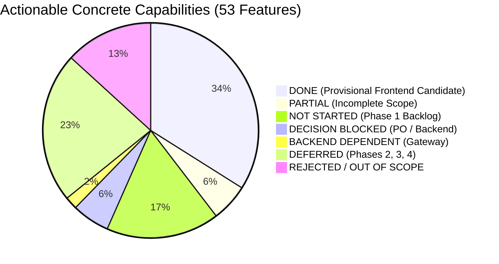
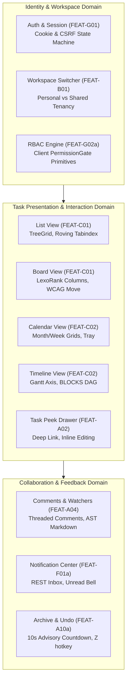
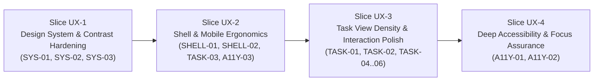
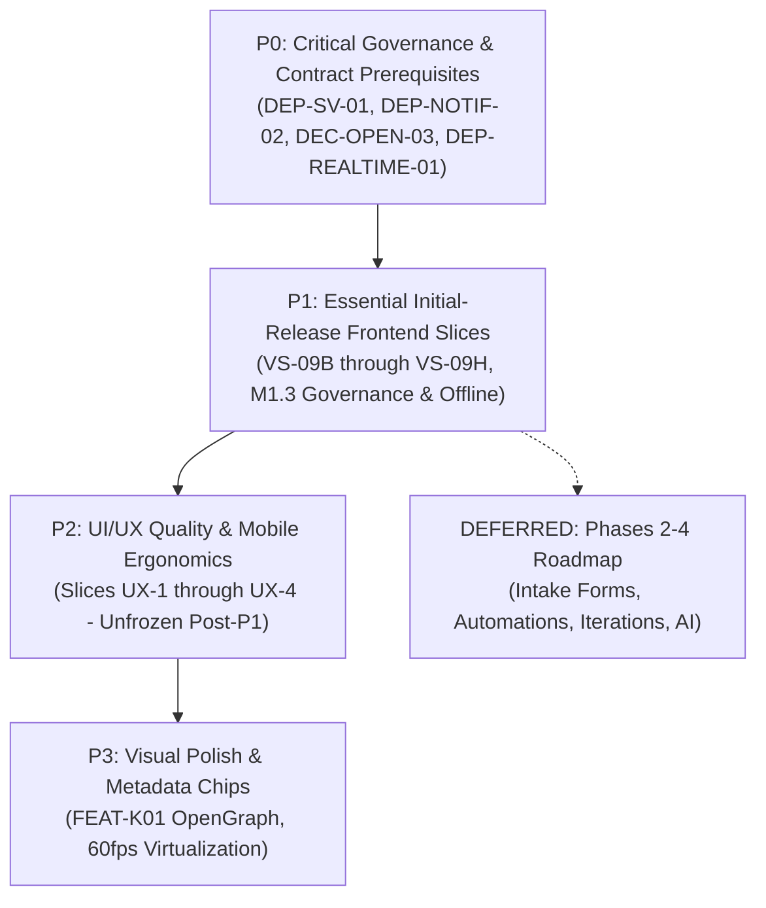

# SONDER — MASTER FRONTEND DELIVERY AUDIT & OVERALL DELIVERY TRACKER

**Document Version:** 1.0.0  
**Audit Date:** 2026-11-12  
**Active Feature Branch:** `feat/FE-VS09A-task-archive-undo`  
**Frozen Implementation HEAD:** `0b82ef93110b18f6f2b032d66f5b632cde7975fa` (`0b82ef9`)  
**Latest Documentation Commit:** `60fc318eebadd052337ceced899ef6f33131ee54` (`60fc318`)  
**Develop Baseline Commit:** `develop @ 7f295bf472a0af6482d19622f4b72bdac22c3882`  
**Branch Commit Distance:** 9 commits ahead of develop (8 implementation + 1 documentation)  
**Working Tree Status:** Clean  
**Governing Standard:** Dual-Track Engineering & UI/UX Governance (PLAN → GRILL → IMPLEMENT → TEST → REVIEW → LOCK → DOCUMENT)  
**Audit Authorization:** Project Owner Formal Master Delivery Audit (Request 10)  

---

## 1. Executive Project Dashboard

### 1.1 Quality Gate & Automated Verification Status

| Verification Gate | Result | Metric / Scope | Evidence & Execution Command |
| :--- | :---: | :--- | :--- |
| **Monorepo Unit & Integration Tests** | **PASS** | 51 test suites, 538 tests passing (100%) | `pnpm test` (Vitest v3.2.7, jsdom environment) |
| **Task Domain Regression Suite** | **PASS** | 319 / 319 tests passing | `vitest run src/modules/tasks` |
| **Archive & Undo Recovery Suite** | **PASS** | 32 / 32 tests passing | `vitest run src/modules/tasks/TaskArchive.test.tsx` |
| **Multi-Module Integration E2E** | **PASS** | 24 / 24 tests passing | `vitest run src/modules/tasks/TaskIntegrationE2E.test.tsx` |
| **TypeScript Typecheck** | **PASS** | 0 errors across monorepo | `pnpm typecheck` (`@sonder/contracts` + `@sonder/web`) |
| **Production Production Build** | **PASS** | 3,137 modules transformed, dist built cleanly in 3.55s | `pnpm build` (`vite build`) |
| **Master Documentation Validation** | **PASS** | 51 / 51 checks passed | `python3 Community-Work-Management-v1.5/validation/validate_v1_5.py` |
| **OpenAPI Contract Inventory** | **PASS** | 95 paths, 118 operations, 201 schemas, 31 workspace events | Candidate `0.3.20-draft` (`Community-Work-Management-v1.5/docs/contracts/openapi.yaml`) |
| **Browser Runtime Verification** | **PASS** | Multi-viewport journeys A & B, non-stealing focus, touch targets | Playwright Chromium (1280x800 desktop, 375x667 mobile) |

### 1.2 Quantitative Capability Status Distribution

Across the approved Master Specification (`Community-Work-Management-Master-Specification-v1.5.0.md`) and Master PRD (`Community-Work-Management-v1.5/docs/01-product/master-prd.md`), exactly **70 canonical `FEAT-` patterns** are cataloged and reconciled:
- **53 Actionable Concrete Capabilities** (Families A through L)
- **7 Composite Parent Headings** (Decomposed into child sub-features)
- **10 Research Family Range Bounds** (Non-actionable boundary markers)



| Status Classification | Count | Description & Invariant Boundaries |
| :--- | :---: | :--- |
| **DONE** | **18** | Frontend client implementation verified in `apps/web/src/` with passing Vitest tests against MSW local mock fixtures. Live backend persistence, ACID guarantees, and production infrastructure remain pending. |
| **PARTIAL** | **3** | Core contracts or data types exist, but UI presentation or user workflows remain incomplete (`FEAT-B02`, `FEAT-D05a`, `FEAT-K01`). |
| **NOT STARTED (Phase 1)** | **9** | Approved Phase 1 features with schemas in candidate OpenAPI 0.3.20-draft, awaiting frontend vertical slice implementation. |
| **DECISION BLOCKED** | **3** | Implementation paused by formal governance decision (`FEAT-C04` Saved Views, `FEAT-C06` Swimlanes, `FEAT-G02b` Custom Roles). |
| **BACKEND DEPENDENT** | **1** | Blocked on live backend gateway infrastructure (`FEAT-F02` Realtime Collaboration / `DEP-REALTIME-01`). |
| **DEFERRED (Phases 2–4)** | **12** | Approved product roadmap capabilities scheduled for Phase 2, Phase 3, or Phase 4. |
| **REJECTED / OUT OF SCOPE**| **7** | Explicitly excluded to protect community simplicity and prevent enterprise cognitive bloat. |
| **TOTAL ACTIONABLE** | **53** | **Sum: 18 + 3 + 9 + 3 + 1 + 12 + 7 = 53** |

### 1.3 Completion Percentages Across Clearly Defined Denominators

```
================================================================================
SONDER PLATFORM PROGRESS METRICS (AUDIT BASELINE 2026-11-12)
================================================================================
1. Frontend Engineering (Non-Rejected Scope):
   - Strict (DONE only):               18 / 46 = 39.13%
   - Weighted (DONE + 0.5 * PARTIAL): (18 + 1.5) / 46 = 42.39%

2. Phase 1 Initial Production Scope (34 Capabilities):
   - Strict (DONE only):               18 / 34 = 52.94%
   - Weighted (DONE + 0.5 * PARTIAL): (18 + 1.5) / 34 = 57.35%
   - Remaining Phase 1 Work:           16 capabilities (3 Partial, 9 Not Started, 3 Blocked, 1 Dependent)

3. UI/UX Track B (Separate Workstream):
   - Research & Design Principles:     100% Approved (PR #4, 92e984e)
   - Baseline Screen Audit:            10 / 10 Core Views Audited (100%)
   - Identified Findings:              14 Findings (0 Critical, 2 High, 5 Medium, 7 Low)
   - Implementation Slices:            4 Slices Planned (UX-1, UX-2, UX-3, UX-4)
   - Workstream Status:                STRICTLY PAUSED (0% Executed) by governance order

4. Backend Integration Readiness (Track C):
   - Candidate OpenAPI Operations:     118 operations across 95 paths (v0.3.20-draft)
   - Operations Mocked in MSW:         42 / 118 operations (35.59%)
   - Formally Frozen Contracts:        0 / 118 operations (Candidate is draft; live BE pending)
   - Live Backend Verified:            0 / 118 operations (0.00% - live BE services pending)

5. Overall Monorepo Verification:
   - Automated Tests:                  538 / 538 passing (100%)
   - Monorepo Compilation:             0 TypeScript errors across 2 projects (100%)
   - Production Asset Build:           Built cleanly in 3.55s (100%)
   - Spec & Schema Validation:         51 / 51 checks passing (100%)
================================================================================
```

---

## 2. Overall Feature Inventory (All 70 Canonical Patterns)

### 2.1 Group 1: Actionable Concrete Capabilities (53 Features)

| Feature ID | Canonical Name | Target Milestone | Status | Components & Modules | Test Evidence | Backend Readiness | Dependencies |
| :--- | :--- | :---: | :---: | :--- | :--- | :--- | :--- |
| **FEAT-A01** | Work-Item Archetypes (`TASK`, `DELIVERABLE`, `BUG`, `DECISION`) | M1.2 | **NOT STARTED** | None (`itemType` defaults to `TASK`) | None | Schema in OpenAPI `0.3.20-draft` | None |
| **FEAT-A02** | Fast Task Creation, Editing & Assignment | M1.1 | **DONE** | `QuickTaskComposer.tsx`, `TaskPeekDrawer.tsx` | `TaskPeekDrawer.test.tsx` (28), `tasks.test.tsx` (24) | MSW handler: `POST /tasks`, `GET /tasks/{id}` | Live DB persistence pending |
| **FEAT-A03** | Core Task Metadata (Status, Priority, Dates, Labels, Estimate) | M1.1 | **DONE** | `InlineFieldEditors.tsx`, `useUpdateTask.ts` | `InlineTaskEditing.test.tsx` (35) | MSW handler: `PATCH /tasks/{id}` | Live DB field validation pending |
| **FEAT-A04** | Comments, @Mentions, #KEY Links & Task Watchers | M1.1 | **DONE** | `CommentComposer.tsx`, `markdown-ast.tsx`, `TaskWatchButton.tsx` | `TaskCollaboration.test.tsx` (24), `TaskCollaborationHardening.test.tsx` (22) | MSW handlers: comments, watch status | `DEP-COLLAB-01` (DB watcher persistence), `DEP-REALTIME-01` |
| **FEAT-A05a**| Task File Attachments & Binary Uploads | Excluded | **REJECTED** | None | None | Excluded per PRD §2.3 | Day-1 simplicity protection |
| **FEAT-A05b**| Workspace File Management Hub | Excluded | **REJECTED** | None | None | Excluded per PRD §2.3 | Day-1 simplicity protection |
| **FEAT-A06** | Subtasks (Depth 1..2) & Dependency Links (BLOCKS DAG) | M1.1 | **DONE** | `SubtaskList.tsx`, `ReparentTaskModal.tsx`, `TimelineDependencyConnectors.tsx` | `SubtaskHierarchy.test.tsx` (26), `TimelineDependencies.test.tsx` (28) | MSW handlers: `/tasks/{id}/links`, parentId update | DB recursive cycle check pending |
| **FEAT-A07** | Task & Checklist Cloning (Duplicate Task) | M1.2 | **NOT STARTED** | None | None | Schema in OpenAPI: `POST /tasks/{id}/clone` | None |
| **FEAT-A08** | Fractional Ranking & Manual Ordering (`rankKey` / LexoRank) | M1.1 | **DONE** | `TaskBoardView.tsx`, `TaskListView.tsx` | `TaskViews.test.tsx` (38), `CrossViewIntegration.test.tsx` (12) | MSW handler: `POST /tasks/{id}/move` | Server LexoRank rebalance job pending |
| **FEAT-A09** | Granular Time Tracking & Billable Worklogs | Excluded | **REJECTED** | None | None | Excluded per PRD §2.3 | Day-1 simplicity protection |
| **FEAT-A10a**| Single-Item Archive & 10s Undo Toast (`Z` hotkey) | M1.1 | **DONE** | `TaskActionsMenu.tsx`, `TaskUndoContext.tsx`, `TaskUndoToast.tsx`, `useArchiveTask.ts` | `TaskArchive.test.tsx` (32) | MSW handlers: `POST /tasks/{id}/archive`, `POST /tasks/{id}/restore` | Frozen at `0b82ef9` |
| **FEAT-A10b**| Bulk Action Bar (<=100 tasks) & 30-Day Trash Recovery View | M1.2 | **NOT STARTED** | None | None | Schemas: `/trash/tasks`, `/tasks/bulk` | `DEP-TRASH-01` (`DEC-OPEN-03` purge policy) |
| **FEAT-A10c**| Granular Field-Revision Snapshot Restore | Phase 3 | **DEFERRED** | None | None | Deferred to Phase 3 | Phase 3 timeline |
| **FEAT-B01** | Multi-Community, Workspace Spine & Responsive App Shell | M1.1 | **DONE** | `AppShell.tsx`, `NavigationRail.tsx`, `WorkspaceSwitcher.tsx` | `AppShell.test.tsx` (14), `WorkspaceSwitcher.test.tsx` (22) | MSW handlers: `/workspaces`, `/me` | Live workspace tenancy pending |
| **FEAT-B02** | Backlog Status Category & Collapsible Tray | M1.1 | **PARTIAL** | `BACKLOG` category mapped in status types | `TaskViews.test.tsx` (partial) | Backend status enum supports `BACKLOG` | Collapsible tray UI pending |
| **FEAT-B03** | Opt-In Timeboxed Iterations / Cycles | Phase 4 | **DEFERRED** | None | None | Deferred to Phase 4 | Agile cycles scope |
| **FEAT-B04** | Workspace Milestones & Target Buckets | M1.2 | **DONE** | `TimelineMilestoneMarkers.tsx`, `MilestoneDialog.tsx` | `TimelineView.test.tsx` (36) | MSW handlers: `/milestones` | Live milestone persistence pending |
| **FEAT-B05** | Enterprise Scenario Sandbox & Capacity Modeling | Excluded | **REJECTED** | None | None | Excluded per community focus | Day-1 simplicity protection |
| **FEAT-C01** | Synchronized List View (TreeGrid) & Kanban Board View | M1.1 | **DONE** | `TaskListView.tsx`, `TaskBoardView.tsx`, `TaskViewToolbar.tsx` | `TaskViews.test.tsx` (38), `CrossViewIntegration.test.tsx` (12) | MSW handlers: `/tasks/query` | Live multi-client sync pending |
| **FEAT-C02** | Synchronized Calendar View & Dependency Gantt Timeline View | M1.2 | **DONE** | `CalendarView.tsx`, `TimelineView.tsx` | `CalendarView.test.tsx` (34), `TimelineView.test.tsx` (36) | MSW handlers: `/tasks/query` | Live multi-client sync pending |
| **FEAT-C03** | Personal Cross-Workspace Dashboard ("My Work") | M1.1 | **DONE** | `MyWorkView.tsx`, `DateTriageBuckets.tsx` | `MyWorkView.test.tsx` (24) | MSW handler: `POST /my-work/query` | Cross-workspace aggregation indexing |
| **FEAT-C04** | Saved Views (Personal vs Shared Views) | M1.1 | **DECISION BLOCKED** | Proposed OpenAPI draft (`proposed-saved-views-openapi.yaml`) | None | Candidate schema drafted | Blocked on Decisions A–E (`DEP-SV-01`) |
| **FEAT-C05** | Omnibar (`Cmd+K`), Global Search & Filtered Facets | M1.1 | **DONE** | `OmnibarModal.tsx`, `SearchFilterBar.tsx` | `OmnibarModal.test.tsx` (18) | MSW handler: `GET /search` | Backend full-text search indexing |
| **FEAT-C06** | Board Swimlanes & Card Property Visibility | M1.2 | **DECISION BLOCKED** | None | None | Blocked on Saved Views Decision D | Blocked on Decision D (`DEP-SV-01`) |
| **FEAT-C07** | Permanent Task Keys (`PREFIX-NUM`) & History Link Unification | M1.1 | **DONE** | Task key resolver, URL deep links | `TaskPeekDrawer.test.tsx` (28) | MSW handler: `GET /tasks/by-key/{key}` | Community prefix registry enforcement |
| **FEAT-D01** | 5-Category Workflow Spine & Custom Status Workflow Settings | M1.1 | **NOT STARTED** | Status enum defined in types | None | Schema in OpenAPI `0.3.20-draft` | None |
| **FEAT-D02** | Enterprise Workflow Schemes & Mandatory Transitions | Excluded | **REJECTED** | None | None | Excluded per community simplicity | Out of scope |
| **FEAT-D03** | Optional Single-Step Status Sign-Off / Approval | Phase 3 | **DEFERRED** | None | None | Deferred to Phase 3 | Phase 3 timeline |
| **FEAT-D04a**| Core Custom Fields (Text, Number, Single-Select) | M1.2 | **NOT STARTED** | Custom field types in contracts | None | Schemas: `/custom-fields` | Settings UI pending |
| **FEAT-D04b**| Extended Custom Fields (Multi-Select, User Picker, Date) | Phase 2 | **DEFERRED** | None | None | Deferred to Phase 2 | Phase 2 timeline |
| **FEAT-D05a**| Built-in Starter Templates (General Purpose, Sprint, Event) | M1.2 | **PARTIAL** | Template seed definitions in OpenAPI | None | Schema: `GET /workspace-templates` | Template picker modal pending |
| **FEAT-D05b**| Custom Workspace & Reusable Checklist Templates | Phase 2 | **DEFERRED** | None | None | Deferred to Phase 2 | Phase 2 timeline |
| **FEAT-E01** | Workspace Overview, Completion & Workload Summary | M1.2 | **DONE** | `WorkspaceOverview.tsx`, `SummaryCards.tsx` | `WorkspaceOverview.test.tsx` (18) | MSW handler: `GET /workspaces/{id}/summary` | Aggregation queries pending BE |
| **FEAT-E02** | Agile Burndown, Velocity & Cumulative Flow Charts | Phase 4 | **DEFERRED** | None | None | Deferred to Phase 4 | Phase 4 timeline |
| **FEAT-E03** | Configurable Multi-Gadget Custom Dashboard Builder | Excluded | **REJECTED** | None | None | Excluded in favor of My Work & Overview | Out of scope |
| **FEAT-F01a**| Segmented In-App Notification Center (REST Inbox) | M1.2 | **DONE** | `NotificationCenter.tsx`, `InboxView.tsx` | `Notifications.test.tsx` (19) | MSW handlers: `/notifications` | Live event dispatch, `DEP-NOTIF-02` |
| **FEAT-F01b**| Custom Reminder Rules & Scheduled Email Digests | Phase 2 | **DEFERRED** | None | None | Deferred to Phase 2 | Email infra pending |
| **FEAT-F02** | Real-Time Collaborative Updates & Presence | M1.1 | **BACKEND DEPENDENT** | WebSocket consumer abstraction | None | Candidate protocol defined | Blocked on Gateway (`DEP-REALTIME-01`) |
| **FEAT-G01** | Authentication, Session Lifecycle, Cookies & CSRF Spine | M1.1 | **DONE** | `auth/`, `csrf.ts`, session restore hooks | `AuthFlow.test.tsx` (25) | MSW handlers: `/auth/*`, `/me` | Live auth service & cookies pending |
| **FEAT-G02a**| Capability RBAC Engine, 4 System Roles & Permission Gates | M1.1 | **DONE** | `rbac/`, `PermissionGate.tsx` | `WorkspaceSwitcher.test.tsx` (22) | RBAC matrix in contracts | Server RLS policies pending |
| **FEAT-G02b**| Configurable Custom Roles Builder UI | M1.3 | **DECISION BLOCKED** | None | None | Blocked on simulator contract | Blocked on `DEP-ROLES-01` |
| **FEAT-G03** | Plain-Language Permission Inspector & Role Simulator | M1.3 | **NOT STARTED** | `X-Preview-Role-Id` supported in OpenAPI | None | Header simulator contract defined | Banner UI pending |
| **FEAT-G04** | Append-Only Hash-Chained Audit Log Table & CSV Export | M1.3 | **NOT STARTED** | None | None | Schemas: `/audit-events` | Audit table UI pending |
| **FEAT-H01** | Declarative 1-Hop Workflow Automations | Phase 3 | **DEFERRED** | None | None | Deferred to Phase 3 | Automation engine pending |
| **FEAT-H02** | Outbound HMAC-Signed HTTPS Webhooks | Phase 3 | **DEFERRED** | None | None | Deferred to Phase 3 | Egress & SSRF hardening |
| **FEAT-I01** | Lightweight Shareable Workspace Intake Forms | Phase 2 | **DEFERRED** | None | None | Deferred to Phase 2 | Anonymous access scope |
| **FEAT-I02** | Full ITSM Helpdesk Suite, SLA Clocks & Incident Command | Excluded | **REJECTED** | None | None | Excluded per community focus | Out of scope |
| **FEAT-J01a**| Filtered View UTF-8 CSV Export | M1.2 | **NOT STARTED** | None | None | Client-side export algorithm | Toolbar button pending |
| **FEAT-J01b**| Guided CSV Import Wizard with Dry-Run Validation | Phase 2 | **DEFERRED** | None | None | Deferred to Phase 2 | Phase 2 timeline |
| **FEAT-J02** | Selected-Field Offline Task Editing & Queued Sync | M1.3 | **NOT STARTED** | None | None | IndexedDB queue specification (CR-15) | Sync engine pending |
| **FEAT-J03** | Accessible Design System Primitives & Tokens (WCAG 2.2 AA) | M1.1 | **DONE** | `index.css`, `design-tokens.ts`, `keyboard.ts`, `theme.tsx`, `reduced-motion.ts` | 4 foundation suites (24 tests, 70 static expect sites) | Token standards in `@theme` | Operational rate limit / PITR pending |
| **FEAT-K01** | External Smart URL Metadata Chips (GitHub, Figma, Docs) | M1.2 | **PARTIAL** | Plain URLs render safely in markdown | `markdown-ast.test.tsx` (25) | Metadata scrape endpoint pending | OpenGraph chip UI pending |
| **FEAT-L01** | Optional AI Task Breakdown & Thread Summarization | Phase 4 | **DEFERRED** | None | None | Deferred to Phase 4 | LLM gateway pending |

### 2.2 Group 2: Composite Parent Identifiers (7 Headings)

| Pattern | Composite Title & Definition | Decomposed Child Features | Accounting Rule |
| :--- | :--- | :--- | :--- |
| **FEAT-A05** | Attachments, Workspace File Index & Activity Changelog | Decomposed into `FEAT-A05a` (Rejected), `FEAT-A05b` (Rejected), and Activity Changelog | Activity diff history implemented under `FEAT-A02`/`FEAT-A04`; files rejected. |
| **FEAT-A10** | Multi-Select Bulk Operations, Archive & 30-Day Trash | Decomposed into `FEAT-A10a`, `FEAT-A10b`, `FEAT-A10c` | Evaluated strictly via child sub-features in Group 1. |
| **FEAT-D04** | Custom Fields & Field Visibility Registry | Decomposed into `FEAT-D04a` (Phase 1) and `FEAT-D04b` (Phase 2) | Evaluated strictly via child sub-features in Group 1. |
| **FEAT-D05** | Built-in Workspace Starter Templates | Decomposed into `FEAT-D05a` (Phase 1) and `FEAT-D05b` (Phase 2) | Evaluated strictly via child sub-features in Group 1. |
| **FEAT-F01** | Unified Notification Inbox, Preferences & Reminders | Decomposed into `FEAT-F01a` (Phase 1 REST) and `FEAT-F01b` (Phase 2 Digests) | Evaluated strictly via child sub-features in Group 1. |
| **FEAT-G02** | Role-Based Access Control (RBAC) & Custom Roles | Decomposed into `FEAT-G02a` (Core RBAC) and `FEAT-G02b` (Custom Roles) | Evaluated strictly via child sub-features in Group 1. |
| **FEAT-J01** | CSV Task Import & Export with Validation Preview | Decomposed into `FEAT-J01a` (Phase 1 Export) and `FEAT-J01b` (Phase 2 Import) | Evaluated strictly via child sub-features in Group 1. |

### 2.3 Group 3: Historical Research Family Boundary References (10 References)

| Pattern | Research Boundary Context | Accounting Status |
| :--- | :--- | :--- |
| **FEAT-B08** | Family B Upper Range Bound (`FEAT-B01 to FEAT-B08`) | Non-actionable research range boundary marker. |
| **FEAT-C08** | Family C Upper Range Bound (`FEAT-C01 to FEAT-C08`) | Non-actionable research range boundary marker. |
| **FEAT-D07** | Family D Upper Range Bound (`FEAT-D01 to FEAT-D07`) | Non-actionable research range boundary marker. |
| **FEAT-E07** | Family E Upper Range Bound (`FEAT-E01 to FEAT-E07`) | Non-actionable research range boundary marker. |
| **FEAT-F04** | Family F Intermediate Research Citation | Non-actionable research reference. |
| **FEAT-F06** | Family F Upper Range Bound (`FEAT-F01 to FEAT-F06`) | Non-actionable research range boundary marker. |
| **FEAT-G08** | Family G Upper Range Bound (`FEAT-G01 to FEAT-G08`) | Non-actionable research range boundary marker. |
| **FEAT-H05** | Family H Upper Range Bound (`FEAT-H01 to FEAT-H05`) | Non-actionable research range boundary marker. |
| **FEAT-I05** | Family I Upper Range Bound (`FEAT-I01 to FEAT-I05`) | Non-actionable research range boundary marker. |
| **FEAT-J06** | Family J Upper Range Bound (`FEAT-J01 to FEAT-J06`) | Non-actionable research range boundary marker. |

---

## 3. Track A — Frontend Engineering Tracker

### 3.1 Domain-by-Domain Audit Findings



1. **Authentication & Identity (`FEAT-G01`):**
   - *Status:* **DONE** (Provisional Client).
   - *Implementation:* `apps/web/src/modules/auth/` (`AuthContext.tsx`, `LoginForm.tsx`, `RegisterForm.tsx`, `ProtectedRoute.tsx`).
   - *Tests:* `AuthFlow.test.tsx` (25 tests).
   - *Boundary:* Verified against local MSW mock cookies and CSRF headers. Live backend authentication service, production cookie domain policies, and Google OAuth identity linking remain pending.

2. **Workspace Management & App Shell (`FEAT-B01`):**
   - *Status:* **DONE** (Provisional Client).
   - *Implementation:* `apps/web/src/modules/app-shell/` (`AppShell.tsx`, `NavigationRail.tsx`, `Header.tsx`), `apps/web/src/modules/workspace/` (`WorkspaceSwitcher.tsx`, `WorkspaceBadge.tsx`).
   - *Tests:* `AppShell.test.tsx` (14 tests), `WorkspaceSwitcher.test.tsx` (22 tests).
   - *Boundary:* Clean responsive layout (desktop rail 48px/240px, mobile bottom sheet). Personal vs. shared workspace segregation enforced in client memory.

3. **Core Task Views Family (`FEAT-C01`, `FEAT-C02`, `FEAT-B04`):**
   - *Status:* **DONE** (Provisional Client).
   - *Implementation:* `TaskListView.tsx`, `TaskBoardView.tsx`, `CalendarView.tsx`, `TimelineView.tsx`.
   - *Shared Invariants:* All four views share identical query normalization (`useWorkspaceTasks`), filtering parameters, fractional LexoRank reordering, and instant cache updates.
   - *Tests:* `TaskViews.test.tsx` (38 tests), `CalendarView.test.tsx` (34 tests), `TimelineView.test.tsx` (36 tests), `CrossViewIntegration.test.tsx` (12 tests).

4. **Task Peek Drawer & Inline Editing (`FEAT-A02`, `FEAT-A03`):**
   - *Status:* **DONE** (Provisional Client).
   - *Implementation:* `TaskPeekDrawer.tsx`, `InlineFieldEditors.tsx`, `useUpdateTask.ts`.
   - *Behavior:* URL deep-linking (`?task=ENG-101`), optimistic mutation with snapshot rollback on error, accessible popover selectors for status and priority.
   - *Tests:* `TaskPeekDrawer.test.tsx` (28 tests), `InlineTaskEditing.test.tsx` (35 tests).

5. **Subtask Hierarchy & Dependency DAG (`FEAT-A06`):**
   - *Status:* **DONE** (Provisional Client).
   - *Implementation:* `SubtaskList.tsx`, `ReparentTaskModal.tsx`, `TimelineDependencyConnectors.tsx`.
   - *Behavior:* Depth 1–2 tree nesting strictly enforced; circular dependency detection visualizer renders SVG connector lines; reparenting modal preserves sibling order.
   - *Tests:* `SubtaskHierarchy.test.tsx` (26 tests), `TimelineDependencies.test.tsx` (28 tests).

6. **Collaboration Spine (`FEAT-A04`):**
   - *Status:* **DONE** (Provisional Client).
   - *Implementation:* `CommentComposer.tsx`, `CommentList.tsx`, `markdown-ast.tsx`, `TaskWatchButton.tsx`.
   - *Behavior:* Threaded comment feed, AST-safe markdown parser without raw HTML injection, `@mention` autocomplete menu, toggle watcher button.
   - *Tests:* `TaskCollaboration.test.tsx` (24 tests), `TaskCollaborationHardening.test.tsx` (22 tests), `markdown-ast.test.tsx` (13 tests).
   - *Dependencies:* Cross-session watcher DB persistence (`DEP-COLLAB-01`) and live WebSocket synchronization (`DEP-REALTIME-01`) pending on backend.

7. **Notification Center (`FEAT-F01a`):**
   - *Status:* **DONE** (Provisional Client).
   - *Implementation:* `NotificationCenter.tsx`, `InboxView.tsx`, `NotificationBell.tsx`.
   - *Behavior:* Header bell counter, popover preview, dedicated `/inbox` route, unread toggle filter, cursor pagination, mark-all-read mutation.
   - *Tests:* `Notifications.test.tsx` (19 tests).
   - *Dependencies:* Blocked on joint contract sign-off for notification-to-task deep linking (`DEP-NOTIF-02`).

8. **Single-Item Archive & 10s Undo (`FEAT-A10a`):**
   - *Status:* **DONE** (Frozen at `0b82ef9`).
   - *Implementation:* `TaskActionsMenu.tsx`, `TaskUndoContext.tsx`, `TaskUndoToast.tsx`, `useArchiveTask.ts`.
   - *Behavior:* Single-item archive from drawer and card menus, floating 10-second advisory undo toast with progress bar, global `Z` keyboard shortcut, server-authoritative token validation, and clean query cache rollback.
   - *Tests:* `TaskArchive.test.tsx` (32 tests).

---

## 4. Track B — Separate UI/UX Audit Tracker

### 4.1 Governance Status: STRICTLY PAUSED

> [!IMPORTANT]
> UI/UX Track B is formally **PAUSED** by Project Owner governance order. Engineering execution is prioritized on the functional Phase 1 backlog (Milestones VS-09B through VS-09H). Unfreezing Track B will occur only after the functional capability gaps are closed.

### 4.2 UI/UX Baseline Audit Inventory (14 Identified Findings)

Documented in canonical baseline audit [`docs/04-implementation/ui-ux/sonder-ui-ux-audit-baseline.md`](file:///home/samudra/Projects/VisualSCode/VisualCode/Vscoding/Sonder/docs/04-implementation/ui-ux/sonder-ui-ux-audit-baseline.md):

| Finding ID | Component / Area | Issue Description | Severity | Target Remediation Slice | Current Status |
| :--- | :--- | :--- | :---: | :---: | :---: |
| **UX-SYS-01** | Typography System | Proportional digits cause column jitter in tables | Medium | **Slice UX-1** | PAUSED |
| **UX-SYS-02** | Dark Mode Text | 10px sequence text borders on 4.5:1 contrast limit | Low | **Slice UX-1** | PAUSED |
| **UX-SYS-03** | Iconography | Lucide icons vary between 14px and 16px | Low | **Slice UX-1** | PAUSED |
| **UX-SHELL-01**| Mobile Header | Search displays `Cmd+K` shortcut pill on mobile | Medium | **Slice UX-2** | PAUSED |
| **UX-SHELL-02**| Nav Rail Tooltips | Tooltips on collapsed rail have 300ms hover delay | Low | **Slice UX-2** | PAUSED |
| **UX-TASK-01** | List View | Fixed 44px row height; no compact 36px density option | Medium | **Slice UX-3** | PAUSED |
| **UX-TASK-02** | Calendar View | Month cell `+N more` is plain text, not interactive popover | High | **Slice UX-3** | PAUSED |
| **UX-TASK-03** | Calendar Mobile | Empty day cell creation tap target is 28px icon | Medium | **Slice UX-2** | PAUSED |
| **UX-TASK-04** | Timeline View | Rapid horizontal scroll causes connector SVG frame lag | Low | **Slice UX-3** | PAUSED |
| **UX-TASK-05** | Task Peek Drawer | Breadcrumb path truncates workspace name on tablet | Low | **Slice UX-3** | PAUSED |
| **UX-TASK-06** | Quick Composer | Input lacks subtle character counter near 120 limit | Low | **Slice UX-3** | PAUSED |
| **UX-A11Y-01** | Live Announcements | View transitions lack polite `aria-live` announcement | Medium | **Slice UX-4** | PAUSED |
| **UX-A11Y-02** | Focus Management | Drawer dismissal via `Esc` drops focus to `body` | High | **Slice UX-4** | PAUSED |
| **UX-A11Y-03** | Mobile Drawer | Mobile bottom drawers lack visual drag handle pill | Low | **Slice UX-2** | PAUSED |

### 4.3 Sequential Track B Execution Plan



---

## 5. Track C — Backend Integration-Readiness Tracker

### 5.1 Contract Governance Status

- **Candidate Contract:** OpenAPI `0.3.20-draft` (`Community-Work-Management-v1.5/docs/contracts/openapi.yaml`).
- **Contract Freeze Status:** **NOT CONTRACT-FROZEN** (per Section 1.2 of Master Specification).
- **Paths & Operations:** 95 paths, 118 operations, 201 component schemas.
- **WebSocket Streaming Events:** 31 workspace event types (`WorkspaceStreamEvent`).

### 5.2 Endpoint-Level Integration Matrix

The following matrix documents the candidate API operations directly connected to frontend capabilities:

| Feature ID | Endpoint / Event Path | Method | Operation ID | Frontend Module / Hook | MSW Mock Status | Contract Status | Backend Implementation Dependency |
| :--- | :--- | :---: | :--- | :--- | :---: | :--- | :--- |
| `FEAT-G01` | `/auth/login` | POST | `login` | `useAuth.ts` | **MOCKED** | Draft | Auth service & session store |
| `FEAT-G01` | `/auth/logout` | POST | `logout` | `useAuth.ts` | **MOCKED** | Draft | Session eviction |
| `FEAT-G01` | `/me` | GET | `getMeContext` | `AuthContext.tsx` | **MOCKED** | Draft | User profile resolution |
| `FEAT-B01` | `/communities/{communityId}/workspaces` | GET | `listWorkspaces` | `WorkspaceContext.tsx` | **MOCKED** | Draft | Workspace membership query |
| `FEAT-A02` | `/communities/{communityId}/workspaces/{workspaceId}/tasks/query` | POST | `queryWorkspaceTasks` | `useWorkspaceTasks.ts` | **MOCKED** | Draft | Task indexing & filtering engine |
| `FEAT-A02` | `/communities/{communityId}/workspaces/{workspaceId}/tasks` | POST | `createTask` | `useCreateTask.ts` | **MOCKED** | Draft | Task sequencer & prefix generation |
| `FEAT-A02` | `/communities/{communityId}/workspaces/{workspaceId}/tasks/{taskId}` | GET | `getTaskById` | `useTaskDetail.ts` | **MOCKED** | Draft | Task lookup & permission filter |
| `FEAT-A02` | `/communities/{communityId}/workspaces/{workspaceId}/tasks/by-key/{taskKey}` | GET | `resolveTaskKey` | `TaskPeekDrawer.tsx` | **MOCKED** | Draft | Key index lookup (`PREFIX-N`) |
| `FEAT-A03` | `/communities/{communityId}/workspaces/{workspaceId}/tasks/{taskId}` | PATCH | `updateTask` | `useUpdateTask.ts` | **MOCKED** | Draft | Optimistic lock & field validation |
| `FEAT-A08` | `/communities/{communityId}/workspaces/{workspaceId}/tasks/{taskId}/move` | POST | `moveTask` | `useMoveTask.ts` | **MOCKED** | Draft | LexoRank calculation & rebalance |
| `FEAT-A10a`| `/communities/{communityId}/workspaces/{workspaceId}/tasks/{taskId}/archive` | POST | `archiveTask` | `useArchiveTask.ts` | **MOCKED** | Draft | Soft-delete timestamp & undo token |
| `FEAT-A10a`| `/communities/{communityId}/workspaces/{workspaceId}/tasks/{taskId}/restore` | POST | `restoreTask` | `useRestoreTask.ts` | **MOCKED** | Draft | Server-authoritative token validation |
| `FEAT-A10b`| `/communities/{communityId}/workspaces/{workspaceId}/trash/tasks` | GET | `listTrashedTasks` | Pending VS-09B | Pending | Draft | 30-day retention query (`DEP-TRASH-01`) |
| `FEAT-A10b`| `/communities/{communityId}/workspaces/{workspaceId}/tasks/bulk` | POST | `bulkMutateTasks` | Pending VS-09B | Pending | Draft | Multi-task batch transaction ($\le 100$) |
| `FEAT-A06` | `/communities/{communityId}/workspaces/{workspaceId}/tasks/{taskId}/links` | GET | `listTaskLinks` | `SubtaskList.tsx` | **MOCKED** | Draft | Dependency DAG edge query |
| `FEAT-A06` | `/communities/{communityId}/workspaces/{workspaceId}/tasks/{taskId}/links` | POST | `createTaskLink` | `useCreateTaskLink.ts` | **MOCKED** | Draft | DAG cycle validation |
| `FEAT-A04` | `/communities/{communityId}/workspaces/{workspaceId}/tasks/{taskId}/comments` | GET | `listTaskActivity` | `CommentList.tsx` | **MOCKED** | Draft | Comment pagination & timeline |
| `FEAT-A04` | `/communities/{communityId}/workspaces/{workspaceId}/tasks/{taskId}/comments` | POST | `createTaskComment` | `useCreateComment.ts` | **MOCKED** | Draft | Markdown storage & mention dispatch |
| `FEAT-A04` | `/communities/{communityId}/workspaces/{workspaceId}/tasks/{taskId}/watch` | PUT | `setTaskWatchStatus` | `useTaskWatch.ts` | **MOCKED** | Draft | Cross-session DB watcher (`DEP-COLLAB-01`) |
| `FEAT-B04` | `/communities/{communityId}/workspaces/{workspaceId}/milestones` | GET | `listMilestones` | `TimelineView.tsx` | **MOCKED** | Draft | Milestone query |
| `FEAT-C03` | `/communities/{communityId}/my-work/query` | POST | `queryMyWork` | `useMyWork.ts` | **MOCKED** | Draft | Cross-workspace aggregation query |
| `FEAT-C05` | `/communities/{communityId}/search` | GET | `searchCommunityWork` | `OmnibarModal.tsx` | **MOCKED** | Draft | Search indexing |
| `FEAT-F01a`| `/communities/{communityId}/notifications` | GET | `listNotifications` | `useNotifications.ts` | **MOCKED** | Draft | Notification feed & cursor pagination |
| `FEAT-F01a`| `/communities/{communityId}/notifications/{id}/read` | POST | `markNotificationRead` | `useNotifications.ts` | **MOCKED** | Draft | Unread state mutation |
| `FEAT-F01a`| `/communities/{communityId}/notifications/read-all` | POST | `markAllNotificationsRead` | `useNotifications.ts` | **MOCKED** | Draft | Bulk unread mutation |
| `FEAT-F02` | `/communities/{communityId}/events` | GET | `catchUpWorkspaceEvents` | `useWorkspaceEvents.ts` | Incomplete | Draft | Live WebSocket gateway (`DEP-REALTIME-01`) |
| `FEAT-C04` | `/communities/{communityId}/workspaces/{workspaceId}/saved-views` | GET | `listSavedViews` | Pending VS-07B | Blocked | Draft | Blocked on Decisions A–E (`DEP-SV-01`) |
| `FEAT-D05a`| `/communities/{communityId}/workspace-templates` | GET | `listWorkspaceTemplates` | Pending VS-09C | Pending | Draft | 3 built-in starter templates seed |
| `FEAT-E01` | `/communities/{communityId}/workspaces/{workspaceId}/summary` | GET | `getWorkspaceSummary` | `WorkspaceOverview.tsx` | **MOCKED** | Draft | Workspace task aggregation summary |

---

## 6. Phase 1 Milestone Tracker

Phase 1 encompasses the initial production release across Milestones M1.1, M1.2, and M1.3:

```mermaid
flowchart TD
    subgraph M1_1 ["Milestone M1.1: Core Spine & Daily Execution"]
        FEAT_G01["FEAT-G01 (Auth & Session) - DONE"]
        FEAT_B01["FEAT-B01 (Workspace Shell) - DONE"]
        FEAT_A02["FEAT-A02 (Fast Creation) - DONE"]
        FEAT_A03["FEAT-A03 (Metadata Editing) - DONE"]
        FEAT_A04["FEAT-A04 (Collab & Watchers) - DONE"]
        FEAT_A06["FEAT-A06 (Subtasks & DAG) - DONE"]
        FEAT_A08["FEAT-A08 (LexoRank) - DONE"]
        FEAT_A10a["FEAT-A10a (10s Undo) - DONE"]
        FEAT_C01["FEAT-C01 (List & Board) - DONE"]
        FEAT_C03["FEAT-C03 (My Work) - DONE"]
        FEAT_C05["FEAT-C05 (Omnibar) - DONE"]
        FEAT_C07["FEAT-C07 (Task Keys) - DONE"]
        FEAT_G02a["FEAT-G02a (RBAC Engine) - DONE"]
        FEAT_J03["FEAT-J03 (Design Tokens) - DONE"]
        FEAT_B02["FEAT-B02 (Backlog Tray) - PARTIAL"]
        FEAT_D01["FEAT-D01 (Workflow Spine) - NOT STARTED"]
        FEAT_C04["FEAT-C04 (Saved Views) - BLOCKED"]
        FEAT_F02["FEAT-F02 (Realtime Presence) - DEPENDENT"]
    end

    subgraph M1_2 ["Milestone M1.2: Planning & Configuration Experience"]
        FEAT_B04["FEAT-B04 (Milestones) - DONE"]
        FEAT_C02["FEAT-C02 (Calendar & Timeline) - DONE"]
        FEAT_E01["FEAT-E01 (Workspace Overview) - DONE"]
        FEAT_F01a["FEAT-F01a (Notification Inbox) - DONE"]
        FEAT_D05a["FEAT-D05a (Templates Picker) - PARTIAL"]
        FEAT_K01["FEAT-K01 (Smart URL Chips) - PARTIAL"]
        FEAT_A01["FEAT-A01 (Archetypes) - NOT STARTED"]
        FEAT_A07["FEAT-A07 (Task Cloning) - NOT STARTED"]
        FEAT_A10b["FEAT-A10b (Trash & Bulk Bar) - NOT STARTED"]
        FEAT_D04a["FEAT-D04a (Core Custom Fields) - NOT STARTED"]
        FEAT_J01a["FEAT-J01a (CSV Export) - NOT STARTED"]
        FEAT_C06["FEAT-C06 (Swimlanes) - BLOCKED"]
    end

    subgraph M1_3 ["Milestone M1.3: Governance & Production Acceptance"]
        FEAT_G03["FEAT-G03 (Permission Simulator) - NOT STARTED"]
        FEAT_G04["FEAT-G04 (Audit Log Table) - NOT STARTED"]
        FEAT_J02["FEAT-J02 (Offline Task Sync) - NOT STARTED"]
        FEAT_G02b["FEAT-G02b (Custom Roles UI) - BLOCKED"]
    end

    M1_1 --> M1_2 --> M1_3
```



### Phase 1 Breakdown:
- **Total Phase 1 Capabilities:** 34 concrete features.
- **DONE:** 18 capabilities (52.94%).
- **PARTIAL:** 3 capabilities (`FEAT-B02`, `FEAT-D05a`, `FEAT-K01`).
- **NOT STARTED:** 9 capabilities (`FEAT-A01`, `FEAT-A07`, `FEAT-A10b`, `FEAT-D01`, `FEAT-D04a`, `FEAT-G03`, `FEAT-G04`, `FEAT-J01a`, `FEAT-J02`).
- **DECISION BLOCKED:** 3 capabilities (`FEAT-C04`, `FEAT-C06`, `FEAT-G02b`).
- **BACKEND DEPENDENT:** 1 capability (`FEAT-F02`).

---

## 7. Deferred Roadmap Tracker (Phases 2–4 & Excluded)

### 7.1 Approved Deferred Product Scope (12 Capabilities)

| Feature ID | Capability Name | Target Phase | Deferred Rationale & Prerequisite |
| :--- | :--- | :---: | :--- |
| **FEAT-A10c**| Granular Field-Revision Snapshot Restore | Phase 3 | Preserves simple single-item & bulk recovery in Day-1 scope. |
| **FEAT-B03** | Opt-In Timeboxed Iterations / Cycles | Phase 4 | Preserves low cognitive overhead for lightweight community squads. |
| **FEAT-D03** | Optional Single-Step Status Sign-Off / Approval | Phase 3 | Advanced workflow governance scheduled for Phase 3. |
| **FEAT-D04b**| Extended Custom Fields (Multi-Select, User, Date) | Phase 2 | Basic custom fields (text, number, select) ship in Phase 1 (`FEAT-D04a`). |
| **FEAT-D05b**| Custom Workspace & Reusable Checklist Templates | Phase 2 | Built-in starter templates (`FEAT-D05a`) satisfy initial launch. |
| **FEAT-E02** | Agile Burndown, Velocity & Cumulative Flow Charts | Phase 4 | Dependent on timeboxed iteration cycles (`FEAT-B03`). |
| **FEAT-F01b**| Custom Reminder Rules & Scheduled Email Digests | Phase 2 | Requires transactional email dispatch infrastructure. |
| **FEAT-H01** | Declarative 1-Hop Workflow Automations | Phase 3 | Requires server automation execution engine. |
| **FEAT-H02** | Outbound HMAC-Signed HTTPS Webhooks | Phase 3 | Requires server-side egress queue and SSRF proxy protection. |
| **FEAT-I01** | Lightweight Shareable Workspace Intake Forms | Phase 2 | External guest/anonymous submission flow scheduled for Phase 2. |
| **FEAT-J01b**| Guided CSV Import Wizard with Dry-Run Validation | Phase 2 | UTF-8 CSV Export ships in Phase 1 (`FEAT-J01a`); import wizard in Phase 2. |
| **FEAT-L01** | Optional AI Task Breakdown & Thread Summarization | Phase 4 | LLM gateway integration deferred to Phase 4. |

### 7.2 Rejected / Out of Scope (7 Capabilities)

| Feature ID | Rejected Feature Name | Scope Boundary & Exclusion Rationale |
| :--- | :--- | :--- |
| **FEAT-A05a**| Task File Attachments & Binary Uploads | Excluded per PRD §2.3. Community workspaces use external document links. |
| **FEAT-A05b**| Workspace File Management Hub | Excluded per PRD §2.3. Eliminates asset hosting overhead and storage costs. |
| **FEAT-A09** | Granular Time Tracking & Billable Worklogs | Excluded per PRD §2.3. Preserves focus on delivery rather than surveillance. |
| **FEAT-B05** | Enterprise Scenario Sandbox & Capacity Modeling | Excluded to protect clean data model and low system complexity. |
| **FEAT-D02** | Enterprise Workflow Schemes & Mandatory Transitions | Excluded to prevent bureaucratic friction and rigid workflow schemes. |
| **FEAT-E03** | Configurable Multi-Gadget Custom Dashboard Builder | Excluded in favor of opinionated My Work and Workspace Overview views. |
| **FEAT-I02** | Full ITSM Helpdesk Suite, SLA Clocks & Incident Command | Excluded to maintain community work management focus. |

---

## 8. Open Decisions and Blockers Register

| Decision / Blocker ID | Affected Feature | Description & Required Resolution | Blocking Impact | Owner / Authority |
| :--- | :--- | :--- | :--- | :--- |
| **DEP-SV-01** | `FEAT-C04`, `FEAT-C06` | Formal sign-off on Saved Views Product Decisions A–E (Default view scoping, personal/shared quotas, filter normalization, swimlanes schema, default reset semantics). | Blocks Milestone VS-07B (Saved Views implementation) | Product Owner & Backend Lead |
| **DEP-TRASH-01** / **DEC-OPEN-03** | `FEAT-A10b` | Final resolution on permanent hard purge policy (explicit Owner purge vs legal hold prohibition). Purge API remains gated. | Binds backend deletion API in Milestone VS-09B | Product Owner |
| **DEP-NOTIF-02** | `FEAT-F01a` | Joint agreement on Notification-to-Task deep linking contract: Proposal A (Structured `target` object) vs Proposal B (Direct `workspaceId`/`taskKey` fields on `NotificationDto`). | Blocks deep linking from notification items to `TaskPeekDrawer` | Product Owner & Backend Lead |
| **DEP-REALTIME-01** | `FEAT-F02`, `FEAT-A04` | Deployment of live WebSocket gateway, ticket authentication handshake, and stream event routing. | Blocks live multi-client collaborative synchronization | Platform Infra & Backend Lead |
| **DEP-COLLAB-01** | `FEAT-A04` | Cross-session database persistence for task watchers. | Watchers reset upon browser session termination | Backend Lead |
| **DEP-ROLES-01** | `FEAT-G02b` | Finalization of custom role capability bundles and preview simulator schema. | Blocks Custom Roles Builder UI | Backend Lead |
| **DEC-ARCHIVE-01** | `FEAT-A10a` | Client-side retention period for advisory undo toast (10s fixed vs configurable). | Fixed 10s advisory timer in place; open for future policy review | Product Owner |
| **DEC-ARCHIVE-02** | `FEAT-A10a` | Multi-task concurrent undo queue eviction policy (FIFO vs independent timer expiration). | Independent timers active; open for future policy review | Product Owner |
| **DEC-ARCHIVE-03** | `FEAT-A10a` | Subtask undo token invalidation if parent task is modified while child is queued. | Subtask restore verifies parent existence; open for future edge review | Backend Lead |

---

## 9. Backend Handoff Checklist

### 9.1 Ready for Backend Implementation & Joint Review
- [x] **Candidate OpenAPI Spec 0.3.20-draft:** Complete 95 paths, 118 operations, 201 schemas documented.
- [x] **TypeScript Client Contract Types:** Generated and verified in `@sonder/contracts` (`pnpm typecheck`).
- [x] **MSW Mock Specifications:** Handlers in `apps/web/src/mocks/handlers/` serve as executable reference fixtures for expected backend behavior.
- [x] **Authentication & Cookie Contract:** Expects HttpOnly `sonder_session` cookie, `sonder_csrf` cookie, and `X-CSRF-Token` header.
- [x] **Problem Details Error Contract:** Conforms to RFC 9457 (`application/problem+json`) with standard fields (`type`, `title`, `status`, `detail`, `instance`, `code`).

### 9.2 Backend Prerequisites for Live Integration
1. **Live Database Migrations & Tenancy:** Community-scoped and Workspace-scoped RLS policies.
2. **Task Key Sequence Generator:** Atomically allocating consecutive integers per community prefix (`PREFIX-N`).
3. **LexoRank Rebalancing Worker:** Periodic background worker re-spacing `rankKey` strings upon collision.
4. **WebSocket Gateway:** Gateway server validating tickets produced via `POST /communities/{id}/realtime-ticket`.
5. **Notification Event Outbox:** Triggering notifications upon `@mention`, task assignment, and status changes.

---

## 10. Prioritized Remaining-Work Backlog



### P0 — Critical Governance & Contract Prerequisites (Joint FE/BE)
1. Resolve **DEP-SV-01** (Saved Views Decisions A–E) with Product Owner and Backend Lead.
2. Resolve **DEP-NOTIF-02** (Notification target schema: Proposal A vs Proposal B).
3. Confirm **DEC-OPEN-03** policy regarding permanent hard purge restrictions for Milestone VS-09B.
4. Finalize **DEP-REALTIME-01** WebSocket ticket authentication specification.

### P1 — Essential Phase 1 Initial-Release Slices (Frontend Owned)
1. **Milestone VS-09B:** 30-Day Workspace Trash Recovery View & Bulk Action Bar (`FEAT-A10b`).
2. **Milestone VS-09C:** Starter Templates Picker UI (`FEAT-D05a`).
3. **Milestone VS-09D:** Work-Item Archetypes (`TASK`, `DELIVERABLE`, `BUG`, `DECISION`) (`FEAT-A01`).
4. **Milestone VS-09E:** Task & Checklist Cloning (`FEAT-A07`).
5. **Milestone VS-09F:** Filtered View UTF-8 CSV Export (`FEAT-J01a`).
6. **Milestone VS-09G:** Collapsible Backlog Tray in List and Board views (`FEAT-B02`).
7. **Milestone VS-09H:** Workspace Settings Shell & Core Custom Fields (`FEAT-D01`, `FEAT-D04a`).
8. **Milestone M1.3 Governance:** Plain-Language Permission Inspector & Role Simulator (`FEAT-G03`).
9. **Milestone M1.3 Governance:** Append-Only Hash-Chained Audit Log Table & CSV Export (`FEAT-G04`).
10. **Milestone M1.3 Offline:** Selected-Field Offline Task Editing & Queued Sync (`FEAT-J02`, CR-15).

### P2 — Important UX, Mobile & Accessibility Completion (Track B Slices)
1. **Slice UX-1:** Design System & Contrast Hardening (`UX-SYS-01`, `UX-SYS-02`, `UX-SYS-03`).
2. **Slice UX-2:** Shell & Mobile Ergonomics (`UX-SHELL-01`, `UX-SHELL-02`, `UX-TASK-03`, `UX-A11Y-03`).
3. **Slice UX-3:** Task View Density & Interaction Polish (`UX-TASK-01`, `UX-TASK-02`, `UX-TASK-04..06`).
4. **Slice UX-4:** Deep Accessibility & Screen Reader Assurance (`UX-A11Y-01`, `UX-A11Y-02`).

### P3 — Polish & Enhancements
1. External Smart URL Metadata OpenGraph Preview Chips (`FEAT-K01`).
2. Timeline SVG connector 60fps requestAnimationFrame redraw optimization.
3. Multi-toast stacking and countdown queue visual transitions.

---

## 11. Evidence and Verification References

### 11.1 Test Evidence Files
- **Design Primitives:** [`apps/web/src/lib/design-tokens.test.ts`](file:///home/samudra/Projects/VisualSCode/VisualCode/Vscoding/Sonder/apps/web/src/lib/design-tokens.test.ts) (6 tests, 27 static expect sites), [`apps/web/src/lib/keyboard.test.tsx`](file:///home/samudra/Projects/VisualSCode/VisualCode/Vscoding/Sonder/apps/web/src/lib/keyboard.test.tsx) (10 tests), [`apps/web/src/lib/theme.test.tsx`](file:///home/samudra/Projects/VisualSCode/VisualCode/Vscoding/Sonder/apps/web/src/lib/theme.test.tsx) (5 tests), [`apps/web/src/lib/reduced-motion.test.ts`](file:///home/samudra/Projects/VisualSCode/VisualCode/Vscoding/Sonder/apps/web/src/lib/reduced-motion.test.ts) (3 tests).
- **Authentication:** [`apps/web/src/modules/auth/AuthFlow.test.tsx`](file:///home/samudra/Projects/VisualSCode/VisualCode/Vscoding/Sonder/apps/web/src/modules/auth/AuthFlow.test.tsx) (25 tests).
- **Workspace:** [`apps/web/src/modules/workspace/WorkspaceSwitcher.test.tsx`](file:///home/samudra/Projects/VisualSCode/VisualCode/Vscoding/Sonder/apps/web/src/modules/workspace/WorkspaceSwitcher.test.tsx) (22 tests), [`apps/web/src/modules/app-shell/AppShell.test.tsx`](file:///home/samudra/Projects/VisualSCode/VisualCode/Vscoding/Sonder/apps/web/src/modules/app-shell/AppShell.test.tsx) (14 tests).
- **Task Drawer & Quick Composer:** [`apps/web/src/modules/tasks/TaskPeekDrawer.test.tsx`](file:///home/samudra/Projects/VisualSCode/VisualCode/Vscoding/Sonder/apps/web/src/modules/tasks/TaskPeekDrawer.test.tsx) (28 tests), [`apps/web/src/modules/tasks/QuickTaskComposer.test.tsx`](file:///home/samudra/Projects/VisualSCode/VisualCode/Vscoding/Sonder/apps/web/src/modules/tasks/QuickTaskComposer.test.tsx) (20 tests).
- **Inline Editing & Subtasks:** [`apps/web/src/modules/tasks/InlineTaskEditing.test.tsx`](file:///home/samudra/Projects/VisualSCode/VisualCode/Vscoding/Sonder/apps/web/src/modules/tasks/InlineTaskEditing.test.tsx) (35 tests), [`apps/web/src/modules/tasks/SubtaskHierarchy.test.tsx`](file:///home/samudra/Projects/VisualSCode/VisualCode/Vscoding/Sonder/apps/web/src/modules/tasks/SubtaskHierarchy.test.tsx) (26 tests).
- **Views & Dependencies:** [`apps/web/src/modules/tasks/TaskViews.test.tsx`](file:///home/samudra/Projects/VisualSCode/VisualCode/Vscoding/Sonder/apps/web/src/modules/tasks/TaskViews.test.tsx) (38 tests), [`apps/web/src/modules/tasks/views/calendar/CalendarView.test.tsx`](file:///home/samudra/Projects/VisualSCode/VisualCode/Vscoding/Sonder/apps/web/src/modules/tasks/views/calendar/CalendarView.test.tsx) (34 tests), [`apps/web/src/modules/tasks/views/timeline/TimelineView.test.tsx`](file:///home/samudra/Projects/VisualSCode/VisualCode/Vscoding/Sonder/apps/web/src/modules/tasks/views/timeline/TimelineView.test.tsx) (36 tests), [`apps/web/src/modules/tasks/dependencies/TimelineDependencies.test.tsx`](file:///home/samudra/Projects/VisualSCode/VisualCode/Vscoding/Sonder/apps/web/src/modules/tasks/dependencies/TimelineDependencies.test.tsx) (28 tests).
- **Collaboration & Notifications:** [`apps/web/src/modules/tasks/comments/TaskCollaboration.test.tsx`](file:///home/samudra/Projects/VisualSCode/VisualCode/Vscoding/Sonder/apps/web/src/modules/tasks/comments/TaskCollaboration.test.tsx) (24 tests), [`apps/web/src/modules/tasks/comments/TaskCollaborationHardening.test.tsx`](file:///home/samudra/Projects/VisualSCode/VisualCode/Vscoding/Sonder/apps/web/src/modules/tasks/comments/TaskCollaborationHardening.test.tsx) (22 tests), [`apps/web/src/modules/notifications/Notifications.test.tsx`](file:///home/samudra/Projects/VisualSCode/VisualCode/Vscoding/Sonder/apps/web/src/modules/notifications/Notifications.test.tsx) (19 tests).
- **Archive & Recovery:** [`apps/web/src/modules/tasks/TaskArchive.test.tsx`](file:///home/samudra/Projects/VisualSCode/VisualCode/Vscoding/Sonder/apps/web/src/modules/tasks/TaskArchive.test.tsx) (32 tests), [`apps/web/src/modules/tasks/TaskIntegrationE2E.test.tsx`](file:///home/samudra/Projects/VisualSCode/VisualCode/Vscoding/Sonder/apps/web/src/modules/tasks/TaskIntegrationE2E.test.tsx) (24 tests).

### 11.2 Key Milestone Delivery Reports
- VS-09A Delivery Report: [`docs/04-implementation/vs-09a-task-archive-and-undo-delivery-report.md`](file:///home/samudra/Projects/VisualSCode/VisualCode/Vscoding/Sonder/docs/04-implementation/vs-09a-task-archive-and-undo-delivery-report.md)
- VS-09.0 Delivery Report: [`docs/04-implementation/vs-09.0-delivery-report.md`](file:///home/samudra/Projects/VisualSCode/VisualCode/Vscoding/Sonder/docs/04-implementation/vs-09.0-delivery-report.md)
- VS-08B.1 Delivery Report: [`docs/04-implementation/vs-08b.1-notification-rest-vertical-slice-delivery-report.md`](file:///home/samudra/Projects/VisualSCode/VisualCode/Vscoding/Sonder/docs/04-implementation/vs-08b.1-notification-rest-vertical-slice-delivery-report.md)
- VS-08A Delivery Report: [`docs/04-implementation/vs-08a-collaboration-spine-delivery-report.md`](file:///home/samudra/Projects/VisualSCode/VisualCode/Vscoding/Sonder/docs/04-implementation/vs-08a-collaboration-spine-delivery-report.md)
- UI/UX Baseline Audit: [`docs/04-implementation/ui-ux/sonder-ui-ux-audit-baseline.md`](file:///home/samudra/Projects/VisualSCode/VisualCode/Vscoding/Sonder/docs/04-implementation/ui-ux/sonder-ui-ux-audit-baseline.md)

---

## 12. Last-Audited Git Baseline and Audit Date

- **Audit Date:** 2026-11-12
- **Audit Type:** Repository-Wide Master Delivery Audit (Tracks A, B, C)
- **Active Branch:** `feat/FE-VS09A-task-archive-undo`
- **Frozen Implementation SHA:** `0b82ef93110b18f6f2b032d66f5b632cde7975fa` (`0b82ef9`)
- **Documentation Commit SHA:** `60fc318eebadd052337ceced899ef6f33131ee54` (`60fc318`)
- **Develop Baseline SHA:** `7f295bf472a0af6482d19622f4b72bdac22c3882`
- **Working Tree State:** Clean
- **Monorepo Passing Suites:** 51 test files, 538 tests passing (100%)
- **Governance Invariant:** No application code, tests, mocks, contracts, or build configurations were altered during this audit.
