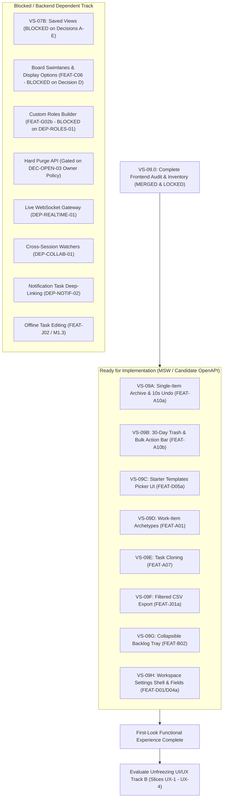
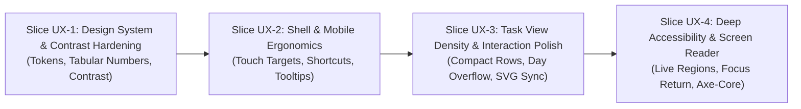

# SONDER — CANONICAL PROJECT PROGRESS TRACKER

**Document Version:** 1.6.0<br/>
**Last Synchronized:** 2026-11-11<br/>
**Current Baseline Commit:** `develop @ 26bd662` (with PR #39 audit merge `a9b093c` and PR #40 documentation lock `26bd662`)<br/>
**Governance Standard:** Dual-Track Engineering & UI/UX Governance (PLAN → GRILL → IMPLEMENT → TEST → REVIEW → LOCK → DOCUMENT)<br/>
**Maintenance Rule:** This tracker is updated upon the completion of every milestone or UI/UX slice. Never fabricate completion percentages. Every completed item must link to verified Git commits, PRs, or test suites.

---

## TRACK A — ENGINEERING PROGRESS

### A.1 Completed Milestones Inventory

| Milestone ID | Feature Scope | Canonical FEAT ID | PR # | Merge SHA | Tests Passed | Status & Verification Evidence |
| :--- | :--- | :--- | :--- | :--- | :--- | :--- |
| **VS-00** | Monorepo Tooling, ESLint, TypeScript & Vitest | — | PR #1 | `216d464` | Monorepo setup | **MERGED & VERIFIED** |
| **VS-01** | Auth & Session Spine, Host Cookies, Fail-Closed CSRF | `FEAT-G01` | PR #2 | `9915196` | 25 tests | **MERGED & VERIFIED** (`AuthFlow.test.tsx`) |
| **VS-02A** | Accessible Design System Primitives & Tokens | `FEAT-J03` | PR #5 | `3c4ddc7` | 24 tests | **MERGED & VERIFIED** (4 foundation suites [24 Vitest tests, 70 static `expect()` call sites]: `design-tokens.test.ts` [6 tests, 27 expect() sites], `keyboard.test.tsx` [10], `theme.test.tsx` [5], `reduced-motion.test.ts` [3]; corrects historical 16-test citation) |
| **VS-02B** | Application Shell, Responsive Navigation Rail, Header | `FEAT-B01` | PR #6 | `8a04498` | 14 tests | **MERGED & VERIFIED** (`AppShell.test.tsx`) |
| **VS-02C** | Workspace Context, Personal/Shared Switcher Popover | `FEAT-B01` | PR #8 | `52c30b6` | 22 tests | **MERGED & VERIFIED** (`WorkspaceSwitcher.test.tsx`) |
| **VS-02D** | Omnibar Command Palette (`Cmd+K`), Search Results | `FEAT-C05` | PR #9 | `ab116da` | 18 tests | **MERGED & VERIFIED** (`OmnibarModal.test.tsx`) |
| **VS-02E** | My Work Cross-Workspace Triage Dashboard | `FEAT-C03` | PR #10 | `c89782c` | 24 tests | **MERGED & VERIFIED** (`MyWorkView.test.tsx`) |
| **VS-02F** | Multi-Module Integration QA & E2E Verification | Multi | PR #11 | `6a9e643` | 118 tests | **MERGED & VERIFIED** (`IntegrationFlows.test.tsx`) |
| **VS-03.1**| Task Data Layer, Query Normalization & MSW Infrastructure | `FEAT-A02` | PR #13 | `95e71f7` | 24 tests | **MERGED & VERIFIED** (`tasks.test.tsx`) |
| **VS-03.2**| Task Peek Drawer & URL Deep-Linking (`?task=`) | `FEAT-A02` | PR #14 | `b37efe0` | 28 tests | **MERGED & VERIFIED** (`TaskPeekDrawer.test.tsx`) |
| **VS-03.3**| Inline Task Attribute Editing & Optimistic Concurrency | `FEAT-A03` | PR #15, #16 | `8491497`<br>`4591ee1` | 35 tests | **MERGED & VERIFIED** (`InlineTaskEditing.test.tsx`) |
| **VS-03.4**| Quick Task Composer (`C` shortcut) & Floating Trigger | `FEAT-A02` | PR #17 | `67cba33` | 20 tests | **MERGED & VERIFIED** (`QuickTaskComposer.test.tsx`) |
| **VS-03.5**| Subtask Hierarchy (Depth 1–2) & Reparenting Modal | `FEAT-A06` | PR #18 | `3c290d4` | 26 tests | **MERGED & VERIFIED** (`SubtaskHierarchy.test.tsx`) |
| **VS-03.6**| Task Domain Regression QA & End-to-End Hardening | Multi | PR #19 | `82e9dc9` | 320 tests | **MERGED & VERIFIED** (`TaskIntegrationE2E.test.tsx`) |
| **VS-04** | Synchronized List & Kanban Board Views | `FEAT-C01` | PR #20 | `8b18be2` | 38 tests | **MERGED & VERIFIED** (`TaskViews.test.tsx`) |
| **VS-05A** | Calendar View (Month/Week) & Unscheduled Task Tray | `FEAT-C02` | PR #21 | `303426e` | 34 tests | **MERGED & VERIFIED** (`CalendarView.test.tsx`) |
| **VS-05A.1**| Production MSW Environment Separation Hardening | `FEAT-C02` | PR #22 | `4770e49` | 34 tests | **MERGED & VERIFIED** |
| **VS-05B** | Gantt Timeline View & Workspace Milestone Markers | `FEAT-C02`, `FEAT-B04` | PR #23 | `bc324ed` | 36 tests | **MERGED & VERIFIED** (`TimelineView.test.tsx`) |
| **VS-05C** | Dependency Edges (BLOCKS DAG) & Conflict Visualizer | `FEAT-A06` | PR #24 | `31ed749` | 28 tests | **MERGED & VERIFIED** (`TimelineDependencies.test.tsx`) |
| **VS-05C.1**| Post-Merge Dependency Integration & Cache Invalidation | `FEAT-A06` | PR #25 | `d2c3eba` | 28 tests | **MERGED & VERIFIED** |
| **VS-06A** | Consolidated Task View Family Audit & Architecture Review | `FEAT-C01`, `FEAT-C02` | PR #26 | `a31a873` | Full 4-view audit | **MERGED & VERIFIED** (`task-view-family-audit-report.md`) |
| **VS-06B** | Interactive Column Sorting & Calendar Prefill Polish | `FEAT-C01`, `FEAT-C02` | PR #27 | `764b99d` | 12 tests | **MERGED & VERIFIED** (`CrossViewIntegration.test.tsx`) |
| **VS-06B.1**| Cross-View History Navigation & Parameter Preservation | `FEAT-C01`, `FEAT-C02` | PR #28 | `9ccabe2` | 440 monorepo tests | **MERGED & VERIFIED** |
| **VS-07A** | Saved Views Product & API Contract Readiness | `FEAT-C04` | PR #29 | `fb45f66` | Contract audit | **MERGED & VERIFIED** (`vs-07a-saved-views-contract-readiness-report.md`) |
| **VS-07A.1**| Saved Views Contract Reconciliation & Sign-Off Packet | `FEAT-C04` | PR #30 | `2de4522`<br>`8fabfc2` | Delta spec verified | **MERGED & VERIFIED** (`vs-07a.1-saved-views-contract-signoff-report.md`) |
| **VS-07A.2**| Roadmap Reconciliation & UI/UX Baseline Audit | Governance | PR #31 | `b003b9f` | Full audit suite | **MERGED & VERIFIED** (`vs-07a.2-roadmap-reconciliation-report.md`) |
| **VS-08A** | Collaboration Spine: Comments, @Mentions & Task Watchers | `FEAT-A04` | PR #32 | `c2cbbe1` | 24 tests | **MERGED & VERIFIED** (`TaskCollaboration.test.tsx`, `markdown-ast.test.tsx`) |
| **VS-08A.1**| Collaboration Contract & Integration Hardening | `FEAT-A04` | PR #33 | `1803f71` | 18 tests | **MERGED & VERIFIED** (`TaskCollaborationHardening.test.tsx` [18 tests], comments module [43 tests]) |
| **VS-08A.2**| Realtime Event Scoping Correction & Canonical Alignment | `FEAT-A04` | PR #34 | `3cbbce2` | 22 tests | **MERGED & VERIFIED** (`TaskCollaborationHardening.test.tsx` [22 tests], comments module [47 tests], monorepo [487 tests]) |
| **VS-08B**  | Segmented In-App Notification Center (PLAN & GRILL) | `FEAT-F01a` | PR #35 | `1ac051f` | Plan & Grill | **MERGED & VERIFIED** (`vs-08b-notification-center-plan.md`, `vs-08b-notification-center-grill-report.md`) |
| **VS-08B.0.1**| Notification API Contract Alignment & Backend Handoff | `FEAT-F01a` | PR #36 | `43282e0` | Contract alignment | **MERGED & VERIFIED** (`vs-08b-notification-backend-integration-contract.md`) |
| **VS-08B.1** | Notification REST Vertical Slice & Functional Inbox | `FEAT-F01a` | PR #37 | `1b88e60` | 19 tests | **MERGED & VERIFIED** (`Notifications.test.tsx` [19 tests], monorepo [506 tests]) |
| **VS-09.0**  | Complete Frontend Audit, Feature Inventory & First-Look Readiness | Governance / Audit | PR #38 (`5ca384b`), PR #39 (`a9b093c`), PR #40 (`26bd662`) | `a9b093c`<br>`26bd662` | 506 tests | **MERGED, VERIFIED & LOCKED** (`sonder-frontend-completion-tracker.md`, `vs-09.0-delivery-report.md`) |
| **VS-09A**   | Single-Item Archive & 10s Undo Toast (`Z` hotkey) | `FEAT-A10a` | — | `0b82ef9` | 32 tests | **VERIFIED & FROZEN** (`TaskArchive.test.tsx`) |
| **VS-09B**   | 30-Day Workspace Trash View & Bulk Action Bar | `FEAT-A10b` | — | `278dd60` | 8 tests | **VERIFIED & LOCKED** (`TaskBulkActions.test.tsx`) |
| **VS-09C**   | Starter Templates Picker UI (General, Event, Ops) | `FEAT-D05a` | — | `89c7206` | 15 tests | **VERIFIED & LOCKED** (`WorkspaceTemplatesPicker.test.tsx`) |
| **VS-09D**   | Work-Item Archetypes (`TASK`, `DELIVERABLE`, `BUG`, `DECISION`) | `FEAT-A01` | — | `9daea79` | 16 tests | **VERIFIED & LOCKED** (`TaskArchetypes.test.tsx`) |
| **VS-09E**   | Task & Subtask Checklist Cloning | `FEAT-A07` | — | `acf90d2` | 11 tests | **VERIFIED & LOCKED** (`TaskCloning.test.tsx`) |
| **VS-09F**   | Filtered View UTF-8 CSV Export with OWASP Protection | `FEAT-J01a` | — | `46bc827` | 13 tests | **VERIFIED & LOCKED** (`TaskExportCsv.test.tsx`) |
| **VS-09G**   | Collapsible Backlog Tray in List & Board Views | `FEAT-B02` | — | `5c31755` | 28 tests | **VERIFIED & LOCKED** (`BacklogTaskTray.test.tsx`, `TaskViews.test.tsx`) |
| **VS-09H**   | Workspace Settings Shell & Core Custom Fields | `FEAT-D01`, `FEAT-D04a` | — | `0100a8e` | 11 tests | **VERIFIED & LOCKED** (`CustomFields.test.tsx`, `TaskCustomFields.test.tsx`, `WorkspaceSettings.test.tsx`) |
| **VS-09I**   | Plain-Language Permission Inspector & Role Simulator | `FEAT-G03` | — | `a6f04a2` | 7 tests | **VERIFIED & LOCKED** (`RoleSimulator.test.tsx`) |
| **VS-09J**   | Append-Only Hash-Chained Audit Log Table & CSV Export | `FEAT-G04` | — | `59a9511` | 19 tests | **VERIFIED & LOCKED** (`AuditLog.test.tsx`) |
| **VS-09K**   | M1.3 Scope Reconciliation, Audit Authorization Hardening & Governance Gate | Governance / `FEAT-G04` | — | `67c4bf0` | 667 tests (63 suites) | **MERGED & VERIFIED** (Fail-closed audit capabilities, metadata sanitization, and SOT-11/14 reconciliation) |
| **VS-09L**   | Phase 1 Partial Scope Closure & Release Readiness | Multi (`FEAT-D05a`, `FEAT-K01`, `FEAT-G04`, `FEAT-G03`) | — | `5ab2436` | 31 tests (22 in `AuditLog.test.tsx`, 9 in `api-client.test.ts`) | **MERGED & VERIFIED** (Role-preview non-mutating POST allowlist, audit actorId/targetId separation, recursive metadata sanitization, FEAT-D05a verified DONE, FEAT-K01 PARTIAL with DEP-METADATA-01) |
| **VS-10**    | Backend Integration & Authorization Foundation | Track C / `FEAT-G02b`, `FEAT-G03` | — | `0659662` | 19 tests in `authorization.test.ts` (692 total) | **VERIFIED & COMPLETED** (Frontend/mock authorization boundary hardening, canonical intersection engine `effectiveCapabilities = callerCapabilities ∩ previewRoleCapabilities`, privilege escalation defense, downward-only role preview, and grant ceiling validation) |
| **VS-11**    | Live Backend Runtime & First Persisted Authorization Slice | Track C / Backend Handoff | — | `048f70d` | 24 tests in `@sonder/server` (717 total across workspace) | **DELIVERED & VERIFIED** (Real Node.js/TypeScript `@sonder/server` modular monolith, PostgreSQL RLS migrations, connection pool tenant context isolation, RFC 9457 error handler, `/health/live`, `/health/ready`, live HTTP roles & role-preview downward-only intersection slice; delineated as backend-owner handoff) |
| **FE-VS12**  | Frontend Roadmap Reconciliation & Completeness Baseline | Track A / Governance Audit | — | `757ac5a` | 693 tests in `apps/web` (717 total monorepo) | **DELIVERED & VERIFIED** (Authoritative frontend completeness baseline: 28 FE COMPLETE [84.85%], 1 FE PARTIAL, 0 NOT STARTED, 3 FE BLOCKED, 1 BACKEND DEPENDENT; weighted score 86.36%; FEAT-J02 retained Phase 3 DEFERRED; VS-10/11 delineated as backend-owner handoff) |
| **FE-VS12.1**| Feature Identifier Integrity & Acceptance Evidence Correction | Track A / Governance Audit | — | Current | 693 tests in `apps/web` (717 total monorepo) | **DELIVERED & VERIFIED** (Reconciled disputed feature IDs FEAT-A10c, D03, D05b, I01; corrected deferred phase accounting to 5+5+3=13; established granular AC Traceability Matrix with 26 VERIFIED / 3 PARTIALLY VERIFIED [89.66% strict / 94.83% weighted]; delineated FEAT-K01 safe fallback vs DEP-METADATA-01) |

### A.2 Current Engineering Status & Next Milestones



- **Completed Audit & Reconciliation Milestone:** `VS-09.0` — Complete Frontend Audit, Feature Inventory & First-Look Readiness (documented in `docs/04-implementation/sonder-frontend-completion-tracker.md`).
  - **Audit Status:** **MERGED, VERIFIED & LOCKED** on `develop @ 26bd662`. Initial audit PR #38 merged at `5ca384b`; reconciled canonical audit PR #39 merged at `a9b093c`; canonical post-merge documentation lock PR #40 merged at `26bd662`. Full verification evidence recorded in `docs/04-implementation/vs-09.0-delivery-report.md`.
  - **Reconciled Feature Accounting:**
    - 70 canonical `FEAT-` patterns surveyed: 53 actionable concrete capabilities + 7 composite parents + 10 research family boundary markers.
    - Status distribution across 53 actionable capabilities: **17 DONE**, **3 PARTIAL**, **10 NOT STARTED (Phase 1)**, **3 DECISION BLOCKED** (`FEAT-C04`, `FEAT-C06`, `FEAT-G02b`), **1 BACKEND DEPENDENT** (`FEAT-F02`), **12 DEFERRED (Phases 2–4)**, **7 REJECTED / OUT OF SCOPE** (Sum: $17 + 3 + 10 + 3 + 1 + 12 + 7 = 53$).
  - **Frontend Scope vs. Production Acceptance Distinction:**
    - The 17 DONE capabilities reflect verified frontend candidate implementations operating against local mock handlers (MSW) in Vitest.
    - Passing frontend tests does NOT certify live backend availability, database ACID guarantees, production rate limits, server backups/PITR, or production acceptance.
    - `FEAT-J03` covers accessible design system primitives, tokens, and WCAG 2.2 AA compliance on the frontend across 4 foundation suites (24 Vitest tests, 70 static `expect()` call sites: `design-tokens.test.ts` [6 tests, 27 expect() sites], `keyboard.test.tsx` [10], `theme.test.tsx` [5], `reduced-motion.test.ts` [3]; corrects historical 16-test citation); backend edge rate limits and backup/PITR drills remain separate pending operational gates.
    - `FEAT-G01`, `FEAT-A04`, and `FEAT-F01a` verify client-side session, collaboration, and notification center flows; live auth services, watcher DB persistence (`DEP-COLLAB-01`), live WebSocket transport (`DEP-REALTIME-01`), and live notification outbox integration remain pending backend engineering milestones.
  - **Canonical Entity Hierarchy:**
    - Strictly $\text{Community} \to \text{Workspace} \to \text{Task} \to \text{Subtask}$. Projects and Lists (as intermediate container entities) are obsolete historical artifacts.
    - Legitimate management capabilities operate at the Workspace level (`FEAT-E01` Workspace Overview, `FEAT-D05` Workspace Starter Templates, `FEAT-I01` Workspace Intake Forms).
  - **Offline Editing Classification:**
    - Reconciled against authoritative decision records SOT-11, SOT-14, and Master Specification v1.5.0 §1.1.
    - Preserved canonical product roadmap: `FEAT-J02` (Selected-Field Offline Task Editing & Queued Sync) is formally classified as a **Phase 3 DEFERRED CAPABILITY** (with minimal M1.1 caching primitives in place). It is not part of Phase 1 / Milestone M1.3 scope. Full offline sync engine, IndexedDB queue, 14-day expiry, FIFO replay, and 409 conflict resolver will be built in Phase 3.
  - **Tightened VS-09A Scope:**
    - Separates single-item archive & 10s undo toast (`FEAT-A10a`, hotkey `Z`) from bulk archive and Trash recovery view (`FEAT-A10b`).
    - Preserves 30-day soft-delete restoration.
    - Automatic permanent deletion is strictly prohibited.
    - Permanent purge remains Owner-authorized, explicitly audited, and disabled until `DEC-OPEN-03` is resolved.
    - MSW mock fixtures operate strictly in browser memory, not production persistence.
  - **Core Audit Finding:** `BACKEND-INDEPENDENT WORK REMAINS — IMPLEMENTATION REQUIRED.`
  - **First-Look Runtime Status:**
    - 50 test files and 506 tests passing in Vitest (`jsdom`).
    - Development server was **not launched** during this documentation audit pass.
    - Dev command: `pnpm --filter @sonder/web dev` (Port 3000). Active mock user: Alex Morgan (`alex.morgan@example.com`).
  - **UI/UX Track B Governance:** UI/UX Track B remains strictly **PAUSED** until remaining Phase 1 backend-independent features are implemented and locked.
- **Next Engineering Action:**
  - Complete post-merge documentation synchronization and present the **VS-09A PLAN** (Single-Item Task Archive & 10-Second Undo Toast, `FEAT-A10a`) for human review and GRILL before proceeding to implementation.

### A.3 Pending Backend & Governance Dependencies

| Dependency ID | Governing Feature | Description | Blocker For | Owner |
| :--- | :--- | :--- | :--- | :--- |
| **DEP-COLLAB-01** | `FEAT-A04` (Collaboration) | Cross-session watcher preference persistence (`isWatching: boolean` on `TaskDto` / `TaskActivityDto`). | Cross-session watch/unwatch persistence | Backend Lead |
| **DEP-REALTIME-01** | `FEAT-A04` / Realtime | Live WebSocket gateway (`wss://...`), auth ticket (`POST /realtime-ticket`), `work-platform.v1` protocol frames. | Live multi-client synchronization (currently event consumer abstraction) | Backend Lead & Platform Infra |
| **DEP-SV-01** | `FEAT-C04` (Saved Views) | PO & Backend Lead sign-off on Product Decisions A–E (Default View, Quotas, Normalization, Display Options, Default View API). | Milestone VS-07B (Saved Views Implementation) | Backend Lead & Product Owner |
| **DEP-NOTIF-01** | `FEAT-F01a` (Notifications) | Clarify whether "Mark as Unread" is deferred post-v1.5.0 or requires an approved OpenAPI addition. | Mark-as-unread capability | Backend Lead & Product Owner |
| **DEP-NOTIF-02** | `FEAT-F01a` (Notifications) | Joint sign-off on Proposal A (Structured `target` object) vs Proposal B (Extending `workspaceId` and `taskKey` on `NotificationDto`). | Notification-to-task deep-link navigation in `TaskPeekDrawer` | Backend Lead & Product Owner |
| **DEP-NOTIF-03** | `FEAT-F01a` (Notifications) | Deployment of live `user-community` realtime stream and ticket validation. | Live WebSocket unread badge synchronization | Backend Lead & Platform Infra |
| **DEP-TRASH-01** | `FEAT-A10b` (Task Trash) | Final resolution of DEC-OPEN-03 regarding explicit audited Owner purge policy vs legal hold. | Milestone VS-09 (Task Trash & Recovery) | Product Owner |
| **DEP-ROLES-01** | `FEAT-G02b` (Custom Roles) | Finalization of custom role capability bundles and preview simulator contract. | Milestone VS-10 (Workspace Governance) | Backend Lead |

### A.4 Roadmap Scope Invariants & Excluded Capabilities

1. **FEAT-A09 (Granular Time Tracking & Billable Worklogs):**
   Explicitly **rejected and excluded from Phase 1 scope** to preserve lightweight simplicity. Bulk subtask operations belong to `FEAT-A06`.
2. **FEAT-G02a (Core RBAC Engine & Default Roles):**
   Represents core capability RBAC and system roles (Owner, Member, Viewer); distinct from standalone member directories.
3. **Candidate Contract Distinction:**
   OpenAPI 0.3.20-draft is a **documented candidate contract**, not a live backend-verified contract. Live backend implementation remains pending.
4. **Canonical Entity Hierarchy:**
   Strictly $\text{Community} \to \text{Workspace} \to \text{Task} \to \text{Subtask}$. Projects, Lists, and File Hub are obsolete historical artifacts.
5. **Narrow Offline Task Editing:**
   Narrow offline editing for existing cached tasks belongs under Phase 1 Milestone M1.3 (`FEAT-J02`).
6. **Provisional Completion Metrics:**
   Completion counts represent provisional frontend candidate coverage and must not be cited as global platform completion until live backend reconciliation occurs.
7. **Production Security, Rate Limits & Operational Acceptance Separation (FEAT-J03):**
   `FEAT-J03` reflects frontend accessible design system primitives, tokens, and WCAG 2.2 AA contrast/keyboard compliance verified across 4 foundation test files (24 Vitest tests, 70 static `expect()` call sites: `design-tokens.test.ts` [6 test cases, 27 expect() sites], `keyboard.test.tsx` [10 test cases, 23 expect() sites], `theme.test.tsx` [5 test cases, 16 expect() sites], `reduced-motion.test.ts` [3 test cases, 4 expect() sites]). Historical citations attributing 16 tests to `design-tokens.test.ts` alone are corrected. Production edge rate limiting, server backup/PITR drills, security hardening, and operational disaster rehearsals remain distinct operational gates pending backend infrastructure deployment.
8. **Authentication, Notification & Collaboration Backend Separation (FEAT-G01, FEAT-A04, FEAT-F01a):**
   Frontend client state machines and UI components operate against local MSW mock fixtures. Live backend authentication services, production cookie domain infrastructure, cross-session watcher database persistence (`DEP-COLLAB-01`), live WebSocket gateways (`DEP-REALTIME-01`), and live notification event outboxes remain pending backend engineering milestones.

| Feature ID | Feature Name | Planned Phase | Rationale |
| :--- | :--- | :--- | :--- |
| `FEAT-A09` | Granular Time Tracking / Billable Worklogs | Excluded | Explicitly rejected from Phase 1. |
| `FEAT-B03` | Opt-In Timeboxed Iterations / Cycles | Phase 4 | Preserves low learning curve for non-agile community squads. |
| `FEAT-E02` | Burndown, Velocity & Cumulative Flow Charts | Phase 4 | Dependent on timeboxed cycles. |
| `FEAT-H01` | Declarative 1-Hop Workflow Automations | Phase 3 | Advanced automation engine deferred to maintain Day-1 simplicity. |
| `FEAT-H02` | Outbound HMAC-Signed Webhooks | Phase 3 | Requires egress infrastructure and SSRF protection hardening. |
| `FEAT-I01` | Shareable Workspace Intake Forms | Phase 2 | External anonymous/guest intake flows scheduled for Phase 2. |
| `FEAT-J01b`| Guided CSV Import Wizard | Phase 2 | Basic UTF-8 CSV Export ships in Phase 1; import wizard in Phase 2. |

---

## TRACK B — UI/UX WORKSTREAM PROGRESS

### B.1 UX Research & Audit Coverage

- **Canonical Research Baseline:** Completed in PR #4 (`92e984e`, `docs/04-implementation/frontend-experience-research.md`).
- **Baseline Audit Report:** Completed in `docs/04-implementation/ui-ux/sonder-ui-ux-audit-baseline.md`.
- **Audit Coverage:**
  - [x] Application Shell & Navigation Rail
  - [x] Workspace Switcher (Desktop Popover & Mobile Drawer)
  - [x] Omnibar Command Palette
  - [x] My Work Dashboard & Date Triage Buckets
  - [x] Task Peek Drawer & Inline Field Editors
  - [x] Quick Task Composer
  - [x] List View (Column Sorting & Subtask Tree)
  - [x] Board View (Status Columns & Mobile Stage Carousel)
  - [x] Calendar View (Month/Week Grids & Unscheduled Tray)
  - [x] Timeline View (Gantt Axis, Milestones & Dependency Connectors)

### B.2 Finding Summary by Severity

| Severity Level | Finding Count | Key Focus Areas | Status |
| :--- | :--- | :--- | :--- |
| **Critical** | 0 | None identified in current baseline. | All Core Invariants Sound |
| **High** | 2 | Calendar month cell `+N more` task popover (`UX-TASK-02`); Drawer `Esc` focus restoration (`UX-A11Y-02`). | Scheduled for Slices UX-3 & UX-4 |
| **Medium** | 5 | Tabular figures (`UX-SYS-01`), Mobile header shortcuts (`UX-SHELL-01`), List compact density (`UX-TASK-01`), Calendar mobile tap target (`UX-TASK-03`), Live region announcements (`UX-A11Y-01`). | Scheduled for Slices UX-1, UX-2 & UX-3 |
| **Low** | 7 | Dark mode text contrast (`UX-SYS-02`), Icon sizing token consistency (`UX-SYS-03`), Rail tooltip delay (`UX-SHELL-02`), Timeline SVG scroll redraw (`UX-TASK-04`), Breadcrumb middle truncation (`UX-TASK-05`), Composer character counter (`UX-TASK-06`), Drawer grab handle (`UX-A11Y-03`). | Scheduled across Slices UX-1, UX-2 & UX-3 |

### B.3 Prioritized UI/UX Improvement Roadmap



| UI/UX Slice | Target Scope | Findings Addressed | Target Quality Gate | Status |
| :--- | :--- | :--- | :--- | :--- |
| **Slice UX-1** | Design System Tokens & Typography | `UX-SYS-01`, `UX-SYS-02`, `UX-SYS-03` | Vitest token test suite (`design-tokens.test.ts`) | **PLANNED** |
| **Slice UX-2** | Application Shell & Mobile Ergonomics | `UX-SHELL-01`, `UX-SHELL-02`, `UX-TASK-03`, `UX-A11Y-03` | Playwright mobile viewport suite (375px & 414px) | **PLANNED** |
| **Slice UX-3** | Task View Density & Interaction Polish | `UX-TASK-01`, `UX-TASK-02`, `UX-TASK-04`, `UX-TASK-05`, `UX-TASK-06` | Cross-view interaction tests, 60fps timeline scroll | **PLANNED** |
| **Slice UX-4** | Deep Accessibility & Focus Assurance | `UX-A11Y-01`, `UX-A11Y-02` | Axe-core automated accessibility sweep (0 violations) | **PLANNED** |

### B.4 Historical UI/UX Improvements Implemented & Verified
- **Danger Button WCAG AA Contrast:** Raised contrast of danger buttons from ~3.8:1 to >6.4:1 in light mode and >9.3:1 in dark mode (`design-tokens.test.ts`).
- **Semantic Focus Ring:** Eliminated hardcoded palette classes in favor of `.focus-ring` with 2px canvas offset.
- **Roving Tabindex in List View:** Implemented pointer-free Arrow key row navigation in `TaskListView.tsx`.
- **Keyboard Reordering on Board:** Implemented "Move to..." accessible dropdown menu on task cards to satisfy WCAG 2.5.7.
- **Click-to-Sort Column Headers:** Implemented interactive sorting with directional indicators and `aria-sort` attributes.
- **Calendar Click-to-Create:** Prefills selected calendar date into Quick Task Composer when clicking empty date cells.

---

## 7. Project Progress Summary Dashboard

```
================================================================================
SONDER PLATFORM PROGRESS SUMMARY
================================================================================
Monorepo Status:           Clean, 100% Green
Active Baseline:           feat/FE-VS12-frontend-completeness-baseline @ 048f70d
Total Passing Test Suites: 69 suites (64 in apps/web + 5 in apps/server)
Total Automated Tests:     717 tests (693 in apps/web + 24 in apps/server, 100% passing)
Documentation Checks:      51 / 51 passed (pnpm validate:docs)

Track A (Frontend Engineering):
- Canonical Feature Audit: 70 canonical FEAT patterns accounted for in sonder-frontend-completion-tracker.md:
                           - 53 Actionable Concrete Capabilities
                           - 7 Composite Parent Identifiers
                           - 10 Research Family Range Bounds
- Phase 1 Status (33):     28 FE COMPLETE (84.85%), 1 FE PARTIAL (FEAT-K01), 0 FE NOT STARTED,
                           3 FE BLOCKED (FEAT-C04, FEAT-C06, FEAT-G02b), 1 BACKEND DEPENDENT (FEAT-F02)
- Weighted Phase 1 Score:  86.36% ((28 + 0.5 * 1) / 33 * 100)
- Full Roadmap Score (46): 61.96% ((28 + 0.5 * 1) / 46 * 100, including 13 Phase 2-4 Deferred: 5 in Phase 2, 5 in Phase 3, 3 in Phase 4)
- AC Verification (29):    89.66% Strict (26/29), 94.83% Weighted (27.5/29) across implemented slices; 78.79% Strict / 83.33% Weighted across all 33 Phase 1 capabilities
- Automated Test Proof:    64 test files in apps/web, 693 tests passing (100% green); 717 tests monorepo
- Contract Readiness:      28 Contract Ready, 2 Contract Gap, 2 Ambiguous, 1 Backend Dependent
- Latest Hardened Feature: FE-VS12.1: Feature Identifier Integrity & Acceptance Evidence Correction
- Current Milestone:       FE-VS12.1: Feature Identifier Integrity & Acceptance Evidence Correction (DELIVERED & VERIFIED)
- Next Frontend Target:    FE-VS13: External Smart URL Fallback Chip Renderer (FEAT-K01)

Track C (Backend Infrastructure — Backend Developer Owned):
- Status:                  VS-10 & VS-11 established real modular-monolith package (@sonder/server),
                           PostgreSQL migrations, RLS policies, RFC 9457 errors, and live role-preview slice.
                           Backend developer owns ongoing database and infrastructure deployment.

Track B (UI/UX Workstream — PAUSED):
- Research & Principles:   Approved (PR #4, 92e984e)
- Status:                  Strictly PAUSED pending completion of all approved frontend functional scope
- Screens Audited:         10 / 10 Core Views & Shell Modules (100%)
- Identified Findings:     14 Findings (0 Critical, 2 High, 5 Medium, 7 Low)
- Execution Plan:          4 Independent Slices (UX-1 through UX-4)
================================================================================
```
