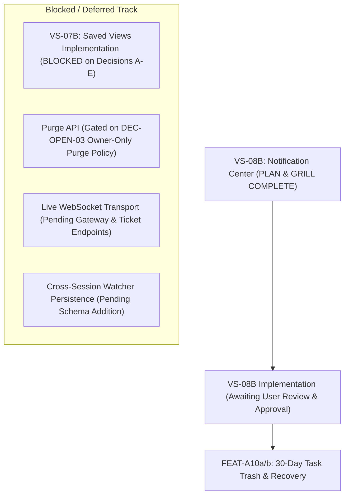
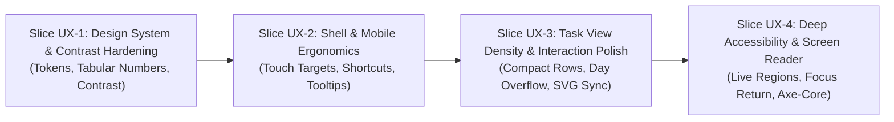

# SONDER — CANONICAL PROJECT PROGRESS TRACKER

**Document Version:** 1.1.0<br/>
**Last Synchronized:** 2026-11-10<br/>
**Current Baseline Commit:** `develop @ 3cbbce2` (PR #34 merged)<br/>
**Governance Standard:** Dual-Track Engineering & UI/UX Governance (PLAN → GRILL → IMPLEMENT → TEST → REVIEW → LOCK → DOCUMENT)<br/>
**Maintenance Rule:** This tracker is updated upon the completion of every milestone or UI/UX slice. Never fabricate completion percentages. Every completed item must link to verified Git commits, PRs, or test suites.

---

## TRACK A — ENGINEERING PROGRESS

### A.1 Completed Milestones Inventory

| Milestone ID | Feature Scope | Canonical FEAT ID | PR # | Merge SHA | Tests Passed | Status & Verification Evidence |
| :--- | :--- | :--- | :--- | :--- | :--- | :--- |
| **VS-00** | Monorepo Tooling, ESLint, TypeScript & Vitest | — | PR #1 | `216d464` | Monorepo setup | **MERGED & VERIFIED** |
| **VS-01** | Auth & Session Spine, Host Cookies, Fail-Closed CSRF | `FEAT-G01` | PR #2 | `9915196` | 25 tests | **MERGED & VERIFIED** (`AuthFlow.test.tsx`) |
| **VS-02A** | Accessible Design System Primitives & Tokens | `FEAT-J03` | PR #5 | `3c4ddc7` | 16 tests | **MERGED & VERIFIED** (`design-tokens.test.ts`) |
| **VS-02B** | Application Shell, Responsive Navigation Rail, Header | `FEAT-B01` | PR #6 | `8a04498` | 14 tests | **MERGED & VERIFIED** (`AppShell.test.tsx`) |
| **VS-02C** | Workspace Context, Personal/Shared Switcher Popover | `FEAT-B01` | PR #8 | `52c30b6` | 22 tests | **MERGED & VERIFIED** (`WorkspaceSwitcher.test.tsx`) |
| **VS-02D** | Omnibar Command Palette (`Cmd+K`), Search Results | `FEAT-C05` | PR #9 | `ab116da` | 18 tests | **MERGED & VERIFIED** (`OmnibarModal.test.tsx`) |
| **VS-02E** | My Work Cross-Workspace Triage Dashboard | `FEAT-C03` | PR #10 | `c89782c` | 24 tests | **MERGED & VERIFIED** (`MyWorkView.test.tsx`) |
| **VS-02F** | Multi-Module Integration QA & E2E Verification | Multi | PR #11 | `6a9e643` | 118 tests | **MERGED & VERIFIED** (`IntegrationFlows.test.tsx`) |
| **VS-03.1**| Task Data Layer, Query Normalization & MSW Infrastructure | `FEAT-A02` | PR #13 | `95e71f7` | 24 tests | **MERGED & VERIFIED** (`tasks.test.tsx`) |
| **VS-03.2**| Task Peek Drawer & URL Deep-Linking (`?task=`) | `FEAT-A02` | PR #14 | `b37efe0` | 28 tests | **MERGED & VERIFIED** (`TaskPeekDrawer.test.tsx`) |
| **VS-03.3**| Inline Task Attribute Editing & Optimistic Concurrency | `FEAT-A03` | PR #15, #16 | `8491497`<br>`4591ee1` | 35 tests | **MERGED & VERIFIED** (`InlineTaskEditing.test.tsx`) |
| **VS-03.4**| Quick Task Composer (`C` shortcut) & Floating Trigger | `FEAT-A02` | PR #17 | `67cba33` | 20 tests | **MERGED & VERIFIED** (`QuickTaskComposer.test.tsx`) |
| **VS-03.5**| Subtask Hierarchy (Depth 1–2) & Reparenting Modal | `FEAT-A06` | PR #18 | `3c290d4` | 26 tests | **MERGED & VERIFIED** (`SubtaskHierarchy.test.tsx`) |
| **VS-03.6**| Task Domain Regression QA & End-to-End Hardening | Multi | PR #19 | `82e9dc9` | 320 tests | **MERGED & VERIFIED** (`TaskIntegrationE2E.test.tsx`) |
| **VS-04** | Synchronized List & Kanban Board Views | `FEAT-C01` | PR #20 | `8b18be2` | 38 tests | **MERGED & VERIFIED** (`TaskViews.test.tsx`) |
| **VS-05A** | Calendar View (Month/Week) & Unscheduled Task Tray | `FEAT-C02` | PR #21 | `303426e` | 34 tests | **MERGED & VERIFIED** (`CalendarView.test.tsx`) |
| **VS-05A.1**| Production MSW Environment Separation Hardening | `FEAT-C02` | PR #22 | `4770e49` | 34 tests | **MERGED & VERIFIED** |
| **VS-05B** | Gantt Timeline View & Workspace Milestone Markers | `FEAT-C02`, `FEAT-B04` | PR #23 | `bc324ed` | 36 tests | **MERGED & VERIFIED** (`TimelineView.test.tsx`) |
| **VS-05C** | Dependency Edges (BLOCKS DAG) & Conflict Visualizer | `FEAT-A06` | PR #24 | `31ed749` | 28 tests | **MERGED & VERIFIED** (`TimelineDependencies.test.tsx`) |
| **VS-05C.1**| Post-Merge Dependency Integration & Cache Invalidation | `FEAT-A06` | PR #25 | `d2c3eba` | 28 tests | **MERGED & VERIFIED** |
| **VS-06A** | Consolidated Task View Family Audit & Architecture Review | `FEAT-C01`, `FEAT-C02` | PR #26 | `a31a873` | Full 4-view audit | **MERGED & VERIFIED** (`task-view-family-audit-report.md`) |
| **VS-06B** | Interactive Column Sorting & Calendar Prefill Polish | `FEAT-C01`, `FEAT-C02` | PR #27 | `764b99d` | 12 tests | **MERGED & VERIFIED** (`CrossViewIntegration.test.tsx`) |
| **VS-06B.1**| Cross-View History Navigation & Parameter Preservation | `FEAT-C01`, `FEAT-C02` | PR #28 | `9ccabe2` | 440 monorepo tests | **MERGED & VERIFIED** |
| **VS-07A** | Saved Views Product & API Contract Readiness | `FEAT-C04` | PR #29 | `fb45f66` | Contract audit | **MERGED & VERIFIED** (`vs-07a-saved-views-contract-readiness-report.md`) |
| **VS-07A.1**| Saved Views Contract Reconciliation & Sign-Off Packet | `FEAT-C04` | PR #30 | `2de4522`<br>`8fabfc2` | Delta spec verified | **MERGED & VERIFIED** (`vs-07a.1-saved-views-contract-signoff-report.md`) |
| **VS-07A.2**| Roadmap Reconciliation & UI/UX Baseline Audit | Governance | PR #31 | `b003b9f` | Full audit suite | **MERGED & VERIFIED** (`vs-07a.2-roadmap-reconciliation-report.md`) |
| **VS-08A** | Collaboration Spine: Comments, @Mentions & Task Watchers | `FEAT-A04` | PR #32 | `c2cbbe1` | 24 tests | **MERGED & VERIFIED** (`TaskCollaboration.test.tsx`, `markdown-ast.test.tsx`) |
| **VS-08A.1**| Collaboration Contract & Integration Hardening | `FEAT-A04` | PR #33 | `1803f71` | 18 tests | **MERGED & VERIFIED** (`TaskCollaborationHardening.test.tsx` [18 tests], comments module [43 tests]) |
| **VS-08A.2**| Realtime Event Scoping Correction & Canonical Alignment | `FEAT-A04` | PR #34 | `3cbbce2` | 22 tests | **MERGED & VERIFIED** (`TaskCollaborationHardening.test.tsx` [22 tests], comments module [47 tests], monorepo [487 tests]) |
| **VS-08B**  | Segmented In-App Notification Center (PLAN & GRILL) | `FEAT-F01a` | PR #35 | `1ac051f` | Plan & Grill | **MERGED & VERIFIED** (`vs-08b-notification-center-plan.md`, `vs-08b-notification-center-grill-report.md`) |

### A.2 Current Engineering Status & Next Milestones



- **Completed Planning Milestone:** `VS-08B` — Segmented In-App Notification Center PLAN & GRILL (`FEAT-F01a`).
- **Next Engineering Action (Upon User Approval):**
  > **MILESTONE VS-08B IMPLEMENTATION: SEGMENTED IN-APP NOTIFICATION CENTER (`FEAT-F01a`)**
  - **Scope:** Header bell, popover quick triage, full `/inbox` view, `ACTION_REQUIRED` and `UPDATES` categories, client-side reason faceting, optimistic mark-read, bulk mark-all-read, task deep-linking, real-time unread count synchronization.
  - **Contract Surface:** Canonical OpenAPI 0.3.20-draft (`/communities/{communityId}/notifications` routes).

### A.3 Pending Backend & Governance Dependencies

| Dependency ID | Governing Feature | Description | Blocker For | Owner |
| :--- | :--- | :--- | :--- | :--- |
| **DEP-COLLAB-01** | `FEAT-A04` (Collaboration) | Cross-session watcher preference persistence (`isWatching: boolean` on `TaskDto` / `TaskActivityDto`). | Cross-session watch/unwatch persistence | Backend Lead |
| **DEP-REALTIME-01** | `FEAT-A04` / Realtime | Live WebSocket gateway (`wss://...`), auth ticket (`POST /realtime-ticket`), `work-platform.v1` protocol frames. | Live multi-client synchronization (currently event consumer abstraction) | Backend Lead & Platform Infra |
| **DEP-SV-01** | `FEAT-C04` (Saved Views) | PO & Backend Lead sign-off on Product Decisions A–E (Default View, Quotas, Normalization, Display Options, Default View API). | Milestone VS-07B (Saved Views Implementation) | Backend Lead & Product Owner |
| **DEP-TRASH-01** | `FEAT-A10b` (Task Trash) | Final resolution of DEC-OPEN-03 regarding explicit audited Owner purge policy vs legal hold. | Milestone VS-09 (Task Trash & Recovery) | Product Owner |
| **DEP-ROLES-01** | `FEAT-G02b` (Custom Roles) | Finalization of custom role capability bundles and preview simulator contract. | Milestone VS-10 (Workspace Governance) | Backend Lead |

### A.4 Roadmap Scope Invariants & Excluded Capabilities

1. **FEAT-A09 (Granular Time Tracking & Billable Worklogs):**
   Explicitly **rejected and excluded from Phase 1 scope** to preserve lightweight simplicity. Bulk subtask operations belong to `FEAT-A06`.
2. **FEAT-G02a (Core RBAC Engine & Default Roles):**
   Represents core capability RBAC and system roles (Owner, Member, Viewer); distinct from standalone member directories.
3. **Candidate Contract Distinction:**
   OpenAPI 0.3.20-draft is a **documented candidate contract**, not a live backend-verified contract. Live backend implementation remains pending.
4. **Canonical Entity Hierarchy:**
   Strictly $\text{Community} \to \text{Workspace} \to \text{Task} \to \text{Subtask}$. Projects, Lists, and File Hub are obsolete historical artifacts.
5. **Narrow Offline Task Editing:**
   Narrow offline editing for existing cached tasks belongs under Phase 1 Milestone M1.3 (`FEAT-J02`).
6. **Provisional Completion Metrics:**
   Completion counts represent provisional frontend candidate coverage and must not be cited as global platform completion until live backend reconciliation occurs.

| Feature ID | Feature Name | Planned Phase | Rationale |
| :--- | :--- | :--- | :--- |
| `FEAT-A09` | Granular Time Tracking / Billable Worklogs | Excluded | Explicitly rejected from Phase 1. |
| `FEAT-B03` | Opt-In Timeboxed Iterations / Cycles | Phase 4 | Preserves low learning curve for non-agile community squads. |
| `FEAT-E02` | Burndown, Velocity & Cumulative Flow Charts | Phase 4 | Dependent on timeboxed cycles. |
| `FEAT-H01` | Declarative 1-Hop Workflow Automations | Phase 3 | Advanced automation engine deferred to maintain Day-1 simplicity. |
| `FEAT-H02` | Outbound HMAC-Signed Webhooks | Phase 3 | Requires egress infrastructure and SSRF protection hardening. |
| `FEAT-I01` | Shareable Project Intake Forms | Phase 2 | External anonymous/guest intake flows scheduled for Phase 2. |
| `FEAT-J01b`| Guided CSV Import Wizard | Phase 2 | Basic UTF-8 CSV Export ships in Phase 1; import wizard in Phase 2. |

---

## TRACK B — UI/UX WORKSTREAM PROGRESS

### B.1 UX Research & Audit Coverage

- **Canonical Research Baseline:** Completed in PR #4 (`92e984e`, `docs/04-implementation/frontend-experience-research.md`).
- **Baseline Audit Report:** Completed in `docs/04-implementation/ui-ux/sonder-ui-ux-audit-baseline.md`.
- **Audit Coverage:**
  - [x] Application Shell & Navigation Rail
  - [x] Workspace Switcher (Desktop Popover & Mobile Drawer)
  - [x] Omnibar Command Palette
  - [x] My Work Dashboard & Date Triage Buckets
  - [x] Task Peek Drawer & Inline Field Editors
  - [x] Quick Task Composer
  - [x] List View (Column Sorting & Subtask Tree)
  - [x] Board View (Status Columns & Mobile Stage Carousel)
  - [x] Calendar View (Month/Week Grids & Unscheduled Tray)
  - [x] Timeline View (Gantt Axis, Milestones & Dependency Connectors)

### B.2 Finding Summary by Severity

| Severity Level | Finding Count | Key Focus Areas | Status |
| :--- | :--- | :--- | :--- |
| **Critical** | 0 | None identified in current baseline. | All Core Invariants Sound |
| **High** | 2 | Calendar month cell `+N more` task popover (`UX-TASK-02`); Drawer `Esc` focus restoration (`UX-A11Y-02`). | Scheduled for Slices UX-3 & UX-4 |
| **Medium** | 5 | Tabular figures (`UX-SYS-01`), Mobile header shortcuts (`UX-SHELL-01`), List compact density (`UX-TASK-01`), Calendar mobile tap target (`UX-TASK-03`), Live region announcements (`UX-A11Y-01`). | Scheduled for Slices UX-1, UX-2 & UX-3 |
| **Low** | 7 | Dark mode text contrast (`UX-SYS-02`), Icon sizing token consistency (`UX-SYS-03`), Rail tooltip delay (`UX-SHELL-02`), Timeline SVG scroll redraw (`UX-TASK-04`), Breadcrumb middle truncation (`UX-TASK-05`), Composer character counter (`UX-TASK-06`), Drawer grab handle (`UX-A11Y-03`). | Scheduled across Slices UX-1, UX-2 & UX-3 |

### B.3 Prioritized UI/UX Improvement Roadmap



| UI/UX Slice | Target Scope | Findings Addressed | Target Quality Gate | Status |
| :--- | :--- | :--- | :--- | :--- |
| **Slice UX-1** | Design System Tokens & Typography | `UX-SYS-01`, `UX-SYS-02`, `UX-SYS-03` | Vitest token test suite (`design-tokens.test.ts`) | **PLANNED** |
| **Slice UX-2** | Application Shell & Mobile Ergonomics | `UX-SHELL-01`, `UX-SHELL-02`, `UX-TASK-03`, `UX-A11Y-03` | Playwright mobile viewport suite (375px & 414px) | **PLANNED** |
| **Slice UX-3** | Task View Density & Interaction Polish | `UX-TASK-01`, `UX-TASK-02`, `UX-TASK-04`, `UX-TASK-05`, `UX-TASK-06` | Cross-view interaction tests, 60fps timeline scroll | **PLANNED** |
| **Slice UX-4** | Deep Accessibility & Focus Assurance | `UX-A11Y-01`, `UX-A11Y-02` | Axe-core automated accessibility sweep (0 violations) | **PLANNED** |

### B.4 Historical UI/UX Improvements Implemented & Verified
- **Danger Button WCAG AA Contrast:** Raised contrast of danger buttons from ~3.8:1 to >6.4:1 in light mode and >9.3:1 in dark mode (`design-tokens.test.ts`).
- **Semantic Focus Ring:** Eliminated hardcoded palette classes in favor of `.focus-ring` with 2px canvas offset.
- **Roving Tabindex in List View:** Implemented pointer-free Arrow key row navigation in `TaskListView.tsx`.
- **Keyboard Reordering on Board:** Implemented "Move to..." accessible dropdown menu on task cards to satisfy WCAG 2.5.7.
- **Click-to-Sort Column Headers:** Implemented interactive sorting with directional indicators and `aria-sort` attributes.
- **Calendar Click-to-Create:** Prefills selected calendar date into Quick Task Composer when clicking empty date cells.

---

## 7. Project Progress Summary Dashboard

```
================================================================================
SONDER PLATFORM PROGRESS SUMMARY
================================================================================
Monorepo Status:           Clean, 100% Green
Active Baseline:           develop @ 3cbbce2 (PR #34 merged)
Total Passing Test Suites: 49 suites (apps/web + packages/contracts)
Total Automated Tests:     487 tests (100% passing)
Documentation Checks:      51 / 51 passed (pnpm validate:docs)

Track A (Engineering):
- Phase 1 Capabilities:   18 / 24 Provisional Frontend Candidate Coverage (~75%)
- Contract Readiness:      Candidate OpenAPI 0.3.20-draft (Live Backend Pending)
- Hardened Milestone:      VS-08A.2: Realtime Event Scoping Correction
- Next Engineering Target: FEAT-F01a: In-App Notification Center

Track B (UI/UX Workstream - PAUSED):
- Research & Principles:   Approved (PR #4, 92e984e)
- Screens Audited:         10 / 10 Core Views & Shell Modules (100%)
- Identified Findings:     14 Findings (0 Critical, 2 High, 5 Medium, 7 Low)
- Execution Plan:          4 Independent Slices (UX-1 through UX-4)
================================================================================
```
