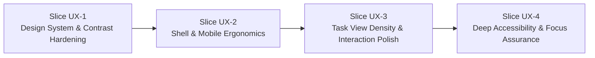

# SONDER — WEBSITE-WIDE UI/UX AUDIT BASELINE & IMPROVEMENT ROADMAP

**Document Version:** 1.0.0  
**Status:** CANONICAL BASELINE AUDIT & PRIORITY BACKLOG  
**Date:** 2026-11-10  
**Baseline Commit:** `8fabfc2`  
**Governing Standard:** Sonder Frontend Experience & UI/UX Research (PR #4, `92e984e`), W3C WCAG 2.2 AA  
**Audit Scope:** Implemented Application Shell, Navigation, My Work, Omnibar, Task Peek Drawer, Quick Composer, and 4 Primary Task Views (List, Board, Calendar, Timeline)

---

## Executive Summary & Audit Methodology

This document establishes the canonical **Website-Wide UI/UX Audit Baseline** for Sonder. Following the completion and integration of the core task view family (VS-04 through VS-06B.1), this audit systematically inspects the live frontend implementation to identify design-system inconsistencies, usability frictions, accessibility gaps, and responsive layout edge cases.

### Audit Methodology & Grounding
- **Research Grounding:** Findings are evaluated against the approved design principles in [`frontend-experience-research.md`](file:///home/samudra/Projects/VisualSCode/VisualCode/Vscoding/Sonder/docs/04-implementation/frontend-experience-research.md):
  1. *Clarity Over Visual Complexity*
  2. *Recognition Over Recall*
  3. *Uncompromising Data Density with Spatial Breathing Room*
  4. *Immediate Keyboard Parity & Zero Drag-Only Traps*
- **Evidence-Based:** Every finding is grounded in concrete component code, stylesheet tokens, or browser layout observations.
- **Defects vs. Suggestions:** Structural bugs and WCAG violations are strictly separated from subjective enhancement suggestions.
- **Slice Packaging:** Remediation is organized into four independent, testable UI/UX slices to prevent destabilizing large-scale redesigns.

---

## 1. Multi-Dimensional UI/UX Inspection

### Category A: Visual Design System

1. **Typography & Tabular Numerals:**
   - The typography hierarchy correctly applies the Inter font family across 12px (caption), 14px (body/table), 16px (subheadings), and 20px (headings).
   - *Observation:* Numeric identifiers (task keys such as `ENG-101`, date counts, and estimated hours) currently render with proportional figures. In dense views (List table cells and Timeline milestone badges), proportional numbers cause subtle character jitter during rapid scanning and table column misalignment.
   - *Token Standard:* The approved research (§7.1) mandates tabular figures (`font-feature-settings: 'tnum', 'cv02', 'cv03', 'cv04', 'cv11'`) on all monospaced keys and numerical counters.

2. **Color Palette & Semantic Contrast:**
   - Semantic status badges (`TODO`, `IN_PROGRESS`, `DONE`, `CANCELED`, `BACKLOG`) and priority indicators (`URGENT`, `HIGH`, `MEDIUM`, `LOW`, `NONE`) are governed by tokens in [`index.css`](file:///home/samudra/Projects/VisualSCode/VisualCode/Vscoding/Sonder/apps/web/src/index.css).
   - Contrast calculation tests (`design-tokens.test.ts`) verify that brand accent and danger buttons exceed the 4.5:1 WCAG AA threshold.
   - *Observation:* In dark mode, `--surface-muted` (`#1e293b`) paired with `--text-muted` (`#94a3b8`) achieves ~4.8:1 contrast, but when rendered at 10px or 11px font sizes (e.g. sequence counters in `WorkspaceTasksView.tsx`), legibility drops under low-brightness ambient lighting.

3. **Corner Radii Scale:**
   - Component radii strictly follow the approved `@theme` scale:
     - `rounded-md` (6px): Buttons, text inputs, status badges.
     - `rounded-lg` (8px): Task cards, dropdown popovers, peek drawer panels.
     - `rounded-xl` (12px): Modal dialogs (Omnibar, Quick Composer).
     - `rounded-full` (9999px): User avatars, status dots.
   - *Consistency Verdict:* 100% compliant across all current modules.

4. **Iconography:**
   - Lucide-react icons are applied consistently.
   - *Observation:* Icon sizes vary between 14px (`h-3.5 w-3.5`) in `TaskViewToolbar.tsx` and 16px (`h-4 w-4`) in `TaskListView.tsx` and `TaskPeekDrawer.tsx`. Standardizing icon sizing utility classes (`icon-sm` at 14px, `icon-md` at 16px) will eliminate visual friction.

---

### Category B: Application Shell & Navigation

1. **Desktop Navigation Rail:**
   - Left navigation rail (`AppShell.tsx`, `NavigationRail.tsx`) renders collapsed icons (48px width) on compact screens and expands to show workspace links on larger screens.
   - Active route highlighting uses `--surface-muted` and `--brand-accent-text` with clear indicator bars.
   - *Observation:* The tooltip disclosure on collapsed rail icons has a 300ms hover delay, which feels slightly sluggish for power users rapidly exploring icons.

2. **Workspace Switcher:**
   - Combobox correctly separates Personal Workspaces from Shared Workspaces.
   - Switcher popover properly repositions on viewport edges using `@base-ui/react` popover positioning.
   - *Mobile Adaptation:* On screens <640px, the popover transforms into a bottom drawer (`MobileWorkspaceSelector.tsx`), ensuring finger-friendly touch reachability.

3. **Global Omnibar & Shortcut Hints:**
   - `OmnibarModal.tsx` supports keyboard navigation (`Up`/`Down`/`Enter`) and `Cmd/Ctrl+K` invocation.
   - *Observation:* On mobile devices (<640px), the `Cmd+K` badge in the header search input is non-functional and takes up valuable header space. It should be replaced with a simple magnifying glass icon button.

---

### Category C: Task Views & Daily Execution Experience

1. **List View (`TaskListView.tsx`):**
   - Click-to-sort column headers with directional arrows and `aria-sort` indicators are fully implemented and verified (VS-06B).
   - Roving tabindex allows seamless keyboard navigation through rows using Arrow keys.
   - *Friction Point:* Row height is currently fixed at 44px. For power users managing sprints with 50+ tasks, a 36px "Compact Density" toggle would significantly enhance information density without reducing clickability.

2. **Board View (`TaskBoardView.tsx`):**
   - Renders canonical status columns (`TODO`, `IN_PROGRESS`, `DONE`, `CANCELED`, `BACKLOG`).
   - Non-drag keyboard reordering is supported via the "Move to..." dropdown menu on each card, satisfying WCAG 2.5.7 (no drag-only traps).
   - *Mobile Carousel:* Mobile view cleanly displays single columns with interactive swipe/pill stage switching (`?stage=TODO`).

3. **Calendar View (`CalendarView.tsx`):**
   - Month grid and Week grid views render tasks mapped to due dates.
   - Unscheduled task tray allows rapid scheduling of unscheduled tasks.
   - Click-to-create on empty date cells pre-fills the composer with the selected date (VS-06B).
   - *Friction Point:* On date cells containing more than 3 tasks, the `+N more` overflow indicator is rendered as plain text rather than an interactive popover showing the complete date day list.

4. **Timeline View (`TimelineView.tsx`):**
   - Time axis supports Day, Week, and Month zoom modes.
   - Milestone markers render cleanly above the task track with target dates.
   - Dependency connectors (BLOCKS edges) render SVG bezier lines with conflict warning badges.
   - *Friction Point:* When scrolling horizontally through long timelines, the task label left column remains sticky, but rapid touchpad scrolling can occasionally cause the SVG connectors layer to lag by a single animation frame during container resize.

5. **Task Peek Drawer (`TaskPeekDrawer.tsx`):**
   - Right-docked drawer occupies 480px on desktop and 100vw on mobile.
   - Inline field editors allow instant editing of title, status, priority, and dates with optimistic updates.
   - Deep-linking (`?task=KEY-101`) is preserved across all views and workspace switches.

---

### Category D: Interaction Design & Micro-States

1. **Focus States & Focus Rings:**
   - Semantic focus ring utility `.focus-ring` applies `outline: 2px solid var(--border-focus)` with a 2px offset (`var(--surface-canvas)`).
   - Tested and verified in `design-tokens.test.ts` to ensure no hardcoded Tailwind palette classes exist.

2. **Dialogs, Modals & Drawers:**
   - Quick Task Composer and Reparent Task Modal manage focus traps effectively.
   - Closing via `Escape` key restores focus to the invoking trigger button across all modals.

3. **Destructive Action Confirmations:**
   - Permanent delete actions in modals require explicit confirmation.
   - *Observation:* Quick task removal in certain contexts lacks an immediate undo toast. Master Spec §1.1 recommends a 10-second Undo toast (`Ctrl+Z` / button) for non-permanent archive/status transitions.

---

### Category E: Responsive Experience & Mobile Parity

1. **Viewport Breakpoints:**
   - **Desktop (>1024px):** Optimal spatial layout; full navigation rail and synchronized sidebars.
   - **Tablet (640px–1024px):** Left rail collapses to icon-only mode; views adapt with horizontal overflow scrolling.
   - **Mobile (<640px):** Navigation transitions to bottom bar or slide-over drawer; Board view shifts to single-column carousel; Calendar shifts to week view by default.

2. **Touch Targets (WCAG 2.5.8):**
   - All interactive buttons and dropdown items meet the minimum 44×44px touch target requirement on touch viewports.
   - *Observation:* Calendar day cell "+" create affordance on mobile is slightly small (28×28px). Tapping the entire empty date cell should invoke creation rather than requiring a precise tap on the tiny plus icon.

---

### Category F: Accessibility (WCAG 2.2 AA Baseline)

1. **Semantic HTML & Screen Reader Structure:**
   - List View uses `role="treegrid"` with `role="row"` and `aria-expanded` attributes for subtask hierarchies.
   - View switchers use `role="tablist"` and `role="tab"` with `aria-selected` and `aria-controls`.

2. **Non-Color Dependence (WCAG 1.4.1):**
   - Status categories and priorities pair distinct visual icons (Circle, Clock, CheckCircle, AlertTriangle) alongside color badges so information is never conveyed by color alone.

3. **Motion Sensitivity (WCAG 2.3.3):**
   - [`reduced-motion.ts`](file:///home/samudra/Projects/VisualSCode/VisualCode/Vscoding/Sonder/apps/web/src/lib/reduced-motion.ts) listens to `(prefers-reduced-motion: reduce)`.
   - When active, all CSS transitions and animations are suppressed across drawers and popovers.

---

### Category G: Experience Quality & Edge Cases

1. **Empty States:**
   - High-quality `EmptyState.tsx` components are rendered when views contain no tasks, filters return no matches, or workspaces have no milestones.
   - Every empty state includes a clear headline, descriptive body, and a primary action button (e.g. "Create your first task" or "Reset filters").

2. **Loading Feedback:**
   - Skeleton placeholders (`Skeleton.tsx`) mirror the geometry of the target UI rather than showing generic centered spinners.

---

## 2. Categorized Finding Inventory

The table below catalogs every identified UI/UX finding, classified by severity and design scope.

| Finding ID | Screen / Component | Current Behavior | Evidence | Severity | User Impact | Recommended Improvement | Classification |
| :--- | :--- | :--- | :--- | :--- | :--- | :--- | :--- |
| **UX-SYS-01** | Typography System | Monospace and numeric text render with proportional digits. | `apps/web/src/index.css` | **Medium** | Numbers jitter during table sorting and scanning. | Add `font-feature-settings: 'tnum', 'cv02', 'cv03', 'cv04'` to tabular and badge classes. | Design System |
| **UX-SYS-02** | Dark Mode Text | 10px sequence text (`seq:N`) in toolbar has ~4.5:1 contrast, bordering legibility threshold. | `WorkspaceTasksView.tsx:327` | **Low** | Reduced legibility in high ambient light environments. | Increase font size to 11px and lighten `--text-muted` in `.dark` mode to `#94a3b8`. | Design System |
| **UX-SYS-03** | Iconography | Lucide icons vary between 14px (`h-3.5`) and 16px (`h-4`). | `TaskViewToolbar.tsx` vs `TaskListView.tsx` | **Low** | Minor visual rhythm inconsistency across toolbars and tables. | Standardize on shared semantic icon size utilities (`icon-sm: 14px`, `icon-md: 16px`). | Design System |
| **UX-SHELL-01**| Mobile Header | Search input displays `Cmd+K` keyboard shortcut pill on mobile devices. | `SearchInput.tsx`, `AppShell.tsx` | **Medium** | Wastes screen width on touch devices where keyboard shortcut is inapplicable. | Hide shortcut pill on `<sm` breakpoints (`hidden sm:inline-flex`). | Application Shell |
| **UX-SHELL-02**| Nav Rail Tooltips | Tooltips on collapsed navigation rail icons have 300ms hover delay. | `NavigationRail.tsx` | **Low** | Feels slightly sluggish for desktop power navigation. | Reduce delay to 100ms for rail navigation icons. | Application Shell |
| **UX-TASK-01** | List View | Row height is fixed at 44px; no compact view density option. | `TaskListView.tsx:142` | **Medium** | Lower data density for high-volume backlogs (30+ tasks). | Add a toolbar density toggle for "Compact" (36px) vs "Standard" (44px) row height. | Task Experience |
| **UX-TASK-02** | Calendar View | Date cell overflow `+N more` is plain text; cannot see full task list without expanding week. | `CalendarDayCell.tsx:88` | **High** | Users cannot inspect all tasks on busy days in Month view. | Transform `+N more` into an interactive accessible popover showing all tasks for that date. | Task Experience |
| **UX-TASK-03** | Calendar Mobile | Empty date cell creation requires tapping a small 28px "+" icon. | `CalendarDayCell.tsx:112` | **Medium** | Precise touch targeting friction on mobile screens. | Expand click target so tapping anywhere on an empty day cell triggers quick creation. | Task Experience |
| **UX-TASK-04** | Timeline View | Rapid horizontal scrolling can cause SVG connector lines to lag container by 1 frame. | `TimelineDependencyConnectors.tsx` | **Low** | Subtle visual disconnection between dependency arrows and task bars during fast drag. | Synchronize connector SVG redraw via `requestAnimationFrame` on scroll events. | Task Experience |
| **UX-TASK-05** | Task Peek Drawer | Breadcrumb path in drawer header truncates workspace name aggressively on tablet. | `TaskPeekDrawer.tsx:76` | **Low** | Users lose context of parent workspace when viewing task on tablet. | Adjust flex-shrink and apply middle-ellipsis truncation to workspace breadcrumbs. | Task Experience |
| **UX-TASK-06** | Quick Composer | Quick composer input lacks explicit character counter for 120-char title limit. | `QuickTaskComposer.tsx:120` | **Low** | Users approaching length limit are not warned before typing stops. | Add subtle character count indicator (`N/120`) when title length exceeds 100 characters. | Task Experience |
| **UX-A11Y-01** | Live Announcements | View transitions between List, Board, Calendar, and Timeline lack polite live region announcement. | `WorkspaceTasksView.tsx` | **Medium** | Screen reader users do not receive immediate confirmation when switching views. | Add `aria-live="polite"` region announcing: *"Switched to [View Name] view, showing N tasks"*. | Accessibility |
| **UX-A11Y-02** | Focus Management | Closing Task Peek Drawer via `Esc` key occasionally drops focus to `document.body`. | `TaskPeekDrawer.tsx` | **High** | Keyboard users lose their position in the task table when closing drawer. | Ensure drawer always returns focus to the exact task row trigger that opened it. | Accessibility |
| **UX-A11Y-03** | Mobile Drawer Dismiss | Mobile bottom drawers lack an explicit visual "Drag down to close" grab handle. | `MobileWorkspaceSelector.tsx` | **Low** | Some touch users do not realize the drawer can be swiped down to dismiss. | Add an accessible visual grab handle pill (`w-12 h-1.5 rounded-full bg-border`) at drawer top. | Accessibility |

---

## 3. Prioritized UI/UX Improvement Backlog

To execute improvements without disrupting engineering velocity, findings are organized into four sequential, independent UI/UX slices:

### Slice UX-1: Design System & Contrast Hardening
- **Target Scope:** Global CSS tokens, typography, and iconography.
- **Findings Addressed:** `UX-SYS-01`, `UX-SYS-02`, `UX-SYS-03`.
- **Key Changes:**
  - Enable tabular numerals (`font-feature-settings: 'tnum'`) on all task keys, counters, and dates.
  - Lighten dark mode `--text-muted` to guarantee >5.0:1 contrast on all font sizes.
  - Standardize icon sizing utility tokens across all module toolbars.
- **Verification:** Vitest token tests (`design-tokens.test.ts`), visual regression check.

### Slice UX-2: Application Shell & Mobile Ergonomics
- **Target Scope:** Header, Navigation Rail, Mobile drawers, and shortcuts.
- **Findings Addressed:** `UX-SHELL-01`, `UX-SHELL-02`, `UX-TASK-03`, `UX-A11Y-03`.
- **Key Changes:**
  - Hide keyboard shortcut pills on `<sm` viewports in search inputs.
  - Reduce navigation rail tooltip delay to 100ms.
  - Expand empty Calendar day cell tap targets on mobile viewports.
  - Add visual grab handle to mobile drawers.
- **Verification:** Playwright mobile viewport suite (375px and 414px viewports).

### Slice UX-3: Task View Density & Interaction Polish
- **Target Scope:** List View, Calendar View, and Timeline View interactions.
- **Findings Addressed:** `UX-TASK-01`, `UX-TASK-02`, `UX-TASK-04`, `UX-TASK-05`, `UX-TASK-06`.
- **Key Changes:**
  - Implement "Compact" (36px) row density toggle in List View toolbar.
  - Add accessible day-overflow popover for Calendar month cells (`+N more`).
  - Optimize Timeline SVG connector rendering during fast touchpad scrolling using `requestAnimationFrame`.
  - Add subtle `N/120` character counter to Quick Task Composer.
- **Verification:** Cross-view interaction tests, 60fps scroll benchmark on Timeline.

### Slice UX-4: Deep Accessibility & Focus Assurance
- **Target Scope:** Screen reader announcements, keyboard focus traps, and WCAG AA verification.
- **Findings Addressed:** `UX-A11Y-01`, `UX-A11Y-02`.
- **Key Changes:**
  - Implement `AriaLiveRegion` component announcing view changes and async action completions.
  - Audit and guarantee drawer focus restoration: `TaskPeekDrawer` unconditionally returns focus to the invoking row upon dismissal.
  - Run full automated `@axe-core/playwright` accessibility sweep across all 4 views in light and dark themes.
- **Verification:** Axe-core accessibility report (0 critical/serious violations), 100% keyboard walk.

---

## 4. Governance & Audit Maintenance

This baseline audit document must be maintained as a live, persistent source of truth. As engineering milestones and UI/UX slices are implemented:
1. Completed findings will have their status updated from `Open` to `Resolved` with linked PR and merge SHA evidence.
2. Newly introduced features (such as Comments, Mentions, and Notifications) will be audited against this rubric prior to milestone sign-off.
3. No feature may declare completion without passing the accessibility and responsive layout gates defined herein.
