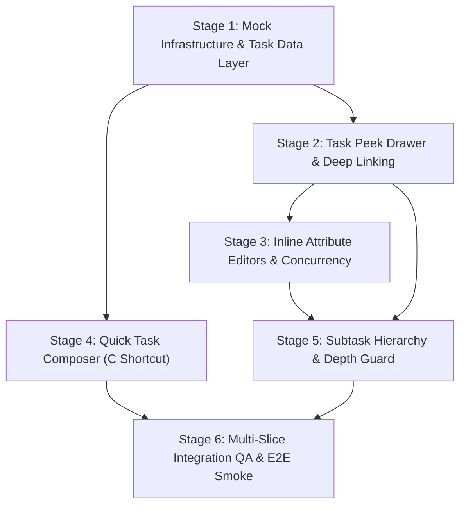

# VS-03: Task Domain, Contract & Implementation Readiness Preflight Report

- **Milestone:** VS-03 — Canonical Task Model, Quick Composer & Task Peek Drawer
- **Readiness Branch:** `docs/FE-VS03-readiness`
- **Target Branch:** `develop`
- **Baseline Baseline Commit:** [`6a9e643`](https://github.com/Samudra-Bose/sonder/commit/6a9e643) (VS-02F merged via PR #11)
- **Specification Authority:** `Community-Work-Management-Master-Specification-v1.5.0.md` & `Community-Work-Management-v1.5/docs/00-governance/source-of-truth-registry.md`
- **Active Contract Authority:** `Community-Work-Management-v1.5/docs/contracts/openapi.yaml` (`0.3.20-draft`, 95 paths / 118 operations / 201 schemas)

---

## 1. Executive Readiness Verdict

### Verdict: **READY FOR STAGED IMPLEMENTATION WITH MOCK SERVICE WORKER (MSW)**

1. **Contract Integrity:** The active contract `Community-Work-Management-v1.5/docs/contracts/openapi.yaml` completely specifies all required task operations (`createTask`, `getTaskById`, `resolveTaskKey`, `updateTask`, `moveTask`, `queryWorkspaceTasks`). Generated TypeScript types in `packages/contracts/src/api-types.ts` are 100% synchronized with zero schema drift (`pnpm typegen:check` passing).
2. **Backend Runtime Reality:** The backend is developed separately by an independent backend team. No live backend task API runtime or migration is currently deployed. Frontend implementation for VS-03 must proceed **mock-first** via contract-faithful MSW handlers and deterministic fixtures in `apps/web/src/mocks/handlers/tasks.ts`.
3. **VS-02 Correctness Audit:** Post-merge inspection of VS-02 identified 4 architectural findings (React Hook rules in `AuthContext`, timezone-aware reference date interpretation, targeted community cache eviction, and canonical enum spelling `"CANCELED"`). None block VS-03, but they provide critical guidance for task domain implementation.
4. **Implementation Sequence:** VS-03 is scoped into **6 independently verifiable stages**, starting with Stage 1 (MSW Mock Infrastructure & Task Data Access Layer).

---

## 2. Canonical Source-of-Truth References

In accordance with the [Source-of-Truth Registry](file:///home/samudra/Projects/VisualSCode/VisualCode/Vscoding/Sonder/Community-Work-Management-v1.5/docs/00-governance/source-of-truth-registry.md), the following authority order governs VS-03:

| Priority | Document | Authority & Scope |
|---|---|---|
| **Tier 1** | [Decision Register](file:///home/samudra/Projects/VisualSCode/VisualCode/Vscoding/Sonder/Community-Work-Management-v1.5/docs/00-governance/decision-register.md) | Owner-confirmed architectural decisions (`DEC-OPEN-01`, `DEC-OPEN-02`, `DEC-OPEN-06` through `11`, `DEC-OPEN-15`). |
| **Tier 2** | [Master Specification v1.5.0](file:///home/samudra/Projects/VisualSCode/VisualCode/Vscoding/Sonder/Community-Work-Management-v1.5/docs/Community-Work-Management-Master-Specification-v1.5.0.md) | Normative product semantics, task hierarchy rules, temporal buckets, and permissions. |
| **Tier 3** | [`openapi.yaml`](file:///home/samudra/Projects/VisualSCode/VisualCode/Vscoding/Sonder/Community-Work-Management-v1.5/docs/contracts/openapi.yaml) | Authoritative HTTP wire format (`0.3.20-draft`). *Note: Root `./openapi-0.3.20-draft.yaml` is a historical snapshot; the split file under `docs/contracts/` is the active single source of truth validated by `pnpm validate:docs`.* |
| **Tier 4** | [Permission & Security Model](file:///home/samudra/Projects/VisualSCode/VisualCode/Vscoding/Sonder/Community-Work-Management-v1.5/docs/03-architecture/permission-and-security-model.md) | Capability-driven authorization matrix and field-group delegation policies. |
| **Tier 5** | [Frontend Antigravity Blueprint](file:///home/samudra/Projects/VisualSCode/VisualCode/Vscoding/Sonder/Community-Work-Management-v1.5/docs/04-implementation/frontend-antigravity-blueprint.md) | UI architecture, drawer mechanics, URL query synchronization, and keyboard interaction models. |

---

## 3. Review of VS-02 Post-Merge Correctness

A forensic inspection of the codebase on `develop` at commit [`6a9e643`](https://github.com/Samudra-Bose/sonder/commit/6a9e643) evaluated four specific integration concerns:

### 3.1. AuthContext and QueryClient (`AuthContext.tsx`)
- **Inspection:** In [`AuthContext.tsx`](file:///home/samudra/Projects/VisualSCode/VisualCode/Vscoding/Sonder/apps/web/src/modules/auth/AuthContext.tsx#L22-L27), `let queryClient = null; try { queryClient = useQueryClient(); } catch { queryClient = null; }` was wrapped in a `try/catch` block.
- **Rules of Hooks Compliance:** Calling a React Hook (`useQueryClient()`) inside a `try/catch` block violates React's Rules of Hooks. Hooks cannot be conditionally wrapped or called inside catch blocks.
- **Provider Hierarchy:** In production [`App.tsx`](file:///home/samudra/Projects/VisualSCode/VisualCode/Vscoding/Sonder/apps/web/src/App.tsx#L50-L53), `<SafeQueryClientProvider>` always wraps `<AuthProvider>`. Furthermore, every existing test suite (`AuthFlow.test.tsx`, `AuthTheme.test.tsx`, `Omnibar.test.tsx`, `AppShell.test.tsx`, `IntegrationFlows.test.tsx`) renders under a `QueryClientProvider`.
- **Logout Behavior:** Confirmed server logout successfully calls `queryClient.clear()` and removes `sonder-active-community-id`. When logout fails or network fails, the hook throws an `ApiProblemError`, keeping local authentication state intact (fail-closed).
- **Disposition:** During Stage 1 of VS-03, refactor `AuthContext.tsx` to call `const queryClient = useQueryClient();` directly at the top level without `try/catch`.

### 3.2. My Work Date Semantics (`date-utils.ts`, `useMyWork.ts`)
- **Inspection:** [`getDefaultReferenceDate()`](file:///home/samudra/Projects/VisualSCode/VisualCode/Vscoding/Sonder/apps/web/src/modules/my-work/date-utils.ts#L62-L68) currently computes today's date using `now.getUTCFullYear()`, `now.getUTCMonth()`, and `now.getUTCDate()`.
- **Timezone Analysis:** 
  - Storing and transmitting task due dates as ISO 8601 `YYYY-MM-DD` strings is strictly canonical: it prevents a task due on "Nov 15" from shifting to "Nov 14 at 19:00" when viewed across timezones.
  - However, evaluating "today" strictly in UTC means a user at 8:00 PM in San Francisco (UTC-8) on Nov 3 would have UTC clock reading 4:00 AM on Nov 4. Tasks due today (Nov 3) would prematurely appear "Overdue" before the user's local day has ended.
  - The master specification mandates: *"Resolution uses the workspace IANA timezone and snapshot-local date"*. For cross-workspace My Work, tasks span multiple workspaces with differing timezones; the personal triage view should resolve reference dates against the user's local calendar day.
- **Disposition:** In `date-utils.ts`, update `getDefaultReferenceDate()` to format today's calendar date using the client's local date (`new Date().toLocaleDateString("en-CA")` or `Intl.DateTimeFormat().resolvedOptions().timeZone`), while preserving explicit `referenceDate` parameter injection for deterministic testing.

### 3.3. Community Cache Behavior (`WorkspaceContext.tsx`)
- **Inspection:** [`WorkspaceContext.tsx`](file:///home/samudra/Projects/VisualSCode/VisualCode/Vscoding/Sonder/apps/web/src/modules/workspace/WorkspaceContext.tsx#L173-L175) performs `queryClient.invalidateQueries({ queryKey: ["communities"] })` on `selectCommunity`.
- **Invalidation vs. Eviction:**
  - TanStack Query's `invalidateQueries` marks matching queries as **stale**. If a query is active, it refetches; if inactive (the previous community's workspace and task queries), it remains in the in-memory cache until `gcTime` (5 minutes) expires.
  - Stale previous-community task data is therefore not leaked to the active UI (because the UI selects based on `currentCommunityId`), but it remains resident in memory.
  - Furthermore, `["communities"]` is a broad prefix that invalidates all communities.
- **Disposition:** When switching communities, invoke `queryClient.removeQueries({ queryKey: ["communities", previousCommunityId] })` to explicitly purge the prior community's sensitive workspace and task caches from memory, alongside invalidating the active community.

### 3.4. My Work Contract Assumptions
- **Terminal Status Enums:** In `packages/contracts/src/api-types.ts`, `TaskStatusCategory` is defined as `"BACKLOG" | "TODO" | "IN_PROGRESS" | "DONE" | "CANCELED"`. The canonical spelling is **`CANCELED` (one L)**. The defensive check for `"CANCELLED"` (two Ls) in `date-utils.ts` should be retained for backward tolerance but normalized to `CANCELED`.
- **Community Scope:** `/communities/{communityId}/my-work/query` is explicitly community-scoped. The contract states: *"By default, never aggregates across other communities"*. The current frontend correctly scopes My Work to the active community.
- **Pagination:** `MyWorkQueryResult` returns `total: number` and `nextCursor: string | null`. The current frontend loads the initial cursor page and performs client-side relationship filtering on returned items; cursor pagination support is an upcoming enhancement.

---

## 4. The Canonical Task Model

The Sonder task model strictly adheres to the containment hierarchy:
$$\text{Community} \longrightarrow \text{Workspace} \longrightarrow \text{Task} \longrightarrow \text{Subtask (Depth 1--2)}$$
There is **no Project or List entity** in the data model.

### 4.1. Task Entity Schema (`TaskDto`)

| Field | Type | Required/Optional | Description / Invariants |
|---|---|---|---|
| `id` | `Uuid` | Required | Unique canonical task identifier (UUIDv7 format). |
| `workspaceId` | `Uuid` | Required | Enclosing Workspace UUID. |
| `parentTaskId` | `Uuid \| null` | Optional | Parent task UUID. Null for root tasks; points to parent for subtasks (depth 1–2). Null if caller lacks read access to parent. |
| `taskKey` | `string` | Required | Human-readable public key formatted as `{PREFIX}-{SEQUENCE}` (e.g. `ENG-101`). Immutable within workspace. |
| `title` | `string` | Required | Task title. Min 1, max 255 characters. |
| `description` | `string \| null` | Optional | Extended task description (Markdown source). |
| `itemType` | `TaskType` | Required | System task type (`TASK`, `BUG`, `FEATURE`, `RESEARCH`, `MILESTONE_ITEM`). |
| `statusCategory` | `TaskStatusCategory` | Required | Canonical category: `"BACKLOG"`, `"TODO"`, `"IN_PROGRESS"`, `"DONE"`, `"CANCELED"`. |
| `priority` | `TaskPriority` | Required | Priority level: `"URGENT"`, `"HIGH"`, `"MEDIUM"`, `"LOW"`, `"NONE"`. |
| `assigneeIds` | `Uuid[]` | Required | Array of active workspace member UUIDs assigned to this task. |
| `creatorId` | `Uuid` | Required | Actor UUID who created the task. |
| `startDate` | `string \| null` | Optional | ISO 8601 date-only string (`YYYY-MM-DD`). |
| `dueDate` | `string \| null` | Optional | ISO 8601 date-only string (`YYYY-MM-DD`). |
| `estimatePoints` | `number \| null` | Optional | Story points / effort estimate ($\ge 0$). |
| `labelIds` | `Uuid[]` | Optional | Array of workspace label UUIDs applied to the task. |
| `milestoneId` | `Uuid \| null` | Optional | Associated workspace milestone UUID. |
| `rankKey` | `string` | Optional | Fractional index / Lexorank string for ordered projections. |
| `version` | `number` | Required | Monotonic task revision sequence. |
| `fieldRevisions` | `Record<string, number>` | Required | Map of field paths to monotonically increasing revision counters (used for atomic conflict detection). |
| `effectivePermissions` | `TaskPermissions` | Required | Backend-computed action booleans for the authenticated caller. |
| `createdAt` | `string` (date-time) | Required | ISO 8601 creation timestamp. |
| `updatedAt` | `string` (date-time) | Required | ISO 8601 last modified timestamp. |
| `archivedAt` | `string \| null` | Optional | Soft-deletion timestamp (Trash lifecycle). |

### 4.2. Task-Key Aliases and Non-Discovery Invariants
- **Immutable Aliases:** When a task is transferred across workspaces (`/tasks/{taskId}/move`), its historical key (e.g. `OLD-42`) is preserved as an immutable alias mapping to the task's lineage.
- **Resolution Authorization (`resolveTaskKey`):** Resolution follows the lineage pointer to the task's *current* workspace. The caller is authorized against the *current* workspace.
- **Non-Discovery Invariant:** If a user without read access to the destination workspace attempts to resolve a historical key, the server returns an **indistinguishable generic 404 (`RESOURCE_NOT_FOUND`)**. The API never reveals that the task existed, was renamed, or was moved.

---

## 5. API Operation-to-Contract Matrix for VS-03

Every operation required for VS-03 was audited against `packages/contracts/src/api-types.ts` and `Community-Work-Management-v1.5/docs/contracts/openapi.yaml`:

| # | Operation Name | Method & Path | Contract Operation ID | Headers / Auth | Request Schema | Response Schema | Contract Status | Implementation Status |
|---|---|---|---|---|---|---|---|---|
| **1** | **Get Task by ID** | `GET /communities/{communityId}/workspaces/{workspaceId}/tasks/{taskId}` | `getTaskById` | Cookie Session | None | `200: TaskDto`<br>`404: Problem` | Defined | **READY_WITH_MOCKS** |
| **2** | **Resolve Task Key** | `GET /communities/{communityId}/workspaces/{workspaceId}/tasks/by-key/{taskKey}` | `resolveTaskKey` | Cookie Session | None | `200: TaskKeyResolutionDto`<br>`404: Problem`<br>`410: Problem` | Defined | **READY_WITH_MOCKS** |
| **3** | **Create Task** | `POST /communities/{communityId}/workspaces/{workspaceId}/tasks` | `createTask` | `X-CSRF-Token`<br>`X-Mutation-Id` (UUIDv7) | `CreateTaskRequest` | `201: TaskDto`<br>`409: Problem` | Defined | **READY_WITH_MOCKS** |
| **4** | **Update Task Attributes** | `PATCH /communities/{communityId}/workspaces/{workspaceId}/tasks/{taskId}` | `updateTask` | `X-CSRF-Token`<br>`X-Mutation-Id`<br>`baseFieldRevisions` | `UpdateTaskRequest` | `200: TaskDto`<br>`409: Problem` | Defined | **READY_WITH_MOCKS** |
| **5** | **Update Assignees** | `PATCH .../tasks/{taskId}` | `updateTask` | `X-CSRF-Token`<br>`X-Mutation-Id` | `{ assigneeIds, baseFieldRevisions }` | `200: TaskDto` | Defined | **READY_WITH_MOCKS** |
| **6** | **Update Status & Priority** | `PATCH .../tasks/{taskId}` | `updateTask` | `X-CSRF-Token`<br>`X-Mutation-Id` | `{ statusCategory, priority, baseFieldRevisions }` | `200: TaskDto`<br>`409: Problem` | Defined | **READY_WITH_MOCKS** |
| **7** | **Update Dates & Estimates** | `PATCH .../tasks/{taskId}` | `updateTask` | `X-CSRF-Token`<br>`X-Mutation-Id` | `{ dueDate, startDate, estimatePoints, baseFieldRevisions }` | `200: TaskDto` | Defined | **READY_WITH_MOCKS** |
| **8** | **Update Labels** | `PATCH .../tasks/{taskId}` | `updateTask` | `X-CSRF-Token`<br>`X-Mutation-Id` | `{ labelIds, baseFieldRevisions }` | `200: TaskDto` | Defined | **READY_WITH_MOCKS** |
| **9** | **Fetch Subtasks** | `POST .../workspaces/{workspaceId}/tasks/query` | `queryWorkspaceTasks` | `X-CSRF-Token` | `TaskViewQueryRequest` (`subtaskMode: "NESTED"`) | `200: TaskQueryResult` | Defined | **READY_WITH_MOCKS** |
| **10** | **Create Subtask** | `POST .../workspaces/{workspaceId}/tasks` | `createTask` | `X-CSRF-Token`<br>`X-Mutation-Id` | `CreateTaskRequest` (`parentTaskId: Uuid`) | `201: TaskDto`<br>`409: Problem` | Defined | **READY_WITH_MOCKS** |
| **11** | **Reparent Subtask** | `POST .../tasks/{taskId}/move` | `moveTask` | `X-CSRF-Token`<br>`X-Mutation-Id` | `MoveTaskRequest` (`targetParentTaskId`) | `200: TaskMoveResultDto` | Defined | **READY_WITH_MOCKS** |

---

## 6. Backend Dependency & Blocker Matrix

| Capability | Backend Runtime Requirement | Contract Status | Local Frontend Path | Blocker Classification |
|---|---|---|---|---|
| **Task Creation & Allocation** | Database monotonic sequence allocator per workspace prefix; UUIDv7 generation. | Fully Defined | Contract-faithful MSW handler generating sequence keys (`{PREFIX}-{N}`). | `READY_WITH_MOCKS` (No FE blocker) |
| **Key & Alias Resolution** | `task_key_aliases` table and lineage resolution with indistinguishable 404s. | Fully Defined | MSW mock lookup supporting canonical keys and alias redirection. | `READY_WITH_MOCKS` (No FE blocker) |
| **Field-Level Concurrency** | Atomically validating `baseFieldRevisions` against stored `field_revisions`. | Fully Defined | MSW handler checking revisions and returning 409 Conflict when stale. | `READY_WITH_MOCKS` (No FE blocker) |
| **Subtask Depth Validation** | Database check constraint enforcing `hierarchy_depth <= workspace.max_subtask_depth`. | Fully Defined | Client pre-check + MSW returning `SUBTASK_DEPTH_LIMIT` error on breach. | `READY_WITH_MOCKS` (No FE blocker) |
| **Production Deployment** | Real backend server runtime, Postgres migrations, RLS policies. | Not Deployed | MSW provides deterministic sandbox for automated testing and browser QA. | `BLOCKED_BY_BACKEND` (Deploy only) |

---

## 7. Deep Analysis of the Four VS-03 Capabilities

### 7.1. Quick Task Composer
- **Trigger & Keyboard Shortcut:** Global single-character shortcut `C`.
  - Suppressed when focus is inside `<input>`, `<textarea>`, `[contenteditable="true"]`, or Base UI input components.
  - Suppressed if user has disabled single-character shortcuts in personal preferences.
- **Progressive Disclosure ($\le 5$ Core Fields Initially):**
  1. *Title:* Text input with auto-focus, placeholder `"Task title..."`. (Required)
  2. *Workspace Selector:* If opened outside workspace context (e.g. My Work), dropdown defaults to active workspace; pre-selected when inside a workspace.
  3. *Status:* Dropdown initialized to workspace default status (typically `TODO` or `BACKLOG`).
  4. *Assignee:* Quick combobox supporting typeahead search of workspace members.
  5. *Due Date:* Accessible date picker input (`YYYY-MM-DD`).
  - *Secondary Disclosure:* "Add details" disclosure toggle revealing Description (Markdown textarea), Priority (`URGENT`–`LOW`), Estimate Points, and Labels.
- **Submission & Feedback:**
  - Dispatches `createTaskApi` with fresh UUIDv7 `X-Mutation-Id` and `X-CSRF-Token`.
  - Accessible inline error alert if validation fails or server rejects.
  - On success: Closes dialog, announces creation via `aria-live="polite"`, invalidates relevant queries, and provides an action to "Open in drawer".

### 7.2. Task Peek Drawer
- **Desktop Mechanics:** Right-docked non-modal drawer (width $480\text{ px}$–$540\text{ px}$) that does not obscure or block interaction with the main canvas.
- **Mobile Mechanics:** Responsive full-height bottom sheet / full-screen drawer on viewports $< 768\text{ px}$ with swipe/drag handle and modal focus trap.
- **Deep Linking (`?task=KEY-123`):**
  - Synchronizes with React Router query parameter `task`.
  - Opening a task updates URL to `?task=ENG-101` (via `replace` or `push` depending on navigation provenance).
  - Closing the drawer cleanses the `task` parameter while strictly preserving other active search parameters (e.g. `?filter=assigned&task=ENG-101` $\to$ `?filter=assigned`).
- **Resolution & Privacy:**
  - Drawer accepts task key (e.g. `ENG-101`).
  - Calls `resolveTaskKey(key)`. If `resolvedFromAlias === true`, transparently updates URL to `?task=${currentKey}` without an HTTP 3xx redirect.
  - If server returns 404, drawer renders an accessible "Task not found" state without revealing workspace or lineage existence.
- **Focus Management:**
  - Desktop: Focus moves to drawer title on open; pressing `Escape` closes drawer and restores focus to the invoking trigger card/button.
  - Mobile: FloatingFocusManager locks focus within bottom sheet; returns focus on close.

### 7.3. Inline Attribute Editors
- **Supported Fields:** Status category, Priority, Due Date, Assignee, Estimate Points, Labels.
- **Authorization Enforcement (`effectivePermissions`):**
  - The UI never relies on blind role checks. It directly inspects the task's backend-computed `effectivePermissions`:
    - Status requires `canUpdateStatus === true`.
    - Due Date & Priority require `canEditDatesPriority === true`.
    - Assignees require `canAssign === true`.
    - Estimates require `canEditEstimate === true`.
    - Labels require `canEditCustomFieldsLinks === true`.
  - When unauthorized, the attribute renders as a static badge with an accessible tooltip (e.g. *"You do not have permission to edit assignees in this workspace"*).
- **Optimistic Concurrency & Rollback:**
  - When user edits a field (e.g. changes Status from `TODO` to `IN_PROGRESS`), the UI updates optimistically.
  - Payload sends `baseFieldRevisions: { statusCategory: currentRevision }`.
  - If the server responds with HTTP 409 Conflict (field was updated concurrently by another actor), the UI rolls back to the server state, highlights the conflicted field, and displays a non-destructive conflict notification.

### 7.4. Subtask Hierarchy
- **Depth Constraints:**
  - The master specification allows a maximum parent-child depth of **1–2** levels, controlled by `workspace.maxSubtaskDepth` (default 1, maximum 2).
  - Subtask depth calculation:
    $$\text{Depth} = 0 \text{ (Root Task)}, \quad \text{Depth} = 1 \text{ (Subtask)}, \quad \text{Depth} = 2 \text{ (Nested Subtask)}$$
  - If a task's depth equals `maxSubtaskDepth`, the "+ Add Subtask" button is hidden/disabled with tooltip *"Maximum subtask depth reached for this workspace"*.
- **Creation & Linkage:**
  - Adding a subtask inside the Task Peek Drawer calls `createTask` with `parentTaskId: currentTask.id`.
  - Subtasks inherit the parent's workspace context and key namespace.
- **Cycle Prevention:**
  - A task cannot have itself as a parent (`targetParentTaskId !== taskId`).
  - Reparenting via `/move` enforces that a parent cannot be placed under any of its own descendants.

---

## 8. Proposed Staged Implementation Sequence

To maintain continuous integration and prevent monolithic PRs, VS-03 is partitioned into six verifiable stages:



### Stage 1: MSW Task Fixtures & Data Access Layer
- **Scope:** Implement contract-faithful MSW handlers in `apps/web/src/mocks/handlers/tasks.ts` supporting CRUD, key resolution, and field-revision conflict simulation. Implement API client functions in `apps/web/src/modules/tasks/api.ts` and React Query hooks (`useTask`, `useResolveTaskKey`, `useCreateTask`, `useUpdateTask`). Fix React Hook `try/catch` in `AuthContext.tsx`.
- **Deliverables:** `tasks.ts` MSW handler, `api.ts`, query hooks, and unit tests.

### Stage 2: Task Peek Drawer & Deep Linking
- **Scope:** Implement `TaskPeekDrawer` component with right-docked desktop canvas and mobile bottom sheet. Integrate URL query parameter synchronization (`?task=KEY-123`), loading skeletons, indistinguishable 404 error boundaries, and focus restoration.
- **Deliverables:** `TaskPeekDrawer.tsx`, `useTaskPeekDrawer.ts`, responsive tests, and deep-link routing tests.

### Stage 3: Inline Attribute Editors & Concurrency Rollback
- **Scope:** Implement popover/inline editors for Status, Priority, Due Date, Assignee, Estimate, and Labels. Enforce capability guards (`effectivePermissions`). Implement optimistic UI updates with automatic rollback on 409 Conflict or 403 Forbidden.
- **Deliverables:** Attribute editor components, optimistic mutation hooks, and conflict rollback tests.

### Stage 4: Quick Task Composer (`C` Shortcut)
- **Scope:** Implement `QuickTaskComposer` modal dialog with progressive disclosure ($\le 5$ core fields initially). Implement global single-character `C` shortcut with input/contenteditable suppression.
- **Deliverables:** `QuickTaskComposer.tsx`, shortcut listener integration, accessible form validation, and component tests.

### Stage 5: Subtask Hierarchy & Depth Guard
- **Scope:** Implement `SubtaskList` and `SubtaskItem` within the Task Peek Drawer. Implement subtask creation, depth checks against `workspace.maxSubtaskDepth`, cycle prevention, and same-workspace reparenting.
- **Deliverables:** Subtask tree components, depth limit guards, and subtask creation tests.

### Stage 6: Full Integration QA, Browser Smoke & PR Delivery
- **Scope:** End-to-end integration test suite (`TaskFlows.test.tsx`) connecting Quick Composer, My Work, Omnibar, and Task Peek Drawer. Playwright multi-viewport smoke tests capturing screenshots on Desktop, Tablet, and Mobile.
- **Deliverables:** Integration test suite, visual artifacts, and final VS-03 PR targeting `develop`.

---

## 9. Acceptance Criteria & Regression Test Plan

Every stage must satisfy the following quality gates before merging:
1. **Contract & Static Integrity:**
   - `pnpm validate:docs` (51/51 checks passing).
   - `pnpm typegen:check` (zero contract/type drift).
   - `pnpm -r run typecheck` (zero TypeScript compilation errors).
2. **Automated Testing:**
   - 100% green test suite across all 27+ test files.
   - Comprehensive test coverage for new components (composer, drawer, inline editors, subtasks).
   - Idempotency verification: Every mutation sends valid UUIDv7 `X-Mutation-Id` and `X-CSRF-Token`.
3. **Accessibility (WCAG 2.2 AA):**
   - Touch targets $\ge 44 \times 44\text{ px}$ on mobile viewports.
   - Keyboard navigation: Full Tab/Arrow cycling, focus trap in mobile sheet, focus restoration to trigger on desktop drawer close.
   - Contrast ratio $\ge 4.5:1$ for text and $\ge 3:1$ for active controls across light and dark themes.
4. **Security & Non-Discovery:**
   - No disclosure of unauthorized or moved task metadata.
   - Stale cache eviction upon community context switch.

---

## 10. Open Decisions and Invariants

| Decision | Current Status | Impact on VS-03 |
|---|---|---|
| **DEC-OPEN-01** | Owner-Confirmed (`AUDITED_BREAK_GLASS`) | Personal workspace tasks remain private to caller; Task Peek Drawer must not expose personal tasks to unauthorized users. |
| **DEC-OPEN-02** | Owner-Confirmed (Option A) | Workspace prefix collisions rejected; task keys are immutable within a workspace. |
| **DEC-OPEN-03** | Open Stakeholder Decision | 30-day Trash purge policy is pending; permanent task purge API is disabled. Soft-archived tasks resolve with `lifecycleState=ARCHIVED`. |
| **DEC-OPEN-10** | Owner-Confirmed | Cross-workspace transfer creates top-level destination task only (`targetParentTaskId` must be null). Same-workspace move permits reparenting under another task. |

---

## 11. Recommended Next Implementation Steps

1. **Readiness Sign-Off:** Review and commit this readiness report on branch `docs/FE-VS03-readiness`.
2. **Create Feature Branch for Stage 1:**
   ```bash
   git checkout develop
   git pull origin develop
   git checkout -b feat/FE-VS03-stage1-task-data-layer
   ```
3. **Stage 1 Implementation Scope:**
   - Build contract-faithful MSW mock handlers in `apps/web/src/mocks/handlers/tasks.ts`.
   - Implement typed API client in `apps/web/src/modules/tasks/api.ts`.
   - Remove Hook `try/catch` in `AuthContext.tsx`.
   - Add unit tests for task data access and conflict simulation.
