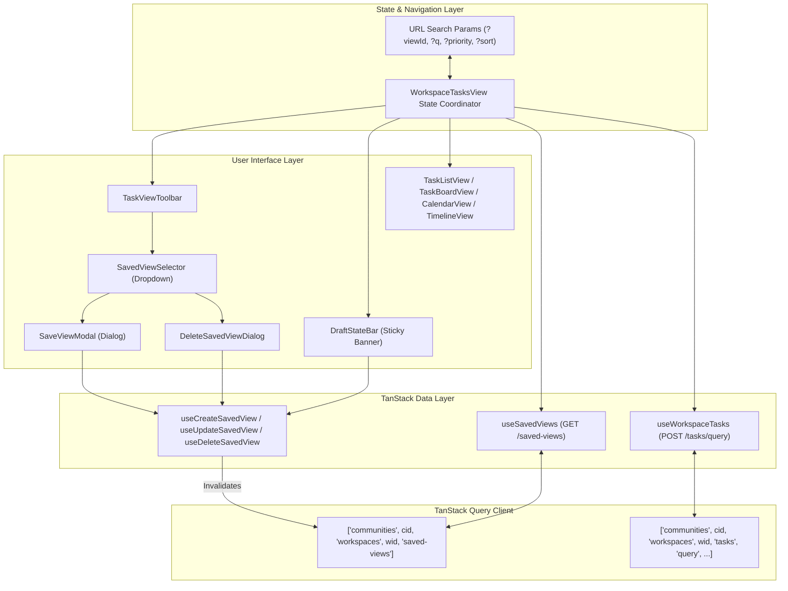
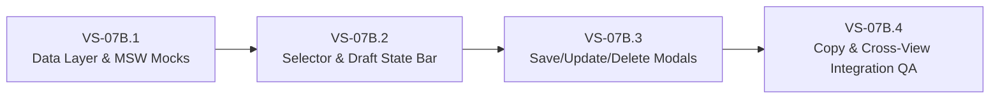

# SONDER — VS-07A: SAVED VIEWS — PRODUCT & API CONTRACT READINESS REPORT

**Document Version:** 1.0.0  
**Status:** CONTRACT READINESS REVIEW & ARCHITECTURAL BLUEPRINT  
**Date:** 2026-11-09  
**Feature Branch:** `docs/FE-VS07A-saved-views-contract-readiness`  
**Baseline Commit:** `26b4ee9` (HEAD of `develop`, synchronized)  
**Governance Methodology:** PLAN → GRILL → IMPLEMENT → TEST → REVIEW → LOCK → DOCUMENT  
**Target Milestone:** VS-07A (Pre-implementation Contract Readiness)  

---

## Executive Summary & Strict Scope Boundary

This document delivers **VS-07A**, the contract-readiness and architectural definition stage for **Saved Views (FEAT-C04)** in Sonder.

Following the successful implementation, cross-view hardening, and verification of the four primary task views—**List View** (VS-04), **Board View** (VS-04), **Calendar View** (VS-05A/VS-05A.1), and **Timeline View** (VS-05B/VS-05C/VS-06B.1)—this milestone prepares the platform for persistent, shareable, and isolated view presets.

### Strict Scope Boundary
As mandated by engineering governance:
- **No application code** is written or modified in this stage.
- **No backend implementation** is performed.
- **No modifications** to the canonical OpenAPI schemas (`Community-Work-Management-v1.5/docs/contracts/openapi.yaml`) or generated types (`packages/contracts/src/api-types.ts`) are introduced.
- **No mocked persistence** is introduced or presented as production persistence.
- **No unapproved product decisions** are treated as settled fact. All technical choices are classified strictly according to their governance status.
- This milestone halts at contract readiness and handoff. Implementation begins in milestone **VS-07B** only after product and backend sign-off.

---

## 1. Preflight & Authoritative Sources of Truth

### 1.1 Preflight Verification
- **Baseline Git SHA:** `26b4ee9` (verified clean working tree, origin/develop synchronized).
- **Dedicated Branch:** `docs/FE-VS07A-saved-views-contract-readiness`.
- **Preflight Static Document Check:** `pnpm validate:docs` passed 51/51 checks.
- **Typecheck & Linting Baseline:** `pnpm run typecheck` passed with 0 errors across all workspace packages.

### 1.2 Canonical References Reviewed
1. **Master Specification v1.5.0:**
   - Section 5.3: *URL Serialization of Transient Filters vs. Saved Views (FEAT-C04)* (lines 21255–21320).
   - Section 1.1 & 2: *Authoritative Source-of-Truth and Decision Register* (SOT-01 through SOT-08).
   - Section 6: *Single-Task Update, Ordering & All-or-Nothing Bulk Mutation Contract*.
   - Section 7: *Realtime Event Envelope and WebSocket Transport*.
2. **Canonical OpenAPI 0.3.20-draft:**
   - Operations: `listSavedViews` (lines 2435–2478), `createSavedView` (lines 2479–2547), `getSavedView` (lines 2548–2595), `updateSavedView` (lines 2596–2689), `deleteSavedView` (lines 2690–2737), `copySavedView` (lines 5345–5410).
   - Schemas: `SavedViewDto` (8455–8512), `SavedViewListDto` (8513–8521), `SaveViewRequest` (8522–8570), `UpdateSavedViewRequest` (8571–8600), `BoardSavedViewDisplayOptions` (11248–11273), `SavedViewDisplayOptions` (11274–11283), `CopySavedViewRequest` (11284–11300), `ViewQuerySpec` (7835–7890).
3. **Frontend Experience Blueprint & Architecture:**
   - Section 13.4: *Information Architecture and Responsive Layouts*.
   - Section 13.6: *State Machine and Cache Topology*.
   - Section 13.8: *Omnibar and Navigation Discovery*.
4. **Workspace Template Policy (DEC-OPEN-07):**
   - Built-in template seed sets: `GENERAL_PURPOSE`, `EVENT_PLANNING`, `TEAM_OPERATIONS` seed initial shared views.
5. **Existing Codebase Implementation:**
   - `apps/web/src/modules/tasks/views/WorkspaceTasksView.tsx`
   - `apps/web/src/modules/tasks/useWorkspaceTasks.ts`
   - `apps/web/src/modules/tasks/views/TaskViewToolbar.tsx`
   - `apps/web/src/modules/workspace/WorkspaceContext.tsx`
   - `packages/contracts/src/api-types.ts`

---

## 2. Existing Architecture & State Serialization Audit

### 2.1 Inspection of Active Task Query & URL State
In the current implementation (`WorkspaceTasksView.tsx`), task queries are driven by URL search parameters and routed layout components:
- Active projection is derived from route path (`/list`, `/board`, `/calendar`, `/timeline`) with fallback to `?view=` query parameter.
- Filter criteria are parsed directly from query parameters:
  - Search: `?q=<string>`
  - Priority: `?priority=ALL|URGENT|HIGH|MEDIUM|LOW|NONE`
  - Status: `?status=ALL|BACKLOG|TODO|IN_PROGRESS|DONE|CANCELED`
  - Sort: `?sort=<field>&order=asc|desc` (validated against allowlist `ALLOWED_SORT_FIELDS`)
  - Backlog inclusion: `?backlog=true|false`
  - Mobile stage carousel: `?stage=TODO` (Board only)
  - Date window: `?mode=month|week` and `?date=YYYY-MM-DD` (Calendar / Timeline)
  - Drawer selection: `?task=<currentKey>` (Global deep link)
- These parameters are normalized into a `TaskViewQueryRequest` object submitted to `useWorkspaceTasks` with canonical TanStack Query keys:
  `["communities", communityId, "workspaces", workspaceId, "tasks", "query", querySpecJson]`

### 2.2 Concrete State Serialization Boundaries
To prevent the classic collaborative pitfall known as **"View Drift"** (where one user modifying filters on a shared board inadvertently scrambles teammates' views), the platform enforces a strict boundary between state persisted in a `SavedViewDto` and state that remains transient in the URL.

| Parameter / State Property | Source in Active UI | Persisted in `SavedViewDto` | Transient URL Parameter | Exclusion / Inclusion Rationale |
| :--- | :--- | :--- | :--- | :--- |
| **View Type (`viewType`)** | Route path (`/list`, `/board`, etc.) | **YES** (`SavedViewDto.viewType`) | Route segment | View projection (`LIST`, `BOARD`, `CALENDAR`, `TIMELINE`) defines the visual structure of the saved perspective. |
| **View Name (`name`)** | User input in modal | **YES** (`SavedViewDto.name`) | None | Human-readable label (1–120 NFKC chars, unique within scope namespace). |
| **Scope (`scope`)** | Creator selection | **YES** (`SavedViewDto.scope`) | None | Immutable authorization boundary (`PERSONAL` vs. `SHARED`). |
| **Search Filter (`q`)** | `?q=...` | **YES** (`querySpec.filter.conditions`) | `?q=...` | Persisted if part of a deliberate triage view (e.g. "Security Bugs"). |
| **Priority Filter** | `?priority=...` | **YES** (`querySpec.filter.conditions`) | `?priority=...` | Core task query filter criterion. |
| **Status Filter** | `?status=...` | **YES** (`querySpec.filter.conditions`) | `?status=...` | Core task query filter criterion. |
| **Sort Terms (`sortBy`)** | `?sort=...&order=...` | **YES** (`querySpec.sortBy`) | `?sort=...&order=...` | Deterministic ordering of tasks up to 3 terms. |
| **Grouping (`groupBy`)** | Toolbar dropdown | **YES** (`querySpec.groupBy`) | Optional `?group=...` | Primary grouping criterion (`statusCategory`, `priority`, `assigneeId`, etc.). |
| **Sub-Grouping (`subGroupBy`)** | Advanced options | **YES** (`querySpec.subGroupBy`) | Optional `?subgroup=...` | Secondary nesting criterion. |
| **Backlog Flag (`includeBacklog`)** | `?backlog=...` | **YES** (`querySpec.includeBacklog`) | `?backlog=...` | Determines whether backlog tasks appear in primary results or separate tray. |
| **Completed Flag (`includeCompleted`)**| Advanced filter | **YES** (`querySpec.includeCompleted`)| None | Filters terminal statuses across projections. |
| **Subtask Mode (`subtaskMode`)**| View default | **YES** (`querySpec.subtaskMode`) | None | Hierarchy representation (`NESTED`, `TOP_LEVEL_ONLY`, `FLATTENED`). |
| **Board Badges (`visibleCardBadges`)**| Board settings | **YES** (`displayOptions.board`) | None | Presentation preference for card metadata badges. |
| **Board Empty Columns** | Board settings | **YES** (`displayOptions.board`) | None | Board presentation preference (`showEmptyColumns: boolean`). |
| **Selected Task Drawer (`?task=`)** | Drawer deep link | **NO** | **YES** (`?task=KEY-123`) | **Session-only navigation.** Persisting a peek drawer task in a saved view would force every viewer into that drawer upon load. |
| **Calendar Focal Date (`?date=`)** | Date header navigation | **NO** | **YES** (`?date=YYYY-MM-DD`)| **Transient browsing position.** Persisting an absolute date would render the view stale after 24 hours. Only relative dynamic date windows belong in AST. |
| **Calendar/Timeline Mode (`?mode=`)**| Header toggle | **NO** (unless elevated) | **YES** (`?mode=week\|month`)| Session zoom level. Can be elevated to proposed `displayOptions.calendar` in future. |
| **Mobile Board Stage (`?stage=`)** | Carousel pill tab | **NO** | **YES** (`?stage=TODO`) | **Device-specific viewport state.** Desktop screens display all columns simultaneously. |
| **Query Snapshot & Cursor** | TanStack Query state | **NO** | None | **Operational pagination protocol.** Snapshot IDs expire after 15 minutes and cannot be stored. |

### 2.3 The Two-Layer State Architecture (Master Spec §5.3)
As specified in Master Specification v1.5.0 Section 5.3:
1. **Layer 1: Persisted Saved View (`SavedViewDto`)**: Stored canonically in the database, fetched via `GET /saved-views`, cached by TanStack Query, and updated only via explicit, intentional user mutations (`PATCH /saved-views/{viewId}`).
2. **Layer 2: URL Transient Diff Parameters**: When a user selects a saved view (`?viewId=v_sprint`) and modifies a filter chip (e.g., changes Priority to `URGENT`), the frontend **never automatically persists the modification**. Instead, it encodes the diff directly into URL search parameters.
3. **The Draft State Bar**: The application compares `currentUrlQuerySpec` against `activeSavedView.querySpec`. If `isEqual(urlSpec, savedView.querySpec) === false`, the UI renders a sticky Draft State Bar:
   - For all workspace members: `Modified • [Reset to Original] [Save as Personal View]`
   - For users with edit rights (`saved_view:manage_shared` or view creator): adds `[Update Shared View]`

```
+---------------------------------------------------------------------------------------------------------+
| WORKSPACE TASK TOOLBAR                                                                                  |
| [ List ] [ Board ] [ Calendar ] [ Timeline ]   | View: [ Active Sprint Backlog (Shared) v ]   [Search]  |
+---------------------------------------------------------------------------------------------------------+
| DRAFT STATE BAR: * Modified from saved view      [Reset to Original]  [Save as Copy]  [Update Shared]   |
+---------------------------------------------------------------------------------------------------------+
| FILTERS: [Priority: Urgent x] [Status: All v] [Sort: Due Date v] [Backlog: Included]                   |
+---------------------------------------------------------------------------------------------------------+
```

---

## 3. Product Decision Register & Analysis

Below is the definitive evaluation of the eight product decisions required to govern Saved Views.

### Decision 1: Personal vs. Shared Views Scope
*Are Saved Views personal to their creator or shared with a workspace?*

- **Options Considered:**
  - *Option A: Personal Only.* Saved views are strictly private to individual users. No workspace-wide views exist.
  - *Option B: Shared Only.* All views are public to the workspace. No private views exist.
  - *Option C: Dual-Scope (`PERSONAL` and `SHARED`) with Strict Privacy Isolation.* The system supports both scopes. `PERSONAL` views are visible only to the creator (`createdById`). `SHARED` views are visible to all active workspace members.
- **Advantages & Disadvantages:**
  - Option A prevents team alignment on canonical sprint boards, release calendars, and triage lists.
  - Option B pollutes the workspace view selector with idiosyncratic individual filters and risks unauthorized visibility of personal workflows.
  - Option C delivers optimal team alignment while preserving personal productivity and confidentiality.
- **Recommended Choice:** **Option C (Dual-Scope).** Matches canonical OpenAPI 0.3.20-draft and Master Spec §5.3.
- **Dependencies:** Workspace membership verification, actor authentication context (`user.id`).
- **Approval Status:** **CONFIRMED PRODUCT REQUIREMENT** (Formally specified in OpenAPI 0.3.20-draft lines 2525–2532).

---

### Decision 2: CRUD Capabilities (Create, Rename, Update, Delete)
*Can users create, rename, update and delete views?*

- **Options Considered:**
  - *Option A: Create and Delete Only.* Views are immutable snapshots. To update, users must delete and recreate.
  - *Option B: Full CRUD with Optimistic Concurrency.* Users can create, read, partially update (rename, change querySpec, change viewType, adjust displayOptions), and delete views.
- **Advantages & Disadvantages:**
  - Option A causes ID churn, breaks bookmarks/URLs (`?viewId=...`), and destroys audit history.
  - Option B maintains stable resource identifiers, preserves URL bookmarks, supports seamless renaming, and utilizes standard optimistic locking.
- **Recommended Choice:** **Option B (Full CRUD).** Use existing OpenAPI endpoints (`POST`, `GET`, `PATCH`, `DELETE /saved-views/{viewId}`).
- **Dependencies:** Versioned optimistic concurrency (`version` integer on `UpdateSavedViewRequest`).
- **Approval Status:** **CONFIRMED PRODUCT REQUIREMENT** (Implemented in OpenAPI 0.3.20-draft lines 2435–2737).

---

### Decision 3: Default Workspace View Mechanism
*Can a view be marked as the default workspace view?*

- **Options Considered:**
  - *Option A: Static Hardcoded Fallback.* The platform always defaults to the standard List view (`/list`) with default filters when opening a workspace.
  - *Option B: Per-User Personal Default.* Each user configures their personal default landing view stored in user profile preferences.
  - *Option C: Workspace-Level Default Shared View.* The Workspace Owner designates an official shared view as the workspace default (`workspace.defaultSavedViewId`). All users entering `/c/:cid/w/:wid` redirect to this view. Unconfigured workspaces fall back to `/list`.
  - *Option D: Hybrid Default Model.* Workspace Owner sets an official team default, but individual members can override it with a personal preference in settings.
- **Advantages & Disadvantages:**
  - Option A ignores team workflow differences (e.g. an Agile sprint squad that primarily works in Board view vs. an Event team that relies on Calendar view).
  - Option B fractures team onboarding and alignment; new members have no curated landing view.
  - Option C establishes clear team conventions and seamless onboarding. Templates can cleanly seed initial default views.
  - Option D adds multi-level resolution complexity.
- **Recommended Choice:** **Option C for Phase 1.** Support workspace-level default shared view (`defaultSavedViewId` on `WorkspaceDto`), configured exclusively by Workspace Owners. Fall back to `/list` if unset or if the referenced view is deleted. Option D user-overrides can be introduced in Phase 2.
- **Dependencies:** Adding optional `defaultSavedViewId?: string | null` to `WorkspaceDto` and `UpdateWorkspaceRequest`.
- **Approval Status:** **RECOMMENDED DEFAULT — REQUIRES FORMAL PRODUCT/BACKEND APPROVAL.**

---

### Decision 4: Duplicate / Copy Views
*Can users duplicate or copy another user's shared view?*

- **Options Considered:**
  - *Option A: No Duplicate Support.* Users must manually recreate query filters and display preferences from scratch.
  - *Option B: In-Workspace "Save as Copy" Only.* Users can fork an existing view into a new Personal view within the same workspace.
  - *Option C: In-Workspace Forking PLUS Cross-Workspace Copying.* The UI provides an instant "Save as Personal View" fork action for active filters, and the backend provides `POST /workspaces/{srcWid}/saved-views/{viewId}/copy` to replicate a view into another workspace within the same community.
- **Advantages & Disadvantages:**
  - Option A creates unnecessary friction for teams establishing standard operating procedures.
  - Option B solves in-workspace customization but forces cross-project squads to re-author views manually.
  - Option C enables rapid template reuse across projects and effortless personal tweaking without risking shared view drift.
- **Recommended Choice:** **Option C.** Fully leverage canonical OpenAPI `copySavedView` (lines 5345–5410) and frontend Draft State Bar "Save as Copy".
- **Dependencies:** Target workspace compatibility checks (custom field and milestone validation).
- **Approval Status:** **CONFIRMED PRODUCT REQUIREMENT** (Backend endpoint exists in OpenAPI 0.3.20-draft; UI fork action aligns with Master Spec §5.3).

---

### Decision 5: Permissions for Shared Views
*Who can edit and delete shared views?*

- **Options Considered:**
  - *Option A: Fully Open (Wiki-Style).* Any active member with `task:read` can edit or delete any shared view.
  - *Option B: Workspace Owners Strictly.* Only Workspace Owners can create, update, or delete shared views.
  - *Option C: Role-Capability Gated with Original-Creator Update Exception.*
    - Creating and deleting SHARED views requires `saved_view:manage_shared` capability (held by Owner and Coordinator).
    - Updating SHARED views requires `saved_view:manage_shared` OR the original creator (`createdById`), provided the creator remains an active member with `task:read`.
    - PERSONAL views are strictly controlled by their creator (`createdById`).
- **Advantages & Disadvantages:**
  - Option A invites chaotic overwrites and accidental deletions of mission-critical team views.
  - Option B creates an administrative bottleneck on Workspace Owners for routine view tweaks.
  - Option C establishes robust governance while empowering authors to maintain the views they contributed.
- **Recommended Choice:** **Option C.** Exactly matches canonical OpenAPI 0.3.20-draft authorization specification (`x-saved-view-authorization`).
- **Dependencies:** `RoleCapability: "saved_view:manage_shared"` (already declared in `packages/contracts/src/api-types.ts`).
- **Approval Status:** **CONFIRMED PRODUCT REQUIREMENT** (Specified in OpenAPI 0.3.20-draft lines 2525, 2660, 2725).

---

### Decision 6: Handling Invalid Filters, Fields, or Sort Options
*What happens when a saved view references an invalid filter, field or sort option (e.g. a deleted custom field or retired status)?*

- **Options Considered:**
  - *Option A: Hard Error / Unrenderable View.* The backend or frontend rejects the query with 422 Unprocessable Entity, rendering an error crash page.
  - *Option B: Silent Discard.* The invalid condition is silently stripped without notifying the user.
  - *Option C: Resilient Normalization with Non-Blocking Warning Toast.* The frontend normalizer drops invalid leaf conditions or falls back to standard sort (`priority DESC`), loads all valid task criteria, and displays a non-blocking informational alert: *"Filter adjusted: Custom field 'Sprint' is no longer available in this workspace. [Save changes | Dismiss]"*.
- **Advantages & Disadvantages:**
  - Option A bricks user workspace access if a coordinator deletes a custom field that was referenced in a shared view.
  - Option B can mislead users into believing they are viewing a filtered dataset when an essential constraint was silently omitted.
  - Option C guarantees high availability, prevents navigation crashes, and transparently surfaces schema changes to the user.
- **Recommended Choice:** **Option C.** Resilient query normalization with non-destructive alert.
- **Dependencies:** Query filter AST sanitization in `useWorkspaceTasks.ts`.
- **Approval Status:** **RECOMMENDED DEFAULT — REQUIRES FORMAL FRONTEND/BACKEND APPROVAL.**

---

### Decision 7: Query Contract Evolution & Backward Compatibility
*How should view configuration behave when the task-query contract evolves?*

- **Options Considered:**
  - *Option A: Client-Side Ad-Hoc Migration.* The frontend parses legacy formats and sends PATCH updates upon detection.
  - *Option B: Backward-Compatible AST Versioning.* All stored `ViewQuerySpec` payloads adhere to the versioned canonical AST defined in OpenAPI 0.3.20-draft. Future query extensions add optional fields without breaking required baseline properties. Schema changes require a backend database migration or automated read-upgrade adapter.
- **Advantages & Disadvantages:**
  - Option A causes race conditions, unexpected write spikes, and version conflict errors on read paths.
  - Option B enforces contract-first stability, decouples frontend deployments from backend schema versions, and guarantees that older saved views remain valid.
- **Recommended Choice:** **Option B.** Maintain canonical AST compatibility. Unknown properties are safely ignored by the normalizer, and missing optional fields assume documented contract defaults.
- **Dependencies:** Backend JSON schema validation for `ViewQuerySpec`.
- **Approval Status:** **CONFIRMED ARCHITECTURAL INVARIANT** (Standard OpenAPI Draft 2020-12 evolution model).

---

### Decision 8: Limits on Saved Views per User and Workspace
*Are there limits on the number of saved views per user or workspace?*

- **Options Considered:**
  - *Option A: Completely Unlimited.* No constraints on view creation.
  - *Option B: Extremely Restrictive (e.g. 5 views per workspace).* Minimal capacity.
  - *Option C: Generous Bounded Quotas:*
    - **Personal Views:** Maximum **50 views** per user per workspace.
    - **Shared Views:** Maximum **100 views** per workspace.
- **Advantages & Disadvantages:**
  - Option A risks database bloat, degrades Omnibar search performance, and clutters the UI dropdown.
  - Option B frustrates squads managing complex initiatives, sprints, and multi-track workflows.
  - Option C provides ample operational freedom for real-world teams while protecting database indexes, Omnibar autocomplete response times, and API payload sizes.
- **Recommended Choice:** **Option C (50 Personal / 100 Shared).** Returns `422 SAVED_VIEW_LIMIT_EXCEEDED` if a user attempts to exceed the quota.
- **Dependencies:** Backend enforcement in `createSavedView` and `copySavedView`.
- **Approval Status:** **RECOMMENDED DEFAULT — REQUIRES FORMAL PRODUCT APPROVAL.**

---

## 4. API Contract Proposal & OpenAPI Review

### 4.1 Canonical OpenAPI 0.3.20-draft Audit
An audit of `Community-Work-Management-v1.5/docs/contracts/openapi.yaml` confirms that persistent Saved Views endpoints already exist in the canonical contract specification:

```
GET    /communities/{communityId}/workspaces/{workspaceId}/saved-views
POST   /communities/{communityId}/workspaces/{workspaceId}/saved-views
GET    /communities/{communityId}/workspaces/{workspaceId}/saved-views/{viewId}
PATCH  /communities/{communityId}/workspaces/{workspaceId}/saved-views/{viewId}
DELETE /communities/{communityId}/workspaces/{workspaceId}/saved-views/{viewId}
POST   /communities/{communityId}/workspaces/{sourceWorkspaceId}/saved-views/{viewId}/copy
```

#### Authorization Invariants Documented in OpenAPI:
- **`listSavedViews`**: Requires `ACTIVE` workspace membership and `task:read`. Returns caller-owned `PERSONAL` views and workspace `SHARED` views. **Never returns another user's personal view, even to Community Admin, Workspace Owner, or Platform Operator.**
- **`createSavedView`**: `PERSONAL` views can be created by any active member with `task:read`. `SHARED` views require `saved_view:manage_shared`. Name is trimmed, NFKC-normalized, and must be case-insensitively unique within scope. Emits realtime event `saved_view.created` and returns `X-Workspace-Seq` for `SHARED` scope only.
- **`getSavedView`**: Reading another member's `PERSONAL` view returns `404 RESOURCE_NOT_FOUND` (not 403) to prevent identity and existence leakage.
- **`updateSavedView`**: `PERSONAL` views may be updated by creator only. `SHARED` views may be updated by `saved_view:manage_shared` or by original creator while still active with `task:read`. Optimistic concurrency is strictly enforced: `version` must match current version or server returns `409 SAVED_VIEW_VERSION_CONFLICT`.
- **`deleteSavedView`**: `PERSONAL` views deleted by creator only. `SHARED` views deleted by `saved_view:manage_shared` only (the creator update exception does NOT grant deletion rights).
- **`copySavedView`**: Revalidates all custom-field and milestone references in target workspace.

### 4.2 Canonical Schemas Reused
The contract rigorously reuses existing task query models:
- **`ViewQuerySpec`**: Stored query AST including `filter` (`QueryFilterGroup`), `groupBy`, `subGroupBy`, `sortBy` (`QuerySortTerm[]`), `subtaskMode`, `includeBacklog`, `includeCompleted`, and `dateWindow`.
- **`QuerySortTerm`**: Reuses `{ field: QuerySortField, direction: "ASC" | "DESC" }`.
- **`SavedViewDisplayOptions`**: Reuses `board?: BoardSavedViewDisplayOptions` (`visibleCardBadges`, `showEmptyColumns`).

### 4.3 Identified Gaps & Proposed Enhancements
To achieve 100% contract readiness, the following enhancements are proposed for joint review:
1. **Default Workspace View Configuration Endpoint**:
   - Proposal: Introduce `PUT /communities/{communityId}/workspaces/{workspaceId}/default-view` with request body `{"defaultViewId": "<uuid> | null"}` gated to Workspace Owner. Alternatively, include `defaultSavedViewId?: string | null` in `WorkspaceDto` and `UpdateWorkspaceRequest`.
2. **Display Options for Non-Board Projections**:
   - The canonical `SavedViewDisplayOptions` currently supports only `board`. We propose extending it to support:
     - `list?: { visibleColumns?: string[]; compactDensity?: boolean }`
     - `calendar?: { defaultCalendarMode?: "month" | "week"; showWeekends?: boolean }`
     - `timeline?: { defaultTimelineMode?: "day" | "week" | "month"; showMilestoneTrack?: boolean }`
3. **Explicit Error Problem Schemas**:
   - Formalize `SavedViewLimitExceededProblem` (`422 SAVED_VIEW_LIMIT_EXCEEDED`).

> [!NOTE]
> All proposed extensions have been isolated into a standalone document:
> `docs/04-implementation/proposed-saved-views-openapi.yaml`.
> The canonical contract remains untouched in strict compliance with VS-07A scope boundaries.

---

## 5. Frontend Integration Architecture



### 5.1 Component Hierarchy & Integration

1. **`SavedViewSelector` (`apps/web/src/modules/tasks/saved-views/SavedViewSelector.tsx`)**:
   - Rendered in `TaskViewToolbar` between view switcher tabs and the search input.
   - Shows current active view name with scope icon (lock for Shared, user for Personal).
   - Dropdown displays two distinct sections:
     - **Shared Views** (sorted alphabetically, with default view badge).
     - **Personal Views** (sorted alphabetically).
   - Bottom action: `+ Save current view as...`.
   - Each item offers a context menu `...` for Rename, Duplicate, or Delete (subject to permissions).

2. **`DraftStateBar` (`apps/web/src/modules/tasks/saved-views/DraftStateBar.tsx`)**:
   - Renders conditionally directly beneath the toolbar when `activeSavedView` is present and `isEqual(currentQuerySpec, activeSavedView.querySpec) === false`.
   - Clear text: *"Modified from saved view"*.
   - Actions:
     - `[Reset to Original]`: Clears transient URL diff parameters and restores original view query spec.
     - `[Save as New Personal View]`: Opens `SaveViewModal` prefilled with current draft query.
     - `[Update Shared View]`: Visible only if user has `saved_view:manage_shared` or is `createdById`. Triggers optimistic `PATCH /saved-views/{viewId}` with current version.

3. **`SaveViewModal` (`apps/web/src/modules/tasks/saved-views/SaveViewModal.tsx`)**:
   - Form fields: Name (text input, autofocus, min 1 max 120 chars), Scope (Radio group: `Personal` vs `Shared`).
   - `Shared` option is disabled with helper tooltip if user lacks `saved_view:manage_shared`.
   - Displays summary of active filters, sort terms, and projection type that will be captured.

### 5.2 TanStack Query Cache Strategy
- **Query Key:**
  ```typescript
  export function savedViewsQueryKey(communityId?: string | null, workspaceId?: string | null) {
    if (!communityId || !workspaceId) return ["saved-views", "disabled"] as const;
    return ["communities", communityId, "workspaces", workspaceId, "saved-views"] as const;
  }
  ```
- **Query Options:**
  - `staleTime: 1000 * 60` (1 minute).
  - Private per-user scope; never shared across accounts.
- **Cache Invalidation:**
  - On `createSavedView`, `updateSavedView`, `deleteSavedView`, or `copySavedView`: invalidate `savedViewsQueryKey(cid, wid)`.
  - When switching workspaces: query automatically refetches for new workspace scope.

### 5.3 Realtime Synchronization & Event Handling
- The frontend WebSocket spine (`useWorkspaceRealtime`) subscribes to the active workspace channel.
- Handlers for workspace events:
  - `saved_view.created`: Invalidate `savedViewsQueryKey(cid, wid)` so newly added shared views appear immediately on teammates' screens.
  - `saved_view.updated`: If the updated view is currently active in the user's browser, prompt user: *"This view was updated by [Author]. [Reload View]"* to avoid overwriting ongoing transient triage.
  - `saved_view.deleted`: If the user is currently on the deleted view, gracefully transition to system default view (`/list`) with a toast notice.

### 5.4 URL State & Routing Mechanics
- **Canonical Route Structure:**
  - Standard view navigation: `/c/:communityId/w/:workspaceId/:viewType?viewId=:viewId`
  - Example: `/c/0192d8e0-0000-7000-8000-000000000001/w/0192d8e0-0000-7000-8000-000000000002/board?viewId=0192d8f0-1111-7000-8000-000000000010`
- **View Selection Flow:**
  - When user selects a saved view from the dropdown:
    1. Look up `savedView.viewType` (`LIST` -> `/list`, `BOARD` -> `/board`, etc.).
    2. Navigate to that route with `?viewId=${savedView.id}` and strip transient filter diffs from URL.
    3. The query layer executes `TaskViewQueryRequest` using `savedView.querySpec`.
- **Browser History Integration:**
  - Selecting a different saved view calls `navigate(..., { replace: false })` (pushes new history entry).
  - Adjusting a transient filter chip calls `setSearchParams(..., { replace: true })` to prevent polluting browser history with every single keystroke.
  - Back/Forward navigation cleanly restores previously selected saved views.

---

## 6. Backend Coordination & Handoff

This section provides the backend engineering team with complete, contract-faithful specifications for implementing Saved Views persistence.

### 6.1 Proposed Endpoint Summary

| Method | Endpoint Path | Auth Required | Capabilities Required | Realtime Event Emitted |
| :--- | :--- | :--- | :--- | :--- |
| `GET` | `/communities/{cid}/workspaces/{wid}/saved-views` | Active Member | `task:read` | None |
| `POST`| `/communities/{cid}/workspaces/{wid}/saved-views` | Active Member | `task:read` (`PERSONAL`), `saved_view:manage_shared` (`SHARED`) | `saved_view.created` (Shared only) |
| `GET` | `/communities/{cid}/workspaces/{wid}/saved-views/{viewId}` | Active Member | `task:read` (Must be creator if Personal) | None |
| `PATCH`| `/communities/{cid}/workspaces/{wid}/saved-views/{viewId}` | Active Member | Creator (Personal), `saved_view:manage_shared` OR Creator (Shared) | `saved_view.updated` (Shared only) |
| `DELETE`| `/communities/{cid}/workspaces/{wid}/saved-views/{viewId}` | Active Member | Creator (Personal), `saved_view:manage_shared` (Shared) | `saved_view.deleted` (Shared only) |
| `POST`| `/communities/{cid}/workspaces/{srcWid}/saved-views/{viewId}/copy` | Active Member | `task:read` in src & dest; `saved_view:manage_shared` for dest Shared | `saved_view.created` (Dest Shared) |
| `PUT` | `/communities/{cid}/workspaces/{wid}/default-view` | Active Member | `workspace:update_settings` (Workspace Owner) | `workspace.updated` |

### 6.2 Database Schema & Row-Level Security (PostgreSQL)

```sql
-- Migration: 0025_create_saved_views_table.sql
CREATE TABLE IF NOT EXISTS saved_views (
    id UUID PRIMARY KEY DEFAULT gen_random_uuid(),
    community_id UUID NOT NULL REFERENCES communities(id) ON DELETE CASCADE,
    workspace_id UUID NOT NULL REFERENCES workspaces(id) ON DELETE CASCADE,
    name VARCHAR(120) NOT NULL,
    scope VARCHAR(20) NOT NULL CHECK (scope IN ('PERSONAL', 'SHARED')),
    view_type VARCHAR(20) NOT NULL CHECK (view_type IN ('LIST', 'BOARD', 'CALENDAR', 'TIMELINE')),
    query_spec JSONB NOT NULL,
    display_options JSONB NOT NULL DEFAULT '{}'::jsonb,
    version INTEGER NOT NULL DEFAULT 1,
    created_by_id UUID NOT NULL REFERENCES users(id) ON DELETE RESTRICT,
    created_at TIMESTAMPTZ NOT NULL DEFAULT NOW(),
    updated_at TIMESTAMPTZ NOT NULL DEFAULT NOW(),
    archived_at TIMESTAMPTZ NULL
);

-- Indexes for performance and uniqueness
CREATE INDEX idx_saved_views_workspace_scope 
    ON saved_views(workspace_id, scope) WHERE archived_at IS NULL;

CREATE INDEX idx_saved_views_creator 
    ON saved_views(created_by_id, workspace_id) WHERE archived_at IS NULL;

-- Case-insensitive scope uniqueness:
-- Shared views must have unique names within the workspace
CREATE UNIQUE INDEX uq_saved_views_shared_name 
    ON saved_views(workspace_id, LOWER(BTRIM(name))) 
    WHERE scope = 'SHARED' AND archived_at IS NULL;

-- Personal views must have unique names per creator within the workspace
CREATE UNIQUE INDEX uq_saved_views_personal_name 
    ON saved_views(workspace_id, created_by_id, LOWER(BTRIM(name))) 
    WHERE scope = 'PERSONAL' AND archived_at IS NULL;

-- Row Level Security (RLS)
ALTER TABLE saved_views ENABLE ROW LEVEL SECURITY;

-- SELECT policy: Users see all SHARED views in their active workspaces, plus their own PERSONAL views
CREATE POLICY rls_saved_views_select ON saved_views
    FOR SELECT
    USING (
        EXISTS (
            SELECT 1 FROM workspace_memberships wm
            WHERE wm.workspace_id = saved_views.workspace_id
              AND wm.user_id = current_setting('app.current_user_id')::uuid
              AND wm.membership_status = 'ACTIVE'
        )
        AND (
            saved_views.scope = 'SHARED' 
            OR saved_views.created_by_id = current_setting('app.current_user_id')::uuid
        )
        AND saved_views.archived_at IS NULL
    );
```

### 6.3 Validation Invariants
1. **Name Normalization:** Server must trim leading/trailing whitespace and normalize using **Unicode NFKC**.
2. **QuerySpec AST Depth & Limits:** Total leaf filter conditions across the `filter.conditions` tree must not exceed **50**. Max sort terms: **3**.
3. **Optimistic Version Lock:** `PATCH /saved-views/{viewId}` requires `version` in payload. If payload `version != stored.version`, abort transaction and return `409 SAVED_VIEW_VERSION_CONFLICT`.
4. **Idempotency:** `POST`, `PATCH`, `DELETE`, and `POST .../copy` enforce `X-Mutation-Id` replay caching.

### 6.4 Acceptance Criteria for Backend Developer
- [ ] **AC-01:** `GET /saved-views` returns only SHARED views plus caller's own PERSONAL views. Never leaks another member's PERSONAL view.
- [ ] **AC-02:** Attempting to fetch another user's PERSONAL view via `GET /saved-views/{viewId}` returns `404 RESOURCE_NOT_FOUND` (not 403).
- [ ] **AC-03:** Creating a SHARED view without `saved_view:manage_shared` capability returns `403 INSUFFICIENT_CAPABILITY`.
- [ ] **AC-04:** Creating a view with duplicate case-insensitive name within its scope returns `409 SAVED_VIEW_NAME_CONFLICT`.
- [ ] **AC-05:** Updating a view with mismatched version returns `409 SAVED_VIEW_VERSION_CONFLICT` and performs zero database writes.
- [ ] **AC-06:** Deleting a SHARED view succeeds only for users with `saved_view:manage_shared` (creator exception does not apply to deletion).
- [ ] **AC-07:** Creating, updating, or deleting a SHARED view emits the corresponding WebSocket event with incremented `X-Workspace-Seq`. PERSONAL mutations emit zero realtime events.
- [ ] **AC-08:** `POST .../copy` re-validates custom field IDs and milestone IDs against the destination workspace. If references are missing, returns `422 SAVED_VIEW_COPY_INCOMPATIBLE`.
- [ ] **AC-09:** Repeated requests with identical `X-Mutation-Id` replay the cached response with `X-Idempotent-Replayed: true`.
- [ ] **AC-10:** Template application (`GENERAL_PURPOSE`, `EVENT_PLANNING`, `TEAM_OPERATIONS`) seeds the documented initial shared views during workspace creation.

---

## 7. Phased Implementation Breakdown (Recommended for VS-07B)

When implementation is authorized, **VS-07B** should be structured into four sequential, verifiable vertical slices:



### Stage VS-07B.1: Core Saved Views Data Layer & MSW Handlers
- Implement TypeScript contract interfaces and query helper functions in `apps/web/src/modules/tasks/saved-views/api.ts`.
- Implement TanStack Query hooks: `useSavedViews`, `useSavedView`, `useCreateSavedView`, `useUpdateSavedView`, `useDeleteSavedView`.
- Build comprehensive MSW v2 handlers in `apps/web/src/mocks/handlers/saved-views.ts` with deterministic seed views (matching workspace templates).
- Unit tests verifying optimistic updates, rollback on 409 conflict, and query key invalidation.

### Stage VS-07B.2: Saved View Selector & Draft State Bar
- Implement `SavedViewSelector` component in `TaskViewToolbar.tsx`.
- Implement `DraftStateBar` with deep equality check between active URL search params and `activeSavedView.querySpec`.
- Wire `[Reset to Original]` to URL parameter reset.
- Unit and integration tests for dirty state detection and URL preservation.

### Stage VS-07B.3: Creation, Update, Renaming & Permissions
- Implement `SaveViewModal` for creating Personal and Shared views.
- Implement inline renaming and `DeleteSavedViewDialog`.
- Implement permission gates: disable/hide Shared options when user lacks `saved_view:manage_shared`.
- Verify optimistic concurrency conflict handling (displaying refresh prompt on 409).

### Stage VS-07B.4: Cross-Workspace Copy, Default View & Cross-View Integration QA
- Implement "Save as Copy" and cross-workspace copy modal.
- Connect workspace default view redirect logic in `WorkspaceTasksView`.
- Multi-viewport Playwright E2E and component integration suite across List, Board, Calendar, and Timeline views.
- Final PR, CI verification, and delivery report.

---

## 8. Verification & Governance Summary

### 8.1 Deliverables Produced
1. **Contract Readiness Report (This Document):** `docs/04-implementation/vs-07a-saved-views-contract-readiness-report.md`
2. **Proposed Non-Canonical OpenAPI Schema:** `docs/04-implementation/proposed-saved-views-openapi.yaml`

### 8.2 Scope & Governance Check
- **Application Code Modified:** None.
- **Canonical OpenAPI Document Modified:** None (`Community-Work-Management-v1.5/docs/contracts/openapi.yaml` is untouched).
- **Generated Types Modified:** None (`packages/contracts/src/api-types.ts` is untouched).
- **Documentation Validation:** `pnpm validate:docs` passed 51/51 checks.
- **Git Working Tree:** Clean.

---

## 9. Sign-Off & Handoff Checklist

Before beginning Stage VS-07B, the following approvals must be obtained:

| Item | Responsible Role | Status | Notes |
| :--- | :--- | :--- | :--- |
| Personal vs. Shared Scope Boundary | Product Owner | **CONFIRMED** | OpenAPI 0.3.20-draft |
| Dual-Scope Permission Invariants | Security Lead | **CONFIRMED** | `saved_view:manage_shared` capability |
| Default Workspace View Proposal | Product Owner | **PENDING** | Recommend Option C (Workspace-level) |
| Display Options Multi-Projection Extension | Frontend Lead | **PENDING** | Proposed in `proposed-saved-views-openapi.yaml` |
| View Quotas (50 Personal / 100 Shared) | Backend Lead | **PENDING** | Recommended for DoS protection |
| PostgreSQL DDL & RLS Migration | Backend Lead | **READY FOR REVIEW** | Documented in Section 6.2 |
