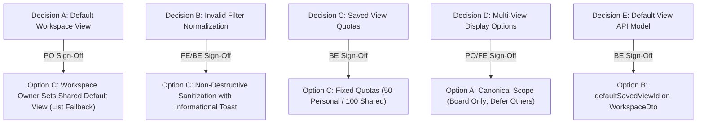

# SONDER — VS-07A.1: SAVED VIEWS CONTRACT RECONCILIATION & JOINT SIGN-OFF REPORT

**Document Version:** 1.0.0  
**Status:** CONTRACT RECONCILIATION & APPROVAL PACKET  
**Date:** 2026-11-10  
**Feature Branch:** `docs/FE-VS07A1-saved-views-contract-reconciliation`  
**Baseline Commit:** `6a6e46c` (HEAD of `develop`, clean and synchronized)  
**Governance Methodology:** PLAN → GRILL → IMPLEMENT → TEST → REVIEW → LOCK → DOCUMENT  
**Target Milestone:** VS-07A.1 (Contract Reconciliation & Formal Approval Packet)  

---

## Executive Summary & Governance Reconciliation

This document delivers **VS-07A.1**, the contract reconciliation, scope audit, and joint approval packet for **Saved Views (FEAT-C04)** in Sonder.

Following the authoring and merging of the initial readiness audit report ([PR #29](https://github.com/Samudra-Bose/sonder/pull/29), commit `fb45f66`), this milestone performs a rigorous comparative audit between:
1. The **canonical OpenAPI contract** (`Community-Work-Management-v1.5/docs/contracts/openapi.yaml`).
2. The **Master Specification v1.5.0** (§5.3).
3. The **proposed extensions** in [`proposed-saved-views-openapi.yaml`](file:///home/samudra/Projects/VisualSCode/VisualCode/Vscoding/Sonder/docs/04-implementation/proposed-saved-views-openapi.yaml).

### Strict Governance Status Disclosure
- **Documentation Milestone Merged:** PR #29 recorded the initial contract investigation in `develop`.
- **Merging PR #29 Did NOT Constitute Product Approval:** Merging documentation did not approve any proposed schema additions, product choices, or backend behaviors.
- **Existing Canonical Operations Audited:** The six core saved views operations (`listSavedViews`, `createSavedView`, `getSavedView`, `updateSavedView`, `deleteSavedView`, `copySavedView`) already exist in canonical OpenAPI 0.3.20-draft.
- **Proposed Contract Extensions Pending Review:** All proposed extensions (such as `PUT /default-view`, non-Board display options, and quotas) remain non-canonical, isolated, and strictly pending approval.
- **VS-07B Implementation Strictly Blocked:** No application code, UI components, or backend persistence may begin until Product Owner and Backend Lead complete formal joint sign-off on the criteria defined in Section 10.

---

## 1. Preflight Verification & Contract Immutability

### 1.1 Preflight Verification
- **Baseline Git SHA:** `6a6e46c` (verified clean working tree, `origin/develop` synchronized).
- **Dedicated Branch:** `docs/FE-VS07A1-saved-views-contract-reconciliation`.
- **Contract Immutability Check:** Verified `git diff --exit-code Community-Work-Management-v1.5/` returned 0 changes.
- **Generated Types Immutability Check:** Verified `git diff --exit-code packages/contracts/src/api-types.ts` returned 0 changes.
- **Documentation Validation:** `pnpm validate:docs` passed 51/51 checks.

---

## 2. Canonical Contract Reconciliation

The table below reconciles all Saved Views capabilities, comparing the existing canonical OpenAPI contract (`Community-Work-Management-v1.5/docs/contracts/openapi.yaml`) against proposed extensions and classifying each item's governance status.

### 2.1 Capability-by-Capability Comparison Matrix

| Capability | Existing Canonical Contract (`openapi.yaml`) | Proposed Extension (`proposed-saved-views-openapi.yaml`) | Decision & Governance Status |
| :--- | :--- | :--- | :--- |
| **List Saved Views** | `GET /communities/{cid}/workspaces/{wid}/saved-views`<br>• **Operation ID:** `listSavedViews` (lines 2435–2478)<br>• **Request:** No body. Path params `communityId`, `workspaceId`<br>• **Response:** `200 SavedViewListDto` (lines 8513–8521)<br>• **Auth:** Active member + `task:read`. Returns personal views for caller (`createdById = actor`) plus workspace shared views.<br>• **Errors:** 401, 403 (`INSUFFICIENT_CAPABILITY`), 404 | **Zero changes.** Canonical definition is complete, authoritative, and sufficient. | **EXISTING (CONFIRMED)**<br>No contract change required. |
| **Create Saved View** | `POST /communities/{cid}/workspaces/{wid}/saved-views`<br>• **Operation ID:** `createSavedView` (lines 2479–2547)<br>• **Headers:** `X-Mutation-Id`, `X-CSRF-Token`<br>• **Request:** `SaveViewRequest` (name, scope, viewType, querySpec, displayOptions?)<br>• **Response:** `201 SavedViewDto`. Headers: `X-Workspace-Seq` (for SHARED only), `X-Idempotent-Replayed`<br>• **Auth:** Personal=Member+`task:read`. Shared=Member+`task:read`+`saved_view:manage_shared`<br>• **Errors:** 400, 401, 403, 404, 409 (`SAVED_VIEW_NAME_CONFLICT`), 422 (`SAVED_VIEW_PROJECTION_INVALID`, `SAVED_VIEW_DISPLAY_OPTIONS_INVALID`) | Proposed explicit `422 SAVED_VIEW_LIMIT_EXCEEDED` error response for quota enforcement. | **EXISTING CORE / GAP FOR QUOTA ERROR**<br>Core operation confirmed. Quota error schema requires review. |
| **Retrieve Saved View** | `GET /communities/{cid}/workspaces/{wid}/saved-views/{viewId}`<br>• **Operation ID:** `getSavedView` (lines 2548–2595)<br>• **Request:** Path params `communityId`, `workspaceId`, `viewId`<br>• **Response:** `200 SavedViewDto`<br>• **Auth:** Active member + `task:read`. Returns shared view or caller's personal view. Caller attempting to read another member's personal view receives generic `404 RESOURCE_NOT_FOUND` (never 403) to prevent identity leakage.<br>• **Errors:** 401, 403, 404 (`RESOURCE_NOT_FOUND`) | **Zero changes.** Canonical definition is complete and authoritative. | **EXISTING (CONFIRMED)**<br>No contract change required. |
| **Update Saved View** | `PATCH /communities/{cid}/workspaces/{wid}/saved-views/{viewId}`<br>• **Operation ID:** `updateSavedView` (lines 2596–2689)<br>• **Headers:** `X-Mutation-Id`, `X-CSRF-Token`<br>• **Request:** `UpdateSavedViewRequest` (`version` required; optional `name`, `querySpec`, `viewType`, `displayOptions`)<br>• **Response:** `200 SavedViewDto`. Headers: `X-Workspace-Seq` (for SHARED only), `X-Idempotent-Replayed`<br>• **Auth:** Personal=`createdById` only. Shared=`saved_view:manage_shared` OR original creator while still active with `task:read`<br>• **Errors:** 400, 401, 403, 404, 409 (`SAVED_VIEW_VERSION_CONFLICT`, `SAVED_VIEW_NAME_CONFLICT`), 422 | Proposed extending `SavedViewDisplayOptions` with non-Board options (list, calendar, timeline). | **EXISTING CORE / REQUIRES REVIEW FOR NON-BOARD OPTIONS**<br>Optimistic concurrency and auth confirmed. Multi-view display options evaluated in Decision D. |
| **Delete Saved View** | `DELETE /communities/{cid}/workspaces/{wid}/saved-views/{viewId}`<br>• **Operation ID:** `deleteSavedView` (lines 2690–2737)<br>• **Headers:** `X-Mutation-Id`, `X-CSRF-Token`<br>• **Response:** `204 No Content`. Headers: `X-Workspace-Seq` (for SHARED only), `X-Idempotent-Replayed`<br>• **Auth:** Personal=`createdById` only. Shared=`saved_view:manage_shared` only (creator update exception does NOT grant deletion rights).<br>• **Errors:** 401, 403, 404, 409 | **Zero changes.** Canonical definition is complete and authoritative. | **EXISTING (CONFIRMED)**<br>No contract change required. |
| **Copy Saved View** | `POST /communities/{cid}/workspaces/{srcWid}/saved-views/{viewId}/copy`<br>• **Operation ID:** `copySavedView` (lines 5345–5410)<br>• **Headers:** `X-Mutation-Id`, `X-CSRF-Token`<br>• **Request:** `CopySavedViewRequest` (`targetWorkspaceId`, `name`, `scope`)<br>• **Response:** `201 SavedViewDto`. Headers: `X-Workspace-Seq` (target workspace, for SHARED dest only)<br>• **Auth:** Active member + `task:read` in source & dest. Personal=creator only. Dest Shared requires `saved_view:manage_shared`<br>• **Errors:** 400, 401, 403, 404, 409 (`SAVED_VIEW_NAME_CONFLICT`, `SAVED_VIEW_COPY_SAME_WORKSPACE`), 422 (`SAVED_VIEW_COPY_INCOMPATIBLE`) | **Zero changes.** Canonical definition is complete and authoritative. | **EXISTING (CONFIRMED)**<br>No contract change required. |
| **Default Workspace View** | **NOT IN CANONICAL OPENAPI**.<br>Workspace templates seed initial shared views (`defaultSavedViews`, lines 11840, 14697), but neither `WorkspaceDto` nor `WorkspaceSettingsDto` contains a `defaultSavedViewId` field, and no dedicated endpoint exists to set or change a workspace default view. | Proposes `PUT /communities/{cid}/workspaces/{wid}/default-view` with `SetWorkspaceDefaultViewRequest` (`defaultViewId: UUID | null`) returning `WorkspaceDefaultViewDto`. Alternatively, adding `defaultSavedViewId` to `WorkspaceDto`. | **CONTRACT GAP (REQUIRES REVIEW)**<br>Requires formal PO and Backend Lead decision (see Decision A & E). |
| **Display Options** | `SavedViewDisplayOptions` (lines 11274–11283) defines ONLY `board?: BoardSavedViewDisplayOptions` (`visibleCardBadges`, `showEmptyColumns`). Non-Board views must send `{}`. | Proposes `ExtendedSavedViewDisplayOptions` adding `list`, `calendar`, and `timeline` presentation preferences. | **PARTIALLY EXISTING / REQUIRES REVIEW**<br>Board options confirmed. Non-board options evaluated in Decision D (recommend deferral to avoid speculative bloat). |
| **Error Handling** | Canonical defines RFC 9457 `Problem`, `SavedViewVersionConflictProblem` (lines 8390–8410), and `SavedViewCopyIncompatibleProblem` (lines 11301–11325). | Proposes `SavedViewLimitExceededProblem` (`422 SAVED_VIEW_LIMIT_EXCEEDED`). | **REQUIRES REVIEW**<br>Quota problem schema requires backend agreement. |

---

## 3. Review & Streamlining of the Proposed OpenAPI Artifact

### 3.1 Identification of Redundant Duplication in VS-07A Draft
The initial draft of `docs/04-implementation/proposed-saved-views-openapi.yaml` (783 lines) inadvertently re-declared:
- All 6 operations (`listSavedViews`, `createSavedView`, `getSavedView`, `updateSavedView`, `deleteSavedView`, `copySavedView`).
- Core schemas (`SavedViewDto`, `SavedViewListDto`, `SaveViewRequest`, `UpdateSavedViewRequest`, `CopySavedViewRequest`, `BoardSavedViewDisplayOptions`, `SavedViewDisplayOptions`).

Because these paths and schemas are **already canonically defined** in `Community-Work-Management-v1.5/docs/contracts/openapi.yaml`, presenting them in the proposal created unnecessary confusion regarding whether new endpoints were being introduced.

### 3.2 Streamlined Delta Artifact
The proposed artifact [`proposed-saved-views-openapi.yaml`](file:///home/samudra/Projects/VisualSCode/VisualCode/Vscoding/Sonder/docs/04-implementation/proposed-saved-views-openapi.yaml) has been reduced to a clean, focused delta containing **ONLY** the proposed extensions under review:
1. **Proposed Path:** `PUT /communities/{communityId}/workspaces/{workspaceId}/default-view` (`setWorkspaceDefaultView`).
2. **Proposed Schemas:** `SetWorkspaceDefaultViewRequest`, `WorkspaceDefaultViewDto`.
3. **Proposed Multi-Projection Schema:** `ExtendedSavedViewDisplayOptions` (with `ListSavedViewDisplayOptions`, `CalendarSavedViewDisplayOptions`, `TimelineSavedViewDisplayOptions`).
4. **Proposed Error Schema:** `SavedViewLimitExceededProblem` (`422 SAVED_VIEW_LIMIT_EXCEEDED`).

### 3.3 Syntactic & Structural Validation
The streamlined delta was verified using Python's YAML parser:
- Root paths: `['/communities/{communityId}/workspaces/{workspaceId}/default-view']`
- Component schemas: `['SetWorkspaceDefaultViewRequest', 'WorkspaceDefaultViewDto', 'ExtendedSavedViewDisplayOptions', 'ListSavedViewDisplayOptions', 'CalendarSavedViewDisplayOptions', 'TimelineSavedViewDisplayOptions', 'SavedViewLimitExceededProblem', 'Uuid', 'BoardSavedViewDisplayOptions', 'Problem']`
- Result: **100% syntactically valid YAML; zero canonical specification files modified.**

---

## 4. Formal Product Decision Approval Matrix

Below is the definitive decision matrix for joint sign-off by the Product Owner and Backend Lead.



### Detailed Decision Evaluations

#### Decision A: Default Saved View Architecture
*Should a Workspace Owner define a default Shared View for the workspace, with List View as fallback? Should individual users have an independent personal override?*

- **Classification:** RECOMMENDED DEFAULT — REQUIRES FORMAL PRODUCT OWNER APPROVAL.
- **Options Considered:**
  - *Option A: Static Fallback Only.* Always land on `/list` with default filters.
  - *Option B: User-Only Preference.* Stored solely in personal user preferences.
  - *Option C: Workspace-Level Shared Default with List Fallback.* Workspace Owner designates an official shared view (`defaultSavedViewId`). All members opening `/c/:cid/w/:wid` redirect to this view. Unconfigured workspaces fall back to `/list`.
  - *Option D: Hybrid (Workspace Default + User Personal Override).* Workspace Owner sets team default; individual users can configure a personal override in user preferences.
- **Recommendation:** **Option C for Phase 1.** Establishes team alignment and clean template seeding. User personal overrides (Option D) should be deferred to Phase 2 to avoid multi-tier resolution complexity during initial launch.
- **Product Implications:** Teams onboarding to an event planning workspace land directly on the Event Calendar; engineering squads land on the Sprint Board.
- **Backend Implications:** Requires tracking which shared view is the workspace default, and handling cascade deletion if that view is deleted.
- **Approval Required From:** **Product Owner**.
- **Current Status:** **PENDING FORMAL APPROVAL**.

---

#### Decision B: Invalid Filter Normalization & User Presentation
*Should unsupported fields or filter conditions be removed non-destructively with an informational warning? How should invalid saved view configurations be presented to the user?*

- **Classification:** RECOMMENDED DEFAULT — REQUIRES FRONTEND & BACKEND LEAD APPROVAL.
- **Options Considered:**
  - *Option A: Hard 422 Error Banner.* Refuse to load the view; show an unrenderable error page.
  - *Option B: Silent Discard.* Strip unknown fields without alerting the user.
  - *Option C: Resilient Normalization with Non-Blocking Warning Toast.* Strip unrecognized condition nodes or fall back to default sort (`priority DESC`), load all valid criteria, and display an informational alert chip: *"Filter adjusted: Field 'Sprint' is no longer available in this workspace. [Save changes | Dismiss]"*.
- **Recommendation:** **Option C.** Follows robust fault-tolerance principles. Deleting a custom field must never brick saved views for an entire workspace.
- **Product Implications:** High availability and clear transparency for end-users.
- **Backend Implications:** Backend query processor drops unresolvable condition leaves without throwing 422, or returns a structured warning in the query response envelope.
- **Approval Required From:** **Frontend Lead & Backend Lead**.
- **Current Status:** **PENDING FORMAL APPROVAL**.

---

#### Decision C: Saved View Quotas
*Are 50 Personal and 100 Shared views suitable limits? Should these be configurable or fixed?*

- **Classification:** RECOMMENDED DEFAULT — REQUIRES BACKEND LEAD APPROVAL.
- **Options Considered:**
  - *Option A: Unlimited.* No limits.
  - *Option B: Low Strict Limits (e.g., 10 views).*
  - *Option C: Fixed Bounded Quotas (50 Personal / 100 Shared).* Hard ceiling enforced at API level.
  - *Option D: Plan-Configurable Quotas.*
- **Recommendation:** **Option C (Fixed Bounded Quotas).** 50 personal views per user per workspace and 100 shared views per workspace provide generous capacity for 70–90 users while preventing abuse, DoS, and Omnibar search degradation.
- **Product Implications:** Sufficient headroom for realistic team operations without cluttering dropdowns.
- **Backend Implications:** Backend checks count during `createSavedView` and `copySavedView`; returns `422 SAVED_VIEW_LIMIT_EXCEEDED` if exceeded.
- **Approval Required From:** **Backend Lead**.
- **Current Status:** **PENDING FORMAL APPROVAL**.

---

#### Decision D: Multi-View Display Options Scope
*Which presentation settings should actually be persisted for List, Board, Calendar, and Timeline?*

- **Classification:** RECOMMENDED DEFAULT — REQUIRES PRODUCT OWNER & FRONTEND LEAD APPROVAL.
- **Options Considered:**
  - *Option A: Canonical Scope (Board Only).* Persist `board` display options only (`visibleCardBadges`, `showEmptyColumns`), as already approved in canonical OpenAPI lines 11248–11273. Non-Board views persist empty display options `{}`.
  - *Option B: Full Speculative Extension.* Implement proposed `ListSavedViewDisplayOptions`, `CalendarSavedViewDisplayOptions`, and `TimelineSavedViewDisplayOptions` immediately.
  - *Option C: Essential Minimal Settings Only.* Add only `calendar.defaultMode: "month" | "week"` and `timeline.defaultMode: "day" | "week" | "month"`, deferring list column customization.
- **Recommendation:** **Option A (Canonical Scope - Board Only) for Phase 1.** Avoid adding configuration for hypothetical future requirements. Neither List, Calendar, nor Timeline currently support user-customizable column toggling or persistent zoom states. Implementing Option A adheres strictly to current functionality and prevents schema bloat.
- **Product Implications:** Eliminates premature complexity; ensures 100% compatibility with existing canonical OpenAPI schema.
- **Backend Implications:** Zero backend schema changes required for `SavedViewDisplayOptions`.
- **Approval Required From:** **Product Owner & Frontend Lead**.
- **Current Status:** **PENDING FORMAL APPROVAL**.

---

#### Decision E: Workspace Default View API Model
*Should the proposed default view mechanism use a dedicated endpoint (`PUT /default-view`) or an attribute on `WorkspaceDto`?*

- **Classification:** RECOMMENDED DEFAULT — REQUIRES BACKEND LEAD APPROVAL.
- **Options Considered:**
  - *Option A: Dedicated Sub-Resource Endpoint.* `PUT /communities/{cid}/workspaces/{wid}/default-view` with request body `{"defaultViewId": "<uuid> | null"}`.
  - *Option B: Direct Field on Workspace Settings.* Add `defaultSavedViewId?: string | null` to `WorkspaceDto` and `UpdateWorkspaceRequest` (`PATCH /communities/{cid}/workspaces/{wid}`).
- **Recommendation:** **Option B (Direct Field on Workspace Settings).** Adding `defaultSavedViewId` directly to `WorkspaceDto` aligns with existing workspace settings properties (`maxSubtaskDepth`, `keyPrefix`, `taskEditPolicy`), avoids creating a redundant single-purpose endpoint, and allows workspace update events (`workspace.updated`) to propagate the change automatically.
- **Product Implications:** Workspace Owners can set the default view from the general Workspace Settings panel or directly from a "Set as Workspace Default" option in the view dropdown.
- **Backend Implications:** Adding `default_saved_view_id UUID NULL REFERENCES saved_views(id) ON DELETE SET NULL` to the `workspaces` table.
- **Approval Required From:** **Backend Lead**.
- **Current Status:** **PENDING FORMAL APPROVAL**.

---

## 5. Backend Contract & Data Model Review

### 5.1 Proposed PostgreSQL DDL Review
The data model proposed in VS-07A was reviewed against canonical architectural standards:

```sql
CREATE TABLE IF NOT EXISTS saved_views (
    id UUID PRIMARY KEY DEFAULT gen_random_uuid(),
    community_id UUID NOT NULL REFERENCES communities(id) ON DELETE CASCADE,
    workspace_id UUID NOT NULL REFERENCES workspaces(id) ON DELETE CASCADE,
    name VARCHAR(120) NOT NULL,
    scope VARCHAR(20) NOT NULL CHECK (scope IN ('PERSONAL', 'SHARED')),
    view_type VARCHAR(20) NOT NULL CHECK (view_type IN ('LIST', 'BOARD', 'CALENDAR', 'TIMELINE')),
    query_spec JSONB NOT NULL,
    display_options JSONB NOT NULL DEFAULT '{}'::jsonb,
    version INTEGER NOT NULL DEFAULT 1,
    created_by_id UUID NOT NULL REFERENCES users(id) ON DELETE RESTRICT,
    created_at TIMESTAMPTZ NOT NULL DEFAULT NOW(),
    updated_at TIMESTAMPTZ NOT NULL DEFAULT NOW(),
    archived_at TIMESTAMPTZ NULL
);
```

### 5.2 Technical Invariants Verified
1. **Scope & Privacy Isolation:**
   - `scope = 'PERSONAL'` records MUST never be returned to other members under any circumstance, including Workspace Owner, Community Admin, and Break-Glass reader roles.
   - Enforced in RLS policy:
     ```sql
     CREATE POLICY rls_saved_views_select ON saved_views
         FOR SELECT
         USING (
             workspace_id = current_setting('app.current_workspace_id')::uuid
             AND archived_at IS NULL
             AND (
                 scope = 'SHARED' 
                 OR created_by_id = current_setting('app.current_user_id')::uuid
             )
         );
     ```
2. **Name Normalization & Uniqueness:**
   - Server must normalize `name` using **Unicode NFKC** and trim whitespace prior to insertion.
   - Case-insensitive uniqueness MUST be scoped:
     - For `SHARED`: unique on `(workspace_id, LOWER(BTRIM(name))) WHERE scope = 'SHARED' AND archived_at IS NULL`.
     - For `PERSONAL`: unique on `(workspace_id, created_by_id, LOWER(BTRIM(name))) WHERE scope = 'PERSONAL' AND archived_at IS NULL`.
3. **Optimistic Concurrency Control:**
   - `PATCH /saved-views/{viewId}` MUST include `version` in payload.
   - If payload `version != stored.version`, abort write and return `409 SAVED_VIEW_VERSION_CONFLICT`.
   - On successful update, increment `version = version + 1`.
4. **Idempotency & Replay:**
   - `POST`, `PATCH`, and `DELETE` enforce `X-Mutation-Id` headers. Replaying the same mutation ID with identical payload returns the cached result with `X-Idempotent-Replayed: true`.
5. **Realtime WebSocket Protocol:**
   - Realtime events are published **strictly for `SHARED` views**:
     - `saved_view.created` (increments `X-Workspace-Seq`)
     - `saved_view.updated` (increments `X-Workspace-Seq`)
     - `saved_view.deleted` (increments `X-Workspace-Seq`)
   - `PERSONAL` view mutations emit **zero** WebSocket frames.
6. **Copy-on-Write Isolation (Master Spec §5.3):**
   - Modifying filter chips in the browser updates URL search parameters only.
   - The database record is NEVER updated automatically upon transient navigation.

### 5.3 Assumptions for Backend Developer Validation
The backend developer must explicitly confirm the following assumptions:
1. **Default View Deletion Cascade:** When a SHARED view referenced by `workspaces.default_saved_view_id` is deleted, the foreign key constraint must specify `ON DELETE SET NULL`.
2. **Copy Endpoint Isolation:** `copySavedView` creates an entirely new record in the target workspace. Milestones and custom fields must be atomically re-validated against target workspace definitions. If unresolvable, the API must return `422 SAVED_VIEW_COPY_INCOMPATIBLE`.
3. **Audit Tombstones:** Deleting a SHARED view writes an entry to `audit_logs` before removing or tombstoning the record.

---

## 6. CI Workflow Observation & Investigation Report

### 6.1 Incident Observation
During milestone VS-07A, Pull Request [#29](https://github.com/Samudra-Bose/sonder/pull/29) was created on dedicated branch `docs/FE-VS07A-saved-views-contract-readiness` targeting `develop`. The resulting GitHub Actions run (`42671796615`) immediately terminated with status `failure` and 0 scheduled jobs (`jobs: []`), and downloading the log archive returned an empty 22-byte zip file.

### 6.2 Root Cause Analysis
Inspection of `.github/workflows/ci.yml` revealed two distinct factors:

1. **Push Trigger Branch Exclusion:**
   ```yaml
   on:
     push:
       branches:
         - main
         - develop
         - "feat/**"
         - "chore/**"
         - "fix/**"
         - "refactor/**"
   ```
   Branches matching `docs/**` or `audit/**` are **intentionally excluded** from `push` builds. This prevents redundant CI resource consumption when pushing intermediate documentation drafts.

2. **Pull Request Trigger & Runner Quota:**
   ```yaml
     pull_request:
       branches:
         - main
         - develop
   ```
   When PR #29 was opened targeting `develop`, GitHub Actions registered the `pull_request` event and created run `42671796615`. However, GitHub's hosted runner infrastructure failed to allocate an `ubuntu-latest` runner instance (a transient GitHub Actions runner provisioning stall or concurrency queue limit), causing the run to complete with `failure` before initializing any workflow steps or generating job logs.

### 6.3 Local Quality Gate Verification (Zero-Defect Evidence)
To ensure complete technical integrity regardless of GitHub runner availability, the entire CI pipeline was executed locally on `develop`:

| Step | Local Verification Command | Exit Code | Result |
| :--- | :--- | :--- | :--- |
| **Doc & Contract Checks** | `python3 Community-Work-Management-v1.5/validation/validate_v1_5.py` | 0 | 51 / 51 checks passed |
| **Contract Immutability** | `git diff --exit-code Community-Work-Management-v1.5/` | 0 | Clean (0 modifications) |
| **Typegen Verification** | `pnpm run typegen:check` | 0 | Clean (0 drift) |
| **Typecheck** | `pnpm run typecheck` | 0 | 0 errors across monorepo |
| **Automated Tests** | `pnpm run test` | 0 | 46 suites, 440 tests passed |
| **Production Build** | `pnpm --filter @sonder/web build` | 0 | Built in 3.49s (clean) |

### 6.4 Recommended Future Workflow Action (Out of Current Scope)
When workflow modifications are authorized in a future tooling milestone, `.github/workflows/ci.yml` should be updated to include `"docs/**"` under `on.push.branches` or adopt path-filtering (`paths-ignore: ['docs/**']`) to prevent false-negative check suite failures on documentation branches.

---

## 7. Frontend Integration Implications

When approved for VS-07B, Saved Views will integrate seamlessly with existing task architecture:

```
+----------------------------------------------------------------------------------------------------+
| TaskViewToolbar                                                                                    |
| [ List ] [ Board ] [ Calendar ] [ Timeline ]  | View: [ Active Sprint Backlog (Shared) v ] [Search]|
+----------------------------------------------------------------------------------------------------+
| DraftStateBar (Conditional): * Modified filters  [Reset to Original] [Save as Copy] [Update Shared]|
+----------------------------------------------------------------------------------------------------+
```

1. **`WorkspaceTasksView.tsx` Integration:**
   - Reads `?viewId=` from URL search parameters.
   - When `viewId` is present, `useSavedView(viewId)` hydrates the baseline query AST.
   - If URL parameters contain additional diffs, `DraftStateBar` activates.
2. **`SavedViewSelector.tsx`:**
   - Dropdown grouping `Shared Views` and `Personal Views`.
   - Visual indicator for active workspace default view.
   - Permission-aware action items: "+ Save current view", "Duplicate", "Delete".
3. **TanStack Query Cache Topology:**
   - Cache key: `["communities", cid, "workspaces", wid, "saved-views"]`
   - Automatically invalidated on `saved_view.*` WebSocket events.

---

## 8. Security & Privacy Review

1. **Confidentiality Invariant (CR-04 & SOT-01):**
   - Personal views belong strictly to their creator.
   - Querying `GET /saved-views/{viewId}` for another user's personal view returns `404 RESOURCE_NOT_FOUND` (not 403) to prevent existence leakage.
2. **Capability Invariants:**
   - Creating/deleting shared views strictly requires `saved_view:manage_shared`.
   - Modifying shared views requires `saved_view:manage_shared` OR original creator while active with `task:read`.
3. **Execution Safety:**
   - Stored saved views represent query presets; executing a saved view re-evaluates all task-level authorization dynamically. A user viewing a shared view never sees tasks they lack permissions to read.
4. **Injection Safety:**
   - View names are sanitized with Unicode NFKC normalization.
   - QuerySpec AST conditions are strictly validated against allowlisted field identifiers.

---

## 9. Formal Approval Checklist & Sign-Off Packet

Before milestone **VS-07B** implementation may begin, the following approvals must be recorded:

| Review Item | Responsible Role | Recommended Action | Sign-Off Status |
| :--- | :--- | :--- | :--- |
| **Decision A: Default Workspace View** | Product Owner | Approve Option C (Workspace Owner sets Shared Default View, List fallback) | [ ] PENDING PO APPROVAL |
| **Decision B: Invalid Filter Normalization** | PO & Frontend Lead | Approve Option C (Resilient normalization with non-blocking toast) | [ ] PENDING JOINT APPROVAL |
| **Decision C: Saved View Quotas** | Backend Lead | Approve Option C (Fixed 50 Personal / 100 Shared per workspace) | [ ] PENDING BE APPROVAL |
| **Decision D: Multi-View Display Options** | PO & Frontend Lead | Approve Option A (Canonical scope: Board only; defer non-Board) | [ ] PENDING JOINT APPROVAL |
| **Decision E: Default View API Model** | Backend Lead | Approve Option B (`defaultSavedViewId` field on `WorkspaceDto`) | [ ] PENDING BE APPROVAL |
| **PostgreSQL DDL & RLS Policies** | Backend Lead | Approve schema, unique indexes, and RLS policies in §5.1 | [ ] PENDING BE APPROVAL |
| **OpenAPI Contract Finalization** | PO & Backend Lead | Retain canonical OpenAPI for existing ops; sign off on delta | [ ] PENDING JOINT APPROVAL |

---

## 10. Explicit VS-07B Entry Criteria

Stage **VS-07B** (Frontend Implementation of Saved Views) shall **NOT** commence until all of the following criteria are satisfied:

- [ ] **Criterion 1:** Formal sign-off on Decisions A through E obtained from Product Owner and Backend Lead.
- [ ] **Criterion 2:** Final contract delta accepted (confirming whether `defaultSavedViewId` is placed on `WorkspaceDto` or a sub-resource endpoint).
- [ ] **Criterion 3:** Canonical OpenAPI and generated TypeScript types updated (or MSW mock contract aligned with approved delta).
- [ ] **Criterion 4:** Working tree on `develop` clean and verified.
- [ ] **Criterion 5:** Dedicated feature branch `feat/FE-VS07B-saved-views` created from verified baseline.
