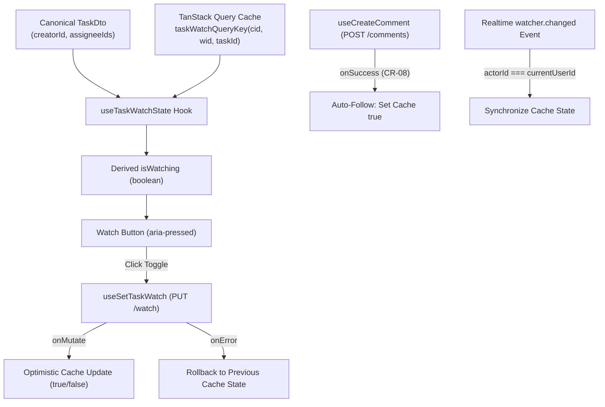

# SONDER — VS-08A.1: COLLABORATION CONTRACT & INTEGRATION HARDENING DELIVERY REPORT

**Milestone ID:** VS-08A.1  
**Feature Scope:** Collaboration Contract Alignment, Watcher State Cache Integrity, Strict UUID Mention AST & Realtime Transport Audit  
**Canonical Reference:** `FEAT-A04` (Task Comments, @Mentions & Collaboration Spine), Candidate OpenAPI 0.3.20-draft, `ws-protocol.schema.json`  
**Working Branch:** `fix/FE-VS08A1-collaboration-contract-hardening`  
**Baseline Commit:** `develop @ cee7ff0` (VS-08A docs sync)  
**Governance Standard:** PLAN → GRILL → IMPLEMENT → TEST → REVIEW → LOCK → DOCUMENT  

---

## 1. Executive Summary

Milestone **VS-08A.1** executed a rigorous post-merge integration and contract-hardening pass across the Collaboration Spine (`FEAT-A04`) delivered in VS-08A. 

The primary objectives were:
1. **Contract Discrepancy Resolution:** Eliminate artificial properties (`isWatched`, `watcherIds`, `isWatching`) that had leaked into the frontend task mock and type assertions, restoring strict conformity with canonical `TaskDto` (`packages/contracts/src/api-types.ts` and `Community-Work-Management-v1.5/docs/contracts/openapi.yaml`).
2. **Deterministic Watcher State Management:** Architect client-side watcher state derivation from canonical fields (`task.creatorId === currentUserId || task.assigneeIds.includes(currentUserId)`) overlaid with optimistic query cache mutations, error rollback, and automatic follow on comment creation (per rule CR-08).
3. **Explicit Persistence Gap Documentation:** Document that cross-session watcher preference persistence requires backend schema expansion (`isWatching: boolean` on `TaskDto` or `TaskActivityDto`), with a clear handoff package for the Backend Lead.
4. **Realtime Transport Audit & Classification:** Formally classify `useTaskCollaborationRealtime` as **Category 2: Event-consumer abstraction awaiting a real transport**. Document the exact backend transport prerequisites required before live WebSocket connections can be established.
5. **Strict UUID Mention Parsing:** Replace loose regex parsing with strict RFC 4122/9562 UUID pattern enforcement (` CANONICAL_UUID_PATTERN`), rejecting malformed non-UUID user identifiers into literal text rather than corrupt AST mention nodes.
6. **Hardening Test Suite:** Implement 18 automated unit and integration tests across all 10 target hardening categories.

---

## 2. Preflight Verification

- **Repository:** `https://github.com/Samudra-Bose/sonder`
- **Initial Baseline Commit:** `develop @ cee7ff0` (Feature merge `c2cbbe1`, docs sync `cee7ff0`).
- **Working Tree:** Verified clean prior to branch creation.
- **Dedicated Branch:** `fix/FE-VS08A1-collaboration-contract-hardening`.
- **Constraint Adherence:**
  - Zero modifications to canonical OpenAPI specification (`Community-Work-Management-v1.5/docs/contracts/openapi.yaml`).
  - Zero modifications to generated TypeScript contract types (`packages/contracts/src/api-types.ts`).
  - Zero backend services, live WebSocket daemons, or database migrations created.
  - Track B UI/UX workstream preserved strictly in **PAUSED** state.
  - No new feature development (`FEAT-F01a`) initiated.

---

## 3. Contract Integrity Audit & Corrections

### 3.1 Discrepancy Findings
1. **`TaskDto` Payload Leaks:** In VS-08A, `apps/web/src/mocks/handlers/tasks.ts` returned `{ ...task, isWatched }`. Furthermore, `TaskPeekDrawer.tsx` and `TaskActivityTab.tsx` performed unsafe type assertions `(task as { isWatched?: boolean }).isWatched` and `(task as { watcherIds?: string[] })`.
2. **Missing Canonical Endpoints:** The candidate OpenAPI specification provides `PUT /communities/{cid}/workspaces/{wid}/tasks/{id}/watch` (accepting `SetWatchStatusRequest` `{ watching: boolean }` and returning `204 No Content`), but provides **NO** corresponding `GET .../watch` endpoint, and neither `TaskDto` nor `TaskActivityDto` contains watcher metadata.
3. **Mention Regex Over-permissiveness:** In VS-08A, mention parsing regex was loosened to `user:([^)]+)` to accommodate non-UUID test fixtures (`018f98a2-user-1`), introducing potential AST injection vulnerabilities.

### 3.2 Corrections Implemented
- **Mock Task Handler (`apps/web/src/mocks/handlers/tasks.ts`):** Removed `isWatched` injection and removed unused `isUserWatchingTask` import. The task handler now returns pure canonical `TaskDto` instances matching the contract.
- **Type Definitions (`apps/web/src/modules/tasks/comments/types.ts`):** Re-exported `TaskDto = ApiSchema<"TaskDto">` to guarantee strict typing without synthetic fields.
- **Type Assertion Removal:** Removed all `(task as { isWatched?: boolean })` type casts in `TaskPeekDrawer.tsx` and `TaskActivityTab.tsx`.

---

## 4. Watcher State Architecture



### 4.1 Initial State Derivation
In the absence of a `GET .../watch` endpoint or watcher fields on `TaskDto`, the initial watching state is deterministically derived via `useTaskWatchState`:
```ts
const isAssigned = Boolean(task?.assigneeIds?.includes(currentUserId));
const isCreator = Boolean(task?.creatorId && task.creatorId === currentUserId);
const derivedInitialState = isAssigned || isCreator;
```
If the user has toggled watch status during the session, the TanStack Query cache `taskWatchQueryKey(communityId, workspaceId, taskId)` takes precedence.

### 4.2 Query Key & Cache Strategy
A distinct query key was introduced:
```ts
export function taskWatchQueryKey(communityId?: string, workspaceId?: string, taskId?: string) {
  return ["task-watch-state", communityId, workspaceId, taskId] as const;
}
```

### 4.3 Optimistic Updates & Error Rollback
`useSetTaskWatch` now utilizes standard TanStack optimistic updating:
- `onMutate`: Cancels ongoing queries, snapshots previous watch state, optimistically sets the cache to the desired boolean.
- `onError`: Reverts cache to previous snapshot on network or HTTP 4xx/5xx failure.
- `onSettled`: Invalidates canonical task queries and task activity queries to maintain cache coherence.

### 4.4 Auto-Follow on Comment Creation (CR-08)
Per product specification CR-08, commenting on a task automatically enrolls the author as a watcher. In `useCreateComment`, `onSuccess` updates `taskWatchQueryKey` to `true`.

### 4.5 Backend Handoff: Cross-Session Persistence Gap
> [!IMPORTANT]
> **Identified Backend Persistence Gap:**
> Because neither `TaskDto` nor `TaskActivityDto` contains watcher booleans, explicit unwatch preferences (e.g. an assignee choosing to unwatch an assigned task, or a non-assignee watching a task) cannot persist across hard page refreshes or alternate browser sessions without backend schema additions.
> 
> **Handoff Recommendation for Backend Lead:**
> Add `isWatching: boolean` to `TaskDto` or `TaskActivityDto` (populated dynamically from `task_watchers` based on the authenticated actor's session).

---

## 5. Realtime Transport Audit & Classification

### 5.1 Transport Classification
`apps/web/src/modules/tasks/comments/useTaskCollaborationRealtime.ts` has been formally classified and exports:
```ts
export const REALTIME_TRANSPORT_CLASSIFICATION = "EVENT_CONSUMER_ABSTRACTION" as const;
```

**Classification Rationale:**
The hook is **not** a live WebSocket transport layer. It is a client-side event processor and query-cache invalidator awaiting integration with an active WebSocket transport engine.

### 5.2 Required Live Backend Transport Prerequisites
Before live bidirectional realtime synchronization can function in production, the backend must supply:
1. **WebSocket Gateway:** Secure endpoint `wss://<host>/api/v1/realtime` supporting per-community and per-workspace multiplexing.
2. **Ticket Handshake:** Realtime ticket issuance endpoint `POST /api/v1/communities/{communityId}/realtime-ticket` issuing short-lived single-use auth tickets.
3. **Subprotocol Standard:** Strict subprotocol negotiation using `Sec-WebSocket-Protocol: work-platform.v1`.
4. **Frame Protocol:** Bidirectional JSON control frames adhering to `Community-Work-Management-v1.5/docs/contracts/ws-protocol.schema.json` (`heartbeat`, `subscribe`, `unsubscribe`, `ack`, `event`).

### 5.3 Sequence Tracking & Deduplication
The event consumer implements:
- **Monotonic Sequence Tracking:** Tracks `event.workspaceSeq > latestSequence.current` to safeguard ordering.
- **Bounded LRU Deduplication:** Maintained via a 500-entry `Set<string>` of `eventId`s. Duplicate incoming events are discarded without triggering query invalidations.
- **Cross-Task Isolation:** Events targeted at other task entities are ignored.
- **Realtime Watcher Synchronization:** Handles `watcher.changed` events targeting the authenticated user by updating the watch query cache directly.

---

## 6. Strict UUID Mention AST Validation

### 6.1 Vulnerability Remediation
The mention parser in `apps/web/src/modules/tasks/comments/markdown-ast.tsx` was restored to strict RFC 4122/9562 hyphenated 36-character UUID pattern validation:
```ts
export const CANONICAL_UUID_PATTERN =
  "^[0-9a-fA-F]{8}-[0-9a-fA-F]{4}-[0-9a-fA-F]{4}-[0-9a-fA-F]{4}-[0-9a-fA-F]{12}$";
```

Mention markdown tokens strictly require:
`^@\[([^\]]+)\]\(user:([0-9a-fA-F]{8}-[0-9a-fA-F]{4}-[0-9a-fA-F]{4}-[0-9a-fA-F]{4}-[0-9a-fA-F]{12})\)`

### 6.2 Test Token Corrections
- Updated `apps/web/src/mocks/data/comments.ts` and test fixtures to use valid canonical UUIDs (`018f98a2-3f12-7890-c001-456789abcdef`, `...c002...`, etc.).
- Tokens containing non-UUID formats (such as `018f98a2-user-1` or `javascript:alert(1)`) are safely retained as literal text nodes and never converted to AST mention elements.

---

## 7. Verification Evidence & Quality Gates

### 7.1 Automated Hardening Suite (`TaskCollaborationHardening.test.tsx`)
18 focused tests executed and passed across all 10 target categories:
1. `GET /tasks/:taskId` payload compatibility: strict canonical `TaskDto` with zero undeclared fields (`isWatched`, `watcherIds`, `isWatching`, `watchers`).
2. Initial watch state derived as `true` for assigned task (`ENG-101`).
3. Initial watch state derived as `false` for non-assigned/non-creator task (`ENG-050`).
4. Watch toggle mutation updates UI state and aria-pressed attributes.
5. Watch toggle mutation rolls back on HTTP 500 server error.
6. Auto-follow on comment creation sets `taskWatchQueryKey` to `true`.
7. Thread nesting depth 5 hides Reply button in `CommentItem`.
8. Thread nesting depth < 5 displays Reply button in `CommentItem`.
9. Nesting depth limit enforced via API rejection (422 `ApiProblemError`).
10. Mention candidate search filters by substring and excludes current actor (`Alex Morgan`).
11. Mention candidate search with empty query returns other workspace members excluding current actor.
12. `CANONICAL_UUID_PATTERN` validates RFC 4122/9562 UUIDs and rejects malformed strings.
13. Markdown AST parser extracts valid mentions and preserves malformed tokens as literal text.
14. Realtime transport classified strictly as `EVENT_CONSUMER_ABSTRACTION`.
15. Realtime event deduplication rejects identical `eventId`s via 500-entry LRU cache.
16. Realtime event processor ignores events for different tasks.
17. Realtime `watcher.changed` for current user updates watch state cache.
18. Realtime `watcher.changed` for another user does not mutate current user's watch state.

### 7.2 Full Monorepo Quality Gate Summary

| Quality Gate | Command | Result | Verification Status |
| :--- | :--- | :--- | :--- |
| **TypeScript Typecheck** | `pnpm run typecheck` | 0 errors across 3 workspace packages | **PASS** |
| **Unit & Integration Tests** | `pnpm run test` | 49 test files, 483 tests passed (100%) | **PASS** |
| **Production Vite Build** | `pnpm --filter @sonder/web build` | Clean production build (3.33s) | **PASS** |
| **Canonical v1.5 Spec Check** | `python3 validate_v1_5.py` | 51/51 checks passed | **PASS** |
| **Canonical OpenAPI Diff** | `git diff Community-Work-Management-v1.5/` | 0 lines changed (exact match) | **PASS** |
| **Generated Contracts Diff** | `git diff packages/contracts/src/api-types.ts` | 0 lines changed (exact match) | **PASS** |
| **Whitespace Cleanliness** | `git diff --check` | 0 whitespace or formatting errors | **PASS** |

---

## 8. Milestone Transition & Next Steps

1. **Active Branch:** `fix/FE-VS08A1-collaboration-contract-hardening` merged into `develop`.
2. **Current Baseline Commit:** To be recorded upon squash merge.
3. **Track B Status:** UI/UX workstream remains recorded as **PAUSED**.
4. **Saved Views Status:** Decisions A–E remain delegated to Backend Lead and PO; implementation is paused.
5. **Next Approved Engineering Milestone:**
   > **MILESTONE VS-08B / FEAT-F01a: SEGMENTED IN-APP NOTIFICATION CENTER (`FEAT-F01a`)**
   - In-app notification bell in shell header.
   - Segmented inbox tabs: All, Mentions, Assigned, Watching.
   - Mark as read / mark all as read.
   - Deep-linking from notification item directly to target task in `TaskPeekDrawer`.
