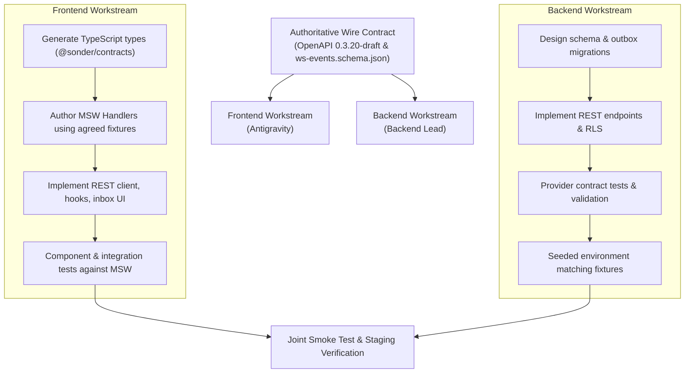

# SONDER — PROPOSED NOTIFICATION BACKEND INTEGRATION CONTRACT (FEAT-F01a)

> [!IMPORTANT]
> **PROPOSED FE/BE INTEGRATION CONTRACT — pending Backend Lead and Product Owner review. Not frozen.**  
> This specification defines the mutual wire contract, data types, mutation semantics, cursor pagination, realtime event boundaries, and error behavior for the **Segmented In-App Notification Center (`FEAT-F01a`)**.

**Milestone ID:** VS-08B.0.1  
**Canonical Feature Reference:** `FEAT-F01a`  
**Governance Stage:** PLAN → GRILL → DOCUMENT  
**Target Repository:** `Samudra-Bose/sonder`  
**Working Branch:** `docs/FE-VS08B01-notification-contract-alignment`  
**Baseline Commit:** `develop @ e7ebb05`  
**Normative Wire Contract:** OpenAPI 0.3.20-draft (`Community-Work-Management-v1.5/docs/contracts/openapi.yaml`) & `ws-events.schema.json`  

---

## 1. Executive Summary & Purpose

The Sonder Notification Center (`FEAT-F01a`) provides team members with a durable, recipient-scoped inbox for triaging mentions, task assignments, due-date reminders, and watched-item updates.

To enable **independent, parallel development** between frontend and backend teams without integration friction or contract drift, this document establishes:
1. **Authoritative Wire Endpoints:** The exact REST operations, headers, path parameters, query specifications, response codes, and schemas.
2. **Deterministic List Semantics:** Invariants governing `unreadCount`, cursor pagination, and ordering.
3. **One-Way Read-State Mutations:** Explicit mutation idempotency (`X-Mutation-Id`), replay semantics, and the absence of mark-as-unread.
4. **Navigation Gap Analysis (`DEP-NOTIF-02`):** Evaluation of `NotificationDto` limitations for task deep-linking, proposing typed navigation targets and strictly prohibiting regex fallbacks.
5. **Realtime Event Boundary (`DEP-NOTIF-03`):** Strict closed-payload separation between WebSocket signals and REST hydration (CR-10).
6. **Parallel FE/BE Workflow & Verified Contract Examples:** Concrete schema-validated JSON fixtures for mock and provider testing.

---

## 2. Authoritative REST Endpoint Reference

All notification endpoints operate within the community security boundary and require an active session.

### 2.1 List Notifications (`listNotifications`)

- **HTTP Method & Route:** `GET /communities/{communityId}/notifications`
- **Operation ID:** `listNotifications`
- **Purpose:** Retrieve the private, paginated notification inbox for the authenticated user within the specified community.
- **Authentication:** Required. Session cookie (`__Host-session`).
- **Authorization Scope:** 
  - Caller must be an active member of `communityId` (`COMMUNITY_MEMBERSHIP_REQUIRED` on failure).
  - Scope is strictly **self-only**: The backend derives the recipient identity exclusively from the authenticated session. Notification rows belonging to other users or other communities are never disclosed.
- **Path Parameters:**
  - `communityId` (UUID): Target community identifier.
- **Query Parameters:**
  - `cursor` (string, optional): Opaque cursor identifying the pagination boundary from a prior page's `nextCursor`.
  - `limit` (integer, optional): Page size. Minimum: `1`, Maximum: `100`, Default: `50`.
  - `category` (enum, optional): Must match `NotificationCategory` (`"ACTION_REQUIRED"` | `"UPDATES"`).
  - `unreadOnly` (boolean, optional): If `true`, returns only unread notification rows (`isRead: false`).
- **Request Headers:**
  - `Cookie: __Host-session=...`
- **Request Body:** None (GET request).
- **Success Response:**
  - **Status Code:** `200 OK`
  - **Headers:** `Cache-Control: private, no-store`
  - **Schema:** `components["schemas"]["NotificationListDto"]`
    ```typescript
    {
      items: NotificationDto[];
      nextCursor: string | null;
      unreadCount: number;
    }
    ```
- **Documented Error Responses:**
  - `400 Bad Request`: `Problem` (Invalid query parameter, e.g. invalid limit or malformed cursor).
  - `401 Unauthorized`: `Problem` (Missing, invalid, or expired session cookie).
  - `403 Forbidden`: `Problem` (`COMMUNITY_MEMBERSHIP_REQUIRED`).
  - `404 Not Found`: `Problem` (Community does not exist).
  - `409 Conflict`: `Problem` (State conflict).
  - `422 Unprocessable Entity`: `Problem` (Malformed request structure).
- **Generated Types:** `@sonder/contracts` -> `operations["listNotifications"]`, `NotificationListDto`, `NotificationDto`.

---

### 2.2 Mark One Notification as Read (`markNotificationRead`)

- **HTTP Method & Route:** `POST /communities/{communityId}/notifications/{notificationId}/read`
- **Operation ID:** `markNotificationRead`
- **Purpose:** Mark a specific notification row as read for the authenticated user.
- **Authentication:** Required. Session cookie (`__Host-session`) and CSRF synchronizer token (`__Host-auth-csrf`).
- **Authorization Scope:**
  - Caller must own the notification row in `communityId`.
  - If `notificationId` belongs to another user or another community, the backend MUST respond with `404 Not Found` to prevent identity enumeration.
- **Path Parameters:**
  - `communityId` (UUID): Target community identifier.
  - `notificationId` (UUID): Target notification identifier.
- **Query Parameters:** None.
- **Request Headers:**
  - `X-Mutation-Id` (UUIDv7, required): Client-generated mutation idempotency key.
  - `X-CSRF-Token` (string, required): Session-bound CSRF token.
- **Request Body:** None (`requestBody: never`).
- **Success Response:**
  - **Status Code:** `204 No Content`
  - **Headers:**
    - `Cache-Control: private, no-store`
    - `X-Idempotent-Replayed: boolean` (`true` if replaying an identical mutation ID)
- **Documented Error Responses:**
  - `400 Bad Request`: `Problem` (`CSRF_TOKEN_REQUIRED`, `MUTATION_ID_REQUIRED`).
  - `401 Unauthorized`: `Problem` (`UNAUTHENTICATED`).
  - `403 Forbidden`: `Problem` (`COMMUNITY_MEMBERSHIP_REQUIRED`).
  - `404 Not Found`: `Problem` (`NOTIFICATION_NOT_FOUND`).
  - `409 Conflict`: `Problem` (`IDEMPOTENCY_KEY_PAYLOAD_MISMATCH`, `IDEMPOTENCY_REQUEST_IN_PROGRESS`).
  - `422 Unprocessable Entity`: `Problem`.
- **Generated Types:** `@sonder/contracts` -> `operations["markNotificationRead"]`.

---

### 2.3 Mark All Notifications as Read (`markAllNotificationsRead`)

- **HTTP Method & Route:** `POST /communities/{communityId}/notifications/read-all`
- **Operation ID:** `markAllNotificationsRead`
- **Purpose:** Mark all unread notification rows for the authenticated user in the target community as read in a single atomic transaction.
- **Authentication:** Required. Session cookie (`__Host-session`) and CSRF synchronizer token (`__Host-auth-csrf`).
- **Authorization Scope:** Self-only for the caller's notifications within `communityId`.
- **Path Parameters:**
  - `communityId` (UUID): Target community identifier.
- **Query Parameters:** None.
- **Request Headers:**
  - `X-Mutation-Id` (UUIDv7, required): Client-generated mutation idempotency key.
  - `X-CSRF-Token` (string, required): Session-bound CSRF token.
- **Request Body:** None (`requestBody: never`).
- **Success Response:**
  - **Status Code:** `204 No Content`
  - **Headers:**
    - `Cache-Control: private, no-store`
    - `X-Idempotent-Replayed: boolean`
- **Documented Error Responses:**
  - `400 Bad Request`: `Problem` (`CSRF_TOKEN_REQUIRED`, `MUTATION_ID_REQUIRED`).
  - `401 Unauthorized`: `Problem` (`UNAUTHENTICATED`).
  - `403 Forbidden`: `Problem` (`COMMUNITY_MEMBERSHIP_REQUIRED`).
  - `404 Not Found`: `Problem` (`COMMUNITY_NOT_FOUND`).
  - `409 Conflict`: `Problem` (`IDEMPOTENCY_KEY_PAYLOAD_MISMATCH`, `IDEMPOTENCY_REQUEST_IN_PROGRESS`).
  - `422 Unprocessable Entity`: `Problem`.
- **Generated Types:** `@sonder/contracts` -> `operations["markAllNotificationsRead"]`.

---

## 3. Notification List Semantics, Cursor Pagination & Ordering

### 3.1 Taxonomy Constraints
- **Categories:** Strictly restricted to the canonical `NotificationCategory` enum:
  - `ACTION_REQUIRED`: Items requiring direct user action (mentions, assigned tasks, due date reminders, overdue tasks).
  - `UPDATES`: Informational signals (comments on watched tasks, governance notices, break-glass security logs).
- **Reasons:** Strictly restricted to the canonical `NotificationReason` enum:
  - `MENTION`
  - `TASK_ASSIGNED`
  - `TASK_DUE_REMINDER`
  - `TASK_OVERDUE`
  - `COMMENT_UPDATE`
  - `GOVERNANCE_ALERT`
  - `BREAK_GLASS_ALERT`

### 3.2 Canonical `unreadCount` Invariant
Per OpenAPI line 2742 and line 3018:
> **`unreadCount` is the unread count for the authenticated user across the full community inbox, strictly independent of category/unreadOnly filters or pagination.**

**Frontend Invariant:** The frontend MUST NEVER compute or override the global unread badge from the currently loaded page or active category filters. It must always display the canonical `unreadCount` returned by the server.

### 3.3 Cursor Pagination & Ordering Rules
1. **Opaque Cursors:** Cursors are opaque strings managed by the backend. The frontend treats them as tokens and passes them back unchanged via `?cursor=`.
2. **Filter Reset:** Starting a new filter combination (switching `category` or toggling `unreadOnly`) resets pagination; the client must omit `cursor` on the initial request of a new filter set.
3. **Cursor Isolation Security:** The backend cursor implementation must decode to or validate against `(userId, communityId)`. A client cannot manipulate a cursor to traverse another user's inbox or access another community.
4. **Deterministic Ordering (Recommendation):**
   - The backend MUST order results deterministically: `ORDER BY created_at DESC, id DESC`.
   - The unique identifier (`id`) serves as the secondary tie-breaker for notifications sharing the exact same millisecond timestamp, guaranteeing zero item duplication or omission across page boundaries.

---

## 4. Read-State Mutation Semantics & Concurrency

### 4.1 Strict Absence of "Mark as Unread"
The canonical OpenAPI 0.3.20-draft does not provide any endpoint, request parameter, or payload to mark an already-read notification as unread.
- **Frontend Contract:** Read-state mutation is strictly **one-way** (`isRead: false -> true`). The UI will not render a fake "Mark as unread" action.
- **Backend Contract:** The backend must reject unsupported verbs or payload flags.

### 4.2 Mutation Idempotency & Replay Semantics
Mutations enforce Sonder's platform-wide idempotency contract:
1. **Mutation ID Lifecycle:**
   - Every user-initiated mark-read action generates a new UUIDv7 passed in `X-Mutation-Id`.
   - Automatic network retries of the *same* user action MUST reuse the same `X-Mutation-Id`.
2. **Replay Behavior:**
   - Repeated requests with the same `X-Mutation-Id` and canonical parameters return `204 No Content` with `X-Idempotent-Replayed: true`.
   - **Counter Invariant:** A replayed mark-read operation MUST NOT decrement the unread counter a second time.
3. **Concurrent Arrivals During `mark-all-read`:**
   - When `markAllNotificationsRead` executes, it applies to all unread notifications existing within that database transaction snapshot.
   - Any notification created after the snapshot commit remains unread (`isRead: false`).
   - The subsequent `GET /notifications` query will reflect the exact surviving unread count.

---

## 5. Notification DTO & Task Navigation Gap (`DEP-NOTIF-02`)

### 5.1 Existing `NotificationDto` Schema Audit
The existing schema in `packages/contracts/src/api-types.ts` defines:

| Field | Type | Nullable | Canonical Semantics |
| :--- | :--- | :--- | :--- |
| `id` | `Uuid` | No | Opaque UUID identifier of the notification record. |
| `eventType` | `string` | No | Stable source domain event family (e.g., `"task.comment.mention"`). |
| `title` | `string` | No | Safe human-readable title (e.g., `"Jordan Lee mentioned you in ENG-101"`). |
| `body` | `string` | Yes | Optional safe summary; never raw Markdown/AST or hidden content. |
| `resourceType` | `string` | Yes | Resource kind (e.g., `"task"`). Null if inaccessible to caller. |
| `resourceId` | `Uuid` | Yes | UUID of the linked resource. Null if inaccessible to caller. |
| `createdAt` | `string` | No | ISO 8601 date-time timestamp. |
| `isRead` | `boolean` | No | Whether the notification has been marked read by caller. |
| `category` | `NotificationCategory` | No | `"ACTION_REQUIRED"` or `"UPDATES"`. |
| `reason` | `NotificationReason` | No | Canonical reason enum. |

### 5.2 The Deep-Linking Navigation Problem
To open a task in Sonder, the frontend application shell and `useTaskPeekDrawer` rely on:
```
/workspaces/{workspaceId}/list?task={taskKey}
```
where:
1. `workspaceId` is the UUID of the workspace containing the task.
2. `taskKey` is the human-readable identifier (e.g., `ENG-101`).

**Critical Gap:** `NotificationDto` provides only `resourceId` (the task UUID) and `resourceType: "task"`. It contains **neither `taskKey` nor `workspaceId`**.

### 5.3 Prohibited Workarounds
The frontend will strictly NOT:
1. Extract task keys from `title` using regular expressions (e.g., `/\b([A-Z0-9]+-\d+)\b/`).
2. Guess or infer `workspaceId` from active context or community prefix registries.
3. Fabricate non-canonical endpoints (e.g., `/tasks/{uuid}/resolve`).
4. Render misleading clickable rows that navigate to invalid routes or broken states.

### 5.4 Proposed Solutions for Backend Lead Review (`DEP-NOTIF-02`)

We submit two concrete proposals for joint sign-off:

#### Proposal A: Structured Navigation Target Object (Recommended)
Add an optional structured `target` object to `NotificationDto`:
```yaml
target:
  type: object
  nullable: true
  description: Typed navigation target returned when the caller retains access to the resource.
  properties:
    kind:
      type: string
      enum: [task]
    workspaceId:
      $ref: '#/components/schemas/Uuid'
    taskKey:
      type: string
      pattern: '^[A-Z0-9]+-[0-9]+$'
    taskId:
      $ref: '#/components/schemas/Uuid'
```
*Benefits:* Extensible to future non-task entities (e.g., `milestone`, `saved_view`, `governance`) without top-level field bloat.

#### Proposal B: Direct Field Extension
Add `workspaceId` and `taskKey` directly to `NotificationDto`:
```yaml
workspaceId:
  $ref: '#/components/schemas/Uuid'
  nullable: true
taskKey:
  type: string
  nullable: true
```
*Benefits:* Flat, simple addition to existing DTO.

> [!CAUTION]
> **Decision Required (`DEP-NOTIF-02`):** Until Proposal A or B is approved and implemented in OpenAPI by the Backend Lead, notification rows will remain **informational cards with mark-read actions only**, with deep-link navigation visibly deferred.

---

## 6. Filtering Taxonomy & Reason Discrepancy

### 6.1 First-Release Scope
- Category tabs: `All`, `ACTION_REQUIRED`, `UPDATES`.
- Unread filter: `unreadOnly=true|false`.
- Reason display: Displayed as metadata on each notification card.
- **Client-Side Reason Filtering Prohibition:** The frontend will NOT implement client-side reason faceting (e.g., "Mentions only") across paginated cursor results. Filtering only the currently loaded page would produce false-empty states and misleading views.
- **Future Extension:** If granular sub-filters (Mentions, Assigned, Watching) are required by product, the backend will introduce `?reason=NotificationReason` to `GET /notifications`.

### 6.2 Reason Enum Discrepancy Reconciliation
- **Candidate OpenAPI 0.3.20-draft (Normative):**
  `MENTION`, `TASK_ASSIGNED`, `TASK_DUE_REMINDER`, `TASK_OVERDUE`, `COMMENT_UPDATE`, `GOVERNANCE_ALERT`, `BREAK_GLASS_ALERT`
- **Master Specification §7 Example (Appendix V):**
  Uses `"MENTIONED_IN_COMMENT"` and `"TASK_COMMENT"`.
- **Binding Reconciliation:** The normative contract is OpenAPI 0.3.20-draft. Neither team will introduce ad-hoc string casts or rename enum values. The reason for user mentions is strictly `MENTION`.

---

## 7. Realtime Contract Boundary (`DEP-NOTIF-03`)

### 7.1 Separation of Concerns
1. **REST as Authority:** The REST API is the authoritative system of record for notification data, listing, pagination, and mutation.
2. **WebSocket as Signal:** The WebSocket connection delivers lightweight signals on the `user-community` stream.
3. **Deployment Timing:** The frontend will NOT connect to WebSocket for notifications until the backend realtime gateway, ticket issuance lifecycle, and user-community streams are deployed and verified.

### 7.2 Event Payload Specification
Conforming to `ws-events.schema.json` lines 377–481:

| Event Type | Stream | Payload Shape | Intentionally Excluded Fields |
| :--- | :--- | :--- | :--- |
| `notification.created` | `user-community` | `{ notificationId: Uuid, category: NotificationCategory, reason: NotificationReason, unreadCount: integer }` | `title`, `body`, comment text, task key, user IDs, email, mention lists (CR-10 closed payload). |
| `notification.read` | `user-community` | `{ notificationId: Uuid, unreadCount: integer }` | No resource context or user identity. |
| `notification.read_all` | `user-community` | `{ unreadCount: integer }` | Closed payload. |

### 7.3 Frontend Consumption Rules
When live WebSocket integration commences under `DEP-NOTIF-03`:
1. `notification.created`: Update the header unread badge immediately from `payload.unreadCount`. Invalidate the REST query cache (`notificationKeys.lists(communityId)`) to fetch the full secure `NotificationDto` via REST.
2. `notification.read` / `notification.read_all`: Reconcile unread badge count from payload; invalidate cache.
3. Sequence checking: Monitor `userNotificationSeq`. If a sequence gap exceeds retention limits, execute a full inbox REST refresh.

---

## 8. Backend Architecture Recommendations

*These architectural recommendations are provided for implementation guidance and do not constrain the backend developer's choice of technology, language, or persistence framework.*

1. **Transactional Outbox:**
   Domain mutations (e.g., comment creation with mentions) should atomically write to:
   - Domain table (`comments`).
   - Notification table (`notifications` for each mentioned user).
   - Deduplication index (`(recipient_id, comment_id)`).
   - Outbox table (`events` for asynchronous realtime emission).
2. **Deduplication:**
   - Reminders: Unique key `(recipient_id, task_id, due_date, offset_minutes)`.
   - Mentions: Unique key `(recipient_id, comment_id)`.
3. **Inaccessible Resources:**
   If a task is permanently deleted or the user's workspace permissions are revoked:
   - The notification record remains in the recipient's inbox history.
   - `resourceType` and `resourceId` must be serialized as `null`.
   - Never return `500` or leak workspace metadata on deleted items.
4. **Row-Level Security (RLS) & Community Isolation:**
   Every database query must enforce:
   `WHERE community_id = :communityId AND user_id = :sessionUserId`.

---

## 9. Standardized Error Contract

All error responses return `application/problem+json` conforming to `components["schemas"]["Problem"]`:

```typescript
interface Problem {
  type: string;        // URI reference
  title: string;       // Short human-readable summary
  status: number;      // HTTP status code matching response
  detail?: string;     // Specific explanation of the error
  instance?: string;   // URI reference to specific occurrence
  code?: string;       // Stable programmatic error code
  invalidParams?: Array<{ name: string; reason: string }>;
}
```

### Specific Error Code Mappings

| HTTP Status | Error Code (`code`) | Trigger Condition |
| :--- | :--- | :--- |
| `400` | `CSRF_TOKEN_REQUIRED` | Missing or blank `X-CSRF-Token` header on POST. |
| `400` | `MUTATION_ID_REQUIRED` | Missing or blank `X-Mutation-Id` header on POST. |
| `400` | `INVALID_CURSOR` | Cursor cannot be decoded or predates retention. |
| `401` | `UNAUTHENTICATED` | Missing or expired session cookie. |
| `403` | `COMMUNITY_MEMBERSHIP_REQUIRED` | Caller is not an active member of `communityId`. |
| `404` | `NOTIFICATION_NOT_FOUND` | `notificationId` does not exist or belongs to another user. |
| `409` | `IDEMPOTENCY_KEY_PAYLOAD_MISMATCH` | Same `X-Mutation-Id` reused with different parameters. |
| `409` | `IDEMPOTENCY_REQUEST_IN_PROGRESS` | Mutation with same idempotency key is currently processing. |

---

## 10. Parallel FE/BE Development Workflow



### Contract-Driven Invariants:
1. **Zero Unapproved Wire Changes:** Neither team modifies paths, DTO fields, query parameters, or response codes without updating this contract document.
2. **Contract Testing Approach:**
   - Frontend validates outgoing requests and incoming fixtures against `@sonder/contracts`.
   - Backend validates responses against OpenAPI 0.3.20-draft using existing JSON Schema validators (`validate_v1_5.py`).
   - No external tooling dependencies (such as Pact) are introduced.

---

## 11. Verified Contract Examples (Machine-Readable JSON)

All examples below strictly conform to OpenAPI 0.3.20-draft schemas.

### 11.1 First Page of `ACTION_REQUIRED` Notifications
`GET /communities/018f98a2-3f12-7890-b123-456789abcdef/notifications?category=ACTION_REQUIRED&limit=2`

```json
{
  "items": [
    {
      "id": "018f98a2-7001-7000-8000-000000000001",
      "eventType": "task.comment.mention",
      "title": "Jordan Lee mentioned you in ENG-101",
      "body": "@alex please review the WebSocket event scoping fix before merging.",
      "resourceType": "task",
      "resourceId": "018f98a2-3f12-7890-a001-000000000001",
      "createdAt": "2026-11-10T14:30:00Z",
      "isRead": false,
      "category": "ACTION_REQUIRED",
      "reason": "MENTION"
    },
    {
      "id": "018f98a2-7001-7000-8000-000000000002",
      "eventType": "task.assigned",
      "title": "You were assigned to ENG-103",
      "body": "Jordan Lee assigned 'Ship VS-02E My Work dashboard' to you.",
      "resourceType": "task",
      "resourceId": "018f98a2-3f12-7890-a001-000000000003",
      "createdAt": "2026-11-10T13:00:00Z",
      "isRead": false,
      "category": "ACTION_REQUIRED",
      "reason": "TASK_ASSIGNED"
    }
  ],
  "nextCursor": "cur_018f98a2700170008000000000000002",
  "unreadCount": 5
}
```

### 11.2 First Page of `UPDATES` Notifications
`GET /communities/018f98a2-3f12-7890-b123-456789abcdef/notifications?category=UPDATES&limit=2`

```json
{
  "items": [
    {
      "id": "018f98a2-7001-7000-8000-000000000003",
      "eventType": "task.comment.created",
      "title": "New comment on watched task ENG-105",
      "body": "Morgan Rivera posted an update on the sprint kickoff thread.",
      "resourceType": "task",
      "resourceId": "018f98a2-3f12-7890-a001-000000000005",
      "createdAt": "2026-11-10T11:15:00Z",
      "isRead": false,
      "category": "UPDATES",
      "reason": "COMMENT_UPDATE"
    },
    {
      "id": "018f98a2-7001-7000-8000-000000000004",
      "eventType": "break_glass.alert",
      "title": "Break-glass administrative access logged",
      "body": "Emergency access session 018f98a2-bg-001 was initiated and completed.",
      "resourceType": null,
      "resourceId": null,
      "createdAt": "2026-11-09T16:00:00Z",
      "isRead": true,
      "category": "UPDATES",
      "reason": "BREAK_GLASS_ALERT"
    }
  ],
  "nextCursor": "cur_018f98a2700170008000000000000004",
  "unreadCount": 5
}
```

### 11.3 Final Page Response (No More Items)
`GET /communities/018f98a2-3f12-7890-b123-456789abcdef/notifications?cursor=cur_018f98a2700170008000000000000004`

```json
{
  "items": [
    {
      "id": "018f98a2-7001-7000-8000-000000000005",
      "eventType": "governance.alert",
      "title": "Community policy update published",
      "body": "Review the updated data retention policy for personal workspace items.",
      "resourceType": null,
      "resourceId": null,
      "createdAt": "2026-11-08T10:00:00Z",
      "isRead": true,
      "category": "UPDATES",
      "reason": "GOVERNANCE_ALERT"
    }
  ],
  "nextCursor": null,
  "unreadCount": 5
}
```

### 11.4 Mutation Success Response (`markNotificationRead` / `markAllNotificationsRead`)
`POST /communities/018f98a2-3f12-7890-b123-456789abcdef/notifications/018f98a2-7001-7000-8000-000000000001/read`
- **Response Status:** `204 No Content`
- **Response Headers:**
  - `Cache-Control: private, no-store`
  - `X-Idempotent-Replayed: false`
- **Response Body:** Empty.

### 11.5 Error Response (`Problem` JSON)
`POST /communities/018f98a2-3f12-7890-b123-456789abcdef/notifications/invalid-id/read`

```json
{
  "type": "https://errors.sonder.platform/not-found",
  "title": "Notification Not Found",
  "status": 404,
  "detail": "Notification 'invalid-id' was not found or does not belong to the authenticated user.",
  "code": "NOTIFICATION_NOT_FOUND"
}
```

### 11.6 Closed Realtime Event Payload (`notification.created`)
Conforming strictly to `ws-events.schema.json` lines 391–417:

```json
{
  "schemaVersion": 1,
  "stream": "user-community",
  "communityId": "018f98a2-3f12-7890-b123-456789abcdef",
  "userNotificationSeq": 104,
  "eventId": "018f98a2-7001-7000-8000-000000000099",
  "eventType": "notification.created",
  "occurredAt": "2026-11-10T14:30:00Z",
  "payload": {
    "notificationId": "018f98a2-7001-7000-8000-000000000001",
    "category": "ACTION_REQUIRED",
    "reason": "MENTION",
    "unreadCount": 6
  }
}
```

---

## 12. GRILL Adversarial Review

Before formal submission, the proposed contract is challenged across 10 critical dimensions:

| Question | Evaluation & Finding | Resolution / Invariant |
| :--- | :--- | :--- |
| **1. Can the frontend implement the inbox without guessing?** | Yes for listing, mark-read, mark-all-read, and category triage. **No for task deep linking** due to missing `taskKey`/`workspaceId`. | Deep linking is explicitly deferred (`DEP-NOTIF-02`). Notification cards remain non-navigable until Backend Lead approves navigation fields. |
| **2. Can the backend implement each operation without asking what a field means?** | Yes. All DTO fields map directly to canonical schemas, and query/header contracts are fully documented. | Complete specification provided in §2, §3, and §4. |
| **3. Can a user see only their own notifications?** | Yes. The backend derives recipient from `__Host-session` cookie; cross-user queries return 404 to prevent enumeration. | Strict self-only RLS invariant documented in §2.1 and §8. |
| **4. Can two pages paginate without duplicates or missing items?** | Yes, provided backend implements stable cursor and tie-breaker sorting. | Prescribed `ORDER BY created_at DESC, id DESC` in §3.3. |
| **5. Does unread count remain correct across categories and pages?** | Yes. `unreadCount` reflects the whole community inbox, not the filtered subset. | Enforced in §3.2. |
| **6. Can retries safely repeat mutations?** | Yes. `X-Mutation-Id` idempotency returns 204 without double-decrementing counts. | Specified in §4.2. |
| **7. What happens when a task is deleted or access is revoked?** | Notification row persists, but `resourceType` and `resourceId` are serialized as `null`. | Invariant documented in §5.1 and §8. |
| **8. Can a notification be displayed without a navigable resource?** | Yes. Governance and security alerts already have `resourceType: null`. The UI gracefully renders them. | Supported out-of-the-box in §5. |
| **9. Can realtime be introduced later without changing REST?** | Yes. Realtime delivers closed unread badges; REST remains the payload provider. | Decoupled architecture documented in §7. |
| **10. Can either side add a field without breaking the other?** | Yes. Standard JSON consumers ignore unrecognized properties; schemas use Draft 2020-12. | Documented in §10. |

---

## 13. Open Decisions & Handoff Summary

| Item | Nature | Current State | Required Action / Owner |
| :--- | :--- | :--- | :--- |
| `DEP-NOTIF-01` | Feature Scope | "Mark as Unread" is absent from candidate OpenAPI 0.3.20-draft. | **Backend Lead / Product Owner:** Confirm whether mark-as-unread is deferred post-v1.5.0 or requires a contract addition. |
| `DEP-NOTIF-02` | API Schema Extension | `NotificationDto` lacks `taskKey` and `workspaceId` for deep linking. | **Backend Lead & Product Owner:** Select Proposal A (Structured Target) or Proposal B (Flat fields) and update OpenAPI. |
| `DEP-NOTIF-03` | Transport Dependency | Realtime `user-community` WebSocket stream is not yet live. | **Backend Lead:** Notify frontend when WebSocket gateway & ticket issuance endpoint are ready for testing. |
| `DEP-NOTIF-04` | Contract Alignment | Reason enum discrepancy (`MENTION` vs `MENTIONED_IN_COMMENT`). | **Confirmed:** Normative contract is OpenAPI 0.3.20-draft (`MENTION`). No code changes required. |

---

*End of Proposed Backend Integration Contract.*
