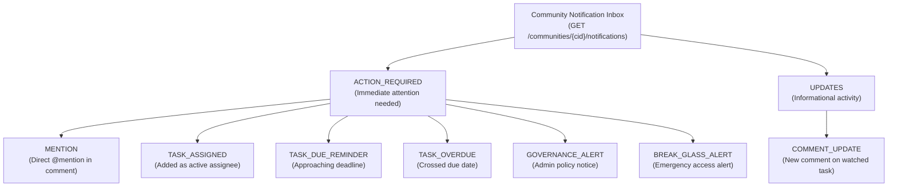
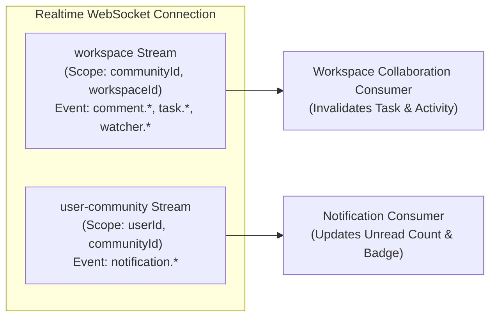

# SONDER — VS-08B: SEGMENTED IN-APP NOTIFICATION CENTER PLAN

**Milestone ID:** VS-08B  
**Canonical Feature Reference:** `FEAT-F01a` (Segmented In-App Notification Center & Preferences Spine)  
**Governance Phase:** Phase 1: PLAN  
**Target Repository:** `Samudra-Bose/sonder`  
**Working Branch:** `plan/FE-VS08B-notification-center`  
**Baseline Commit:** `develop @ 658e807`  
**Merge Commit:** `develop @ 1ac051f` (PR #35)  

---

## 1. Executive Summary & Objective

The objective of **Milestone VS-08B** is to plan the complete frontend implementation of the **Segmented In-App Notification Center (`FEAT-F01a`)**.

Following the successful delivery and contract hardening of the Collaboration Spine in VS-08A, VS-08A.1, and VS-08A.2, Sonder now possesses a robust foundation of comment, @mention, and task-watcher domain events. The Notification Center provides the user-facing hub where team members receive, triage, filter, and act on these collaboration signals.

### Strict Planning Boundary
In accordance with dual-track engineering governance:
- **This phase is PLAN & GRILL only.** Zero feature code is authored.
- **Track B UI/UX workstream remains strictly PAUSED.** The UI implementation will reuse existing design tokens, components, and layout primitives without aesthetic redesign, custom animations, or design-system refactoring.
- **OpenAPI 0.3.20-draft and `ws-events.schema.json` remain the authoritative contracts.** No contract types or schemas will be fabricated or modified without formal joint governance.

---

## 2. Mandatory Source-of-Truth Reconciliation

We have inspected and reconciled the relevant sections across the canonical specification documents:

| Source of Truth | Section / File | Key Requirements & Invariants Established |
| :--- | :--- | :--- |
| **Master Specification v1.5.0** | §5.3, §8, Appendix L, Appendix M (`CR-10`) | Defines the two-category notification taxonomy (`ACTION_REQUIRED` vs `UPDATES`), recipient derivation from session, atomic outbox persistence, quiet hours behavior, and reminder offsets. |
| **Canonical OpenAPI** | `Community-Work-Management-v1.5/docs/contracts/openapi.yaml` | Declares `/communities/{communityId}/notifications` (GET), `.../{notificationId}/read` (POST), and `.../read-all` (POST). |
| **WebSocket Event Schemas** | `ws-events.schema.json`, `ws-protocol.schema.json` | Distinguishes `workspace` stream from `user-community` stream; defines closed payload shapes for `notification.created`, `notification.read`, and `notification.read_all`. |
| **Generated Contract Types** | `packages/contracts/src/api-types.ts` | Confirmed `NotificationDto`, `NotificationListDto`, `NotificationCategory`, and `NotificationReason` are already generated. |
| **App Shell Architecture** | `AppHeader.tsx`, `AppSidebar.tsx`, `navigation.ts` | Existing navigation already specifies `/inbox` route with `InboxPlaceholderView`; `AppHeader` provides natural integration slot for notification bell. |

---

## 3. Scope & Exclusions

### In-Scope (Phase 1 / VS-08B)
1. **Header Notification Bell:** Accessible trigger button in `AppHeader` with reactive badge displaying current community `unreadCount`.
2. **Notification Popover / Quick Inbox:** Dropdown overlay for rapid triage and inspection without leaving the active work context.
3. **Full Notification Inbox View:** Dedicated `/inbox` route replacing `InboxPlaceholderView.tsx` with full-page triage capabilities.
4. **Segmented Category Filtering:** Tab navigation for `All`, `Action Required` (`category=ACTION_REQUIRED`), and `Updates` (`category=UPDATES`), plus client-side sub-filtering for `Mentions`, `Assigned`, and `Watching`.
5. **Read State Management:** Single-item mark-as-read and community-wide bulk `mark-all-read` operations via canonical endpoints.
6. **Task Deep-Linking:** Clicking a notification deep-links to the target task using `useTaskPeekDrawer` and URL query parameter `?task=KEY`.
7. **Safe Loading, Empty, and Error States:** Full WCAG AA accessible empty states, loading skeletons, and error retry handlers.
8. **Realtime User-Community Event Consumer:** Integration with `user-community` event stream to update unread badge counts in real time.
9. **MSW Handlers & Realistic Mock Fixtures:** Complete test data layer modeling all 7 notification reasons across both categories.

### Out-of-Scope (Deferred to Future Milestones)
1. **Mark-as-Unread:** Excluded because the canonical OpenAPI contract contains no mark-as-unread endpoint or request schema.
2. **Push Notifications:** Web push and mobile push notifications are explicitly outside CR-10 Phase 1 scope.
3. **Per-User Email Preference Management UI (`FEAT-F01b`):** Digest schedules, quiet hours configuration, and delivery channel settings belong to Milestone M1.3 / Phase 2.
4. **Live WebSocket Infrastructure:** WebSocket gateway deployment and server-side ticket issuance remain backend infrastructure prerequisites.

---

## 4. Product Taxonomy & Classification



### 4.1 Categories vs. Reasons
Per Master Specification §5.3 and CR-10:
- **`NotificationCategory` (Top-Level Primary Partition):**
  - **`ACTION_REQUIRED`:** High-priority items demanding user response (mentions, assignments, deadline alerts, security alerts). Never digested into batch emails; immediate in-app delivery.
  - **`UPDATES`:** Low-urgency notifications for passive task followers (general comment updates on watched tasks). Eligible for digest batching.
- **`NotificationReason` (Underlying Domain Cause):**
  - Seven explicit reasons partition into the two primary categories:
    - `MENTION` $\to$ `ACTION_REQUIRED`
    - `TASK_ASSIGNED` $\to$ `ACTION_REQUIRED`
    - `TASK_DUE_REMINDER` $\to$ `ACTION_REQUIRED`
    - `TASK_OVERDUE` $\to$ `ACTION_REQUIRED`
    - `GOVERNANCE_ALERT` $\to$ `ACTION_REQUIRED`
    - `BREAK_GLASS_ALERT` $\to$ `ACTION_REQUIRED`
    - `COMMENT_UPDATE` $\to$ `UPDATES`

### 4.2 Segmentation Strategy in Frontend UI
Because the canonical API parameter is `category?: NotificationCategory` and does not accept `reason`, the UI provides:
1. **Primary Tabs (Server-Side Category Filtering):**
   - **All Notifications:** No `category` filter (fetches entire community inbox).
   - **Action Required:** `category=ACTION_REQUIRED`.
   - **Updates:** `category=UPDATES`.
2. **Canonical Unread Filter Toggle:**
   - Toggle button applying `unreadOnly=true` to the active query.
3. **Reason Metadata Display:**
   - Each notification card clearly displays its canonical `reason` (e.g., Mention, Assigned, Overdue, Comment) via a dedicated badge.
   - **Prohibition on Client-Side Reason Faceting:** The frontend will **NOT** implement global reason chips (e.g., Mentions-only, Assigned-only) by filtering only the currently loaded page in memory. Under cursor pagination, client-side filtering across partial pages produces misleading, incomplete inboxes and false empty states.
   - **Future Contract Proposal:** Global reason filtering requires adding `reason?: NotificationReason` to `GET /notifications`, submitted to the Backend Lead as a proposed contract enhancement.

---

## 5. Canonical API Contract Mapping

All notification HTTP endpoints reside under `/communities/{communityId}/notifications`:

```
GET  /api/v1/communities/{communityId}/notifications
POST /api/v1/communities/{communityId}/notifications/{notificationId}/read
POST /api/v1/communities/{communityId}/notifications/read-all
```

### 5.1 Endpoint Details

#### 1. `listNotifications` (GET)
- **Path:** `/api/v1/communities/{communityId}/notifications`
- **Query Parameters:**
  - `cursor?: string` — Opaque pagination cursor.
  - `limit?: number` — Default `50`, min `1`, max `100`.
  - `category?: NotificationCategory` — `"ACTION_REQUIRED"` | `"UPDATES"`.
  - `unreadOnly?: boolean` — Default `false`.
- **Response Headers:** `Cache-Control: private, no-store`.
- **Response Body (200 OK):** `NotificationListDto`
  ```ts
  interface NotificationListDto {
    items: NotificationDto[];
    nextCursor: string | null;
    unreadCount: number; // Always reflects full community inbox unread total
  }
  ```
- **Error Codes:** `400` (Validation), `401` (Unauthorized), `403` (`COMMUNITY_MEMBERSHIP_REQUIRED`).

#### 2. `markNotificationRead` (POST)
- **Path:** `/api/v1/communities/{communityId}/notifications/{notificationId}/read`
- **Headers Required:** `X-CSRF-Token`, `X-Mutation-Id` (UUIDv7).
- **Request Body:** None.
- **Response Body (204 No Content):** Empty.
- **Error Codes:** `400` (CSRF/MutationId error), `404` (Not Found / Inaccessible), `409` (Idempotency conflict).

#### 3. `markAllNotificationsRead` (POST)
- **Path:** `/api/v1/communities/{communityId}/notifications/read-all`
- **Headers Required:** `X-CSRF-Token`, `X-Mutation-Id` (UUIDv7).
- **Request Body:** None.
- **Response Body (204 No Content):** Empty.
- **Error Codes:** `400` (CSRF/MutationId error), `409` (Idempotency conflict).

---

## 6. Realtime & Privacy Architecture

### 6.1 Stream Separation


### 6.2 Closed Payload Invariants
Per `ws-events.schema.json`:
- `notification.created` payload contains strictly:
  `{ notificationId: UUID, category: NotificationCategory, reason: NotificationReason, unreadCount: integer }`
- `notification.read` payload contains strictly:
  `{ notificationId: UUID, unreadCount: integer }`
- `notification.read_all` payload contains strictly:
  `{ unreadCount: integer }`

**Privacy Invariant:**
No task bodies, comment Markdown, AST nodes, or recipient lists are transmitted over the realtime socket. Realtime notifications serve strictly as lightweight invalidation signals and unread counter synchronization.

---

## 7. Frontend Architecture Proposal

```
apps/web/src/modules/notifications/
├── index.ts                     # Public module exports
├── types.ts                     # Re-exported contract schemas & local UI view types
├── api.ts                       # apiRequest wrappers for list, markRead, markAllRead
├── query-keys.ts                # TanStack Query keys factory
├── useNotifications.ts          # Inbox infinite query and list hook
├── useNotificationMutations.ts  # Optimistic markRead and markAllRead mutations
├── useNotificationRealtime.ts   # user-community realtime event handler
├── NotificationBell.tsx         # Header bell trigger with badge counter
├── NotificationPopover.tsx      # Header popover quick triage dropdown
├── NotificationItem.tsx         # Individual notification row with deep-link & read toggle
├── NotificationList.tsx         # Filtered scrollable list with cursor pagination
└── NotificationInboxView.tsx    # Full-page /inbox view with segmented tabs & chips
```

### 7.1 TanStack Query Key Factory
```ts
export const notificationQueryKeys = {
  all: ["notifications"] as const,
  lists: () => [...notificationQueryKeys.all, "list"] as const,
  list: (communityId?: string | null, filters?: NotificationFilters) =>
    [...notificationQueryKeys.lists(), communityId, filters] as const,
  unreadCount: (communityId?: string | null) =>
    [...notificationQueryKeys.all, "unread-count", communityId] as const,
};
```

### 7.2 Optimistic Updates & Cache Invalidation
1. **`useMarkNotificationRead`:**
   - `onMutate`: Optimistically updates the cached `NotificationListDto` items (`isRead = true`) and decrements `unreadCount` by 1 (clamped to 0).
   - `onError`: Reverts query cache to snapshot.
   - `onSettled`: Invalidates notification queries to synchronize authoritative server state.
2. **`useMarkAllNotificationsRead`:**
   - `onMutate`: Optimistically marks all items across all cached lists as `isRead = true` and sets `unreadCount = 0`.
   - `onError`: Reverts query cache to snapshot.
   - `onSettled`: Invalidates all notification lists.

### 7.3 Task Deep-Link Boundary & Backend Handoff (`DEP-NOTIF-02`)
`NotificationDto` provides `resourceType: "task"` and `resourceId: string` (task UUID), but lacks `taskKey` and `workspaceId` needed by the application shell's task drawer (`/workspaces/:workspaceId/list?task=KEY`).

**Strict Architectural Prohibition:**
- The frontend will **NOT** extract task keys from notification titles using regular expressions.
- The frontend will **NOT** guess workspace IDs or invent unapproved task-resolution endpoints.
- The frontend will **NOT** render misleading clickable notification rows until a reliable, typed canonical navigation target is provided by the backend contract.

**Contract Handoff (`DEP-NOTIF-02`):**
In accordance with `vs-08b-notification-backend-integration-contract.md`, task deep-linking is explicitly deferred. The Backend Lead and Product Owner will review Proposal A (structured `target` object) versus Proposal B (extending `workspaceId` and `taskKey` on `NotificationDto`). Until approved, notifications remain informational cards with mark-read capability.

### 7.4 Realtime Invalidation & Transport Boundary (`DEP-NOTIF-03`)
In accordance with CR-09 and CR-10:
- Live WebSocket transport and ticket issuance are backend dependencies.
- The frontend will not establish an unapproved WebSocket connection or invent a polling fallback interval.
- Notifications are retrieved via canonical REST endpoints (`/communities/{communityId}/notifications`).
- When backend realtime transport is deployed under `DEP-NOTIF-03`, incoming `notification.created` events will update the unread count badge and invalidate TanStack Query cache to securely hydrate the full DTO via REST.

---

## 8. Test Strategy & Quality Gates

### 8.1 Automated Test Suites to Implement
1. **API Client Unit Tests (`api.test.ts`):** Verify contract parameter serialization, CSRF attachment, and error decoding.
2. **Hook Unit Tests (`useNotifications.test.ts`):** Verify pagination, optimistic mutations, error rollback, and unread counter math.
3. **Realtime Consumer Tests (`useNotificationRealtime.test.ts`):** Verify `notification.created/read/read_all` updates without PII leaks.
4. **Component Integration Tests (`NotificationCenter.test.tsx`):**
   - Header bell unread badge rendering.
   - Popover open/close on click and keyboard `Esc`.
   - Category tab switching (`All`, `Action Required`, `Updates`).
   - Reason chip sub-filtering (`Mentions`, `Assigned`, `Watching`).
   - Single item read mark and mark all read button.
   - Task deep-linking and drawer open trigger.
   - Empty and error state display.

---

## 9. Implementation Roadmap (Phases for VS-08B)

| Stage | Focus Area | Deliverables |
| :--- | :--- | :--- |
| **Stage 1** | Contract Types & API Client | `modules/notifications/types.ts`, `api.ts`, `query-keys.ts` |
| **Stage 2** | Mock Data Layer & MSW Handlers | `mocks/data/notifications.ts`, `mocks/handlers/notifications.ts` |
| **Stage 3** | Query Hooks & Optimistic Mutations | `useNotifications.ts`, `useNotificationMutations.ts` |
| **Stage 4** | Realtime Event Consumer | `useNotificationRealtime.ts` (handling `user-community` stream) |
| **Stage 5** | Notification Item & List Components | `NotificationItem.tsx`, `NotificationList.tsx` |
| **Stage 6** | Header Bell & Popover Trigger | `NotificationBell.tsx`, `NotificationPopover.tsx`, integration in `AppHeader.tsx` |
| **Stage 7** | Full-Page Inbox View Replacement | `NotificationInboxView.tsx` replacing `InboxPlaceholderView.tsx` |
| **Stage 8** | Integration QA & Verification | Automated test suites, mobile viewport checks, typecheck, build |
