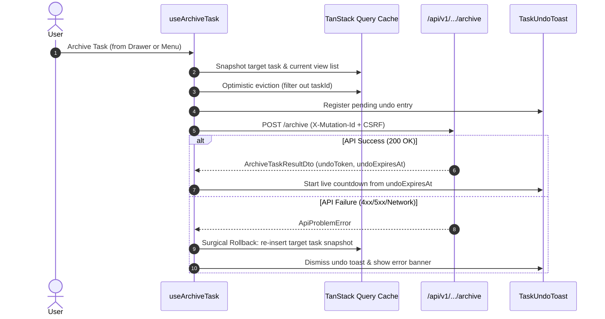

# SONDER — VS-09A REVISED IMPLEMENTATION PLAN: SINGLE-ITEM TASK ARCHIVE & 10-SECOND UNDO

**Milestone**: VS-09A<br/>
**Canonical Capability**: `FEAT-A10a` (Single-Item Archive & 10s Undo Toast)<br/>
**Parent Capability**: `FEAT-A10` (Multi-Select Bulk Operations, Archive & 30-Day Trash)<br/>
**Governance Phase**: Phase 1 (Milestone M1.1 Work Management Foundation)<br/>
**Standard**: PLAN → GRILL → IMPLEMENT → TEST → REVIEW → LOCK → DOCUMENT<br/>
**Document Version**: 2.0.0 (Post-GRILL Revised Architecture)<br/>
**Baseline Commit**: `develop @ 26bd662` (Locked VS-09.0 Product Baseline)<br/>
**Document Status**: **REVISED PLAN PROPOSED FOR HUMAN APPROVAL** (Zero application code modified)<br/>
**Date**: November 11, 2026<br/>
**Author**: Antigravity Pair Programming Agent<br/>

---

## 1. Executive Summary & Problem Definition

In Sonder, task deletion is replaced with non-destructive, recoverable lifecycle transitions. A user archiving a task must have an immediate, low-friction recovery path without having to leave their active workflow or navigate to a trash screen.

Milestone **VS-09A** delivers **Single-Item Task Archive & 10-Second Undo Toast (`FEAT-A10a`)**. It introduces an archive action across primary task presentation surfaces, provides an accessible floating undo toast driven by server expiration timestamps, supports keyboard undo via shortcut `Z` (and `Mod+Z`) with strict input suppression, and restores the task to its exact prior status, ranking, and presentation view position.

### Strict Scope Boundaries & Governance Invariants
- **IN SCOPE (`FEAT-A10a`):**
  - Single-task archive action on `TaskPeekDrawer.tsx` (primary existing surface) and proposed `TaskActionsMenu.tsx`.
  - Immediate optimistic eviction from active List, Board, Calendar, and Timeline view caches.
  - Floating 10-second Undo Toast with progress countdown derived from server `undoExpiresAt`.
  - Global keyboard shortcut `Z` and `Mod+Z` (`Cmd+Z` / `Ctrl+Z`) active during toast lifecycle with input suppression.
  - Preservation of independent undo opportunities for sequentially archived tasks.
  - Optimistic restoration to exact prior rank, status, and view placement upon undo.
  - Surgical cache rollback without overwriting concurrent edits on other tasks.
  - MSW mock handlers conforming to candidate OpenAPI 0.3.20-draft archive and restore endpoints.
- **OUT OF SCOPE (Explicit Negative Invariants):**
  - **No Bulk Archive:** Multi-row checkboxes and Bulk Action Bar ($\le 100$ tasks) belong strictly to Milestone **VS-09B** (`FEAT-A10b`).
  - **No Dedicated Trash View:** The `/trash` route, retention countdown cards, and 30-day recoverable list belong strictly to **VS-09B**.
  - **No Permanent Purge:** Hard deletion is strictly prohibited; purge APIs remain gated on Product Owner policy decision `DEC-OPEN-03`.
  - **No Custom Endpoints or Schemas:** Operates strictly within candidate OpenAPI 0.3.20-draft routes.
  - **UI/UX Track B Remains PAUSED:** Uses existing `@base-ui/react` primitives and semantic design system tokens; no visual redesign or micro-ergonomic restyling.

---

## 2. Architecture & Action Surfaces

### 2.1 Action Surfaces: Existing vs. Proposed Components

```
+-----------------------------------------------------------------------------------------+
| ACTION SURFACE INVENTORY & VERIFICATION                                                |
+-----------------------------------------------------------------------------------------+
| Surface                   | Status   | Location                 | Notes                         |
|---------------------------+----------+--------------------------+-------------------------------|
| TaskPeekDrawer Header     | EXISTING | TaskPeekDrawer.tsx:272   | Primary verified surface;     |
|                           |          |                          | closes drawer & clears ?task= |
| TaskActionsMenu Dropdown  | PROPOSED | TaskActionsMenu.tsx      | New component; required on    |
|                           |          |                          | TaskListView & TaskBoardView  |
+-----------------------------------------------------------------------------------------+
```

1. **`TaskPeekDrawer.tsx` Header Action Bar (Primary Verified Existing Surface):**
   - **Current State:** Header currently hosts `WorkspaceBadge`, `taskKey`, Copy Link `IconButton`, `TaskWatchButton`, and Close `IconButton` ([`TaskPeekDrawer.tsx` lines 230–295](file:///home/samudra/Projects/VisualSCode/VisualCode/Vscoding/Sonder/apps/web/src/modules/tasks/TaskPeekDrawer.tsx#L230-L295)). Read-only archived task state is already implemented in lines 188–189 and 419–426.
   - **Proposed Change:** Add an accessible "Archive Task" button to the header action group beside `TaskWatchButton`.
   - **Icon & Tooltip:** Lucide `Archive` icon with tooltip `"Archive task"`.
   - **Permissions Gate:** Gated by `Boolean(task.effectivePermissions?.canArchive ?? true)` and `!isArchived`.
   - **Execution Flow:** Triggering archive closes the drawer via `closeTask()` (clearing `?task=` from the URL), evicts the task optimistically from the active view cache, and spawns the undo toast.
   - **Focus Management:** When the drawer closes, focus is logically transferred to the next adjacent task row or card in the canvas, or to the view container if no tasks remain. **Focus is NOT stolen into the undo toast.**

2. **`TaskActionsMenu.tsx` (Proposed New Shared Dropdown Primitive):**
   - **Verification:** Inspection of the codebase confirms `TaskActionsMenu.tsx` **does not exist** currently. Neither `TaskListView.tsx` nor `TaskBoardView.tsx` currently has an action menu or three-dots trigger.
   - **Proposed Implementation:** Create `TaskActionsMenu.tsx` using `@base-ui/react` `DropdownMenu` with options:
     - "Copy Link"
     - "Archive Task" (with red/muted hover token)
   - **Integration Surfaces:**
     - `TaskListView.tsx`: Added as a trailing action column cell on table rows.
     - `TaskBoardView.tsx`: Added to card header beside priority badge.
   - **Event Propagation Invariant:** The menu trigger button and menu items must call `e.stopPropagation()` on pointer down, click, and keydown to prevent triggering the row/card's existing `openTask()` click handler.
   - **Styling Invariant:** Built strictly using existing semantic CSS variables (`var(--surface-overlay)`, `var(--border-subtle)`, `var(--text-primary)`, `var(--text-danger)`) without introducing new design tokens or deviating from paused Track B constraints.

### 2.2 Global Toast Spine (`TaskUndoToast.tsx`)
- Mounted in `WorkspaceTasksView.tsx` (scoped to the workspace task management domain).
- Built with `@base-ui/react` primitives and semantic design tokens (`var(--surface-overlay)`, `var(--border-strong)`).
- **Structure:**
  - Status text: `"Task [TASK-KEY] archived."`
  - Linear countdown progress bar linked to remaining server validity.
  - Explicit `"Undo"` button (`variant="secondary"`, accessible focus ring).
  - Explicit `"Dismiss"` button (`IconButton` with `X` icon).
- **Multi-Item Policy:** Preserves independent undo opportunities (see Section 4).

---

## 3. OpenAPI Contract & Data Schema Reconciliation

### 3.1 Request Body Reconciliation: `RestoreRequest` vs. `RestoreTaskRequest`

A critical contract distinction was verified in candidate OpenAPI 0.3.20-draft:

```yaml
# Workspace Restore (NOT for tasks)
/communities/{communityId}/workspaces/{workspaceId}/restore:
  post:
    operationId: restoreWorkspace
    requestBody:
      content:
        application/json:
          schema:
            $ref: '#/components/schemas/RestoreRequest'   # { reason?: string }

# Task Archive
/communities/{communityId}/workspaces/{workspaceId}/tasks/{taskId}/archive:
  post:
    operationId: archiveTask
    requestBody:
      content:
        application/json:
          schema:
            $ref: '#/components/schemas/ArchiveRequest'   # { reason?: string }
    responses:
      '200':
        content:
          application/json:
            schema:
              $ref: '#/components/schemas/ArchiveTaskResultDto'

# Task Restore (CORRECT schema for FEAT-A10a)
/communities/{communityId}/workspaces/{workspaceId}/tasks/{taskId}/restore:
  post:
    operationId: restoreTask
    requestBody:
      content:
        application/json:
          schema:
            $ref: '#/components/schemas/RestoreTaskRequest'  # { undoToken?: string }
    responses:
      '200':
        content:
          application/json:
            schema:
              $ref: '#/components/schemas/TaskDto'
```

- **Reconciliation Invariant:**
  - `RestoreRequest` (`{ reason?: string }`) is strictly for workspace-level recovery.
  - `RestoreTaskRequest` (`{ undoToken?: string }`) is strictly for task restoration.
  - Historical references in previous drafts that cited `RestoreRequest` for task restoration were errors and are now reconciled to `RestoreTaskRequest`.

### 3.2 Optional `undoToken` Status
- In `RestoreTaskRequest`, `undoToken` is not marked as `required`.
- **Contract Boundary:** While it is hypothesized that the optionality allows general 30-day trash recovery (VS-09B) to reuse the endpoint without an undo token, this explanation remains **unconfirmed until formal contract-owner sign-off**.
- **Frontend Candidate Invariant:** For milestone **VS-09A**, the client MUST always supply the `undoToken` received from `ArchiveTaskResultDto`. If `undoToken` is missing or expired, the undo toast action must fail closed.

### 3.3 Mutation Headers
Both `archiveTask` and `restoreTask` require:
- `X-CSRF-Token`: Synchronizer token for cookie-authenticated sessions.
- `X-Mutation-Id`: UUIDv7 idempotency key.
- Handled automatically by [`apiRequest`](file:///home/samudra/Projects/VisualSCode/VisualCode/Vscoding/Sonder/apps/web/src/lib/api-client.ts#L25-L68) in `apps/web/src/lib/api-client.ts`, which auto-attaches `X-Mutation-Id` via `generateUuidV7()` and retrieves `X-CSRF-Token`, failing closed if missing.

---

## 4. Toast Lifecycle, Clock Skew & Multi-Item Policy

### 4.1 Server Expiry & Clock Drift Derivation
- `ArchiveTaskResultDto` provides `undoExpiresAt` (ISO 8601 UTC timestamp).
- **Client Countdown Derivation:**
  $$\text{remainingMs} = \max\left(0, \text{Date.parse}(result.undoExpiresAt) - \text{Date.now()}\right)$$
- **Clock Skew Invariants & Limitations:**
  - If a user's local operating system clock differs significantly from the server clock:
    - *Client clock ahead:* Toast will prematurely expire locally even though the server token remains valid.
    - *Client clock behind:* Toast may attempt to submit an expired token, receiving an error from the server.
  - *Mitigation for Production:* In a live backend deployment, clock skew $\Delta t$ is calibrated via the HTTP response `Date` header:
    $$\Delta t = \text{Date.parse}(\text{response.headers.get("Date")}) - \text{clientTimeAtReceipt}$$
    $$\text{calibratedRemainingMs} = \max\left(0, \text{Date.parse}(result.undoExpiresAt) - (\text{Date.now()} + \Delta t)\right)$$
  - *Testing Environment:* In Vitest with MSW mock handlers, MSW and the test harness execute in the same Node.js/jsdom process, ensuring $\Delta t = 0$.
- **Background Tab Suspension Handling:**
  - When the browser tab is backgrounded, `setInterval` and `requestAnimationFrame` are throttled or frozen by modern browsers.
  - `TaskUndoToast.tsx` registers a `visibilitychange` event listener on `document`. When `document.visibilityState === "visible"`, `remainingMs` is immediately re-calculated against `Date.now()`, ensuring the countdown snaps accurately to true wall-clock time rather than resuming from frozen ticks.

### 4.2 Preservation of Independent Undo Opportunities
- **Policy Invariant:** In accordance with governance instructions, **independent undo opportunities must be preserved** unless the Product Owner explicitly approves an alternative single-slot LIFO replacement policy.
- **Architectural Handling:**
  - The undo toast state manager maintains an active queue of archived items: `activeUndos: Map<string, UndoItemState>`.
  - When a user archives Task A, then immediately archives Task B:
    - Both tasks retain their independent server `undoExpiresAt` expiration timers.
    - The toast displays the most recently archived task with an indicator of additional pending undos (e.g. `"Task PROJ-102 archived (1 other). Undo [Z]"` or stacked notification pills).
    - Triggering Undo (via `Z` or button click) restores the most recent task (Task B) and brings the previous task (Task A) to the forefront with its remaining time intact.
    - Each task expires independently when its own `undoExpiresAt` is reached without cutting short any other task's window.

---

## 5. Keyboard Navigation & Accessibility Specifications

### 5.1 Keyboard Shortcuts & Input Suppression
- **Registered Hotkeys:**
  - Plain `Z` (active while an undo opportunity exists).
  - `Mod+Z` (`Cmd+Z` on macOS, `Ctrl+Z` on Windows/Linux) while an undo opportunity exists.
- **Implementation Mechanism:**
  - Uses [`useKeyboardShortcut`](file:///home/samudra/Projects/VisualSCode/VisualCode/Vscoding/Sonder/apps/web/src/lib/keyboard.ts) with `allowInInput: false`.
  - The centralized [`isInputElement`](file:///home/samudra/Projects/VisualSCode/VisualCode/Vscoding/Sonder/apps/web/src/lib/keyboard.ts#L45-L58) helper suppresses the shortcut whenever `document.activeElement` is an `input`, `textarea`, `select`, or `contenteditable` container.
  - Typing the letter "z" or pressing `Ctrl+Z` inside the task title, description, comment editor, or search bar will strictly perform native text undo and will NOT trigger task restoration.

### 5.2 Focus Management (Non-Stealing Invariant)
- **Focus Invariant:** Archiving a task MUST NOT automatically snatch focus into the floating toast container, as doing so disorients keyboard users engaged in rapid canvas navigation.
- **Focus Flow:**
  - When archived from `TaskPeekDrawer`:
    - Drawer closes smoothly and unmounts.
    - Since the original trigger row/card is optimistically removed from the DOM, focus is returned to the nearest surviving sibling element in the task list/board (or the table/board container if empty).
  - When archived from `TaskActionsMenu`:
    - Menu closes; focus is transferred to the next adjacent task row or card.
  - **Screen Reader Announcement:** The undo toast uses `role="status"` and `aria-live="polite"` (`aria-atomic="true"`). Screen readers announce `"Task [KEY] archived. Press Z to undo"` in the speech buffer without shifting keyboard focus.
  - If the user explicitly wishes to reach the Undo button via keyboard, the toast is placed at a logical DOM landmark accessible via standard sequential `Tab` navigation.

### 5.3 WCAG 2.2 Target Size Conformance
- **Standard Reference:**
  - **WCAG 2.2 Level AA Success Criterion 2.5.8 Target Size (Minimum):** Requires interactive targets to have an area of at least $24 \times 24\,\text{px}$, or sufficient offset spacing.
  - **WCAG Level AAA Success Criterion 2.5.5 Target Size (Enhanced):** Recommends targets of at least $44 \times 44\,\text{px}$.
- **Implementation:**
  - The "Undo" button and "Dismiss" (`X`) button in `TaskUndoToast` strictly satisfy **WCAG 2.2 SC 2.5.8** on desktop with a minimum size of $32 \times 32\,\text{px}$ and appropriate bounding padding.
  - On touch viewports (responsive breakpoint `< 640px`), the buttons expand touch targets to $\ge 44 \times 44\,\text{px}$ via `min-h-[44px] min-w-[44px]` touch target sizing.

---

## 6. Query Cache Invariants & Surgical Rollback



### 6.1 TanStack Query Key Invariants
- **View Queries:**
  - Key format: `["communities", communityId, "workspaces", workspaceId, "tasks", "query", querySpecJson]`
  - Prefix matching: `["communities", communityId, "workspaces", workspaceId, "tasks", "query"]`
  - Eviction: Removes the task from `items` array across all active view cache queries for the workspace.
- **Single Task Query:**
  - Key format: `["communities", communityId, "workspaces", workspaceId, "tasks", taskId]`
  - Cache update: Mark `lifecycleState: "ARCHIVED"`, `archivedAt: new Date().toISOString()`.

### 6.2 Surgical Rollback
- Rather than replacing the entire list cache with an outdated array snapshot (which would wipe out concurrent changes made to other tasks), rollback must:
  1. Capture the archived task's exact `TaskDto` and prior index.
  2. If the archive mutation fails, surgically re-insert that specific `TaskDto` into its original index in the cached queries.
  3. Invalidate workspace task queries to ensure eventual consistency with the server.

---

## 7. Open Backend Decisions (Unresolved Governance Items)

The following three architectural decisions remain explicitly **unresolved** pending Backend Engineering and Product Owner sign-off:

1. **`DEC-ARCHIVE-01`: Subtask Tree Archival Semantics:**
   - *Question:* Does archiving a parent task automatically soft-archive all child subtasks (depth 1–2) in a single server transaction, or must the client issue individual archive calls for each child?
   - *Current Stance:* Unresolved. The frontend candidate implementation will archive the target task ID and rely on server-side subtask cascading.
2. **`DEC-ARCHIVE-02`: Comment & Field Freezing During Retention:**
   - *Question:* Can workspace members post comments or modify fields on an archived task while it sits in the 30-day trash window?
   - *Current Stance:* Unresolved. The frontend currently disables inline editing (`isArchived` flag), but API contract guarantees on comment creation freeze remain pending backend confirmation.
3. **`DEC-ARCHIVE-03`: Undo Token Atomicity & Invalidation:**
   - *Question:* Is `undoToken` single-use, and does the server invalidate it atomically upon the first successful restore call? What error problem code is returned on replay or expiration?
   - *Current Stance:* Unresolved. Frontend candidate mock handler treats the token as single-use and returns `404 Problem` (or `409 Problem`) upon replay or expiration.

---

## 8. Recommended Test Matrix

A dedicated Vitest test suite ([`TaskArchive.test.tsx`](file:///home/samudra/Projects/VisualSCode/VisualCode/Vscoding/Sonder/apps/web/src/modules/tasks/TaskArchive.test.tsx)) will be authored during implementation:

| Test ID | Test Scenario | Verified Condition & Quality Invariant |
| :--- | :--- | :--- |
| **ARCH-01** | Archive task from `TaskPeekDrawer` | Drawer closes, URL query `?task=` is cleared, task is removed from active queries, and `TaskUndoToast` renders. |
| **ARCH-02** | Archive task from `TaskListView` row menu | Task row is immediately removed from table; list count decrements. |
| **ARCH-03** | Archive task from `TaskBoardView` card menu | Task card is immediately removed from board column. |
| **ARCH-04** | Countdown derived from `undoExpiresAt` | Countdown duration matches `undoExpiresAt - Date.now()`; does not reset to 10s upon response receipt. |
| **ARCH-05** | Undo via "Undo" button click | Issues `POST /restore` with `RestoreTaskRequest` (`undoToken`); task restores to exact position and rank. |
| **ARCH-06** | Undo via keyboard shortcut `Z` | Pressing `Z` while toast is active triggers restoration immediately. |
| **ARCH-07** | Undo via keyboard shortcut `Mod+Z` | Pressing `Cmd+Z` / `Ctrl+Z` while toast is active triggers restoration. |
| **ARCH-08** | Input suppression during typing | Pressing `Z` or `Mod+Z` inside `<input>`, `<textarea>`, or `contenteditable` does NOT trigger task undo. |
| **ARCH-09** | Token expiry (10s elapsed) | Toast dismisses automatically upon expiry; subsequent `Z` does not restore. |
| **ARCH-10** | Independent undo opportunities preserved | Archiving Task B while Task A is active preserves both undo opportunities without premature cancellation. |
| **ARCH-11** | Surgical rollback on archive failure | Network failure during archive re-inserts only the target task; does not overwrite other tasks' updates. |
| **ARCH-12** | Expired token error on restore | Server rejection with Problem Details displays error feedback; task remains archived. |
| **ARCH-13** | Non-stealing focus management | Archiving from drawer shifts focus to nearest surviving canvas item; does NOT steal focus into toast. |
| **ARCH-14** | Accessible announcements | `aria-live="polite"` announces archive and restore actions to screen readers. |
| **ARCH-15** | WCAG 2.2 SC 2.5.8 target size | Toast buttons satisfy $\ge 24 \times 24\,\text{px}$ minimum target size with $\ge 44 \times 44\,\text{px}$ mobile touch envelopes. |
| **ARCH-16** | Background tab visibility change | Tab refocus snaps countdown accurately to remaining wall-clock duration. |

---

## 9. Verification & Next Steps

This revised plan is submitted under the **PLAN → GRILL** governance phase.
- **Zero application code has been modified.**
- **API contracts and generated types are untouched.**
- **UI/UX Track B remains strictly paused.**
- **Standing by for human approval of this revised plan before implementation begins.**
