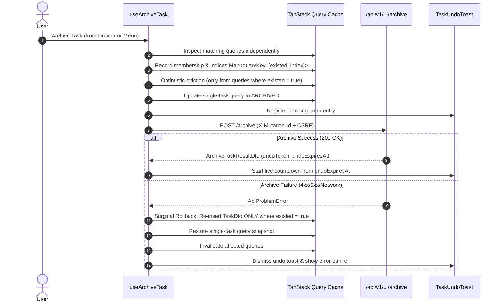

# SONDER — VS-09A REVISED IMPLEMENTATION PLAN: SINGLE-ITEM TASK ARCHIVE & 10-SECOND UNDO

**Milestone**: VS-09A<br/>
**Canonical Capability**: `FEAT-A10a` (Single-Item Archive & 10s Undo Toast)<br/>
**Parent Capability**: `FEAT-A10` (Multi-Select Bulk Operations, Archive & 30-Day Trash)<br/>
**Governance Phase**: Phase 1 (Milestone M1.1 Work Management Foundation)<br/>
**Standard**: PLAN → GRILL → IMPLEMENT → TEST → REVIEW → LOCK → DOCUMENT<br/>
**Document Version**: 2.1.0 (Corrective Architecture Review Packet)<br/>
**Baseline Commit**: `develop @ ebc28d1` (Locked VS-09.0 Product Baseline post-PR #41)<br/>
**Document Status**: **REVISED PLAN PROPOSED FOR HUMAN APPROVAL** (Zero application code modified)<br/>
**Date**: November 11, 2026<br/>
**Author**: Antigravity Pair Programming Agent<br/>

---

## 1. Executive Summary & Problem Definition

In Sonder, task deletion is replaced with non-destructive, recoverable lifecycle transitions. A user archiving a task must have an immediate, low-friction recovery path without leaving their active workflow or navigating to a separate trash management screen.

Milestone **VS-09A** delivers **Single-Item Task Archive & 10-Second Undo Toast (`FEAT-A10a`)**. It introduces an archive action across primary task presentation surfaces, provides an accessible floating undo toast driven by server expiration timestamps, supports keyboard undo via shortcut `Z` (and `Mod+Z`) with strict input suppression, and restores the task to its exact prior status, ranking, and presentation view position.

### Strict Scope Boundaries & Governance Invariants
- **IN SCOPE (`FEAT-A10a`):**
  - Single-task archive action on `TaskPeekDrawer.tsx` (primary existing surface) and proposed `TaskActionsMenu.tsx`.
  - Fail-closed permission checking strictly bound to verified candidate schema `task.effectivePermissions.canArchive`.
  - Multi-query cache membership tracking across List, Board, Calendar, and Timeline presentation views.
  - Surgical cache rollback that preserves concurrent edits on other tasks and respects query filter membership.
  - Floating 10-second Undo Toast with progress countdown derived from server `undoExpiresAt`.
  - Independent undo queue preserving multi-item undo opportunities with concurrency and duplicate-submission locking.
  - Global keyboard shortcut `Z` and `Mod+Z` (`Cmd+Z` / `Ctrl+Z`) active during toast lifecycle with input suppression.
  - Non-stealing focus management returning focus to the canvas rather than snatching focus into the toast.
  - MSW mock handlers conforming to candidate OpenAPI 0.3.20-draft archive and restore endpoints.
- **OUT OF SCOPE (Explicit Negative Invariants):**
  - **No Bulk Archive:** Multi-row checkboxes and Bulk Action Bar ($\le 100$ tasks) belong strictly to Milestone **VS-09B** (`FEAT-A10b`).
  - **No Dedicated Trash View:** The `/trash` route, retention countdown cards, and 30-day recoverable list belong strictly to **VS-09B**.
  - **No Permanent Purge:** Hard deletion is strictly prohibited; purge APIs remain gated on Product Owner policy decision `DEC-OPEN-03`.
  - **No Custom Endpoints or Schemas:** Operates strictly within candidate OpenAPI 0.3.20-draft routes.
  - **No API-Client Modification:** `api-client.ts` remains untouched; HTTP header exposure and `serverTime` payload additions are deferred.
  - **UI/UX Track B Remains PAUSED:** Uses existing `@base-ui/react` primitives and semantic design system tokens; no visual redesign or micro-ergonomic restyling.

---

## 2. Architecture & Action Surfaces

### 2.1 Fail-Closed Permission Invariant
- **Schema Verification:**
  - Candidate OpenAPI schema `TaskPermissions` ([`packages/contracts/src/api-types.ts` lines 2240–2260](file:///home/samudra/Projects/VisualSCode/VisualCode/Vscoding/Sonder/packages/contracts/src/api-types.ts#L2240-L2260)) defines:
    ```typescript
    canArchive: boolean;
    canRestore: boolean;
    canDeletePermanent: boolean;
    ```
  - `TaskDto.effectivePermissions` is guaranteed by the canonical schema to contain this permission map.
- **Strict Fail-Closed Rule:**
  - Prior draft proposals utilizing `task.effectivePermissions?.canArchive ?? true` are **strictly rejected**.
  - Permissions must **never default to allowed** when data is loading, missing, or undefined.
  - The authoritative client gate is:
    ```typescript
    const canArchive = Boolean(task?.effectivePermissions?.canArchive && !isArchived);
    ```
  - If `effectivePermissions` is undefined, loading, null, or `canArchive !== true`, the archive action is completely disabled/hidden.
  - Missing permission data must not expose an authorized archive action.
  - Backend authorization remains authoritative; client checks serve only to prevent invalid requests.

### 2.2 Action Surface Inventory: Existing vs. Proposed Components

```
+-----------------------------------------------------------------------------------------+
| ACTION SURFACE INVENTORY & VERIFICATION                                                |
+-----------------------------------------------------------------------------------------+
| Surface                   | Status   | Location                 | Notes                         |
|---------------------------+----------+--------------------------+-------------------------------|
| TaskPeekDrawer Header     | EXISTING | TaskPeekDrawer.tsx:272   | Primary verified surface;     |
|                           |          |                          | closes drawer & clears ?task= |
| TaskActionsMenu Dropdown  | PROPOSED | TaskActionsMenu.tsx      | New component; required on    |
|                           |          |                          | TaskListView & TaskBoardView  |
+-----------------------------------------------------------------------------------------+
```

1. **`TaskPeekDrawer.tsx` Header Action Bar (Primary Verified Existing Surface):**
   - **Current State:** Header currently hosts `WorkspaceBadge`, `taskKey`, Copy Link `IconButton`, `TaskWatchButton`, and Close `IconButton` ([`TaskPeekDrawer.tsx` lines 230–295](file:///home/samudra/Projects/VisualSCode/VisualCode/Vscoding/Sonder/apps/web/src/modules/tasks/TaskPeekDrawer.tsx#L230-L295)). Read-only archived task state is already implemented in lines 188–189 and 419–426.
   - **Proposed Change:** Add an accessible "Archive Task" button to the header action group beside `TaskWatchButton`.
   - **Icon & Tooltip:** Lucide `Archive` icon with tooltip `"Archive task"`.
   - **Permissions Gate:** Gated strictly by `canArchive` (fail-closed).
   - **Execution Flow:** Triggering archive closes the drawer via `closeTask()` (clearing `?task=` from the URL), evicts the task optimistically from the active view cache, and spawns the undo toast.
   - **Focus Management:** When the drawer closes, focus is logically transferred to the nearest surviving task row or card in the canvas, or to the view container if no tasks remain. **Focus is NOT stolen into the undo toast.**

2. **`TaskActionsMenu.tsx` (Proposed New Shared Dropdown Primitive):**
   - **Verification:** Inspection of the codebase confirms `TaskActionsMenu.tsx` **does not exist** currently. Neither `TaskListView.tsx` nor `TaskBoardView.tsx` currently has an action menu or three-dots trigger.
   - **Proposed Implementation:** Create `TaskActionsMenu.tsx` using `@base-ui/react` `DropdownMenu` with options:
     - "Copy Link"
     - "Archive Task" (gated by `canArchive`, styled with danger/muted hover token)
   - **Integration Surfaces:**
     - `TaskListView.tsx`: Added as a trailing action column cell on table rows.
     - `TaskBoardView.tsx`: Added to card header beside priority badge.
   - **Event Propagation Invariant:** The menu trigger button and menu items must call `e.stopPropagation()` on pointer down, click, and keydown to prevent triggering the row/card's existing `openTask()` click handler.
   - **Styling Invariant:** Built strictly using existing semantic CSS variables (`var(--surface-overlay)`, `var(--border-subtle)`, `var(--text-primary)`, `var(--text-danger)`) without introducing new design tokens or deviating from paused Track B constraints.

### 2.3 Global Toast Spine (`TaskUndoToast.tsx`)
- Mounted in `WorkspaceTasksView.tsx` (scoped to the workspace task management domain).
- Built with `@base-ui/react` primitives and semantic design tokens (`var(--surface-overlay)`, `var(--border-strong)`).
- **Structure:**
  - Status text: `"Task [TASK-KEY] archived."`
  - Linear countdown progress bar linked to remaining server validity.
  - Explicit `"Undo"` button (`variant="secondary"`, accessible focus ring).
  - Explicit `"Dismiss"` button (`IconButton` with `X` icon).
- **Multi-Item Policy:** Preserves independent undo opportunities (see Section 4).

---

## 3. OpenAPI Contract & Data Schema Reconciliation

### 3.1 Request Body Reconciliation: `RestoreRequest` vs. `RestoreTaskRequest`

A critical contract distinction was verified in candidate OpenAPI 0.3.20-draft:

```yaml
# Workspace Restore (NOT for tasks)
/communities/{communityId}/workspaces/{workspaceId}/restore:
  post:
    operationId: restoreWorkspace
    requestBody:
      content:
        application/json:
          schema:
            $ref: '#/components/schemas/RestoreRequest'   # { reason?: string }

# Task Archive
/communities/{communityId}/workspaces/{workspaceId}/tasks/{taskId}/archive:
  post:
    operationId: archiveTask
    requestBody:
      content:
        application/json:
          schema:
            $ref: '#/components/schemas/ArchiveRequest'   # { reason?: string }
    responses:
      '200':
        content:
          application/json:
            schema:
              $ref: '#/components/schemas/ArchiveTaskResultDto'

# Task Restore (CORRECT schema for FEAT-A10a)
/communities/{communityId}/workspaces/{workspaceId}/tasks/{taskId}/restore:
  post:
    operationId: restoreTask
    requestBody:
      content:
        application/json:
          schema:
            $ref: '#/components/schemas/RestoreTaskRequest'  # { undoToken?: string }
    responses:
      '200':
        content:
          application/json:
            schema:
              $ref: '#/components/schemas/TaskDto'
```

- **Reconciliation Invariant:**
  - `RestoreRequest` (`{ reason?: string }`) is strictly for workspace-level recovery.
  - `RestoreTaskRequest` (`{ undoToken?: string }`) is strictly for task restoration.
  - Historical references in previous drafts that cited `RestoreRequest` for task restoration were errors and are now reconciled to `RestoreTaskRequest`.

### 3.2 Optional `undoToken` Contract Caveat
- In `RestoreTaskRequest`, `undoToken` is not marked as `required`.
- **Contract Boundary:** While it is hypothesized that the optionality allows general 30-day trash recovery (VS-09B) to reuse the endpoint without an undo token, this explanation remains **unconfirmed until formal contract-owner sign-off**.
- **Frontend Candidate Invariant:** For milestone **VS-09A**, the client MUST always supply the `undoToken` received from `ArchiveTaskResultDto`. If `undoToken` is missing or expired, the undo toast action must fail closed.

### 3.3 Mutation Headers
Both `archiveTask` and `restoreTask` require:
- `X-CSRF-Token`: Synchronizer token for cookie-authenticated sessions.
- `X-Mutation-Id`: UUIDv7 idempotency key.
- Handled automatically by [`apiRequest`](file:///home/samudra/Projects/VisualSCode/VisualCode/Vscoding/Sonder/apps/web/src/lib/api-client.ts#L25-L68) in `apps/web/src/lib/api-client.ts`, which auto-attaches `X-Mutation-Id` via `generateUuidV7()` and retrieves `X-CSRF-Token`, failing closed if missing.

---

## 4. Toast Lifecycle, Clock Calibration & Concurrency Protection

### 4.1 Server Expiry, Clock Drift & API Header Limitations
- `ArchiveTaskResultDto` provides `undoExpiresAt` (ISO 8601 UTC timestamp).
- **Client Countdown Derivation:**
  $$\text{remainingMs} = \max\left(0, \text{Date.parse}(result.undoExpiresAt) - \text{Date.now()}\right)$$
- **API Response Header Limitation & Clock Skew:**
  - Inspection of [`apps/web/src/lib/api-client.ts` (lines 70–110)](file:///home/samudra/Projects/VisualSCode/VisualCode/Vscoding/Sonder/apps/web/src/lib/api-client.ts#L70-L110) confirms that `apiRequest<T>` returns `(await response.json()) as T`, discarding the underlying HTTP `Response` object and its response headers (`Date`, `X-Workspace-Seq`).
  - Consequently, client code cannot read `response.headers.get("Date")` through the standard `apiRequest` wrapper without modifying core client infrastructure.
  - *Candidate Test Environment:* In Vitest with MSW mock handlers, MSW and the test harness execute in the same Node.js/jsdom runtime process, guaranteeing client-server clock skew is exactly zero ($\Delta t = 0$).
  - *Production Limitation:* If client system clocks drift significantly in production:
    - The client countdown is inherently an **approximation** whenever client clock disagrees with server time.
    - The **server remains authoritative** when evaluating token validity.
    - A client clock skewed ahead will cause premature local toast expiration.
    - A client clock skewed behind will attempt restoration with an expired token, receiving Problem Details rejection (`409` or `404`). Expired-token failures must be handled safely by displaying Problem Details feedback and clearing the expired undo item.
    - Modifying `api-client.ts` to expose the HTTP `Date` header or altering OpenAPI schemas to add a `serverTime` metadata payload would require a separate approved API-client/contract RFC and is explicitly out of scope for this plan.
- **Background Tab Suspension Handling:**
  - When the browser tab is backgrounded, `setInterval` and `requestAnimationFrame` are throttled or frozen by browsers.
  - `TaskUndoToast.tsx` registers a `visibilitychange` event listener on `document`. When `document.visibilityState === "visible"`, `remainingMs` is immediately re-calculated against `Date.now()`, ensuring the countdown snaps accurately to true wall-clock time rather than resuming from frozen ticks.

### 4.2 Independent Undo Queue Concurrency & Concurrency Scenarios
- **Preservation Policy:** Independent undo opportunities are strictly preserved. Sequential archives do not discard or overwrite previous undo opportunities.
- **Queue State Registry:**
  ```typescript
  interface UndoItemState {
    taskId: string;
    taskKey: string;
    undoToken: string;
    undoExpiresAt: string;
    status: "idle" | "restoring" | "restored" | "expired" | "error";
    taskSnapshot: TaskDto;
    queryMemberships: Map<string, { existed: boolean; index: number }>;
  }
  ```
- **Concurrency Scenarios & Deterministic Rules:**
  1. **One task restoring while another expires:**
     - Task A is in-flight (`status: "restoring"`). Meanwhile, Task B's timer reaches `undoExpiresAt` ($T \le 0$).
     - Task B transitions independently to `status: "expired"` and is pruned from the queue.
     - Task A's in-flight restore request proceeds unaffected.
  2. **New archive during existing restore request:**
     - Task A is currently in-flight (`status: "restoring"`).
     - User archives Task B.
     - Task B is captured and added to the queue as `status: "idle"` with its own independent `undoExpiresAt` timer.
     - Task A continues restoring. The toast UI shows Task B as the active banner with an indicator of Task A's in-flight restoration.
  3. **Deterministic keyboard targeting with multiple active undos:**
     - Shortcut `Z` and `Mod+Z` deterministically target the **most recent idle undo entry** (LIFO among active `idle` items).
     - If the newest item is already in-flight (`status: "restoring"`), keyboard events fail closed (ignored) to prevent interleaved mutation races.
  4. **Per-task duplicate-submission protection:**
     - Setting `status: "restoring"` immediately disables the Undo button for that task and ignores hotkeys targeting it.
     - Prevents duplicate requests from rapid clicks or double keydown events.
  5. **Handling expired token while restore is in flight:**
     - User triggers restore at $T = 0.1\text{s}$, but server receives request after token expiration ($> 10\text{s}$).
     - Server responds with Problem Details (`409` or `404`).
     - Client catches `ApiProblemError`, transitions item to `status: "expired"`, re-evicts the task optimistically, and informs the user with polite Problem Details feedback without leaving the task improperly visible in active queries.

---

## 5. Keyboard Navigation & Accessibility Specifications

### 5.1 Keyboard Shortcuts & Input Suppression
- **Registered Hotkeys:**
  - Plain `Z` (active while an undo opportunity exists).
  - `Mod+Z` (`Cmd+Z` on macOS, `Ctrl+Z` on Windows/Linux) while an undo opportunity exists.
- **Implementation Mechanism:**
  - Uses [`useKeyboardShortcut`](file:///home/samudra/Projects/VisualSCode/VisualCode/Vscoding/Sonder/apps/web/src/lib/keyboard.ts) with `allowInInput: false`.
  - The centralized [`isInputElement`](file:///home/samudra/Projects/VisualSCode/VisualCode/Vscoding/Sonder/apps/web/src/lib/keyboard.ts#L45-L58) helper suppresses the shortcut whenever `document.activeElement` is an `input`, `textarea`, `select`, or `contenteditable` container.
  - Typing the letter "z" or pressing `Ctrl+Z` inside the task title, description, comment editor, or search bar will strictly perform native text undo and will NOT trigger task restoration.

### 5.2 Focus Management (Non-Stealing Invariant)
- **Focus Invariant:** Archiving a task MUST NOT automatically snatch focus into the floating toast container, as doing so disorients keyboard users engaged in rapid canvas navigation.
- **Focus Flow:**
  - When archived from `TaskPeekDrawer`:
    - Drawer closes smoothly and unmounts.
    - Since the original trigger row/card is optimistically removed from the DOM, focus is returned to the nearest surviving sibling element in the task list/board (or the table/board container if empty).
  - When archived from `TaskActionsMenu`:
    - Menu closes; focus is transferred to the next adjacent task row or card.
  - **Screen Reader Announcement:** The undo toast uses `role="status"` and `aria-live="polite"` (`aria-atomic="true"`). Screen readers announce `"Task [KEY] archived. Press Z to undo"` in the speech buffer without shifting keyboard focus.
  - If the user explicitly wishes to reach the Undo button via keyboard, the toast is placed at a logical DOM landmark accessible via standard sequential `Tab` navigation.

### 5.3 WCAG 2.2 Target Size Conformance
- **Standard Reference:**
  - **WCAG 2.2 Level AA Success Criterion 2.5.8 Target Size (Minimum):** Requires interactive targets to have an area of at least $24 \times 24\,\text{px}$, or sufficient offset spacing.
  - **WCAG Level AAA Success Criterion 2.5.5 Target Size (Enhanced):** Recommends targets of at least $44 \times 44\,\text{px}$.
- **Implementation:**
  - The "Undo" button and "Dismiss" (`X`) button in `TaskUndoToast` strictly satisfy **WCAG 2.2 SC 2.5.8** on desktop with a minimum size of $32 \times 32\,\text{px}$ and appropriate bounding padding.
  - On touch viewports (responsive breakpoint `< 640px`), the buttons expand touch targets to $\ge 44 \times 44\,\text{px}$ via `min-h-[44px] min-w-[44px]` touch target sizing.

---

## 6. Multi-View Query Cache Membership & Surgical Rollback



### 6.1 Multi-View Membership Tracking Across Query Specifications
In Sonder, the four presentation views (List, Board, Calendar, Timeline) and active filters (status, assignee, priority, search text) use different `querySpecJson` parameters:
- `["communities", communityId, "workspaces", workspaceId, "tasks", "query", querySpecJson]`
- Assuming a single array index or global membership is fundamentally invalid because:
  - A task may be at index 4 in List View, in the second lane of Board View, and completely absent from a filtered view (e.g. `statusCategory: "IN_PROGRESS"`).
- **Per-Query Membership Tracking Algorithm:**
  1. At archive invocation, locate all active queries matching prefix `["communities", communityId, "workspaces", workspaceId, "tasks", "query"]`.
  2. For each query cache entry `[queryKey, data]`:
     - Search `data.items` for `task.id === targetTaskId`.
     - Record in `queryMemberships`:
       ```typescript
       const index = data.items.findIndex(t => t.id === targetTaskId);
       queryMemberships.set(JSON.stringify(queryKey), {
         existed: index !== -1,
         index: index !== -1 ? index : -1,
       });
       ```
     - If `existed` is `true`, optimistically filter out the target task. If `false`, leave the query cache untouched.
  3. Single-task query `["communities", communityId, "workspaces", workspaceId, "tasks", targetTaskId]` is handled separately:
     - Capture `singleTaskSnapshot`.
     - Optimistically set `lifecycleState: "ARCHIVED"`, `archivedAt: new Date().toISOString()`.

### 6.2 Differentiating Archive Failure from Restore Failure
1. **Archive Mutation Failure (Rollback of Optimistic Archive):**
   - If `POST /archive` fails:
     - For each cached query:
       - If `queryMemberships.get(key)?.existed === true`:
         - Read *current* query items.
         - Check if the task is already present (e.g. from a concurrent background fetch).
         - If absent, surgically re-insert `taskSnapshot` at `Math.min(recordedIndex, currentItems.length)`.
         - **Preserves concurrent changes to other tasks:** Other tasks in the array are untouched.
         - **Avoids overwriting newer edits to target task:** If current query already contains a newer version of the task, do not overwrite it.
       - If `existed === false`: Do NOT insert the task into a query where it did not belong.
     - Restore single-task query to `singleTaskSnapshot`.
     - Invalidate workspace task queries to ensure eventual consistency.
2. **Restore Mutation Failure (Rollback of Optimistic Un-Archive):**
   - If `POST /restore` fails (e.g., expired token, network failure):
     - The optimistic un-archive temporarily re-inserted the task into queries.
     - The rollback must re-evict the task from all active view queries.
     - Single-task query is reset to `ARCHIVED`.
     - Display Problem Details error ("Undo failed: token expired").
     - Invalidate affected queries.

---

## 7. Open Backend Decisions (Unresolved Governance Items)

The following three architectural decisions remain explicitly **unresolved** pending Backend Engineering and Product Owner sign-off:

1. **`DEC-ARCHIVE-01`: Subtask Tree Archival Semantics:**
   - *Question:* Does archiving a parent task automatically soft-archive all child subtasks (depth 1–2) in a single server transaction, or must the client issue individual archive calls for each child?
   - *Current Stance:* Unresolved. The frontend candidate implementation will archive the target task ID and rely on server-side subtask cascading.
2. **`DEC-ARCHIVE-02`: Comment & Field Freezing During Retention:**
   - *Question:* Can workspace members post comments or modify fields on an archived task while it sits in the 30-day trash window?
   - *Current Stance:* Unresolved. The frontend candidate disables inline editing (`isArchived` flag), but API contract guarantees on comment creation freeze remain pending backend confirmation.
3. **`DEC-ARCHIVE-03`: Undo Token Atomicity & Invalidation:**
   - *Question:* Is `undoToken` single-use, and does the server invalidate it atomically upon the first successful restore call? What error problem code is returned on replay or expiration?
   - *Current Stance:* Unresolved. Frontend candidate mock handler treats the token as single-use and returns `404 Problem` (or `409 Problem`) upon replay or expiration.

---

## 8. Recommended Test Matrix (24 Comprehensive Scenarios)

The following test matrix will be implemented in [`apps/web/src/modules/tasks/TaskArchive.test.tsx`](file:///home/samudra/Projects/VisualSCode/VisualCode/Vscoding/Sonder/apps/web/src/modules/tasks/TaskArchive.test.tsx) upon approval:

| Test ID | Test Scenario | Verified Condition & Quality Invariant |
| :--- | :--- | :--- |
| **ARCH-01** | Archive task from `TaskPeekDrawer` | Drawer closes, URL query `?task=` is cleared, task is removed from active queries, and `TaskUndoToast` renders. |
| **ARCH-02** | Archive task from `TaskListView` row menu | Task row is immediately removed from table; list count decrements. |
| **ARCH-03** | Archive task from `TaskBoardView` card menu | Task card is immediately removed from board column. |
| **ARCH-04** | Countdown derived from `undoExpiresAt` | Countdown duration matches `undoExpiresAt - Date.now()`; does not reset to 10s upon response receipt. |
| **ARCH-05** | Undo via "Undo" button click | Issues `POST /restore` with `RestoreTaskRequest` (`undoToken`); task restores to exact position and rank. |
| **ARCH-06** | Undo via keyboard shortcut `Z` | Pressing `Z` while toast is active triggers restoration immediately. |
| **ARCH-07** | Undo via keyboard shortcut `Mod+Z` | Pressing `Cmd+Z` / `Ctrl+Z` while toast is active triggers restoration. |
| **ARCH-08** | Input suppression during typing | Pressing `Z` or `Mod+Z` inside `<input>`, `<textarea>`, or `contenteditable` does NOT trigger task undo. |
| **ARCH-09** | Token expiry (10s elapsed) | Toast dismisses automatically upon expiry; subsequent `Z` does not restore. |
| **ARCH-10** | Independent undo opportunities preserved | Archiving Task B while Task A is active preserves both undo opportunities without premature cancellation. |
| **ARCH-11** | In-flight duplicate submission lock | Double-clicking Undo or rapidly repeating `Z` does not dispatch multiple concurrent `/restore` requests. |
| **ARCH-12** | Repeated undo submissions and stale hotkeys | Stale keyboard events while restore is in-flight fail closed without spawning secondary requests. |
| **ARCH-13** | Multi-view query index differentiation | Restores task to index 2 in query A and index 5 in query B without cross-query index contamination. |
| **ARCH-14** | Filtered query absence preservation | Task absent from a filtered query (e.g. status != Done) is NOT erroneously injected on rollback. |
| **ARCH-15** | Concurrent modification of another task | Archive failure on Task A re-inserts Task A without stomping concurrent edits to Task B. |
| **ARCH-16** | Concurrent modification of target task | If target task was updated by background fetch during archive, rollback does not overwrite newer data. |
| **ARCH-17** | Restore failure cleanup | Network/token error on restore re-evicts task from active queries; does not leave it visible. |
| **ARCH-18** | New archive during in-flight restore | Archiving Task B while Task A is actively restoring queues Task B without interrupting Task A. |
| **ARCH-19** | Staggered multi-undo expiration | Task A expiring while Task B is actively restoring prunes Task A without disrupting Task B. |
| **ARCH-20** | Fail-closed missing permissions | Task with `effectivePermissions: undefined` or `canArchive: false` does NOT render archive actions. |
| **ARCH-21** | Server/client clock disagreement | Clock skew exceeding 10s is handled safely via server Problem Details without crashing client. |
| **ARCH-22** | Non-stealing focus management | Archiving from drawer shifts focus to nearest surviving canvas item; does NOT steal focus into toast. |
| **ARCH-23** | Accessible announcements | `aria-live="polite"` announces archive and restore actions to screen readers. |
| **ARCH-24** | WCAG 2.2 SC 2.5.8 target size & tab focus | Toast buttons satisfy $\ge 24 \times 24\,\text{px}$ minimum target size ($\ge 44 \times 44\,\text{px}$ mobile); tab refocus snaps countdown. |

---

## 9. Verification & Next Steps

This revised plan packet (v2.1.0) is submitted under the **PLAN → GRILL** governance phase.
- **Zero application code has been modified.**
- **API contracts, generated types, and `api-client.ts` are untouched.**
- **UI/UX Track B remains strictly paused.**
- **Standing by for explicit human approval before any implementation begins.**
